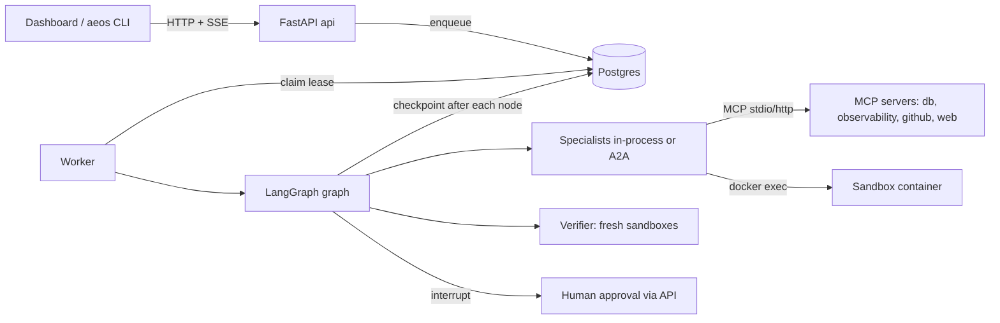

# 02 - Repository tour (tag: TOUR)

## What this file covers

A guided map of the AEOS repository: what every top-level directory is for, which Python package owns which responsibility, how the packages depend on each other (derived from the actual `import aeos.*` statements, not from the docs), which files to read first, and a coverage checklist so you can tell which modules you have actually understood. Counts below come from the repo as of commit `2cd8ad1` (14 Oct 2026): 12,509 lines of Python in `src/aeos`, 8,041 lines in `tests/` (480 `def test_` functions before parametrisation), 8 git commits, one author.

Related files: overview in [01-project-overview.md](01-project-overview.md), architecture in [03-system-architecture.md](03-system-architecture.md), tests in [22-testing-strategy.md](22-testing-strategy.md), evals in [23-evaluation-framework.md](23-evaluation-framework.md), history in [24-technical-challenges-and-history.md](24-technical-challenges-and-history.md).

---

## 1. Annotated directory map

Excluded from this map: `.venv`, `node_modules`, `web/.next`, caches, `demo_target/build` (generated, git-ignored), `.claude/skills`.

```text
autonomous-engineering-os/
├── src/aeos/                 THE PRODUCT (Python 3.12). 12.5k lines. Details in section 2.
├── tests/                    pytest suite, mirrors src/aeos layout (+ chaos/, evals/, demo_target/)
├── evals/                    Evaluation harness: dataset, graders, metrics, judge validation, saved results
│   ├── datasets/tasks.yaml       30 generated tasks (6 bug templates x 5 variants). "Do not edit by hand".
│   ├── make_dataset.py           the generator for tasks.yaml
│   ├── env.py                    per-task isolated environment (own DB schema + own git remote copy)
│   ├── run_evals.py              the runner (CLI), writes results/*.json + *.md
│   ├── graders.py / metrics.py   deterministic + LLM-rubric graders; aggregation and regression compare
│   ├── judge_validation.yaml     12 human-labelled reports to validate the LLM judge
│   ├── validate_judge.py         runs the judge against those labels (live Gemini)
│   └── results/                  6 committed runs (fake + live), each as .json and .md
├── demo_target/              A SYNTHETIC "checkout-service" with planted regressions + ground truth
│   ├── history.py, build_repo.py  builds a 20-commit git history with reproducible SHAs (into gitignored build/)
│   ├── templates.py, truth/*.json 6 regression templates and their measured ground truth
│   ├── datagen.py, seed.py        generates logs/metrics/spans/deployments and loads them into Postgres
│   ├── GROUND_TRUTH.json          the original n_plus_one truth (root cause commit, benchmark numbers)
│   └── web_corpus/                4 markdown pages: the offline "web search" corpus
├── policy/risk_policy.yaml   Declarative risk rules (deny wins, default require_approval)
├── web/                      Next.js 15 / React 19 dashboard (TypeScript). app/, components/, lib/
├── infra/otel-collector.yaml OpenTelemetry collector config
├── scripts/                  aeos (shell wrapper), init_env.py, check_infra.py, check_no_secrets.py, mcp_probe.py
├── docs/                     ARCHITECTURE, DECISIONS (D-001..D-050), PROGRESS, INTERVIEW_PREP, PROMPT_INJECTION,
│                             img/, superpowers/plans/ (7 phase plans), codebase-learning/ (2 chapters)
├── ROADMAP.md                the original 15-phase plan (640 lines); DESIGN.md = a borrowed visual design spec
├── brag-output/              a rendered promo video + its composition sources (NOT product code)
├── docker-compose.yml        postgres+pgvector, redis, otel-collector, Langfuse stack, api, web, a2a specialists
├── Dockerfile, Makefile, pyproject.toml, uv.lock, .github/workflows/ci.yml, .env.example, CONTRIBUTING.md, README.md
```

Things worth knowing that the directory names do not tell you:

- **`DESIGN.md` is not an AEOS architecture document.** Its front matter is `name: Linear-design-analysis`: a visual design token spec (colours, type) that `CLAUDE.md` tells any UI work to follow. (Verified: `CLAUDE.md` is one line, "For any UI work, follow the design system in DESIGN.md.")
- **`brag-output/` is marketing material** (video, snapshots, `brag-plan.md`, `share-copy.txt`). It documents a real run (`t-8eac1a19`, a `ws` dependency bump) in the plan, but contains no logic. Skim only.
- **`docs/codebase-learning/`** contains only `00-learning-roadmap.md` and `01-fundamentals.md`. The roadmap refers to chapters 02 to 12 (architecture, workflows, interview, exercises) that do not exist in the repo. Treat it as unfinished.
- **`demo_target/` is two different things**: a *generator* for a fake service (so the bug and its ground truth are known) and the source of every eval task. The agent tools read the git remote, the database and the web corpus; `GROUND_TRUTH.json` is read by the graders and by the scripted `FakeLLM` replays (`src/aeos/demo/trajectories.py::load_truth`). I found no agent tool that serves it, but note the whole `demo_target/` folder is copied into the Docker image (`Dockerfile`).

---

## 2. Module responsibility table (`src/aeos`)

Lines are from `wc -l`; one-line purposes are the modules' own docstrings, checked against code.

| Package / module | Lines (approx.) | Responsibility |
|---|---|---|
| `core/state.py` | 184 | `TaskState`: the single serializable record of a run (plan history, observations with trust origin, tool-call log with idempotency keys, artifacts, verifications, risk decisions, budget). Everything resumable lives here. |
| `core/risk.py` | 175 | Deterministic `PolicyEngine`: loads `policy/risk_policy.yaml`, deny-wins/first-match/default `require_approval`, approval grants bound to an argument hash. |
| `core/retry.py`, `budget.py`, `events.py`, `config.py`, `logging.py`, `stats.py` | 29/29/69/94/67/71 | Retry state machine; shared token/cost/step/wall-clock tracker; run events + sinks; env-based `Settings`; JSON logging with task/run/agent contextvars; per-task summary for `/tasks/{id}/stats`. |
| `llm/` (`base`, `fake`, `gemini`, `structured`, `traced`, `pricing`, `factory`) | ~470 | Provider interface; scripted `FakeLLM`/`RoutedFakeLLM`; Gemini provider; forced-structured output via a `submit` tool; tracing wrapper; cost estimates. |
| `agents/loop.py` | 199 | The observe-think-act loop with step/token/cost/wall-clock limits, stagnation detection, malformed-output recovery, `finish` validation. |
| `agents/tools.py` | 238 | `ToolDef` and `ToolRuntime`: every tool call goes through the risk gate, tracing, truncation, origin labelling, idempotency-key injection. |
| `agents/specialists.py`, `sandbox_tools.py` | 338 / 325 | Analytics, Research, Coding agents and the coding agent's sandbox-as-tools. The patch is taken from the sandbox by the harness, not from model text. |
| `agents/supervisor.py` | 281 | Planner, replanner, root-cause synthesis, each with deterministic validation and fallback. |
| `agents/verifier.py`, `verifier_change.py`, `suite.py`, `judge.py` | 226 / 203 / 76 / 99 | Deterministic gates for regression fixes and for change requests; running a repo's own tests offline; the advisory LLM judge (can only tighten a verdict). |
| `graph/build.py`, `nodes.py`, `routing.py`, `publish.py`, `checkpoint.py` | 164 / 457 / 91 / 319 / 31 | LangGraph assembly, node bodies, pure routing functions, branch-commit / approval / PR flow, Postgres checkpointer. |
| `store/tasks.py`, `approvals.py`, `events.py` | 211 / 271 / 125 | Postgres: task queue with leases, approvals + audit log (compare-and-set decisions), persisted run events. |
| `worker.py`, `hitl.py`, `runtime.py`, `failure/crash.py` | 132 / 61 / 351 / 16 | Lease-claiming worker; shared decision logic for API and CLI; wiring of MCP servers, sandbox, specialists, LLMs; SIGKILL crash injection. |
| `sandbox/` (`manager`, `policy`, `helpers`, `npm`, `reaper`) | 457 / 78 / 129 / 142 / 31 | Hardened Docker sandbox, command policy, structured test/benchmark helpers, throw-away npm container, orphan reaper. |
| `mcp_client.py`, `mcp_servers/` | 194 + ~1,900 | Agent-side MCP client (timeouts, retry only when safe); four MCP servers: `database` (sqlglot guard), `observability`, `github` (local bare remote + optional real-GitHub mirror), `web`. |
| `a2a/` (`server`, `client`, `service`) | 203 / 208 / 97 | Agent-to-Agent: expose a specialist as its own service; client with stall detection, deadline, failover. |
| `memory/` (`store`, `manager`, `gate`, `embedder`) | 253 / 220 / 100 / 60 | Episodic + semantic memory in pgvector, bounded recall, deterministic write gate. |
| `telemetry/` | ~300 | OpenTelemetry tracing behind `traced()`, metrics, process bootstrap. |
| `api/` (`app`, `auth`, `evals`) | 379 / 237 / 67 | FastAPI: tasks, approvals, SSE events, optional login, read-only eval results. |
| `client/` + `cli.py` | ~1,300 + 346 | Terminal client (`aeos chat`, `watch`, `show`, ...) and the `aeos` entry point. |
| `demo/trajectories.py`, `target.py` | 350 / 86 | Golden scripted LLM trajectories for offline runs and evals; local mirror of the real target repo. |

---

## 3. Dependency graph between modules

Built by scanning every `from aeos.X import` / `import aeos.X` in `src/aeos` (top-level package to top-level package; self-edges dropped). This is the real import structure.

```mermaid
flowchart TD
    cli --> client
    cli --> api
    cli --> worker
    cli --> a2a
    api --> graph
    api --> store
    api --> hitl
    api --> worker
    worker --> graph
    worker --> runtime
    worker --> store
    graph --> agents
    graph --> memory
    graph --> store
    graph --> hitl
    graph --> runtime
    graph --> sandbox
    runtime --> agents
    runtime --> a2a
    runtime --> mcp_client
    runtime --> mcp_servers
    runtime --> memory
    runtime --> sandbox
    a2a --> agents
    a2a --> runtime
    agents --> mcp_client
    agents --> sandbox
    agents --> llm
    hitl --> store
    memory --> llm
    llm --> telemetry
    sandbox --> telemetry
    mcp_client --> telemetry
    mcp_servers --> core
    store --> core
    telemetry --> core
    core --> llm
```

How to read it: arrows point from importer to imported. The top (`cli`, `api`, `worker`) are entry points; `graph` orchestrates; `agents` do the work; `sandbox`, `mcp_client`/`mcp_servers`, `llm` are leaf capabilities; `core` holds the shared vocabulary (state, policy, config). Two things stand out:

1. **`runtime` and `a2a` import each other's world** (`runtime -> a2a` to build remote specialists, `a2a -> runtime` to run a specialist as a service). This is a mild layering knot: the dependency is resolved by Python importing lazily inside functions (Observed from the graph; I did not trace which imports are function-local).
2. **`core -> llm`** is a small inversion: the "core" package depends on `llm` (for example for shared types), while `llm -> core` too (config). It works because the edge pairs are different modules, but it is not a clean DAG at package level.

Neither is a bug; both are fair "what would you refactor" talking points (see Q-TOUR-3).

### Runtime topology (who talks to whom at run time)



Read it left to right: nothing executes in the API; the worker owns execution, Postgres is the shared truth (queue, checkpoints, approvals, events).

---

## 4. Which files to read first

An order that builds understanding with the fewest dead ends (roughly 2 hours):

1. `README.md` (what it claims) and `docs/DECISIONS.md` (why; D-001 to D-050). Then check claims against code, as this knowledge base does.
2. `src/aeos/core/state.py`: if you understand `TaskState`, every other module is "something that reads or writes it".
3. `src/aeos/graph/build.py` + `graph/routing.py` (short): the control flow as plain functions.
4. `src/aeos/agents/loop.py` then `agents/tools.py`: the agent loop and the choke point that all tool calls pass through.
5. `src/aeos/core/risk.py` + `policy/risk_policy.yaml`.
6. `src/aeos/agents/verifier.py` (gates) and `sandbox/manager.py` (hardening).
7. `src/aeos/graph/publish.py` + `store/approvals.py` + `hitl.py`: the human-approval flow.
8. `src/aeos/worker.py` + `store/tasks.py` + `tests/chaos/test_chaos.py`: durability, and the test that proves it.
9. `evals/run_evals.py` + `evals/graders.py`: how quality is measured.
10. Skip until needed: `client/`, `web/`, `a2a/`, `memory/`, `telemetry/`, `brag-output/`.

---

## 5. Coverage checklist

Tick a row when you can explain it without notes. The right column says where this knowledge base covers it.

| Module / area | Can you explain... | Covered in |
|---|---|---|
| `core/state.py` | what is checkpointed and why | 03, 07 |
| `graph/*` | node order, routing, interrupt for approval | 04, 05 |
| `agents/loop.py`, `tools.py` | limits, stagnation, origin labels, idempotency keys | 05, 14 |
| `agents/verifier*.py`, `judge.py` | gates, "judge can only tighten" | 13 |
| `core/risk.py`, `policy/` | deny-wins, grants bound to hash | 13, 14 |
| `sandbox/` | each hardening flag and what test proves it | 12, 22 |
| `mcp_servers/*`, `mcp_client.py` | SQL guard layers, no merge tool, retry rules | 15 |
| `a2a/*` | agent card, stall timeout, failover | 16 |
| `store/*`, `worker.py`, `graph/checkpoint.py` | leases, fencing, CAS decisions | 07, 10 |
| `memory/*` | tiers, write gate, benefit not demonstrated | 08 |
| `telemetry/*` | one trace per task, redaction | 20 |
| `api/*`, `client/*`, `web/` | endpoints, optional login, SSE | 18, 19 |
| `evals/*` | graders, metrics, honest numbers | 23 |
| `tests/*` | pyramid, fakes, chaos, what is untested | 22 |
| git history, ROADMAP vs reality | what is real vs planned | 24 |

---

## Q-TOUR-1. Walk me through this repository in two minutes.
**Difficulty:** Beginner  **Topic:** Repository structure
**Short answer:** "It is a Python package, `src/aeos`, that turns a plain-English engineering request into a verified pull request. A LangGraph graph orchestrates a planner, specialist agents that use MCP tool servers, a Docker sandbox for code, an independent verifier, and a human approval before the real PR. Around it: a FastAPI API and Next.js dashboard, a Postgres-backed task queue with leases so workers can crash and resume, an evals folder with 30 generated tasks, and a synthetic demo service so bugs and ground truth are known."
**Detailed explanation:** Use the three-layer story: entry points (`cli`, `api`, `worker`) feed an orchestration layer (`graph`), which drives agents; agents only touch the world through three capability layers (MCP servers, sandbox, LLM). Safety decisions live in plain code (`core/risk.py`, verifier gates, sandbox policy), not prompts.
**How this project uses it:** see section 2 and the runtime topology above.
**Example/walkthrough:** `aeos new "bump ws to latest" --kind change` goes CLI -> API (`POST /tasks`) -> `store/tasks.enqueue` -> worker claim -> graph.
**Follow-ups:**
- *Where does the LLM sit?* Inside `agents/` and `llm/` only; planner output is validated by code with a deterministic fallback (`agents/supervisor.py`).
- *What is not product code?* `brag-output/`, `DESIGN.md`, `docs/codebase-learning/`, `demo_target/` (test fixture generator).
**Trade-offs and alternatives:** Monorepo with one Python package keeps refactors cheap; the cost is that `runtime.py` (351 lines) becomes a wiring hub that imports almost everything.
**Common interview mistake:** Describing it as "a chatbot that writes code". The distinguishing parts are the verifier, the approval gate and crash recovery.
**Related:** [01-project-overview.md](01-project-overview.md), [03-system-architecture.md](03-system-architecture.md)

## Q-TOUR-2. Why does the repo contain a fake "checkout-service" instead of testing on real repos?
**Difficulty:** Intermediate  **Topic:** Demo target / ground truth
**Short answer:** "To grade the agent you need to know the right answer. `demo_target` generates a service with a planted regression, matching logs/metrics/traces in Postgres, and a ground-truth file with the culprit commit and benchmark numbers. That gives deterministic outcome graders and reproducible SHAs. The trade-off is that it is a synthetic, easier problem than real production bugs."
**Detailed explanation:** `demo_target/history.py` builds a 20-commit history with fixed SHAs; `datagen.py` generates telemetry with seeds; `truth/*.json` stores per-template ground truth. Latency in the benchmark is a deterministic cost meter, not wall clock (D-008), so verifier gates cannot flake.
**How this project uses it:** `evals/env.py` seeds a schema `ev_<template>_s<seed>` per task and copies a per-task git remote; `evals/graders.py::root_cause_match` compares the reported commit with `truth["root_cause"]["commit_sha"]`. Tests in `tests/demo_target/` prove the ground truth matches reality (`test_ground_truth_benchmark_numbers_match_reality`).
**Example/walkthrough:** n_plus_one: bad commit `b166e05` "refactor(catalog): simplify product lookup"; PROGRESS.md records baseline p95 4.52 ms vs regressed 27.92 ms.
**Follow-ups:**
- *Is the ground truth leaked to the agent?* The eval graders and scripted replays read it; I found no agent tool that serves it (Verified by grep of `src` for `GROUND_TRUTH`). One caveat: `judge_report` is told the true root-cause *file* as a reference (`graders.py`, "Reference: the true cause is in ..."), which is a grader-side choice, not agent-visible.
- *What does the synthetic setup not tell you?* Real-world difficulty: noisy repos, flaky tests, large diffs. See [23-evaluation-framework.md](23-evaluation-framework.md).
**Trade-offs and alternatives:** Real repos give realism but no ground truth; SWE-bench-style datasets give ground truth but need heavy environment setup.
**Common interview mistake:** Presenting 87% on this suite as a general success rate.
**Related:** Q-EVAL-1, Q-HIST-4

## Q-TOUR-3. What would you refactor in the package layout?
**Difficulty:** Advanced  **Topic:** Dependency structure
**Short answer:** "The import graph shows `runtime` and `a2a` depend on each other, and `core` and `llm` depend on each other. I would pull shared types (messages, usage, specialist request/result) into a leaf module so the layering is a true DAG, and split `runtime.py` so that wiring of MCP servers, sandbox and specialists are separate factories."
**Detailed explanation:** Package-level cycles are survivable in Python when imports are lazy, but they make it hard to test or extract a component (for instance shipping the A2A service as its own image with fewer dependencies).
**How this project uses it:** The dependency graph in section 3 is computed from the source. Lines: `runtime.py` 351, `graph/nodes.py` 457, `sandbox/manager.py` 457 are the largest modules.
**Example/walkthrough:** To run only a research specialist as a service, `aeos agent research` still imports `aeos.runtime`, which imports MCP servers and the sandbox.
**Follow-ups:**
- *Would you do it now?* Probably not before there is a second deployable; the current layout passes all tests and the cost is cognitive, not functional. (Recommendation.)
**Trade-offs and alternatives:** Hexagonal ports/adapters would formalise the leaves; cost is indirection in a 12k-line codebase.
**Common interview mistake:** Calling the code "clean architecture" without checking the import graph.
**Related:** [03-system-architecture.md](03-system-architecture.md)
