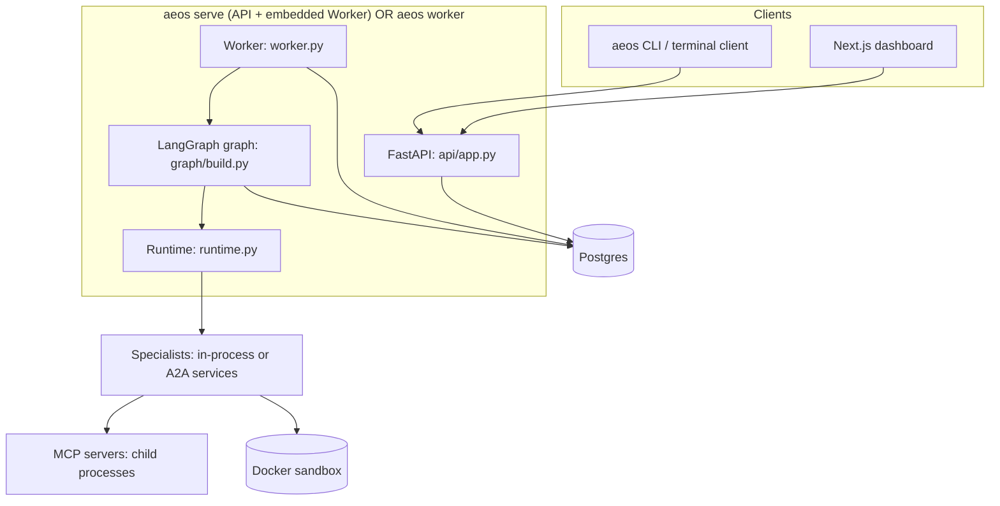
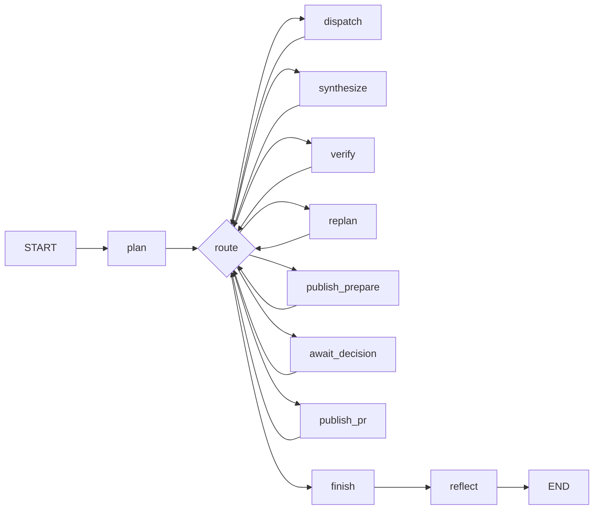
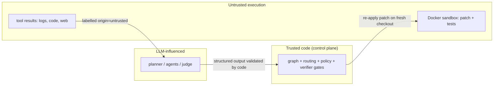

# 03 - System Architecture

**What this file covers.** The components of AEOS, where the boundaries between them are, what runs in which process (runtime topology), how the LangGraph graph is wired, and why. Per-component deep dives are in siblings: agents [05](05-agents-and-orchestration.md), LLM [06](06-llm-integration.md), durability [07](07-state-durability-and-persistence.md), sandbox [12](12-sandbox-and-execution-safety.md), verification/policy [13](13-verification-and-risk-policy.md), MCP [15](15-mcp-servers-and-tool-layer.md), A2A/GitHub [16](16-a2a-and-github-integration.md), API [18](18-api-and-client.md), deployment [21](21-deployment-and-infrastructure.md). Diagram sources: `diagrams/system-architecture.mmd`, `diagrams/primary-workflow.mmd`, `diagrams/state-machine.mmd`.

Labels: **Verified** (code/tests), **Inferred rationale**, **Potential failure scenario**, **Recommendation**.

---

## 1. First principles: what kind of system is this?

A long-running, side-effecting, multi-step job that must survive crashes and wait for a human for hours or days. Systems with that shape need four things regardless of whether an LLM is involved:

1. **A durable record of progress** (so a crash does not lose work),
2. **A way to hand a job to exactly one worker at a time** (so two workers do not do the same job),
3. **Idempotent side effects** (so a retry does not do the action twice),
4. **A pause/resume mechanism for human input**.

AEOS provides each with a specific piece: (1) LangGraph checkpoints in Postgres, (2) a lease-based queue table `aeos.tasks`, (3) idempotency keys enforced by the tool servers, (4) LangGraph `interrupt()` plus `aeos.approvals`. The LLM agents are *inside* this scaffold, not the scaffold itself.

## 2. Component map (Verified)


*How to read it:* arrows are "calls/uses". Notice the API never runs the graph itself; it only writes rows (enqueue, decide, cancel). The Worker claims rows and runs the graph. When started as `aeos serve` the Worker is just an asyncio task inside the API process (`api/app.py` lifespan, `embedded_worker=True`), but the code path is identical to a standalone `aeos worker`. See the fuller diagram in `diagrams/system-architecture.mmd`.

| Component | Files | Responsibility | Does NOT do |
|---|---|---|---|
| Graph (control flow) | `graph/build.py`, `graph/routing.py` | Wire nodes; `route()` is a pure function of `TaskState` choosing the next node | No LLM calls, no I/O |
| Nodes | `graph/nodes.py`, `graph/publish.py` | One unit of work each; return only changed fields | They do not decide the next node (routing does) |
| State | `core/state.py` | `TaskState` pydantic model: the single serializable record of the run | Not process-local memory |
| Runtime | `runtime.py` | Dependency container: LLMs, `RiskGate`, `RetryPolicy`, `SandboxManager`, `MemoryManager`, specialists, MCP clients; builds target-repo wiring | Not persisted; rebuilt on every process start |
| Worker | `worker.py` | Claim/heartbeat/finish loop; resume decision (new / interrupted / crashed); housekeeping | Not part of the graph |
| Queue + approvals + events stores | `store/tasks.py`, `store/approvals.py`, `store/events.py` | Postgres tables with SQL-level concurrency control | No business logic |
| HITL | `hitl.py` | `apply_decision` shared by API and CLI; exactly-once decisions | |
| Retry/budget | `core/retry.py`, `core/budget.py` | Pure policy + live tracker | Budget is not enforced by the graph itself (see 10) |
| Crash injection | `failure/crash.py` | `maybe_crash(point)` SIGKILLs the process when `AEOS_CRASH_AT` matches | No-op unless env var set |
| Specialists | `agents/specialists.py`, `a2a/` | LLM agent loops with tools; return `SpecialistResult` | Never touch Postgres task state directly |
| Tool layer | `agents/tools.py`, `mcp_client.py`, `mcp_servers/*` | `ToolRuntime.execute`: risk gate, idempotency key injection, trace, trust labels | |
| Sandbox | `sandbox/manager.py` | Docker containers for untrusted code | |
| Telemetry | `telemetry/` | OTel spans/metrics | |

## 3. The graph (control plane)

Ten nodes (`graph/build.py build_graph`): `plan, dispatch, synthesize, verify, replan, publish_prepare, await_decision, publish_pr, finish, reflect`. Every node except `finish` and `reflect` has a **conditional edge to the same `route` function**; `finish -> reflect -> END` are fixed edges. So the topology is a hub-and-spoke: after any node, `route(state)` decides.


*How to read it:* the diamond is one Python function. There is no hard-wired "after verify go to publish"; `route` inspects plan step statuses and `state.approval`. This is why the whole workflow can be unit-tested without LangGraph (`tests/graph/test_routing.py`, 14 pure tests).

### Why route by state instead of fixed edges? (Inferred rationale)
After a replan the plan contains new steps with new statuses; "next node" depends on which steps are `done`/`pending`. A plan-driven router handles any plan the validator accepts, and the same function handles resume from any checkpoint. The cost is that the routing function has implicit ordering (see `route`: approval check first, terminal statuses second, replan before synthesize before verify). **Potential failure scenario:** adding a new status or step type without updating `route` can create a dispatch loop; the `recursion_limit: 120` in `_config` is the backstop.

### Each node wrapped by `_crashable` (Verified)
`_crashable(name, fn)` does four things around every node: `maybe_crash("node:<name>:before")`, bind the task id for logging, re-join the task's root trace (`remote_context(state.trace)`) and open a `node <name>` span (the `plan` node instead *creates* the root span), then `maybe_crash("node:<name>:after")`, which fires after the work is done but **before** LangGraph has checkpointed the node's output. That "after" point is exactly the nastiest crash window and is what the chaos tests hit.

## 4. Runtime topology (Verified from `docker-compose.yml`, `cli.py`, `runtime.py`)

| Mode | Processes | Specialists | Used for |
|---|---|---|---|
| Fast mode (default, `docker compose up`, tests) | `api` container = `aeos serve` with embedded Worker; MCP servers are stdio child processes of that process; sandboxes via host Docker socket | in-process (`LoopSpecialist` subclasses) | dev, demos, tests |
| Standalone worker | `aeos worker` process(es) + `aeos serve --no-worker` | in-process | scaling workers horizontally; chaos tests spawn `python -m aeos.cli worker` |
| A2A mode (`--profile a2a`, `AEOS_A2A_MODE=a2a`) | `analytics`, `research`, `coding` services (`aeos agent <owner>`), plus `api-a2a` | `A2ASpecialist` clients over network with failover list | independent deployment of agents |

Details worth knowing:

- **Infrastructure:** Postgres (pgvector image) holds everything durable. Redis is in compose and `Settings.redis_url` exists, but nothing in `src/` imports or uses Redis (grep verified). Docs call it "reserved". Do not claim Redis is used.
- **Change tasks are always in-process.** In `open_runtime`, A2A clients are built only for the demo specialists; `_open_target` (when `target_ready`) creates `rt.change_specialists` in-process via `make_change_specialist`. So even in A2A mode, change-request specialists run inside the API/worker process. (Inferred: the A2A services were built for the regression demo first.)
- **Verification always runs in the control plane.** `GraphNodes.verify` uses `self.rt.sandbox` of the worker, not the coding service's. In A2A mode the worker therefore needs Docker access too (compose mounts the socket on `api-a2a`).
- **Two Postgres roles/schemas:** `aeos` (tasks, events, approvals, audit_log), `vcs` (pull requests, branch creations: owned by the github MCP server), `demo` (seeded telemetry; read-only role `aeos_readonly`), plus LangGraph's checkpoint tables created by `AsyncPostgresSaver.setup()`.

## 5. Boundaries and trust zones (Verified unless noted)


*How to read it:* LLM output crosses into trusted code only through validators (pydantic models, `validate_steps`, `_check_research`). Untrusted data flows toward the LLM labelled `origin`, and the policy can raise requirements for calls "driven only by untrusted content" (`untrusted-driven-writes` rule). More in [14](14-security-and-prompt-injection.md).

Architectural boundaries in code:

1. **API vs worker:** only via Postgres rows (tasks, approvals, pending_resume). Verified: `api/app.py` never calls `graph.ainvoke`; it calls `tasks.enqueue`, `apply_decision`, `tasks.cancel`. (It does call `graph.aget_state` read-only for views.)
2. **Graph vs specialists:** `Specialist` is a `Protocol` (`agents/specialists.py`): `run(req, tracker, sink) -> SpecialistResult`. In-process and A2A implementations are interchangeable; the node code cannot tell.
3. **Agent vs tools:** all tool calls pass `ToolRuntime.execute`, which calls `gate.decide` first. MCP is a process boundary (stdio), so tool servers have their own idempotency stores.
4. **Control plane vs sandbox:** the sandbox is created per task/attempt from a base ref + patch; nothing in it is checkpointed (D-032).

## 6. Data flow summary

```
TaskRequest --enqueue--> aeos.tasks (queued)
Worker.claim --lease--> graph.ainvoke(TaskState) --each node--> Postgres checkpoint
   node -> specialists -> ToolRuntime -> MCP / sandbox
   node -> Runtime.sink.emit(Event) -> DbSink thread -> aeos.events -> SSE -> dashboard
publish_prepare -> aeos.approvals (pending) + interrupt -> Worker.finish(paused)
human -> POST /approvals/{id}/approve -> approvals.decide + tasks.enqueue_resume (ONE txn)
Worker.claim -> Command(resume=payload) -> publish_pr -> github MCP -> PR
```

## 7. Design choices and alternatives

| Choice | Why (Inferred unless cited) | Alternative | Trade-off |
|---|---|---|---|
| LangGraph + Postgres checkpointer + own lease queue (D-033) | Cheap durable state; no new infra | Temporal / Celery | Temporal gives durable timers and retries for free but is another service to run; Celery has no workflow state |
| Hand-written `route()` | Testable, no hidden control flow | LangGraph prebuilt agents / `Send` fan-out | More code, but explicit and unit-tested |
| Parallelism inside `dispatch` via `asyncio.gather` | One checkpoint per superstep; simple | LangGraph parallel branches | Crash mid-dispatch redoes all parallel specialists (cost) |
| Specialists behind a Protocol | Swap in-process/A2A | Hard-wire | Slight indirection |
| API and worker decoupled via DB | Restart-safe, scalable | API calls graph directly | Latency of poll (`poll_s` 1 s default, 0.2 s in API embedded) |
| Postgres for queue | One datastore, `FOR UPDATE SKIP LOCKED` | Redis/SQS | Polling load; fine at this scale |

---

## Interview questions

## Q-ARCH-1. Walk me through the architecture at a high level.
**Difficulty:** Beginner  **Topic:** Architecture overview
**Short answer:** Clients talk to a FastAPI app that only writes rows to Postgres. A worker claims a task row with a lease and runs a LangGraph state machine whose nodes call specialist agents. Agents use MCP tool servers and a Docker sandbox. State is checkpointed in Postgres after every node, so any worker can resume. A human approval is a graph interrupt, and only after it does the system push a branch and open a PR.
**Detailed explanation:** Control plane (graph, routing, policy, verifier) is plain code. LLM-driven parts are specialists, planner, judge. Durable state lives in Postgres: queue (`aeos.tasks`), checkpoints, approvals/audit, events.
**How this project uses it:** `api/app.py` (HTTP), `worker.py` (claim/run), `graph/build.py` (graph), `runtime.py` (wiring), `store/*` (tables).
**Example/walkthrough:** POST /tasks -> `tasks.enqueue` -> Worker `run_once` -> `claim` -> `_execute` -> `graph.ainvoke` -> ... -> `finish` row update.
**Follow-ups:**
- *Why doesn't the API run the graph?* So an API restart does not kill a run and so workers can scale independently; the embedded worker is a convenience (`embedded_worker=True`).
- *Where is the single source of truth for task progress?* The LangGraph checkpoint (`TaskState`); `aeos.tasks.status` is only the scheduling status (queued/running/paused/...). The two can disagree briefly; e.g. after cancel the checkpoint still says running and `view()` overrides to `cancelled` (`api/app.py`).
**Trade-offs and alternatives:** See table in section 7.
**Common interview mistake:** Saying "the agents talk to each other". They do not; the supervisor node coordinates everything via shared state.
**Related:** [04](04-end-to-end-workflows.md), [07](07-state-durability-and-persistence.md).

## Q-ARCH-2. Why route with a pure function instead of fixed graph edges?
**Difficulty:** Intermediate  **Topic:** Orchestration design
**Short answer:** The plan changes at runtime (replan), so "what's next" depends on step statuses, not on the previous node. A pure `route(state)` is trivially unit-testable and works identically after a crash resume because it only reads the checkpointed state.
**Detailed explanation:** `route` priority: (1) awaiting approval with pending id and no decision -> `await_decision`; (2) terminal/paused statuses -> `finish`; (3) failed verifier step or failed publish step -> `replan`; (4) regression with investigation done but no root cause -> `synthesize`; (5) coding done and verifier pending -> `verify`; (6) verifier done and publish step pending/running -> `publish_prepare` (no branch yet) or `publish_pr` (approved/not_required); (7) plan complete -> `finish`; (8) else `dispatch`.
**How this project uses it:** `graph/routing.py`; `build_graph` attaches `route` as the conditional edge function of 8 nodes with a `TARGETS` map.
**Example/walkthrough:** After `await_decision` rejects, it marks the publish step `failed` and sets status `running`; `route` sees `publish_failed` -> `replan`.
**Follow-ups:**
- *What if two conditions are true?* Order of checks decides; e.g. a failed verification outranks pending synthesis. Tests: `test_failed_verification_routes_to_replan`, `test_reopened_diagnosis_synthesizes_after_reinvestigation`.
- *What stops an infinite loop?* `recursion_limit=120` in `_config`, plus retry/replan counters in `RetryPolicy`.
**Trade-offs and alternatives:** Fixed edges are easier to visualize; LangGraph `Command(goto=...)` returned from nodes puts routing in nodes (harder to test globally).
**Common interview mistake:** Thinking LangGraph is the orchestrator's brain. Here it is a durable executor; the logic is in our functions.
**Related:** [05](05-agents-and-orchestration.md), [22](22-testing-strategy.md).

## Q-ARCH-3. What does `_crashable` do and why wrap every node?
**Difficulty:** Intermediate  **Topic:** Cross-cutting concerns
**Short answer:** It injects crash points before/after each node for chaos tests, binds the task id for logs, and re-joins the task's single OpenTelemetry trace so nodes executed by different workers still form one trace.
**Detailed explanation:** The "after" crash fires between "node work finished" and "LangGraph checkpoints the result", the hardest window for exactly-once behaviour.
**How this project uses it:** `graph/build.py::_crashable`; `failure/crash.py::maybe_crash` reads `AEOS_CRASH_AT` and `os.kill(os.getpid(), SIGKILL)`.
**Example/walkthrough:** `AEOS_CRASH_AT=node:publish_pr:after` kills the worker after the PR was created but before checkpoint; worker B re-runs `publish_pr`, the PR MCP call replays by idempotency key, and the test asserts exactly one PR.
**Follow-ups:**
- *Is it safe in production?* Only active if the env var is set; it is a no-op otherwise.
**Trade-offs and alternatives:** Could use fault-injection proxies; this is simpler but only reaches points we instrumented.
**Common interview mistake:** Calling it "a decorator for logging".
**Related:** [07](07-state-durability-and-persistence.md), [10](10-error-handling-and-reliability.md).

## Q-ARCH-4. Where are the process and trust boundaries?
**Difficulty:** Intermediate  **Topic:** Boundaries
**Short answer:** API <-> worker (via Postgres), worker <-> MCP servers (stdio child processes), worker <-> sandbox (Docker), optionally worker <-> specialist services (A2A over HTTP), and control plane <-> LLM (validated structured outputs).
**Detailed explanation:** Each crossing has a contract: DB rows with compare-and-set; MCP tool schemas with declared risk; sandbox policy; A2A `SpecialistRequest/Result` with bearer key; pydantic schemas for LLM output.
**How this project uses it:** see section 5.
**Example/walkthrough:** The planner returns `PlanSpec`; `validate_steps` rejects cycles or analytics-on-change; fallback `default_plan_steps` used instead.
**Follow-ups:**
- *Which boundary is weakest?* The Docker-socket mount (compose mounts `/var/run/docker.sock` into api/coding): compromise of that process controls the host daemon. Documented by the author.
**Trade-offs and alternatives:** Rootless Docker/sysbox/dedicated sandbox host (Recommendation).
**Common interview mistake:** Treating the sandbox as the only security boundary.
**Related:** [12](12-sandbox-and-execution-safety.md), [14](14-security-and-prompt-injection.md).

## Q-ARCH-5. What is `Runtime` and why is it not in the checkpoint?
**Difficulty:** Intermediate  **Topic:** Dependency container vs state
**Short answer:** `Runtime` holds live objects (LLM clients, MCP connections, Docker client, policy engine, memory store) that cannot or should not be serialized. `TaskState` holds only data. After a crash a new process rebuilds `Runtime` and resumes from `TaskState`.
**Detailed explanation:** Mixing connections into state would make checkpoints unserializable and unsafe to resume elsewhere.
**How this project uses it:** `runtime.open_runtime` is an async context manager using `AsyncExitStack` to start MCP child processes and clean them up; nodes receive `rt` via closures (`GraphNodes(rt)`).
**Example/walkthrough:** `test_trace_e2e.py::test_the_trace_survives_the_task_being_resumed_by_another_runtime` builds a second runtime and resumes.
**Follow-ups:**
- *What breaks if Runtime config differs between processes?* E.g. different `retry` policy or LLM provider: the resumed run uses the new one. Recommendation: treat config as part of deployment consistency.
**Trade-offs and alternatives:** LangGraph `config["configurable"]` could carry it; closures are simpler.
**Common interview mistake:** Putting clients in graph state.
**Related:** [07](07-state-durability-and-persistence.md), [21](21-deployment-and-infrastructure.md).

## Q-ARCH-6. How do in-process and A2A specialists coexist?
**Difficulty:** Advanced  **Topic:** Interface design
**Short answer:** Both implement the `Specialist` Protocol. `GraphNodes.dispatch` calls `specialists[owner].run(req, tracker, sink)` and cannot tell which. A2A adds discovery (agent card), streaming, deadlines, stall detection, endpoint failover, and best-effort remote cancel.
**Detailed explanation:** `A2ASpecialist.run` loops over endpoints with `asyncio.wait_for(..., timeout_s)`; on `A2AUnavailableError/TimeoutError/httpx.HTTPError/OSError/LLMError` it emits `a2a_failover` and tries the next endpoint; when all fail returns `SpecialistResult(status="error")`, which flows into the normal retry policy.
**How this project uses it:** `a2a/client.py`, `runtime.open_runtime` (`a2a = s.a2a_mode == "a2a" and specialists is None`), `a2a/service.py` for the service side.
**Example/walkthrough:** `message_id=f"{task_id}-{step_id}-{attempt}"` makes delegations identifiable; budget and trace context are passed in message metadata, and the remote usage is merged into the caller's tracker.
**Follow-ups:**
- *What about change tasks?* They bypass A2A (see section 4).
- *Is the remote side idempotent on replay?* The idempotency keys for tool writes are derived from task/step/attempt/tool/args, so a replayed delegation produces the same keys; read-only specialists have no side effects. (Verified for key derivation; A2A replay not chaos-tested: chaos tests run `--replay happy` in-process.)
**Trade-offs and alternatives:** Direct function calls are faster; A2A allows separate scaling, isolation, and per-agent deploys.
**Common interview mistake:** Conflating MCP (agent-to-tool) with A2A (agent-to-agent).
**Related:** [16](16-a2a-and-github-integration.md), [15](15-mcp-servers-and-tool-layer.md).

## Q-ARCH-7. How does the system decide what the human sees and when does the graph pause?
**Difficulty:** Advanced  **Topic:** Pause/resume architecture
**Short answer:** `publish_prepare` creates the branch/commit (allowed by policy), evaluates policy for `create_pull_request`, and if it is `require_approval` writes an `ApprovalRequest` with evidence and returns `status="awaiting_approval"`. `route` sends it to `await_decision`, which calls `interrupt()`. The worker sees the interrupt, returns "paused", and releases the task.
**Detailed explanation:** Splitting into three nodes (prepare / await / create) ensures that resuming re-executes only the cheap `await_decision` node, not the branch/commit work (the module docstring of `publish.py`).
**How this project uses it:** `graph/publish.py`; `worker._execute` branch `elif snap.interrupts`; `drive()` for in-process approvers.
**Example/walkthrough:** See [04 section 5](04-end-to-end-workflows.md).
**Follow-ups:**
- *What if the human decides while the worker is still winding down?* `finish()` converts `paused` to `queued` if `pending_resume IS NOT NULL` (`tests/store/test_tasks.py::test_a_decision_that_races_the_pause_is_not_lost`).
**Trade-offs and alternatives:** A polling "wait" inside a node would hold a lease and a connection for hours.
**Common interview mistake:** Doing expensive work before `interrupt()`: LangGraph re-runs the node from the top on resume (the code comment warns about this).
**Related:** [13](13-verification-and-risk-policy.md), [07](07-state-durability-and-persistence.md).

## Q-ARCH-8. What would break if you scaled to many workers?
**Difficulty:** Expert  **Topic:** Scalability
**Short answer:** Task claiming is safe (`FOR UPDATE SKIP LOCKED`), checkpoints are per-thread-id, and approvals are compare-and-set, so correctness holds. Pressure points: polling load on `aeos.tasks`, Docker host capacity (sandbox reaping uses labels so workers must see the same Docker daemon or each reap only its own), shared git remote paths (local filesystem paths such as `demo_target/build/remote`), and LLM rate limits.
**Detailed explanation:** **Potential failure scenario:** `Worker.housekeeping` calls `sandbox.reap(active_tasks=...)` using the *local* Docker daemon; with workers on different hosts each reaps only its own host's orphans (correct) but `active_tasks` is global (queued/running/paused), so a task running on host A is protected on host B as well (it has no container there). Also the demo git remote and the target mirror are local directories (`AEOS_GIT_REMOTE_PATH`, `AEOS_TARGET_MIRROR_DIR`); multiple hosts would need a shared volume (compose uses a named volume `demo_build`).
**How this project uses it:** `store/tasks.claim`, `worker.housekeeping`, `sandbox.manager.reap`.
**Example/walkthrough:** `tests/store/test_tasks.py::test_only_one_of_many_concurrent_workers_claims_a_task`.
**Follow-ups:**
- *Is there per-worker concurrency?* Each `Worker.run_once` runs one task at a time (`run_forever` awaits `run_once`); concurrency comes from more workers.
**Trade-offs and alternatives:** A broker with push semantics lowers latency; at this scale polling is fine (Inferred).
**Common interview mistake:** Claiming Redis is the queue; it is not used.
**Related:** [21](21-deployment-and-infrastructure.md), [07](07-state-durability-and-persistence.md).
