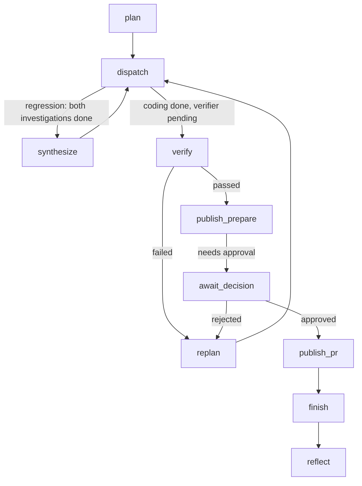
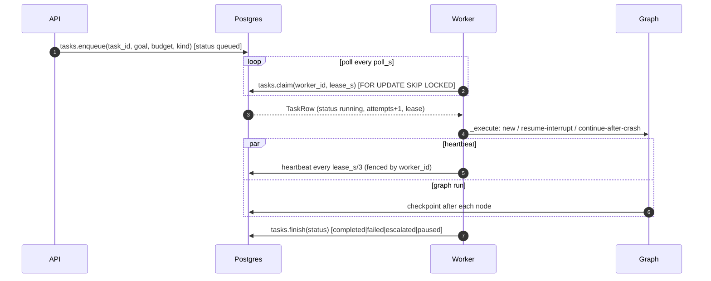
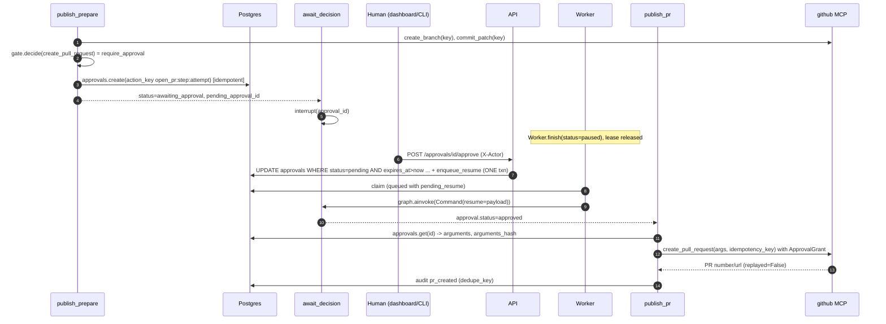
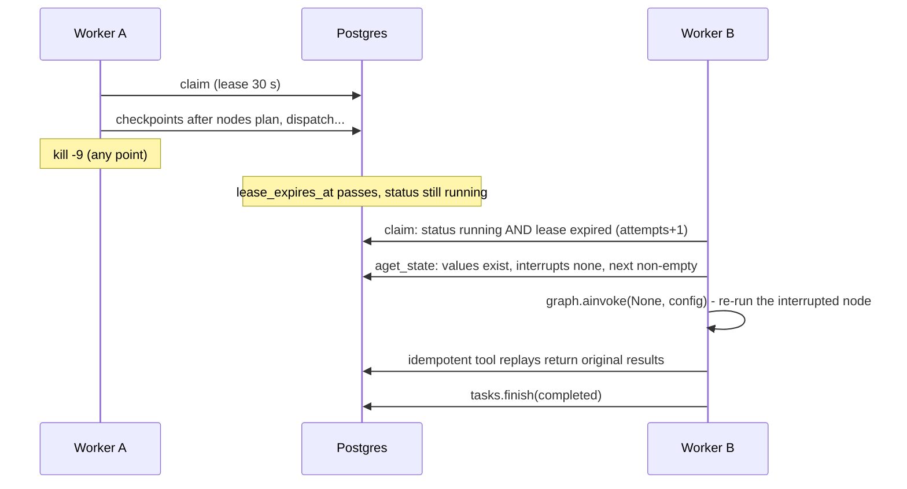

# 04 - End-to-End Workflows

**What this file covers.** Step-by-step traces, with file/symbol references, of: (1) a change-request task, (2) a latency-regression task, (3) the replan loop, (4) approval to publish, (5) cancel and retry, (6) crash and resume. It shows what each node reads and writes in `TaskState`, which events fire, and where state is durable. Architecture context: [03-system-architecture](03-system-architecture.md). Persistence details: [07-state-durability-and-persistence](07-state-durability-and-persistence.md). Failure semantics: [10-error-handling-and-reliability](10-error-handling-and-reliability.md). Diagram sources: `diagrams/primary-workflow.mmd`, `diagrams/state-machine.mmd`.

Labels: **Verified**, **Inferred rationale**, **Potential failure scenario**, **Recommendation**.

---

## 0. Shared skeleton (Verified)

Every task, either kind, follows the same graph (`graph/build.py`). The `route()` function (`graph/routing.py`) picks the next node after every node:


*How to read it:* solid path is the happy path; the `replan` edges are the loop. `dispatch` can also go straight to `finish` when a step fails twice (status `escalated`) or a budget is exhausted.

### Worker-level lifecycle wrapped around the graph


*How to read it:* the heartbeat task runs beside the graph; if `heartbeat` returns False the worker cancels its own run (fencing). `Worker.run_once` creates both asyncio tasks.

---

## 1. Change-request workflow (e.g. "Update the `ws` dependency and raise a PR")

**Precondition:** `AEOS_GITHUB_REPO` and `AEOS_GITHUB_TOKEN` set, so `settings.target_ready`. `open_runtime` called `_open_target`: mirrored the repo (`sync_mirror`), started a second github MCP server on the mirror with `github_publish=True` and `github_base_branch="@default"`, and built `rt.change_specialists = {research, coding}`.

| # | Where | What happens | State written |
|---|---|---|---|
| 1 | `POST /tasks` (`api/app.py create_task`) | `kind="change"` default when `target_ready`; `tasks.enqueue`; returns 202 + id | `aeos.tasks` row `queued` |
| 2 | `Worker.run_once` -> `tasks.claim` | row -> `running`, `attempts=1`, lease 30 s | row updated |
| 3 | `Worker._execute` | no checkpoint (`snap.values` empty) -> `graph.ainvoke(TaskState(...))` | |
| 4 | node `plan` (`GraphNodes.plan/_plan`) | optional memory recall (change: recall allowed but `reflect` later skipped); `rt.refresh_target` re-syncs mirror to default-branch head (event `target_synced`); `create_plan(kind="change")`: LLM plan validated, else default `s1 research, s2 coding` + auto-appended `v1 verifier`, `p1 supervisor(publish)`. Failure to reach the repo -> `status=failed`, `task_failed` | `plans=[plan v1]`, `status=running`, `budget`, `trace` (root span carrier) |
| 5 | `route` -> `dispatch` | ready steps: `s1` only (coding depends on s1). Specialist `ChangeResearchSpecialist` runs the agent loop; result `Observation` stored; `artifacts.research` | `step.status=done`, observation, tool_calls, risk_decisions |
| 6 | `dispatch` again | `s2` coding ready. `_context` passes research (and feedback if any). `ChangeCodingSpecialist` edits in sandbox; `artifacts.patch`, `patch_summary`, `pr_title`, `base_ref` | patch persisted in state |
| 7 | `route` -> `verify` | `coding_done and verifier_pending`. `run_change_gates` re-applies the patch to a fresh checkout and checks gates; then `judge_patch` (advisory); `apply_judgement` combines | `verifications += result`, verifier step `done`/`failed` |
| 8 | `route` -> `publish_prepare` | `verifier_done and publishing and branch is None`. Calls `create_branch` and `commit_patch` through `ToolRuntime` (policy: reversible, allowed), then decides policy for `create_pull_request` | `artifacts.branch = aeos/<task>-v1`; either `approval.not_required` or `pending_approval_id` + `status=awaiting_approval`; `aeos.approvals` row |
| 9 | `route` -> `await_decision` | `interrupt()`; worker returns `paused` | checkpoint has a pending interrupt; `aeos.tasks.status=paused` |
| 10 | human approves | `apply_decision` -> `approvals.decide` + `enqueue_resume` in one txn -> task `queued` | `pending_resume` payload |
| 11 | Worker claims again | `snap.interrupts` and `row.pending_resume` -> `graph.ainvoke(Command(resume=payload))`; then `tasks.consumed_resume` | `approval={"status":"approved",...}`, `status=running` |
| 12 | `route` -> `publish_pr` | grant bound to `req.arguments_hash`; `create_pull_request` via github MCP (idempotent), mirrored to real GitHub; audit entry `pr_created` (dedupe key) | `artifacts.pull_request`; publish step `done` |
| 13 | `route` -> `finish` -> `reflect` | `finish`: status `completed` iff last verification passed and `pull_request` set; `build_report`; metrics. `reflect` no-ops for `change` | `status=completed`, `artifacts.report` |
| 14 | `Worker.run_once` | `tasks.finish(completed)`; `sandbox.reap_task(task_id)` (non-paused) | row terminal |

Notes:
- The PR is opened on the real repo's default branch (`base = rt.target_branch`), the title/body come from `pr_title/pr_body_change`, and the body says plainly if no repo tests ran.
- A different sandbox profile (`profile="change"`, `npm=npm`) allows npm registry access via a controlled `NpmRegistry` tool; see [12](12-sandbox-and-execution-safety.md).
- Events (`Event` objects through `rt.sink`) at each stage: `target_synced, plan_created, step_started, agent_started, tool_call, step_done, verification, approval_requested, approval_decided, pr_created, task_completed`. Persisted to `aeos.events` by `DbSink`.

## 2. Latency-regression workflow

Differences from section 1 (Verified in `nodes.py` and `routing.py`):

1. **Plan:** `s1 analytics`, `s2 research`, `s3 coding(depends s1,s2)`, `v1`, `p1`.
2. **Parallel dispatch:** `dispatch` collects `plan.ready_steps()` = `[s1, s2]` and runs both in `asyncio.gather` with one shared `BudgetTracker`. The test `test_analytics_and_research_run_in_parallel` asserts the interleaving of `agent_started/agent_finished` events.
3. **Hard facts by code:** for `research` results, `_check_research` resolves the suspected commit with `GitBackend.resolve`; if it is not a commit it converts the result to `status="error"` (so it follows the retry policy: `test_a_hallucinated_suspect_commit_is_rejected_and_retried`). It then overwrites `last_good_commit_sha` with `Runtime.baseline_for(suspect)`: the nearest ancestor that contains `benchmark.py` (emits `baseline_corrected` if the agent was wrong).
4. **`synthesize`:** when `investigation_done` and `root_cause is None`, one LLM call picks the single most likely `RootCause` (`synthesize_root_cause`). Failure -> `status=failed` (no retry here; **Potential failure scenario**: a transient structured-output failure fails the task outright). Rejected diagnoses from earlier loops are included so the model cannot choose them again. If `baseline_ref` is missing -> `escalated`.
5. **Coding context:** `_context` supplies `root_cause`, `analytics`, `research`, `baseline_ref`, plus verifier feedback if any.
6. **Verify:** `run_gates` runs tests, lint and a benchmark of baseline vs candidate; the PR body includes p95 and DB-query comparison (`pr_body`).
7. **Memory:** `plan` recalls (`MemoryManager.recall`), `reflect` writes an episode and gated facts after `finish`; memory failures never fail the task (`test_memory_failure_never_fails_the_task`).

## 3. The replan loop (Verified: `GraphNodes.replan`, `core/retry.py`, `tests/graph/test_replan_e2e.py`)

Trigger: the verifier step is `failed` (or the publish step failed after a human rejection). `route` sends to `replan` because `verification_failed(state) or publish_failed(state)`.

```mermaid
sequenceDiagram
  participant V as verify
  participant R as route
  participant RP as replan
  participant S as supervisor (LLM)
  participant D as dispatch
  V->>R: verifier step failed
  R->>RP: replan
  RP->>RP: failures = failed verifications + human rejections
  alt failures >= 3
    RP-->>R: status=escalated, error text (task ends)
  else failures == 2
    RP->>S: replan(require_investigation=True)
  else failures == 1
    RP->>S: replan(require_investigation=False)
  end
  S-->>RP: Plan v+1 (validated) or deterministic fallback
  RP->>RP: new artifacts: branch=None, pull_request=None; if re-investigating: rejected_root_causes += root_cause, root_cause=None
  RP-->>R: plans+=new, approval=None, status=running
  R->>D: dispatch (new steps)
```
*How to read it:* the counter is the only escalation logic; the policy is `RetryPolicy.on_verification_failure`: `>=3 -> escalate`, `>=2 -> replan_new_strategy`, else `replan`.

Key properties:

- **The model must change strategy on the second failure.** If `require_investigation` and the model's plan has no analytics/research step, `validate`-style error is appended and the **deterministic fallback** (`fallback_replan_steps`) is used (one research step + one coding step with unique ids `s{3*version+1}, s{3*version+2}`).
- **Fresh publication.** `new.branch, new.pull_request = None` so the next `publish_prepare` creates `aeos/<task>-v<version>`: a distinct branch per plan version, avoiding idempotency-key collisions and branch reuse.
- **Context feedback.** `dispatch._context` injects `previous_attempt_feedback` (issues, suggested focus, previous patch summary, benchmark) and `rejected_diagnoses` into every agent's request, and `human_feedback` when a human rejected.
- **Step retries are a different loop:** inside `dispatch`, a specialist `status != finished` triggers `RetryPolicy.on_step_failure(attempts)`: retry once (`max_step_attempts=2`), then `step.status=failed`, task `escalated`. Budget exhaustion (`res.status == "budget"`) always escalates, never retries.
- **Tested end to end:** `test_wrong_fix_is_caught_replanned_and_corrected_step_by_step`, `test_repeated_failure_changes_strategy_then_escalates_to_a_human`, `test_a_flaky_specialist_is_retried_and_the_task_still_completes`.

**Inferred rationale:** forcing a strategy change on the 2nd failure addresses the classic agent failure mode "retry the same wrong idea". The regression scenario in the demo ("red herring") is designed around it.

## 4. Approval to publish (Verified: `graph/publish.py`, `hitl.py`, `store/approvals.py`)


*How to read it:* steps 1-4 happen once and are checkpointed; the human's decision and the task's resume payload are written in the same transaction (step 7), so a crash cannot leave an approved request with a task that never wakes.

Decision outcomes in `await_decision`:

| Decision | Effect | Next |
|---|---|---|
| `approved` | `approval` stored, `status=running` | `publish_pr` |
| `rejected` | publish step `failed`, feedback appended to `human_feedback` | `replan` (counts toward the 3-failure limit) |
| `expired` (TTL elapsed, from `expire_due` sweep or late decision) | publish step `failed`, `status=escalated`, error "approval expired ...; nothing was published" | `finish` |

Guards: `decide` is a compare-and-set (`WHERE status='pending' AND expires_at > now()`), so double clicks and races have one winner (`tests/store/test_approvals.py::test_concurrent_decisions_have_a_single_winner`); the API maps `expired` to HTTP 410 and `already_decided` to 409; `X-Actor` is required.

## 5. Cancel and retry (Verified: `api/app.py`, `store/tasks.py`)

**Cancel** (`POST /tasks/{id}/cancel`, `X-Actor` required):

1. `tasks.cancel`: `UPDATE ... SET status='cancelled', worker_id=NULL, lease_expires_at=NULL, pending_resume=NULL WHERE status IN ('queued','running','paused')`. Already-finished -> 409.
2. `approvals.cancel_pending`: pending approvals set to `expired` **without** enqueueing a resume.
3. `approvals.audit(task_cancelled)`, `events.record(task_cancelled)`.
4. Best-effort `sandbox.reap_task(task_id)`.
5. If a worker is mid-run, its next `heartbeat` (every `lease_s/3` = 10 s) fails (`worker_id` no longer matches / status not running) -> `work.cancel()` -> `CancelledError` caught in `run_once` ("lost lease or cancelled") and the worker moves on.

**Potential failure scenario:** between cancel and the next heartbeat (up to ~10 s with defaults) the worker keeps executing; an in-flight tool write (e.g. `create_pull_request` after an approval that raced the cancel) could still complete. The approval decision uses `WHERE status='pending'`, and `cancel_pending` closes pending ones, which narrows but does not eliminate the window. Also the checkpoint still says `running`; `view()` overrides the shown status to `cancelled`.

**Retry** (`POST /tasks/{id}/retry`): only if the old task is in `tasks.TERMINAL`; creates a **new** task id with the same goal/budget/kind. It does not resume the old checkpoint; "retry" here means "run the same request again". (Resume-after-crash is automatic and separate.)

## 6. Crash and resume (Verified: `worker.py _execute`, `tasks.claim`, `tests/chaos`)


*How to read it:* `ainvoke(None)` tells LangGraph "continue from the last checkpoint". The interrupted node runs again from its start.

`_execute` chooses among these cases from `graph.aget_state`:

| Snapshot | Meaning | Action |
|---|---|---|
| no `values` | never started | `ainvoke(initial TaskState)` |
| `interrupts` and `row.pending_resume` | human decided | `ainvoke(Command(resume=payload))`, then `consumed_resume` |
| `interrupts` and no `pending_resume` | still waiting | nothing; `drive` returns `awaiting_approval` -> `paused` |
| `next` non-empty, no interrupt | crashed mid-run | `ainvoke(None)` |
| else | already finished | `drive` just reads the state |

What is repeated vs protected after a crash: LLM calls of the interrupted node are repeated (cost); idempotent writes are not duplicated (branch via recorded key, commit via `AEOS-Idempotency-Key` trailer, PR via unique `(repo, idempotency_key)`, approval via unique `(task_id, action_key)`, audit via `dedupe_key`). Details in [07](07-state-durability-and-persistence.md).

---

## Interview questions

## Q-FLOW-1. Trace a change request from HTTP request to PR.
**Difficulty:** Beginner  **Topic:** End-to-end flow
**Short answer:** POST /tasks enqueues a row; a worker claims it with a lease and runs the graph: plan, research, coding in a sandbox, independent verify, prepare branch and approval request, pause. After a human approves, the worker resumes and `publish_pr` opens the PR. Each node is checkpointed.
**Detailed explanation:** See section 1 table.
**How this project uses it:** `api/app.py create_task`, `worker.run_once/_execute`, `graph/nodes.py`, `graph/publish.py`.
**Example/walkthrough:** "update ws": plan v1 `s1 research, s2 coding, v1 verifier, p1 publish`; branch `aeos/t-xxxx-v1`; approval id `ap-...`; PR number from GitHub.
**Follow-ups:**
- *Where is the human decision stored so a restart doesn't lose it?* `aeos.approvals` + `aeos.tasks.pending_resume`, written in one transaction.
- *What if repo sync fails at plan time?* `status=failed` with message; no later nodes (`_plan` early return).
**Trade-offs and alternatives:** Synchronous request/response would tie up the API for minutes.
**Common interview mistake:** Forgetting the pause is a separate worker invocation, not a blocked thread.
**Related:** [03](03-system-architecture.md), [18-api-and-client](18-api-and-client.md).

## Q-FLOW-2. How does the regression workflow find a root cause and why can't the model just pick the commit?
**Difficulty:** Intermediate  **Topic:** Deterministic checks over LLM claims
**Short answer:** Analytics and research run in parallel; then a synthesis call chooses the cause. But the suspect commit must resolve in git and the baseline is recomputed as the nearest ancestor containing `benchmark.py`, because models confuse "previous commit" with "last benchmarkable commit".
**Detailed explanation:** `_check_research` returns `status="error"` for a non-existent commit so the retry policy gives the agent one more try; `baseline_for` walks `suspect~1..~40`.
**How this project uses it:** `GraphNodes._check_research`, `Runtime.baseline_for`, tests `test_baseline_is_derived_from_the_commit_graph_not_from_the_model` and `test_baseline_for_picks_the_nearest_ancestor_that_can_be_benchmarked`.
**Example/walkthrough:** Agent claims `last_good_commit_sha=abc...`; code finds the true parent with a benchmark; emits `baseline_corrected`; artifacts.baseline_ref is the corrected value.
**Follow-ups:**
- *What is the limit of the 40-ancestor search?* `max_back=40`; if none, `ValueError` -> research step error -> retry/escalate.
- *Is `synthesize` retried?* No: exceptions there mark the task `failed` (gap).
**Trade-offs and alternatives:** Letting the model choose is simpler but a wrong baseline invalidates the benchmark.
**Common interview mistake:** Saying "the agent verifies its own fix".
**Related:** [05](05-agents-and-orchestration.md), [13](13-verification-and-risk-policy.md).

## Q-FLOW-3. Explain the replan loop and its escalation ladder.
**Difficulty:** Intermediate  **Topic:** Replan loop
**Short answer:** Failed verifications (plus human rejections) are counted. First: replan (can keep the diagnosis). Second: replan that must include a re-investigation step and marks the previous root cause rejected. Third: escalate to a human. Step-level retries are separate (retry once, then escalate).
**Detailed explanation:** The counter `failures = failed verifications + len(human_feedback)` feeds `RetryPolicy.on_verification_failure`. New plan version number, new branch name, new verifier step id `v<version>`. The previous diagnosis is appended to `rejected_root_causes` and fed to synthesis with an explicit "do not choose again".
**How this project uses it:** `GraphNodes.replan`, `agents/supervisor.replan/fallback_replan_steps`, `core/retry.py`.
**Example/walkthrough:** `wrong_fix` scenario: attempt 1 patch regresses p95 (+518% per README); replan v2 rejects the red-herring diagnosis; attempt 2 passes.
**Follow-ups:**
- *Why does a human rejection count toward the same limit?* Prevents infinite human<->agent loops (`test_repeated_human_rejections_escalate_instead_of_looping_forever`).
- *What if the LLM replan is invalid?* Deterministic fallback plan with the reason recorded.
**Trade-offs and alternatives:** Unlimited retries burn money; a single retry gives too little exploration. Limits are a configurable `RetryPolicy`.
**Common interview mistake:** Conflating step retries (`max_step_attempts`) with replans.
**Related:** [10](10-error-handling-and-reliability.md), [05](05-agents-and-orchestration.md).

## Q-FLOW-4. Why is publishing split into three nodes?
**Difficulty:** Advanced  **Topic:** Resume-safe node design
**Short answer:** On resume LangGraph re-runs the interrupted node from its start. If branch/commit/approval creation lived in the same node as `interrupt()`, they would be re-executed. Splitting keeps `await_decision` trivially cheap and makes each node individually idempotent.
**Detailed explanation:** `publish_prepare` completes and is checkpointed before `await_decision` runs; `await_decision` does nothing expensive before `interrupt`; `publish_pr` depends only on the stored approval. Even if `publish_prepare` replays after a crash, tool calls carry deterministic idempotency keys (same `step.attempts` since it was not checkpointed) and `approvals.create` is idempotent on `(task_id, action_key)`.
**How this project uses it:** `graph/publish.py` docstring and code.
**Example/walkthrough:** chaos point `node:publish_prepare:after` kills after branch+commit+approval row exist; on replay, `create_branch`/`commit_patch` return the originals, `approvals.create` returns the same request.
**Follow-ups:**
- *Why `step.attempts` matters for the key:* `idempotency_key(ctx,...)` hashes task, step, attempt, tool, args; `attempts` is incremented inside the node, not persisted until checkpoint, so replays recompute the same attempt number.
**Trade-offs and alternatives:** A single node with manual checks ("does the branch exist?") is more fragile.
**Common interview mistake:** Assuming `interrupt()` suspends the Python frame; it raises and later re-executes the node.
**Related:** [07](07-state-durability-and-persistence.md).

## Q-FLOW-5. What happens if a human approves while the worker is still shutting down the run?
**Difficulty:** Advanced  **Topic:** Race conditions
**Short answer:** `decide` writes `pending_resume` and only flips status to queued if it is already `paused`. If the task is still `running`, `Worker.finish("paused")` sees `pending_resume IS NOT NULL` and sets status `queued` instead, so the decision is not lost.
**Detailed explanation:** Both are single SQL statements with CASE expressions; `consumed_resume` is compare-and-clear: it clears `pending_resume` only if it still equals the payload that was delivered, so a newer decision (different `approval_id`) survives.
**How this project uses it:** `store/tasks.finish`, `enqueue_resume`, `consumed_resume`; tests `test_a_decision_that_races_the_pause_is_not_lost`, `test_decision_on_an_already_paused_task_wakes_it_atomically`, `test_consumed_resume_only_clears_the_payload_that_was_delivered`.
**Example/walkthrough:** t0 worker running; t1 approve -> `pending_resume` set, status running; t2 worker finish(paused) -> status queued; t3 next claim resumes.
**Follow-ups:**
- *What if the worker crashes after delivering the resume but before `consumed_resume` (or crashes later in the same resumed run)?* `pending_resume` stays set. If the resumed run never pauses again, the stale payload is harmless: `_execute` only reads it under `elif snap.interrupts`, and `finish` clears it for any non-paused outcome. **Potential failure scenario (found by reading, no test):** if the resumed run goes on to a *second* approval (a rejection leads to replan, new verify, new `publish_prepare`), then `finish("paused")` keeps the stale payload and flips the status to `queued` (because `pending_resume IS NOT NULL`); the next claim would resume the second interrupt with the first decision. `await_decision` does not compare `decision["approval_id"]` with `state.pending_approval_id`. The stale payload is a `rejected` one in this path, so the failure direction is safe (a spurious rejection that counts toward the 3-failure limit), not an unauthorised publish. Recommendation: reject a resume payload whose `approval_id` differs from `state.pending_approval_id`.
**Trade-offs and alternatives:** A message queue would need its own exactly-once story.
**Common interview mistake:** Using two separate statements (read then write) which reintroduces the race.
**Related:** [07](07-state-durability-and-persistence.md).

## Q-FLOW-6. How does cancel work and what are its limits?
**Difficulty:** Intermediate  **Topic:** Cancellation
**Short answer:** Cancel is a DB state change that fences out the running worker at its next heartbeat, closes pending approvals without waking the task, and reaps the sandbox. It is cooperative with up to one heartbeat interval of lag.
**Detailed explanation:** See section 5. There is no mid-node interrupt token inside agents; cancellation arrives as `asyncio.CancelledError` from `work.cancel()`, which raises at the next `await` in the node.
**How this project uses it:** `tasks.cancel`, `approvals.cancel_pending`, `Worker._heartbeat`, `sandbox.reap_task`.
**Example/walkthrough:** cancel at `await_decision`: task `paused` -> `cancelled`, pending approval -> `expired`, no resume queued.
**Follow-ups:**
- *Can a cancelled task's PR still appear?* Narrow window only if `create_pull_request` is already in flight (see Potential failure scenario). Recommendation: re-check task status before the irreversible call.
- *Is there a test?* Store-level behaviour is covered indirectly; I found no chaos test for cancel mid-run (gap).
**Trade-offs and alternatives:** Hard-kill the worker process would affect other tasks.
**Common interview mistake:** Claiming cancel is immediate.
**Related:** [10](10-error-handling-and-reliability.md), [18](18-api-and-client.md).

## Q-FLOW-7. What are the possible terminal outcomes of a task and what causes each?
**Difficulty:** Intermediate  **Topic:** State machine
**Short answer:** `completed` (verifier passed and PR exists), `failed` (finish node found no passing verification/PR, or hard failure like unreachable repo or synthesis error), `escalated` (retries/replans exhausted, policy denial, expired approval, budget, crash-loop guard), `cancelled` (API).
**Detailed explanation:** `finish` computes `completed` only if status is still `running` and last verification passed and `artifacts.pull_request` is set; otherwise `failed`. Statuses set earlier (`failed`, `escalated`, `cancelled`) pass through.
**How this project uses it:** `GraphNodes.finish`; queue statuses in `store/tasks.TaskStatus`. See `diagrams/state-machine.mmd`.
**Example/walkthrough:** budget exhaustion in a specialist -> `res.status=="budget"` -> `escalate` -> `status=escalated` -> `route` -> `finish`.
**Follow-ups:**
- *Difference between TaskState.status and aeos.tasks.status?* The former has `pending/running/awaiting_approval/completed/failed/escalated/cancelled`; the latter `queued/running/paused/completed/failed/escalated/cancelled`. `awaiting_approval` maps to `paused`.
**Trade-offs and alternatives:** One status field would be simpler but conflates scheduling with domain progress.
**Common interview mistake:** Not knowing `escalated` means "needs a human", not "error".
**Related:** [07](07-state-durability-and-persistence.md), [10](10-error-handling-and-reliability.md).

## Q-FLOW-8. Show me how you proved crash recovery works.
**Difficulty:** Expert  **Topic:** Chaos testing
**Short answer:** `tests/chaos/test_chaos.py` spawns real worker processes (`python -m aeos.cli worker`), sets `AEOS_CRASH_AT` so worker A SIGKILLs itself at each node boundary (before/after for 8 nodes) and 7 tool points, starts worker B, and asserts the task completes with exactly one PR, one branch, one extra commit, one approval, one audit entry per effect, and no leftover sandbox. It also does random-kill loops and a crash-while-awaiting-approval case.
**Detailed explanation:** Marked `chaos` and `docker`; excluded from default runs (`addopts = "-m 'not live and not chaos'"`), run with `pytest -m chaos tests/chaos`. Leases are shortened (`--lease 3`) so B takes over in seconds.
**How this project uses it:** `failure/crash.maybe_crash` at nodes (`_crashable`) and tools (`ToolRuntime.execute`: `tool:<name>:before/after`).
**Example/walkthrough:** `tool:create_pull_request:after` kills after the PR row exists but before checkpoint; B replays `publish_pr`; the PR tool returns the existing PR (`replayed=True`); `vcs.pull_requests` count for `aeos/<task>%` is 1.
**Follow-ups:**
- *What do the tests not cover?* LLM nondeterminism (they use `--replay happy` scripted fake LLM), A2A mode, cancel races, and multi-host clock skew. I did not execute them; I read them.
- *Why would a replay be safe with a real LLM?* The LLM may produce a different patch on replay, but side effects key on `(task, step, attempt, tool, args)`; a different patch has different args -> a different key. **Potential failure scenario:** `commit_patch` with a different patch on the same branch after a crash between commit and checkpoint would add a second commit. Mitigation in practice: coding output is persisted in state at the `dispatch` checkpoint before `publish_prepare`, so the patch is fixed by then; the risk exists only inside `dispatch`, which makes no repo writes.
**Trade-offs and alternatives:** Deterministic simulation (e.g. Jepsen-style) explores more interleavings; this tests chosen points.
**Common interview mistake:** Saying "we tested crashes" without naming what invariants were asserted.
**Related:** [22](22-testing-strategy.md), [07](07-state-durability-and-persistence.md).
