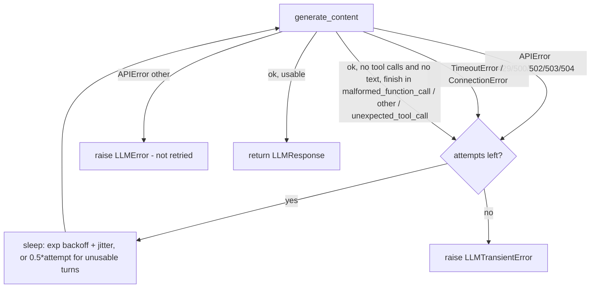
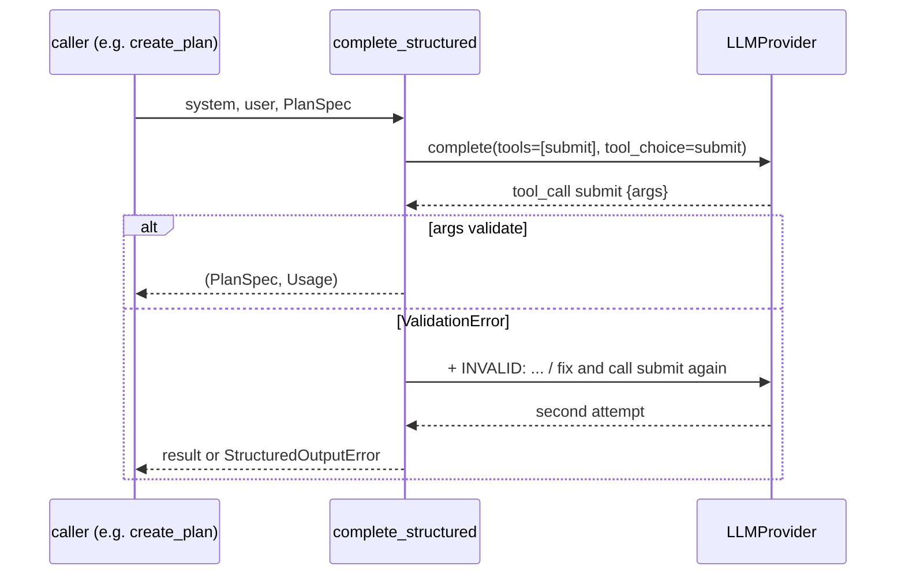

# 06 - LLM Integration (tag: LLM)

## What this file covers

How AEOS talks to language models: the provider abstraction (`src/aeos/llm/base.py`), the Gemini client (`gemini.py`), forced-tool "structured output" (`structured.py`), the tracing wrapper (`traced.py`), cost estimation and budgets (`pricing.py`, `core/budget.py`), the scripted `FakeLLM` / `RoutedFakeLLM` used for deterministic tests, and the nondeterminism that remains when a live model is used. It starts with first-principles explanations of function calling, context windows and structured output, then maps each onto code. The agent loop that consumes this layer is in [05-agents-and-orchestration.md](05-agents-and-orchestration.md); the memory embedder is in [08-memory-system.md](08-memory-system.md); spans and metrics emitted by `TracedLLM` are explained in [20-observability-and-telemetry.md](20-observability-and-telemetry.md); injection defences are in [14-security-and-prompt-injection.md](14-security-and-prompt-injection.md).

Labels used: **Verified** (read in code/tests), **Inferred rationale**, **Potential failure scenario**, **Recommendation**.

---

## 1. First principles

### 1.1 An LLM call is a pure function over text

A chat model is a stateless HTTP endpoint. You send: a list of messages (system / user / assistant turns), optional tool declarations, and generation settings. It returns text and/or tool-call requests, plus token counts. **It remembers nothing between calls.** "Conversation" and "agent memory" are just you re-sending the growing list every time. That has three consequences that shape this whole repo:

1. Cost and latency grow with prompt size on every step (the full history is billed again each call).
2. Anything the model "knows" about the task must be inside the messages (or in its weights).
3. Everything outside the model (loop, state, retries, budgets) is ordinary code that you must write.

### 1.2 Tokens and the context window

Models read and write *tokens* (sub-word chunks; roughly 4 characters of English each; AEOS uses `CHARS_PER_TOKEN = 4` in `memory/manager.py` as its heuristic). The **context window** is the maximum number of tokens (input + output) the model can handle in one call. When history exceeds it, the call fails or you must drop content. Even below the limit, long contexts cost more and models attend to them less reliably. So an agent harness needs a policy for *what to drop*. AEOS's policy: `_compact()` in `agents/loop.py` elides the bulk of the oldest large `tool` messages once the total passes `max_context_chars` (180 000 chars, roughly 45k tokens by the 4:1 heuristic), and `ToolRuntime` clips any single result to `MAX_RESULT_CHARS = 6000`.

### 1.3 Function calling / tool use

A model only emits text. "Tool use" is a protocol on top of that:

1. You declare tools as `{name, description, JSON-Schema parameters}`.
2. The model, instead of (or in addition to) prose, returns a structured *tool call*: `{name, arguments}` where `arguments` is JSON that the provider tries to make conform to your schema.
3. **Your code** validates and executes the call, then appends a `tool` message with the result to the history and calls the model again.
4. The loop ends when the model produces a final answer (or you stop it).

The model never executes anything. This is the key security fact: the model's output is a *request*, and your harness is the policy enforcement point. Providers also offer `tool_choice`-style modes: auto (model decides), any (must call some tool), or force one named tool.

### 1.4 Structured output from first principles

You want a typed object (a plan, a root cause), not prose. Three common techniques:

| Technique | How | Weakness |
|---|---|---|
| "Reply in JSON" in the prompt, then `json.loads` | pure prompting | model adds prose/fences, wrong fields |
| Provider-native JSON-schema mode | provider constrains decoding | provider-specific; schema subset limits |
| **Forced tool call** (what AEOS does) | declare a fake tool `submit` whose parameter schema *is* the Pydantic model's JSON Schema; force the model to call it | still must validate the arguments yourself; semantic errors remain |

Whichever you use, the final defence is validating in your own code (Pydantic `model_validate`) and, on failure, feeding the error back for a retry. Schema validity is not truth: a perfectly valid `RootCause` can still be wrong, which is why AEOS adds deterministic checks (e.g. `GraphNodes._check_research`, see file 05) and an independent verifier.

---

## 2. The abstraction (`llm/base.py`)

**Verified.** The whole system depends on one small interface:

```
LLMProvider.complete(messages, *, tools=None, max_tokens=4096, tool_choice=None) -> LLMResponse
```

Data types (Pydantic): `Message(role in system|user|assistant|tool, content, tool_calls, tool_call_id)`, `ToolCall(id, name, arguments, extra)`, `ToolSpec(name, description, parameters)`, `Usage(input_tokens, output_tokens)`, `LLMResponse(content, tool_calls, usage, model, finish_reason)`. Errors: `LLMError`, with `LLMTransientError` for "safe to retry later".

Design points:

- `ToolCall.extra` is "opaque provider data that must be echoed back" (Gemini thought signatures). It lets a provider-neutral message carry provider-specific state without the rest of the code knowing.
- `finish_reason` is normalised to `stop`, `length`, `blocked`, or the lower-cased provider reason (e.g. `malformed_function_call`).
- `tool_choice` is a string: `None`, `"any"`, or a tool name. The loop never sets it; only `complete_structured` does (`tool_choice="submit"`).
- `get_llm()` (`llm/factory.py`) builds the real provider from `Settings`; only `gemini` is implemented (`llm_provider` is `Literal["gemini","fake"]`; `fake` raises `LLMError` "no live implementation; inject a FakeLLM"). Tests construct `FakeLLM` directly. `strong=True` selects `gemini_strong_model` (default `gemini-3.1-pro-preview`) vs `gemini_model` (`gemini-2.5-flash`).

**Where "strong" is used (Verified, `runtime.py` + `graph/nodes.py`).** `open_runtime` sets `strong = _traced(strong_llm) if strong_llm is not None else llm`. Note: `get_llm(strong=True)` is *defined* but the only callers in `src` are `cli.py` (line 51, no `strong`) and `runtime.py` (no `strong`). So unless a caller injects `strong_llm`, the "strong" model is the same as the default. **Discrepancy to be aware of:** `docs/DECISIONS.md` D-024 says planner/synthesis "use the strong model setting"; the code routes planner, synthesis, judge, replan and memory-curator through `rt.strong_llm`, but that only differs from the default model if something passes `strong_llm`. I found no production call site that builds one with `get_llm(settings, strong=True)`. Treat "planner uses a stronger model" as wiring that exists but is not switched on by default (check `cli.py`/`worker.py` before claiming it in an interview).

**Why an abstraction at all (Inferred rationale).** (a) Swap providers; (b) the same interface is satisfied by `FakeLLM`, which makes the entire graph testable offline; (c) one choke point (`TracedLLM`) for telemetry and cost. **Trade-off:** the lowest-common-denominator interface hides provider features (no streaming, no per-call temperature, no provider-native JSON mode, no caching controls).

---

## 3. The Gemini client (`llm/gemini.py`)

### 3.1 Message conversion (`_to_contents`)

Gemini's wire format differs from the neutral one, so the client translates:

- all `system` messages are joined with blank lines into `system_instruction`;
- `assistant` → role `model`, with text part plus one `function_call` part per tool call;
- `tool` messages become `function_response` parts inside a `user` content. Gemini needs the function *name*, not the call id, so `names[tc.id] = tc.name` is remembered while walking the history;
- **parallel tool results are merged into one user turn** (if the previous content is a user turn made only of function responses, the new part is appended to it). Test: `tests/llm/test_gemini_conversion.py::test_parallel_tool_results_share_one_turn`.
- thought signatures (opaque bytes Gemini returns with thinking-model function calls) are base64-encoded into `ToolCall.extra["thought_signature"]` and decoded when echoed back. Verified by `test_conversion_roundtrips_tool_calls_with_signatures`. **Why it matters:** Gemini's thinking models expect the signature to be passed back on later turns of a tool loop; dropping it can degrade or break multi-step tool use (Inferred rationale from the comment in `base.py`).

### 3.2 Request configuration (`GeminiProvider.complete`)

- `temperature = 0.2` hard-coded (not zero, not configurable per call).
- `automatic_function_calling` is **disabled**: the SDK could execute Python callables itself; AEOS refuses, so every tool call goes through `ToolRuntime` and the risk gate.
- `thinking_budget` (default 1024 from settings): Gemini 2.5 models can spend hidden "thinking" tokens before answering. `max_output_tokens = max_tokens + thinking_budget`, so thinking cannot eat the answer budget. Thinking text parts (`part.thought`) are dropped from `content`.
- tools → `FunctionDeclaration(parameters_json_schema=...)`; `tool_choice` → `FunctionCallingConfig(mode=ANY, allowed_function_names=[name])` (any = no name list).

### 3.3 Response parsing (`_from_response`)

Text parts are concatenated; each function-call part becomes a `ToolCall` (id = Gemini's id if present, else `call_<uuid10>`). Usage: `input_tokens = prompt_token_count`, `output_tokens = candidates_token_count + thoughts_token_count` (thinking billed as output). Empty candidates with `prompt_feedback` is reported as `finish_reason="blocked"` instead of crashing (`test_empty_candidates_is_blocked_not_a_crash`). If there are tool calls and no finish reason, it reports `"stop"`.

### 3.4 Retries



Read it: transient transport/server errors and "garbled" model turns are retried up to `max_retries=4` (5 attempts); client errors (400, 401, 403...) fail immediately. After exhaustion `LLMTransientError` (a subclass of `LLMError`) is raised; the agent loop turns any `LLMError` into `LoopResult("error")`, which the dispatch node treats as a step failure (retry policy then applies, see [10-error-handling-and-reliability.md](10-error-handling-and-reliability.md)). Backoff is `min(2**attempt, 20) + uniform(0, 0.5)` seconds. **Verified:** the retry paths have no unit test with a mocked client (only conversion tests and an opt-in live test `tests/llm/test_live_gemini.py`). **Potential failure scenario:** `finish_reason == "length"` (output truncated at `max_tokens`) is *not* retried and is returned as-is; a truncated `finish` call can arrive as malformed arguments, which the loop handles via the invalid-finish feedback path.

---

## 4. Structured output (`llm/structured.py`)

`complete_structured(llm, system=..., user=..., model=PydanticModel, retries=1)`:

1. Builds a `ToolSpec` named `submit` whose `parameters` are `clean_schema(model.model_json_schema())` (strips Pydantic `title` noise).
2. Calls `llm.complete(..., tools=[spec], tool_choice="submit")`.
3. Finds the `submit` call; `model.model_validate(call.arguments)`.
4. On `ValidationError`: appends the assistant tool call, a `tool` message `INVALID: <first 600 chars of the error>`, and a user nudge "Fix the errors and call submit again", then retries (default `retries=1` → 2 attempts).
5. If the model made no `submit` call: appends "You must call the submit tool." and retries.
6. After the attempts: raises `StructuredOutputError` (subclass of `LLMError`).
7. Usage across attempts is summed and returned; **callers** add it to the `BudgetTracker`.



Read it: one logical request, possibly two model calls; the error text is fed back so the model can self-correct.

**Who uses it (Verified):** `create_plan`, `replan`, `synthesize_root_cause` (`agents/supervisor.py`), `judge_patch` (`agents/judge.py`), `MemoryManager._propose` (`memory/manager.py`). The specialist agents do **not** use it; they use the same idea inside the agent loop with a `finish` tool (file 05).

**Trade-offs.**
- The same trick as the `finish` tool, so one validation style across the repo. Pydantic models double as the schema and the type.
- `Literal` fields (e.g. `PlanStepSpec.owner: Literal["analytics","research","coding"]`) get enforced by validation; schema-level enum hints help the model but are not guaranteed.
- **Potential failure scenario (accounting gap):** when `complete_structured` raises, the tokens spent on the failed attempts are lost, because the `Usage` is only returned on success and the exception path never reaches `tracker.add_llm`. `TracedLLM` still records every individual call in spans/metrics, so observability is complete even though the shared `BudgetTracker` under-counts failed structured attempts. Small effect (one planner call), but real.
- **Recommendation:** attach accumulated usage to `StructuredOutputError`, or record into the tracker from `TracedLLM`.

---

## 5. Cost, pricing and budgets

### 5.1 `pricing.py`

`PRICES` maps model name → (USD per 1M input tokens, USD per 1M output tokens); unknown models fall back to `DEFAULT_PRICE = (1.00, 8.00)`. The docstring says "estimates for budgeting, not billing". Some entries are labelled estimates in-code (`gemini-3.1-pro-preview`). Scripted runs report model `"scripted"`, so they are priced at the default rate. **Verified:** nothing tests the numbers; they are static constants that go stale when provider pricing changes (Recommendation: treat the dashboard's dollar figure as order-of-magnitude).

### 5.2 `BudgetTracker` (`core/budget.py`) and `Budget` (`core/state.py`)

One tracker per node invocation is created from `state.budget` (`BudgetTracker(state.budget)`, a deep copy), all agents inside one dispatch share it, and the updated `Budget` is returned into the checkpointed state. Fields and defaults: `max_steps=200` (loop iterations across the task), `max_tokens=1_500_000`, `max_cost_usd=5.0`, `max_wall_seconds=1800`. `exhausted()` returns a reason string for whichever limit is hit first.

Enforcement is **cooperative and post-hoc**: `_run_agent` calls `tracker.exhausted()` at the *start* of each step, before the next LLM call. So the call that crosses the line still happens; a single step can overshoot. Planner/judge/synthesis/replan/memory calls are *not* gated by `exhausted()` (they just add usage). A budget exhaustion in a specialist yields `status="budget"`, which dispatch never retries (always escalates). Details of that policy: [10-error-handling-and-reliability.md](10-error-handling-and-reliability.md).

**Concurrency note (Verified, Potential failure scenario).** Analytics and research run via `asyncio.gather` in `dispatch` with one shared `BudgetTracker` object. Because asyncio is single-threaded and `add_*` methods are synchronous, there is no race on the counters. But the budget copies are per node: a parallel run through A2A returns remote usage in `SpecialistResult.usage` (the supervisor adds it to the tracker), which depends on that field being honoured.

### 5.3 Two token numbers

Cost is computed twice from the same function: once inside `TracedLLM` (per-call span attribute `aeos.llm.cost_usd`, Prometheus-style counter) and once in `BudgetTracker.add_llm` (enforcement). They agree because both call `estimate_cost`; they differ only on lost failed-structured-attempt usage described above.

---

## 6. Tracing wrapper (`llm/traced.py`)

`TracedLLM(inner, system="gemini")` is a decorator around any provider. Per call it opens a `llm.call <model>` span (kind CLIENT) with OpenTelemetry GenAI semantic attributes (`gen_ai.request.model`, `gen_ai.usage.input_tokens`...) **and** Langfuse attributes (`langfuse.observation.type=generation`, `.input`, `.output`, `.usage_details`, `.cost_details`) so Langfuse renders it as a generation. It then updates metrics: `llm_calls`, `llm_tokens` (by direction), `llm_cost`, `llm_duration`.

Details worth knowing:
- `__getattr__` proxies unknown attributes to the inner provider, so `getattr(llm, "model", "")` (used by supervisor/judge/memory for cost) and `llm.routes` / `llm.calls` in tests still work through the wrapper. Cost of this convenience: a typo'd attribute silently reaches the inner object.
- Prompt capture: `_messages_json` truncates each message's `content` to 3000 chars but includes tool-call arguments in full. Exports go through telemetry redaction (`telemetry/tracing.py` masks secrets; see file 20). **Potential failure scenario:** prompts are stored in the trace backend, so any sensitive data placed in a prompt (logs, code) is retained there; the redaction is pattern-based, not a guarantee.
- `_traced()` in `runtime.py` is idempotent (`llm if isinstance(llm, TracedLLM) else TracedLLM(llm)`), so injecting a `FakeLLM` still yields spans in tests.
- The wrapper adds no retry or timeout; those live in the Gemini client.

---

## 7. Nondeterminism and how AEOS contains it

| Source | Where | Containment |
|---|---|---|
| Sampling (`temperature=0.2`) | `gemini.py` | low but not zero; no seed. Same prompt can give different tool sequences |
| Hidden thinking | `thinking_budget=1024` | varies run to run; counted as output tokens |
| Provider quirks (garbled function calls, empty turns) | `_RETRYABLE_FINISH` | retry; otherwise loop's `max_malformed=3` |
| Model changes upstream (preview models) | `gemini-3.1-pro-preview` default strong model | none; pin versions, re-run evals |
| Concurrency ordering | `asyncio.gather` over agents | per-role scripts in tests (`RoutedFakeLLM`); live runs are order-independent by design because analytics and research don't read each other's output |
| Wrong-but-valid output | any structured output | deterministic checks + independent verifier + human approval |

Documented evidence of the variance: `docs/PROGRESS.md` (Phase 8 memory benefit measurement) reports live call counts of 65/17/19 (memory on) vs 19/21/62 (off) with n=3 per arm and states no benefit can be claimed because variance is dominated by whether a run hits a wrong first diagnosis plus replan. I did not re-run this; it is cited from the doc. It is the project's own illustration of why single live runs prove little and why the eval framework ([23-evaluation-framework.md](23-evaluation-framework.md)) exists.

---

## 8. FakeLLM and RoutedFakeLLM (`llm/fake.py`)

**`FakeLLM(script: list[ScriptStep])`** replays `LLMResponse`s in order. Each `ScriptStep` may carry `expect_in_prompt`, a substring that must appear in the last non-system message (else `UnexpectedPromptError`). It records `calls` (deep-copy snapshots, so later mutation like `_compact` doesn't alter history), returns a deep copy of the step response, and raises `ScriptExhaustedError` when the script runs out ("fails loudly on drift").

**`RoutedFakeLLM(routes: {marker: FakeLLM})`** picks a per-role `FakeLLM` by checking whether a marker string appears in the joined system prompt (`"ROLE: analytics"`, `"ROLE: supervisor-planner"`...). It exists because analytics and research run **concurrently**: a single shared script would be consumed in scheduling order, producing flaky tests. Per-role scripts make the interleaving irrelevant. Unknown role → `UnexpectedPromptError`.

**Coupling to know:** the markers are the literal `ROLE:` prefixes in the system prompts of `supervisor.py`, `specialists.py`, `judge.py`, `memory/manager.py`; changing a prompt's first words breaks routing. Scripted trajectories in `demo/trajectories.py` are covered in [05-agents-and-orchestration.md](05-agents-and-orchestration.md) section 8.

**What FakeLLM does and does not prove.** It proves the harness: loop limits, validation, routing, replan wiring, memory plumbing, risk gate, the real tools running in the real sandbox. It does **not** prove prompt quality or that Gemini can actually solve the task. Live behaviour is checked only by the opt-in `tests/llm/test_live_gemini.py` (tool round trip, structured output; needs an API key) and by the live eval runs (file 23).

---

## Interview questions

## Q-LLM-1. Explain function calling. Who actually runs the tool?
**Difficulty:** Beginner  **Topic:** tool use fundamentals

**Short answer:** The model never runs anything. It returns a structured request, "call tool X with these JSON arguments". The harness validates it, applies policy, executes it, and sends the result back as a new message. In AEOS that harness step is `ToolRuntime.execute`, with a deterministic risk gate in front of every call.

**Detailed explanation:** A tool is declared to the model as name + description + JSON Schema. The provider returns a `function_call` part in the response. Your loop executes it and appends a function-response part, then calls the model again. The model sees tool results only as text you chose to give it. That is why the harness is the security boundary: truncation, trust labelling, approval, idempotency all live in your code.

**How this project uses it:** `ToolSpec` → `FunctionDeclaration` in `GeminiProvider.complete`; `automatic_function_calling` is explicitly disabled so the SDK can't auto-execute. Calls arrive as `ToolCall` in `LLMResponse.tool_calls`; `agents/loop.py` passes each to `ToolRuntime.execute` (`agents/tools.py`), which asks `RiskGate.decide`, runs the tool, records a `ToolCallRecord`, and returns a `<tool_result ...>` string.

**Example/walkthrough:** analytics agent returns `get_metrics{start,end}` → runtime allows it (`risk: read`) → MCP call → result clipped to 6000 chars, wrapped `<tool_result tool="get_metrics" origin="trusted">` → appended as a `tool` message → `_to_contents` turns it into a `function_response` Part for the next call.

**Follow-ups:**
- *What if the model asks for a tool that does not exist?* `execute` returns `<tool_error>unknown tool; available: [...]</tool_error>` and the loop continues (`tests/agents/test_loop.py::test_unknown_tool_lists_available_ones`).
- *Why disable automatic function calling?* The SDK would execute Python callables itself and skip the risk gate, trace spans, idempotency keys and budget accounting. (Inferred rationale; the code simply sets `disable=True`.)
- *What if two tools are requested in one turn?* Both execute in order; results go back in one Gemini user turn (`test_parallel_tool_results_share_one_turn`). Note they run sequentially, not concurrently.

**Trade-offs and alternatives:** Provider SDK tool runners are shorter code but surrender control points. A framework agent executor (LangChain-style) would hide the same loop; AEOS wrote it by hand to own limits and policy (see file 05).

**Common interview mistake:** saying "the LLM calls the API". It emits a request; a human-written harness decides whether to honour it.

**Related:** [05-agents-and-orchestration.md](05-agents-and-orchestration.md) Q-AGT-2, [15-mcp-servers-and-tool-layer.md](15-mcp-servers-and-tool-layer.md)

## Q-LLM-2. How do you get reliable structured output from a model, and how does AEOS do it?
**Difficulty:** Intermediate  **Topic:** structured output

**Short answer:** AEOS declares a fake tool `submit` whose parameter schema is the Pydantic model's JSON Schema and forces the model to call it (`tool_choice="submit"`). It validates the arguments with Pydantic; on failure it feeds the error back once and retries; after that it raises `StructuredOutputError`, which callers treat as an LLM failure and fall back deterministically.

**Detailed explanation:** Prompt-only JSON is fragile; native JSON mode is provider-specific. Forced tool calls reuse the tool-calling machinery that is already built and tested. Validation is still essential: providers try to match the schema, they do not guarantee it, and semantic constraints (like sha length) need your own checks.

**How this project uses it:** `complete_structured` in `llm/structured.py`. Retry count default 1 (two attempts). `clean_schema` drops titles. Callers: planner, replan, synthesis, judge, memory curator.

**Example/walkthrough:** the planner returns `owner: "devops"` → `PlanStepSpec.owner` is a `Literal` → `ValidationError` → message `INVALID: ...` appended → second attempt returns `"research"` → plan accepted. If both attempts fail, `create_plan` catches `LLMError` and uses `default_plan_steps` (`tests/agents/test_supervisor.py::test_invalid_llm_plan_falls_back_to_default`, `test_unusable_planner_output_falls_back_to_default`).

**Follow-ups:**
- *Why only one retry?* Cost and latency, and diminishing returns; the fallback is deterministic. (Inferred rationale.)
- *Is validated output trustworthy?* No: valid shape, possibly wrong content. A valid `RootCause` can name the wrong commit; that is why the verifier and the baseline-commit check exist (file 13).
- *Which errors escape?* `StructuredOutputError` is an `LLMError`; `synthesize_root_cause` does not catch it internally, but the `synthesize` graph node wraps it in `except Exception` and fails the task cleanly.
- *Token accounting on failure?* Lost from `BudgetTracker` (see section 4); still visible in traces.

**Trade-offs and alternatives:** native constrained decoding (guaranteed parseable JSON) removes the retry loop but is provider-specific and often supports a schema subset. Instructor/Outlines-style libraries do similar things; the in-repo version is ~70 lines and has no dependency.

**Common interview mistake:** claiming schema-constrained output eliminates hallucination. It eliminates malformed JSON, not wrong answers.

**Related:** Q-AGT-5, Q-AGT-3

## Q-LLM-3. What is a context window and how does the agent loop avoid blowing it?
**Difficulty:** Intermediate  **Topic:** context management

**Short answer:** The context window is the per-call token limit for prompt plus output. The loop re-sends the whole history every step, so it grows. AEOS clips each tool result to 6000 chars and, past 180 000 chars total, replaces the bulk of the oldest tool results with a short elision marker.

**Detailed explanation:** Because the API is stateless, each step pays for the entire history again. Strategies: truncate, summarise, drop old tool outputs, retrieve selectively. AEOS uses the simplest: truncate and elide.

**How this project uses it:** `MAX_RESULT_CHARS=6000` and `_clip` in `agents/tools.py`; `_compact(messages, max_context_chars)` in `agents/loop.py` skips `messages[:2]` (system and task), then for each `tool` message longer than 300 chars keeps the first 60 chars plus "...[older result elided to save context]" until under the limit. `LoopLimits.max_steps` bounds growth too. The `ToolCallRecord.result_preview` (500 chars) keeps an audit trail independent of what the model still sees.

**Example/walkthrough:** analytics at step 20 has ~30 big metric dumps; `_compact` blanks the oldest ones; the model keeps its own earlier reasoning and recent evidence but may lose detail it needed. 

**Follow-ups:**
- *Weakness?* Characters are a proxy for tokens (4:1 is a heuristic; code and non-English tokenise worse); compaction mutates messages in place; the model is not told which facts were dropped except by the marker; old results that mattered are lost. **Recommendation:** summarise instead of eliding, or let the agent write notes.
- *Does the elision break provider rules?* No: roles and tool_call ids are untouched; only `content` is shortened.
- *Where do tokens get counted for budgets?* From provider usage metadata, not from the char heuristic.

**Trade-offs and alternatives:** summarisation costs an extra LLM call and can introduce errors; sliding windows lose the beginning; retrieval (RAG over past steps) is heavier. AEOS picked cheapest-that-works for tasks of 15-40 steps.

**Common interview mistake:** assuming a larger window removes the problem; cost, latency and attention degradation remain.

**Related:** Q-AGT-2, [10-error-handling-and-reliability.md](10-error-handling-and-reliability.md)

## Q-LLM-4. Walk through how AEOS converts its neutral messages into Gemini's format. Why is it tricky?
**Difficulty:** Advanced  **Topic:** provider adaptation

**Short answer:** Three mismatches: Gemini has no system role (joined into `system_instruction`), tool results are keyed by function *name* rather than call id, and parallel tool results must share one user turn. Thinking models also return opaque thought signatures that must be echoed back, which AEOS carries in `ToolCall.extra`.

**Detailed explanation:** `_to_contents` iterates messages, tracking `names[tool_call_id] → name`. Assistant messages produce a `model` content with text and function-call parts (restoring `gemini_id` and base64-decoded `thought_signature`). Tool messages produce a `function_response` part; if the previous content is a user turn consisting only of function responses, the part is appended (parallel results). `_from_response` does the reverse, encoding signatures to base64 so they survive JSON checkpointing.

**How this project uses it:** `llm/gemini.py`; tested offline in `tests/llm/test_gemini_conversion.py` (round trip with signatures, parallel grouping, empty candidates → `blocked`).

**Example/walkthrough:** messages `[system, user, assistant(2 calls), tool, tool]` → `[user, model(2 fc parts), user(2 fr parts)]`.

**Follow-ups:**
- *Why base64?* `ToolCall` is a Pydantic model that is checkpointed to Postgres as JSON; raw bytes aren't JSON-safe. (Inferred rationale; the state is persisted per file 07.)
- *What if the tool id is unknown when a tool message arrives?* the name falls back to the literal `"tool"` (`names.get(..., "tool")`), which Gemini may reject. Not tested.
- *What breaks if you change providers?* Only `gemini.py` and `factory.py`; the neutral model stays.

**Trade-offs and alternatives:** use the SDK's chat session objects (stateful, hides conversion, harder to checkpoint) versus own the history (portable, resumable).

**Common interview mistake:** forgetting that the tool-loop history must be reproduced faithfully each call, including provider-specific tokens.

**Related:** [07-state-durability-and-persistence.md](07-state-durability-and-persistence.md)

## Q-LLM-5. What does the Gemini client do when the API fails or the model returns garbage?
**Difficulty:** Intermediate  **Topic:** retries and error taxonomy

**Short answer:** It retries transient HTTP errors (429, 500, 502-504), timeouts, connection errors, and "unusable" model turns (no text, no tool call, finish reason malformed_function_call/other/unexpected_tool_call), up to 4 retries with exponential backoff plus jitter. Other API errors raise `LLMError` immediately; exhausted retries raise `LLMTransientError`.

**Detailed explanation:** See the flowchart in section 3.4. The taxonomy `LLMError` / `LLMTransientError` lets callers distinguish "try later" from "will never work". In practice callers catch the base `LLMError`: the loop returns `status="error"`, planners fall back to default plans.

**How this project uses it:** `GeminiProvider.complete`; loop at `agents/loop.py` (`except LLMError`); dispatch's retry policy (`core/retry.py`: `max_step_attempts=2`).

**Example/walkthrough:** a 503 on attempt 1 → sleep ≈1.0-1.5s → attempt 2 → ok. A 400 (bad schema) → immediate `LLMError("gemini error 400: ...")` → step fails.

**Follow-ups:**
- *Is `LLMTransientError` used to make decisions anywhere?* **Verified:** it is raised, but I found no `except LLMTransientError` branching on it in `src`; callers catch `LLMError`. The distinction is available but not exploited.
- *Is jitter important?* Yes, avoids synchronized retries from parallel agents hitting the same rate limit.
- *Tested?* Not with a mocked client; only live tests and conversion tests.

**Trade-offs and alternatives:** a retry library (tenacity) or provider SDK retries; hand-rolled here to also cover "successful HTTP, useless content".

**Common interview mistake:** retrying 4xx errors or retrying without jitter/backoff.

**Related:** [10-error-handling-and-reliability.md](10-error-handling-and-reliability.md)

## Q-LLM-6. How are cost and token budgets computed and enforced? What are the gaps?
**Difficulty:** Intermediate  **Topic:** budgets

**Short answer:** Each LLM response's usage (including thinking tokens as output) is priced from a static per-model table and accumulated in a shared `BudgetTracker`. Before each agent step the loop checks steps, tokens, dollars and wall-clock limits and stops with status `budget`. Enforcement is cooperative: the call that crosses the limit still happens, and non-agent calls aren't gated.

**Detailed explanation:** Defaults: 200 steps, 1.5M tokens, $5, 1800 s per task. Prices are estimates and unknown models use a default. Budget status is never retried; the step escalates to a human.

**How this project uses it:** `core/budget.py`, `core/state.py::Budget.exhausted`, `llm/pricing.py`, `agents/loop.py` (`tracker.exhausted()` at loop top, `add_step`, `add_llm`). Tests: `test_token_budget_halts_the_loop`, `test_step_budget_is_shared_across_agents`.

**Example/walkthrough:** token limit 1000, each call 20 tokens in+out per the tests' scripts → loop halts with `status="budget"` and detail "token budget exhausted (...)".

**Follow-ups:**
- *What's not covered?* Planner/judge/synthesis/replan/memory calls add usage but don't check the budget first; failed structured attempts aren't counted; price table is hand-maintained; wall clock includes human approval waits? (`started_at` is wall time since task start; I did not verify how paused approval time interacts. Treat as an open question.)
- *Per-call cap?* `max_tokens_per_call=4096` limits output of one call, not input.
- *Why shared across agents?* D-023: a runaway agent in parallel must not escape the cap.

**Trade-offs and alternatives:** provider-side spend caps are stronger but coarse; proxy-based metering (LiteLLM) gives accurate billing; in-process is simple and per-task.

**Common interview mistake:** claiming a hard $5 ceiling. It is a soft cap that can overshoot by about one call.

**Related:** [20-observability-and-telemetry.md](20-observability-and-telemetry.md), Q-AGT-4

## Q-LLM-7. Why a `TracedLLM` wrapper rather than tracing inside the Gemini client?
**Difficulty:** Intermediate  **Topic:** decorator / observability

**Short answer:** The wrapper is provider-agnostic, so scripted `FakeLLM` runs produce the same spans as live ones. It records the prompt, completion, tokens, estimated cost and latency in one place, with Langfuse-compatible attributes.

**Detailed explanation:** Decorator pattern around the `LLMProvider` interface. One `llm.call <model>` span per call plus counters/histogram. `__getattr__` forwards `.model`, `.routes`, `.calls` so code and tests that peek at the inner object still work.

**How this project uses it:** `llm/traced.py`; applied in `runtime._traced`, idempotently, for default and strong LLMs and for standalone specialists (`open_specialist`).

**Example/walkthrough:** one agent step → one `llm.call` span nested under `agent analytics`, attributes include `gen_ai.usage.input_tokens`, `aeos.llm.cost_usd`, `langfuse.observation.output` (JSON of content and tool calls).

**Follow-ups:**
- *Risk of recording prompts?* Prompts may contain log lines and source code; stored in the trace backend; redaction is pattern-based (file 20).
- *Does a failed inner call produce a span?* Yes, with an error status: `telemetry/tracing.py::traced` catches the exception, records it, sets `StatusCode.ERROR` and re-raises (the input attributes were set before the call, so the prompt is still visible; output attributes are absent). The metrics lines after the `with` block do not run on failure, so there is no LLM-error counter or duration sample for failed calls.
- *Why `getattr(self.inner, "model", "")` for the model name?* `RoutedFakeLLM` has no `model`; falls back to `"unknown"`.

**Trade-offs and alternatives:** SDK auto-instrumentation (OpenLLMetry) vs hand-rolled attributes; hand-rolled gives control of Langfuse fields at the cost of maintenance.

**Common interview mistake:** forgetting that failed calls are the ones you most want in the trace.

**Related:** [20-observability-and-telemetry.md](20-observability-and-telemetry.md)

## Q-LLM-8. How does FakeLLM make a multi-agent run deterministic, and what are its limits?
**Difficulty:** Intermediate  **Topic:** testing LLM systems

**Short answer:** `FakeLLM` replays a fixed list of responses and fails loudly on drift. `RoutedFakeLLM` gives each role (matched by a `ROLE:` marker in the system prompt) its own script, so concurrent agents can't steal each other's turns. It tests the harness, not the model.

**Detailed explanation:** Determinism problem: analytics and research are scheduled concurrently; with one script, which agent consumes which response depends on scheduling. Per-role scripts remove that. `expect_in_prompt` asserts the prompt contained something (used to check feedback flows); `ScriptExhaustedError` flags extra calls.

**How this project uses it:** `llm/fake.py`; scenario factories `happy_path_llm` and `wrong_fix_then_fix_llm` in `demo/trajectories.py`, used by `tests/graph/test_replan_e2e.py` and `test_memory_e2e.py`, by `aeos run --replay`, and by smoke evals.

**Example/walkthrough:** `test_wrong_fix_is_caught_replanned_and_corrected_step_by_step` asserts that the second research prompt contains `previous_attempt_feedback` and the rejected file, by inspecting `llm.routes[RESEARCH].calls[-1]`.

**Follow-ups:**
- *What can't it catch?* Prompt quality, tool-schema comprehension, real model misbehaviour, drifting model versions. Live Gemini tests and evals cover that.
- *Brittleness?* Routing keys are prompt text; scripts encode exact step counts (change a tool-use sequence and the script drifts and the test fails loudly, by design).
- *Is replay with real tools meaningful?* Yes: tools, sandbox, verifier and graph are real; only the model is scripted (see `trajectories.py` docstring).

**Trade-offs and alternatives:** record/replay (VCR-style) captures real outputs but couples tests to request bytes; scripted fakes are hand-authored and readable.

**Common interview mistake:** presenting FakeLLM tests as evidence that the agent "works"; they show the plumbing works.

**Related:** [22-testing-strategy.md](22-testing-strategy.md), [23-evaluation-framework.md](23-evaluation-framework.md), Q-AGT-11

## Q-LLM-9. Where does nondeterminism enter, and how do you build a reliable system on top of it?
**Difficulty:** Advanced  **Topic:** reliability

**Short answer:** Sampling (temperature 0.2), hidden thinking, provider flakiness, and preview-model drift mean the same task can follow different paths. AEOS doesn't try to remove this; it bounds it: hard loop limits, schema validation, deterministic checks for hard facts, an independent verifier, and human approval before anything is published.

**Detailed explanation:** See the table in section 7. The principle: let the model do open-ended work (investigating, editing), but make the decisions with irreversible consequences deterministic or human. Concrete examples: baseline commit computed by code (`_check_research`), a patch taken from the sandbox rather than from the model's text, judge verdict can only tighten (`apply_judgement`), risk policy in YAML.

**How this project uses it:** `temperature` constant in `gemini.py`; limits in `LoopLimits`; replan state machine in `core/retry.py`.

**Example/walkthrough:** `docs/PROGRESS.md` reports that in live tests a first wrong diagnosis followed by a replan is a common source of variance; the e2e test `test_wrong_fix_is_caught_replanned_...` reproduces that path deterministically to prove the recovery works.

**Follow-ups:**
- *Would temperature 0 fix it?* Reduces variance, doesn't remove it (hardware/batching nondeterminism, thinking, model updates), and can reduce exploration. Not configurable per call today.
- *How would you measure reliability?* Many trials per arm, report distributions, not single runs (the repo's own memory experiment makes this point, n=3 was inconclusive).
- *What about prompt-injection-induced variance?* Treated separately (file 14).

**Trade-offs and alternatives:** majority-vote/self-consistency raises cost; constrained decoding narrows form not content.

**Common interview mistake:** "we set temperature to 0 so it's deterministic".

**Related:** [23-evaluation-framework.md](23-evaluation-framework.md), [13-verification-and-risk-policy.md](13-verification-and-risk-policy.md)

## Q-LLM-10. Why is the thinking budget added to `max_output_tokens`, and how is it billed here?
**Difficulty:** Advanced  **Topic:** Gemini specifics / cost

**Short answer:** Gemini 2.5 models can spend hidden reasoning tokens that count against the output limit. If you set `max_output_tokens` to the answer size, thinking can consume it and truncate or empty the answer. AEOS sets `max_output_tokens = max_tokens + thinking_budget`, and counts thinking tokens as output tokens for cost.

**Detailed explanation:** `ThinkingConfig(thinking_budget=1024)` caps reasoning tokens; `_from_response` sums `candidates_token_count + thoughts_token_count` as `output_tokens`, so the dashboard and the budget see the real spend. Thought parts are excluded from `content`.

**How this project uses it:** `GeminiProvider.complete` and `_from_response`; setting `gemini_thinking_budget` (default 1024); D-024 in `docs/DECISIONS.md`.

**Example/walkthrough:** `max_tokens=4096`, budget 1024 → provider limit 5120; if the model thinks 900 tokens and answers 300, output usage = 1200.

**Follow-ups:**
- *Is the 1024 cap a hard guarantee?* It is the requested budget; providers treat it as a target for reasoning effort. I haven't verified exact semantics beyond the code.
- *What if thinking is disabled?* Set `thinking_budget=None` in code path; the factory passes the setting's int, so `None` is not reachable from env (type is `int`).
- *Why does it matter for the loop?* A truncated tool call → malformed arguments → feedback loop; extra budget avoids spurious truncation.

**Trade-offs and alternatives:** more thinking improves hard reasoning (root-cause diagnosis) but costs tokens; a stronger model for planner vs cheap model for step-by-step tool use is the usual lever (wired but not defaulted here, see section 2).

**Common interview mistake:** forgetting hidden tokens are billed.

**Related:** Q-LLM-6, Q-LLM-3
