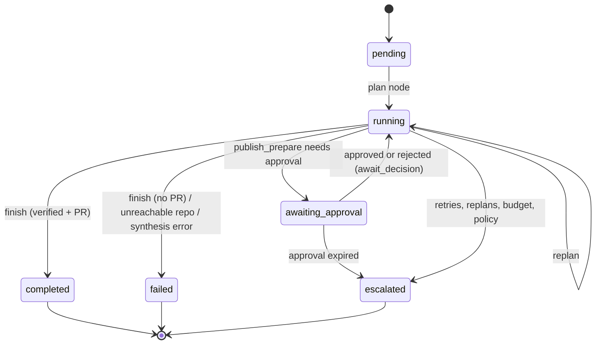
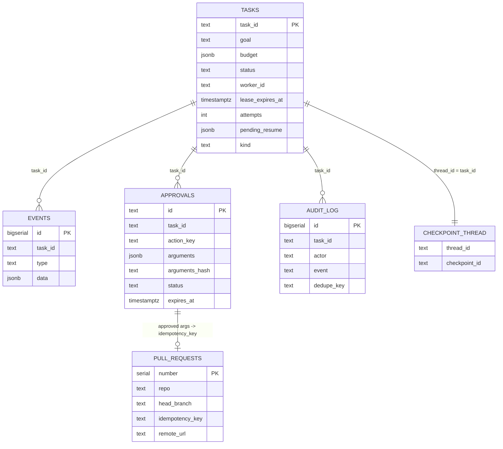

# 07 - State, Durability and Persistence

**What this file covers.** What `TaskState` contains, how LangGraph's Postgres checkpointer persists it, how the lease-based task queue works, how idempotency keys make replays safe, the event log, the data model, and exactly what happens on `kill -9`. Related: [03-system-architecture](03-system-architecture.md), [04-end-to-end-workflows](04-end-to-end-workflows.md), [10-error-handling-and-reliability](10-error-handling-and-reliability.md), [08-memory-system](08-memory-system.md), [22-testing-strategy](22-testing-strategy.md). Diagram sources: `diagrams/state-machine.mmd`.

Labels: **Verified** (code/tests), **Library behaviour** (what LangGraph/psycopg do, not code in this repo), **Inferred rationale**, **Potential failure scenario**, **Recommendation**.

---

## 1. First principles

A process can die at any instruction. To resume you need (a) all information required to continue stored outside the process, (b) a way to decide who owns the job now, and (c) side effects that tolerate being attempted twice. The classic formulation: **at-least-once execution + idempotent effects = effectively-once**. AEOS never claims exactly-once execution; it claims exactly-once *effects* for the side effects it controls (branch, commit, PR, approval, audit entry).

## 2. TaskState (Verified: `core/state.py`)

`TaskState` is one pydantic model; every field is JSON-serialisable (`test_state_roundtrips_through_json`). Nodes return only the fields they change; LangGraph merges them (plain pydantic state, so each returned field **overwrites** the old value; there are no list reducers, which is why nodes return `[*state.plans[:-1], plan]` and `[*state.tool_calls, *new]` explicitly).

| Group | Fields | Notes |
|---|---|---|
| Identity | `task_id`, `goal`, `kind` | `kind` is `regression` or `change` |
| Progress | `status`, `plans` (history), `error` | `plan` property = `plans[-1]` |
| Evidence | `observations` (with `origin`), `tool_calls` (`ToolCallRecord` with `idempotency_key`), `verifications`, `risk_decisions` | audit trail inside the state |
| Artifacts | `artifacts`: analytics, research, `root_cause`, `rejected_root_causes`, `patch`, `patch_attempt`, `patch_summary`, `pr_title`, `base_ref`, `baseline_ref`, `branch`, `pull_request`, `report` | the **patch text lives in state**, so a sandbox can be rebuilt from `base_ref + patch` |
| Budget | `Budget` (limits and used counters, `started_at`, `finished_at`) | |
| Trace | `trace: dict[str,str]` | W3C trace-context carrier so all nodes join one trace |
| Memory | `memory_text`, `memory_trace` | |
| HITL | `pending_approval_id`, `approval`, `human_feedback` | |

`status` values: `pending, running, awaiting_approval, completed, failed, escalated, cancelled`.

*How to read it:* this is the domain status inside the checkpoint. The scheduling status in `aeos.tasks` is a different machine (`diagrams/state-machine.mmd`), and the two are mapped by `Worker._execute` (`awaiting_approval` becomes queue status `paused`). `cancelled` appears in `TaskState.Status` but nothing in the graph sets it; cancel only changes the `aeos.tasks` row (Verified by grep: no node returns `"cancelled"`), and the API overrides the displayed status.

## 3. Checkpointing (Verified code; Library behaviour for internals)

**Concept.** LangGraph executes in "supersteps". After each superstep it writes a *checkpoint* (state snapshot + which nodes run next) keyed by `(thread_id, checkpoint_id)`. Resuming means loading the latest checkpoint for the thread.

**AEOS use.**
- `_config(task_id)` = `{"configurable": {"thread_id": task_id}, "recursion_limit": 120}`; thread id = task id, so one checkpoint stream per task.
- `graph/checkpoint.py::open_checkpointer` opens `AsyncPostgresSaver.from_conn_string(settings.database_url, serde=JsonPlusSerializer(allowed_msgpack_modules=state_types()))` and calls `await saver.setup()` (idempotent migrations).
- `state_types()` lists every pydantic model in `core/state.py` and allowlists them for deserialisation. **Why:** LangGraph is moving to refuse unknown types when deserialising msgpack; allowlisting avoids arbitrary-type deserialisation. (Code comment says so.) **Potential failure scenario:** adding a model outside `core/state.py` and nesting it in state would break resume until it is allowlisted; the function only scans that one module.
- Without a checkpointer (`run_task` default) `MemorySaver` with the same serializer is used (tests, `aeos run`). A `MemorySaver` run is **not** crash-safe.
- Tables created by `saver.setup()` (Library behaviour, not defined in this repo): `checkpoints`, `checkpoint_blobs`, `checkpoint_writes`, `checkpoint_migrations`. I did not inspect the installed package source for the exact DDL; verify before quoting column names.

**Granularity.** One checkpoint per node (each node is its own superstep; the graph has no parallel branches). Inside `dispatch`, specialists run in parallel with `asyncio.gather`, but that is within one node, so partial results of a half-finished `dispatch` are **not** checkpointed (DECISIONS D-032 says so deliberately).

**Resume semantics.**
- `graph.ainvoke(None, config)` continues from the checkpoint's `next` nodes (crash case).
- `interrupt()` in `await_decision` raises; LangGraph stores the interrupt in the checkpoint (`snap.interrupts`). `Command(resume=payload)` re-runs that node from the top and `interrupt()` returns the payload. Hence the rule "nothing expensive before `interrupt()`".

## 4. The task queue and leases (Verified: `store/tasks.py`, `worker.py`)

**Concept.** A *lease* is a time-limited exclusive claim. The owner must renew it (heartbeat). If the owner dies, the lease expires and someone else may claim. *Fencing* means a former owner's later writes are rejected because the row no longer names it.

**Schema `aeos.tasks`:** `task_id PK, goal, budget jsonb, status (queued|running|paused|completed|failed|escalated|cancelled), worker_id, lease_expires_at, heartbeat_at, attempts, pending_resume jsonb, last_error, created_at, updated_at, kind`.

| Function | SQL idea | Property |
|---|---|---|
| `enqueue` | `INSERT ... ON CONFLICT (task_id) DO NOTHING RETURNING *` | idempotent submit |
| `claim` | (1) escalate rows with `attempts >= max_attempts` that are queued or lease-expired; (2) `UPDATE ... WHERE task_id = (SELECT ... WHERE status='queued' OR (status='running' AND lease_expires_at < now()) ORDER BY created_at FOR UPDATE SKIP LOCKED LIMIT 1)` sets `running`, `worker_id`, new lease, `attempts+1` | one winner; dead workers' tasks are reclaimed; oldest first |
| `heartbeat` | `UPDATE ... WHERE task_id=%s AND worker_id=%s AND status='running'`, returns `rowcount==1` | fencing signal |
| `finish` | `WHERE worker_id=%s AND status='running'`; `paused` becomes `queued` if `pending_resume IS NOT NULL` | late finish by a fenced worker updates nothing |
| `release_with_error` | back to `queued`, keep `attempts` | retry after unexpected exception, bounded by guard |
| `cancel` | to `cancelled` from queued/running/paused, clears worker and `pending_resume` | fences the worker |
| `enqueue_resume` | sets `pending_resume`, `paused -> queued`; takes an open connection so it joins the decision's transaction | atomic wake |
| `consumed_resume` | `SET pending_resume = NULL WHERE pending_resume = <same payload>` | compare-and-clear |

Worker timing defaults: `lease_s=30`, heartbeat every `lease_s/3 = 10 s`, `poll_s=1`, `sweep_s=10`, `max_attempts=5`, `reap_grace_s=120`. The embedded API worker uses `poll_s=0.2`, `sweep_s=5`.

**Crash-loop guard (Verified, tested):** `tests/store/test_tasks.py::test_crash_loop_guard_escalates_a_task_that_keeps_killing_workers`. A task that is claimed `max_attempts` times without finishing is `escalated` with "needs a human".

**Potential failure scenario (attempts is not "crash count").** `claim` increments `attempts` on *every* claim, including a normal resume after an approval (paused -> queued -> claim). A healthy task with several approval rounds uses one attempt per round, so with `max_attempts=5` the guard can fire on a task that never crashed (e.g. repeated rejections plus one crash). The guard check also applies to `queued` rows, so a legitimately resumed paused task with `attempts >= 5` is escalated instead of resumed. Recommendation: reset `attempts` on a clean `finish("paused")`, or count only lease-expiry reclaims.

**Potential failure scenario (clock).** Lease expiry compares `lease_expires_at < now()` using the **database** clock in both `claim` and `heartbeat` (all SQL uses `now()`), so worker clock skew does not matter; DB pauses longer than a lease do.

**Potential failure scenario (heartbeat starvation).** The heartbeat is an asyncio task on the same event loop as the graph. Blocking synchronous work on the loop for longer than `lease_s` would let the lease expire while the worker is alive; the code uses `asyncio.to_thread` for DB calls and git operations in nodes, but any new blocking call would reintroduce this. Result of a lease lost to a live worker: two workers briefly running the same task; effects stay idempotent, and the old worker is fenced at its next heartbeat or `finish`.

## 5. Idempotency (Verified)

| Side effect | Mechanism | Where |
|---|---|---|
| Tool writes via MCP | Deterministic key `sha256(task_id|step_id|attempt|tool|canonical_args)[:32]`, hidden from the model and injected by `mcp_tooldefs` | `agents/tools.py::idempotency_key` |
| `create_branch` | `vcs.branch_creations` PK `(repo, idempotency_key)`; replay returns the original sha | `mcp_servers/github/server.py`, `store.py` |
| `commit_patch` | Commit message trailer `AEOS-Idempotency-Key: <key>`; `_find_keyed_commit` searches last 50 commits on the branch with `git log --grep` | `github/backend.py` |
| `create_pull_request` | `vcs.pull_requests UNIQUE (repo, idempotency_key)`; row first, then remote mirror is retried idempotently (`find_open_pr`) | `github/server.py`, `remote.py` |
| Approval request | `UNIQUE (task_id, action_key)`, `ON CONFLICT DO NOTHING`, action key `open_pr:<step>:<attempts>` | `store/approvals.create` |
| Audit entries | partial unique index on `dedupe_key`, `ON CONFLICT DO NOTHING` | `approvals.audit` |
| Human decision | `UPDATE ... WHERE status='pending' AND expires_at > now()` (compare-and-set) | `approvals.decide` |
| Task enqueue | `ON CONFLICT DO NOTHING` | `tasks.enqueue` |
| MCP transport retries | Only tools with `risk == read` or non-empty `idempotency_key` are retried | `mcp_client._retryable` |

**Why `attempt` is in the key.** A legitimate retry of a step (new attempt) should be able to write again; a crash replay of the same attempt must not. The attempt counter is stored in the plan step and persisted at the node's checkpoint, so a replay of an un-checkpointed node recomputes the same attempt number.

**Where the key is weak (Potential failure scenarios).**
1. Keys hash the *arguments*. If a replay produces different arguments (e.g. a regenerated patch), it gets a new key and a second effect. AEOS limits this by making repo writes happen only in `publish_prepare/publish_pr`, after the patch is fixed in a checkpoint. Writes by specialists (sandbox tools) are to an ephemeral sandbox.
2. `commit_patch` replay detection only looks at the last 50 commits of the branch.
3. `create_branch` replay compares with `prior[0] == name` and the branch existing.
4. Approval `action_key` embeds `step.attempts`; after `replan` the publish step has a new id (`p<version>`), so a new key and a new approval request, as intended.

## 6. Events (Verified: `core/events.py`, `store/events.py`)

`Event(type, task_id, agent, message, data, ts)` flows through an `EventSink` protocol (`NullSink`, `ListSink`, `CompositeSink`, `ConsoleSink`, `DbSink`). `DbSink.emit` puts events on an in-memory `queue.Queue`; a daemon thread inserts them into `aeos.events(id bigserial, task_id, ts, type, agent, message, data jsonb)` with index `(task_id, id)`. `llm_call` events are dropped from the timeline (they live in traces). The API serves history (`GET /tasks/{id}/events?after=`) and SSE (`/events/stream`, resumable with `Last-Event-ID`).

Properties and gaps:
- Events are **observability**, not the source of truth. State comes from the checkpoint.
- **Lost on hard kill:** events still in the in-memory queue die with the process. **Duplicated on replay:** a re-run node re-emits its events and there is no dedupe key, so the timeline of a crashed-and-resumed task can show repeated `step_started`/`tool_call` lines. (Inferred from code: no dedupe column or unique index in the DDL.)
- DB write failures are swallowed (`except Exception: conn = None`) so an unavailable DB cannot kill the run, at the cost of silent loss.
- `events.record` (autocommit, synchronous) is used for API-originated events like `task_cancelled`.

## 7. Data model

*How to read it:* there are **no foreign keys** between these tables (task_id is a plain text column everywhere; verified in the DDL strings), so relationships are conventional, not enforced. `CHECKPOINT_THREAD` stands for LangGraph's own tables (Library behaviour). `vcs.pull_requests` belongs to the github MCP server's schema, not the `aeos` schema. Memory tables are covered in [08](08-memory-system.md).

DDL is applied at runtime with `CREATE ... IF NOT EXISTS` (`ensure_schema`), plus `ALTER TABLE ... ADD COLUMN IF NOT EXISTS` for `kind`, `dedupe_key`, remote columns. There is no migration framework; schema evolution is additive-only by convention (**Recommendation**: adopt Alembic before any destructive change).

## 8. What happens on `kill -9` (Verified by tests, plus reasoning)

| Moment of death | Durable state | Recovery | Repeated work |
|---|---|---|---|
| Idle, between tasks | none | nothing | none |
| `node:X:before` | checkpoint from previous node | B claims after lease expiry, `ainvoke(None)` re-runs X | none |
| Mid-node (LLM/tool/sandbox) | previous checkpoint; external effects possibly done | re-run X; keyed tool calls replay; sandbox rebuilt; orphan container reaped by `housekeeping` (`reap` for tasks not in `active_task_ids`, or `reap_task` at finish) | LLM calls of X; its budget spend is lost |
| `tool:T:after` | effect happened, `ToolCallRecord` not checkpointed | re-run, replay by key returns original | one tool call |
| `node:X:after` | work done, output not checkpointed | re-run X | all of X |
| After checkpoint, before `tasks.finish` | checkpoint says done | B claims, `snap.values` set, no `next` -> `drive` returns final state -> `finish` | none |
| While paused for approval | approval row `pending`, checkpoint with interrupt, task `paused` | nobody holds a lease; approval later wakes the task (`test_crash_while_awaiting_approval_then_restart_then_approve`) | none |
| During `Command(resume)` run | checkpoint advances per node; `pending_resume` still set | B continues with `snap.next`; see stale-payload scenario in [04 Q-FLOW-5](04-end-to-end-workflows.md) | the interrupted node |

Recovery latency is up to `lease_s` (30 s default) plus the poll interval. The chaos suite uses `--lease 3`.

**What is lost (Verified/inferred):** in-memory event queue; `BudgetTracker` increments within the dead node; any `running` Docker sandbox contents (rebuilt from base ref + patch); the in-flight LLM request (billed but unused).

**What is not protected:** a crashed worker on a *different host* leaves its containers on that host until some worker on that host runs `reap`.

---

## Interview questions

## Q-STATE-1. What exactly is persisted, and where?
**Difficulty:** Beginner  **Topic:** Persistence overview
**Short answer:** The full `TaskState` is checkpointed in Postgres by LangGraph after every node. Scheduling state (queue, lease, pending resume) is in `aeos.tasks`; approvals and audit in `aeos.approvals`/`aeos.audit_log`; the UI timeline in `aeos.events`; PRs and branch records in `vcs.*`. Nothing needed to resume lives in process memory.
**Detailed explanation:** Division of labour: checkpoint = *what the run knows*; tasks table = *who is running it and whether it is waiting*; approvals = *human decisions*; events = *for display*.
**How this project uses it:** `graph/checkpoint.py`, `store/tasks.py`, `store/approvals.py`, `store/events.py`.
**Example/walkthrough:** After `verify`, the checkpoint contains the patch, `verifications[-1]`, and plan statuses; killing the worker and starting another continues at `publish_prepare` without calling an LLM.
**Follow-ups:**
- *Where is the patch stored?* In `artifacts.patch` inside the checkpoint, so the sandbox can be recreated.
- *Is the queue status the source of truth for progress?* No, the checkpoint is; the queue row only schedules.
**Trade-offs and alternatives:** Event sourcing would store events and rebuild state; here state snapshots are simpler.
**Common interview mistake:** Saying events are the source of truth.
**Related:** [03](03-system-architecture.md), [04](04-end-to-end-workflows.md).

## Q-STATE-2. How does LangGraph checkpointing work and how does AEOS configure it?
**Difficulty:** Intermediate  **Topic:** Checkpointer
**Short answer:** After each superstep LangGraph writes a snapshot keyed by `thread_id` (= task id). AEOS uses `AsyncPostgresSaver` with a `JsonPlusSerializer` that allowlists the pydantic models in `core/state.py`, calls `setup()` idempotently, and resumes with `ainvoke(None)` or `Command(resume=...)`.
**Detailed explanation:** Each node is one superstep, so the unit of recovery is "re-run the node that was in flight". Interrupts are stored in the checkpoint too.
**How this project uses it:** `open_checkpointer`, `state_types`, `_config`, `Worker._execute`.
**Example/walkthrough:** `snap = await graph.aget_state(config)`; `snap.values`, `snap.next`, `snap.interrupts` drive the four-way decision in `_execute`.
**Follow-ups:**
- *Why the allowlist?* LangGraph is moving to refuse unknown types on deserialise (code comment); it also reduces unsafe deserialisation exposure.
- *What happens to old checkpoints if you rename a model?* **Potential failure scenario:** deserialisation fails on resume. Recommendation: version state and keep aliases.
**Trade-offs and alternatives:** Temporal persists event histories and replays deterministic workflow code; LangGraph persists snapshots and re-runs nodes.
**Common interview mistake:** Believing mid-node progress is saved.
**Related:** [Q-STATE-3](#q-state-3-why-re-run-the-interrupted-node-instead-of-checkpointing-mid-node).

## Q-STATE-3. Why re-run the interrupted node instead of checkpointing mid-node?
**Difficulty:** Advanced  **Topic:** Recovery design (D-032)
**Short answer:** It is simpler and verifiably correct: every node is written to be safe to repeat (idempotency keys, unique constraints, dedupe keys). The price is repeated LLM work for the interrupted node only.
**Detailed explanation:** Mid-node state (half-run agent loop, sandbox contents) is large, hard to serialise and hard to prove consistent. Re-running from a known-good snapshot reduces the proof obligation to "each node is idempotent", which the chaos tests check at every boundary.
**How this project uses it:** DECISIONS D-032; `dispatch` returns everything at the end of the node.
**Example/walkthrough:** Kill during the coding agent: B re-runs `dispatch`, the coding agent restarts from scratch with the same context; cost is one more agent run.
**Follow-ups:**
- *What does that do to the budget?* **Potential failure scenario:** cost already spent in the dead node is not in the checkpointed `Budget`, so budgets under-count across crashes. A crash loop could spend up to `max_attempts` times the node cost before the guard escalates.
- *Could dispatch checkpoint per specialist?* Yes by splitting into per-step nodes or using LangGraph `Send`; not done.
**Trade-offs and alternatives:** Mid-node checkpoints save money and time but add a consistency burden.
**Common interview mistake:** Calling this "exactly-once"; it is at-least-once with idempotent effects.
**Related:** [10](10-error-handling-and-reliability.md).

## Q-STATE-4. Explain the lease protocol and fencing.
**Difficulty:** Advanced  **Topic:** Leases
**Short answer:** `claim` atomically takes a queued (or lease-expired running) task and sets a lease; the worker renews it every `lease_s/3`; every later write (`heartbeat`, `finish`) is conditioned on `worker_id` matching and `status='running'`. A worker that lost the lease finds `rowcount==0`, cancels its run, and its late writes change nothing.
**Detailed explanation:** `FOR UPDATE SKIP LOCKED` lets concurrent claimers skip rows another transaction has locked, so exactly one wins and nobody blocks. Expiry uses the database `now()`. Fencing uses worker identity rather than a monotonically increasing token.
**How this project uses it:** `tasks.claim/heartbeat/finish`, `Worker._heartbeat` calls `work.cancel()` on False.
**Example/walkthrough:** `test_heartbeat_renews_and_a_fenced_worker_is_told_to_stop`; `test_only_one_of_many_concurrent_workers_claims_a_task`; `test_dead_worker_lease_expires_and_another_worker_takes_over`.
**Follow-ups:**
- *Is fencing by worker_id strong enough?* **Potential failure scenario:** the same worker_id is never reused (`w-<pid>-<uuid6>`), so a zombie cannot impersonate. But a zombie's already-issued *external* calls are not fenced; they rely on idempotency.
- *What is the correct lease length?* Longer than the worst-case event-loop stall, shorter than acceptable recovery time. 30 s is a default, not tuned data.
**Trade-offs and alternatives:** Fencing tokens checked by the downstream service (e.g. git push) are stronger; ZooKeeper/etcd leases are heavier.
**Common interview mistake:** Thinking the lease prevents duplicate execution entirely; it only bounds it.
**Related:** [Q-STATE-7](#q-state-7-what-happens-on-kill--9-at-the-worst-moment).

## Q-STATE-5. How are idempotency keys built and why include `attempt`?
**Difficulty:** Advanced  **Topic:** Idempotency
**Short answer:** `sha256(task|step|attempt|tool|canonical args)[:32]`, injected into write-tool calls and hidden from the model. Same inputs after a crash give the same key and the server returns the original result; a deliberate retry increments `attempt` and so gets a new key.
**Detailed explanation:** The server, not the client, enforces idempotency, so a client bug cannot duplicate effects. Each tool uses the natural mechanism: table PK, unique constraint, or a git commit trailer.
**How this project uses it:** `agents/tools.py::idempotency_key`, `mcp_tooldefs` injection, `mcp_servers/github/*`.
**Example/walkthrough:** `test_concurrent_approvals_create_exactly_one_pull_request` and the chaos assertions (`branches == [f"aeos/{task_id}-v1"]`, one PR, `branch_count == main_count + 1`).
**Follow-ups:**
- *What if the same call is made twice legitimately in one attempt?* Same key, so the second returns the first's result (intended for writes).
- *Does the key cover local sandbox tools?* They are not MCP write tools; sandbox state is disposable.
**Trade-offs and alternatives:** Random UUID keys stored in state would break if the crash happens before checkpoint; deterministic keys avoid that.
**Common interview mistake:** Generating the key with `uuid4()` at call time.
**Related:** [15-mcp-servers-and-tool-layer](15-mcp-servers-and-tool-layer.md), [16](16-a2a-and-github-integration.md).

## Q-STATE-6. How is approval made exactly-once and crash-safe?
**Difficulty:** Advanced  **Topic:** Transactional design
**Short answer:** `decide` does a compare-and-set update (`status='pending' AND expires_at>now()`), writes the audit row and calls `enqueue_resume` in the **same transaction**. So either the decision and the wake-up both happen, or neither does.
**Detailed explanation:** The failure it prevents: decision stored, process dies before the task is woken, task stuck forever. The reverse (wake without decision) cannot happen either. Expired or already-decided requests return distinct results mapped to HTTP 410/409.
**How this project uses it:** `store/approvals.decide`, `store/tasks.enqueue_resume`, `hitl.apply_decision`.
**Example/walkthrough:** `tests/store/test_approvals.py::test_concurrent_decisions_have_a_single_winner`; `test_expired_requests_cannot_be_approved`.
**Follow-ups:**
- *What binds approval to content?* `arguments_hash` computed at request creation; `create_pr` attaches an `ApprovalGrant` with that hash and the policy rejects a mismatch (`test_tampering_with_the_approved_arguments_is_blocked`). The grant is built from the DB row's stored hash, so an attacker who can rewrite *both* `arguments` and `arguments_hash` defeats it. It guards against accidental/partial tampering rather than a full DB compromise.
- *What if the human approval races a cancel?* See [04 Q-FLOW-6](04-end-to-end-workflows.md).
**Trade-offs and alternatives:** Outbox pattern or a message queue add moving parts.
**Common interview mistake:** Doing "update approval" and "enqueue task" as two commits.
**Related:** [13](13-verification-and-risk-policy.md).

## Q-STATE-7. What happens on `kill -9` at the worst moment?
**Difficulty:** Expert  **Topic:** Failure analysis
**Short answer:** The worst window is "effect done, checkpoint not written" (`node:X:after` / `tool:T:after`). Recovery re-runs the node; keyed tool calls return the original result, so there is still one branch, one commit, one PR. Cost is repeated LLM work and possibly lost events.
**Detailed explanation:** See table in section 8. Recovery time is bounded by the lease. After `max_attempts` claims the crash-loop guard escalates to a human.
**How this project uses it:** `failure/crash.py`, `_crashable`, `tests/chaos/test_chaos.py`.
**Example/walkthrough:** `AEOS_CRASH_AT=tool:create_pull_request:after` -> A dies with the PR row written -> B re-runs `publish_pr` -> `get_by_key` returns it with `replayed=True` -> audit `pr_created` has `dedupe_key` so it is written once.
**Follow-ups:**
- *What do the chaos tests not tell you?* They run with a scripted LLM, in-process specialists, one machine, and require Docker; real-LLM nondeterminism, A2A and multi-host were not exercised. I did not run them myself.
- *Is the real GitHub PR also exactly-once?* `_mirror` uses `find_open_pr` to avoid opening a second remote PR if the local row exists without a remote number; this path depends on the remote helper (`github/remote.py`) which I did not exhaustively review.
**Trade-offs and alternatives:** Stronger: two-phase commit with the remote (not available on GitHub).
**Common interview mistake:** Claiming zero duplicate work; LLM calls are repeated.
**Related:** [Q-FLOW-8 in 04](04-end-to-end-workflows.md), [10](10-error-handling-and-reliability.md).

## Q-STATE-8. Why does the system use a Postgres queue and what are its limits?
**Difficulty:** Intermediate  **Topic:** Queue design
**Short answer:** One datastore already required for checkpoints; `SKIP LOCKED` gives a correct multi-consumer queue; leases give crash recovery. Limits: polling, no priorities, no per-tenant fairness, FIFO by `created_at`.
**Detailed explanation:** Each idle worker polls `claim` every `poll_s`, which runs an UPDATE statement and a guard UPDATE each time (two writes per poll even when nothing is queued: the guard update touches zero rows but still executes). At small scale this is negligible.
**How this project uses it:** `tasks.claim`, `Worker.run_forever`.
**Example/walkthrough:** `test_tasks_are_claimed_oldest_first`.
**Follow-ups:**
- *Redis?* In compose and `Settings.redis_url` but unused by `src/` (grep verified).
- *How would you scale?* LISTEN/NOTIFY to cut polling; concurrency per worker; sharded queues.
**Trade-offs and alternatives:** SQS/RabbitMQ/Temporal.
**Common interview mistake:** Saying Redis backs the queue.
**Related:** [21](21-deployment-and-infrastructure.md), [03 Q-ARCH-8](03-system-architecture.md).

## Q-STATE-9. Why is `TaskState` a plain pydantic model and what are the consequences?
**Difficulty:** Intermediate  **Topic:** State design
**Short answer:** It gives validation, JSON round-trips and one explicit record, but without LangGraph reducers every node must return full replacement values for list fields, so concurrent updates would clobber each other. That is acceptable because the graph is sequential.
**Detailed explanation:** Nodes copy-modify-return (`state.plan.model_copy(deep=True)`), then return `{"plans": [*state.plans[:-1], plan]}`. A bug that returns `plans=[plan]` would erase history.
**How this project uses it:** `core/state.py`, `graph/nodes.py`.
**Example/walkthrough:** `replan` returns `"plans": [*state.plans, plan]` to append, while `dispatch` replaces the last element.
**Follow-ups:**
- *State size?* Everything accumulates (`tool_calls`, `observations` with `data`, the patch) and is re-serialised at every checkpoint; checkpoint size grows with task length. **Potential failure scenario** for very long tasks; budgets cap steps (default 200) which bounds it.
**Trade-offs and alternatives:** `Annotated[list, operator.add]` reducers allow append-only updates and parallel branches.
**Common interview mistake:** Assuming LangGraph merges lists automatically.
**Related:** [03](03-system-architecture.md).

## Q-STATE-10. How would you evolve the schema or the state model safely?
**Difficulty:** Expert  **Topic:** Migration
**Short answer:** Today: additive `IF NOT EXISTS` DDL and pydantic defaults for new fields, which tolerate old checkpoints. Renames, type changes or removed models break deserialisation of in-flight tasks. I would add a state version field, keep deprecated models allowlisted, and use a migration tool.
**Detailed explanation:** Tasks can sleep for 24 h (approval TTL) or longer, so a deploy during a pause resumes old checkpoints with new code.
**How this project uses it:** pydantic defaults on every field; `ALTER TABLE ... ADD COLUMN IF NOT EXISTS`.
**Example/walkthrough:** `kind` was added later with default `regression`, which keeps old rows valid.
**Follow-ups:**
- *Rolling deploy with mixed versions?* An old worker could claim a task whose state has fields it does not know; pydantic ignores extras by default, so it may drop them on its next checkpoint write. **Potential failure scenario.**
**Trade-offs and alternatives:** Drain workers before deploy (requires graceful shutdown, which is not implemented, see [10](10-error-handling-and-reliability.md)).
**Common interview mistake:** Ignoring long-lived paused checkpoints.
**Related:** [21](21-deployment-and-infrastructure.md).

## Q-STATE-11. What is in the event log, can it be trusted, and how does the dashboard stay consistent after refresh?
**Difficulty:** Intermediate  **Topic:** Events
**Short answer:** The log is a best-effort timeline with monotonically increasing `id`; the SSE endpoint replays from a cursor (`after` or `Last-Event-ID`) then follows live, so refresh loses nothing that was written. It is not authoritative: events can be lost on a hard kill or duplicated on replay.
**Detailed explanation:** Writes are asynchronous via a queue and a daemon thread so agent loops never block on the DB. `list_events` reads `WHERE task_id AND id > cursor ORDER BY id`.
**How this project uses it:** `DbSink`, `api/app.py::stream_events`, test `test_events_are_persisted_replayable_and_streamable`.
**Example/walkthrough:** Browser reconnects with `Last-Event-ID: 42`; server resumes at 43.
**Follow-ups:**
- *Would you use events for billing or audit?* No: audit uses `aeos.audit_log` with dedupe keys, written synchronously in the same transaction as the decision.
**Trade-offs and alternatives:** Transactional outbox from node execution to events for stronger guarantees.
**Common interview mistake:** Treating the timeline as an audit log.
**Related:** [18](18-api-and-client.md), [20](20-observability-and-telemetry.md).

## Q-STATE-12. Where could the durability story break, honestly?
**Difficulty:** Expert  **Topic:** Critique
**Short answer:** Five concrete gaps: budget spend lost on crash; `attempts` counts claims not crashes; stale `pending_resume` can carry an old decision into a later interrupt; events lost/duplicated; no schema migration or state versioning. None is hidden by the tests because the chaos tests do not target them.
**Detailed explanation:** (1) `BudgetTracker` is checkpointed at node end. (2) `claim` increments `attempts` always. (3) `await_decision` ignores `decision["approval_id"]`. (4) `DbSink` in-memory queue and no dedupe. (5) additive DDL only.
**How this project uses it:** see respective files.
**Example/walkthrough:** Scenario for (3) in [04 Q-FLOW-5](04-end-to-end-workflows.md).
**Follow-ups:**
- *Which would you fix first?* (3), because it touches the human-approval boundary, then (2).
- *Fixes?* Compare `approval_id` on resume; reset attempts on clean pause; persist budget deltas via DB before returning from expensive calls; outbox for events.
**Trade-offs and alternatives:** Each fix adds code for failure modes that need an unlucky crash timing.
**Common interview mistake:** Presenting durability as complete. Naming limits shows depth.
**Related:** [10](10-error-handling-and-reliability.md), [24](24-technical-challenges-and-history.md).
