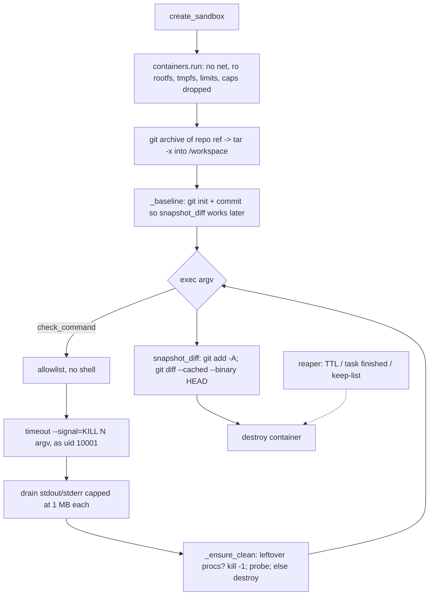

# 12 - Sandbox and Execution Safety (tag: SBX)

## What this file covers

AEOS lets an LLM write code and run it. This file explains how that is made safe: what a Docker container actually is (Linux namespaces, cgroups, capabilities), exactly which isolation flags `SandboxManager.create_sandbox` sets, how commands are constrained (`policy.py`), how runaway processes are killed and orphaned containers reaped, how the one network-needing capability (npm) is carved out into a separate container, and which abuse tests prove each claim. Everything below is tied to `src/aeos/sandbox/*`, `src/aeos/agents/sandbox_tools.py` and `tests/sandbox/*`. For what happens to the patch afterwards see [13-verification-and-risk-policy.md](13-verification-and-risk-policy.md); for the wider threat model see [14-security-and-prompt-injection.md](14-security-and-prompt-injection.md); for deployment of the Docker socket see [21-deployment-and-infrastructure.md](21-deployment-and-infrastructure.md).

Labels used: **Verified** (read in code/tests), **Inferred rationale**, **Potential failure scenario**, **Recommendation**.

---

## 1. Why a sandbox at all

The coding agent (see [05-agents-and-orchestration.md](05-agents-and-orchestration.md)) edits a checkout and runs commands such as `grep`, `python`, `pytest`. A model can be wrong, or be steered by injected text. If those commands ran on the host, a bad command could read secrets, delete files or call out to the internet. The design principle stated in `policy.py` is: **the container is the security boundary; the command allowlist is defense in depth.** (Verified: module docstring of `src/aeos/sandbox/policy.py`.)

## 2. Docker isolation from first principles

A container is not a small VM. It is an ordinary Linux process (tree) on the host kernel that the kernel has been told to restrict. Four kernel features matter:

| Mechanism | What it restricts | Plain-language effect |
|---|---|---|
| **Namespaces** (pid, mnt, net, uts, ipc, user) | What the process can *see* | Own process table (pid 1 is the container's init), own filesystem view, own network stack. It cannot see host processes or host paths unless mounted in. |
| **cgroups** | How much it can *use* | Memory ceiling (OOM-kill beyond it), CPU quota, max number of processes (`pids.max`), so a fork bomb or memory hog is capped. |
| **Capabilities** | What root-ish powers it has | Linux splits "root" into ~40 capabilities (bind low ports, mount, change owner...). `cap_drop=ALL` removes all of them. |
| **no-new-privileges + seccomp** | Privilege escalation | A `setuid` binary can no longer gain powers; Docker's default seccomp profile blocks dangerous syscalls (AEOS uses Docker's default; it sets no custom profile - Verified, no `seccomp` option in `manager.py`). |

Important limit: all containers share the **host kernel**. A kernel exploit is a container escape. Stronger isolation (gVisor, Firecracker microVMs, rootless Docker/sysbox) trades performance and ops complexity for a smaller kernel attack surface. AEOS uses plain Docker and says so in `docs/DECISIONS.md` D-041 (suggests rootless Docker/sysbox for production).

### How AEOS configures its container (Verified: `SandboxManager.create_sandbox`)

| Flag in code | Effect | Test that proves it |
|---|---|---|
| `network_mode="none"` | Only a loopback interface exists. No DNS, no routes. | `test_abuse.py::test_network_egress_is_impossible` (DNS lookup, HTTP to 1.1.1.1, TCP to 8.8.8.8 all fail; `/proc/net/dev` lists only `lo`) |
| `read_only=True` | Root filesystem immutable | `test_cannot_write_outside_workspace` (/etc, /usr, /bin, /proc writes denied) |
| `tmpfs` at `/workspace` (rw, exec, nosuid, nodev, size 256m) and `/tmp` (noexec, nosuid, nodev, size 64m) | The only writable places, in RAM, size-capped, vanish on destroy. `/tmp` is `noexec` so dropped binaries cannot run from there. | `test_workspace_size_limit` (ENOSPC) |
| `mem_limit=512m`, `memswap_limit=512m` | Hard RAM ceiling; equal swap value means no swap | `test_memory_hog_is_killed_by_the_limit` |
| `nano_cpus=1e9` | 1 CPU | (config only) |
| `pids_limit=128` | Fork bomb ceiling | `test_fork_bomb_is_contained...` asserts `PidsLimit == 128` |
| `cap_drop=["ALL"]`, `no-new-privileges` | No capabilities, no escalation | `test_runs_unprivileged_with_no_capabilities` (uid 10001, `setuid(0)` fails, `CapEff` all zeros) |
| `init=True` | A tiny init (tini) as pid 1 reaps zombies | (config) |
| No `volumes`/binds | No host path visible | `test_container_is_hardened` asserts `Binds is None`; `test_host_paths_are_not_visible` |
| Labels `aeos.sandbox`, `aeos.task_id`, `aeos.created_at` | Let the reaper find containers | `test_reaper.py` |

Workspace content arrives as a tar stream (`git archive` of the target ref via `GitBackend`), not a bind mount. Because `put_archive` refuses read-only rootfs and `docker cp` cannot see tmpfs, `_extract` streams the tar into an in-container `tar -x` over exec stdin (DECISIONS D-017; Verified in `_extract`). Trade-off: more code, but the hardening is not weakened.

### Two users on purpose

`pid 1` (`sleep infinity`) runs as uid 10002 (`KEEPALIVE_UID`); commands run as uid 10001 (`SANDBOX_UID`). Inferred rationale, stated in code comment: "kill-all cleanup cannot stop it" - `os.kill(-1, 9)` as uid 10001 can kill only 10001's processes, so the container itself survives and the workspace (in tmpfs) is preserved. DECISIONS D-018 (and D-019 for the leftover-process check).

### Flowchart: lifecycle of one sandbox

How to read it: the left-to-right spine is the happy path; every `exec` loops through policy, a double timeout, output capping and a cleanup check. The dotted edge is the out-of-band safety net that removes anything the normal path leaked (a crashed worker).

## 3. Command policy (`policy.py`)

- Commands are **argv lists, never shell strings**. `exec` never passes through `sh -c`, so `;`, `|`, `$()` and redirects have no meaning. (Verified.)
- `check_command` rejects: empty/non-string argv, NUL bytes, any executable containing `/` (so `/bin/sh` or `./evil` cannot dodge the name check), names in `DENIED_COMMANDS` (sh, bash, curl, wget, nc, ssh, scp, pip, pip3, apt, apt-get, sudo, su, docker, mount, chroot) with an agent-friendly reason, and anything not in `ALLOWED_COMMANDS` (python, pytest, git, node, grep, find, sed, cp, mv, rm, cat, ... about 40 entries).
- For `git`, the **second token must be an allowed subcommand** (`init status diff log show apply add commit restore reset checkout rev-parse ls-files grep blame`). Options before the subcommand are rejected, which blocks `git -c core.sshCommand=... ` or `git -c alias.x=!sh`. `tests/sandbox/test_manager.py::test_policy_is_enforced_by_exec` checks `["git","-c","x=y","log"]`.
- Honest limit (Verified by reading): the allowlist includes `python` and `node`, which can run arbitrary code, so the allowlist is guidance, not containment. `python -c "import os; os.system('curl ...')"` is not blocked by policy; it is blocked because the container has no network and no capabilities. That is why the doc says the container is the boundary. `find -exec`, `sed -i`, `git apply` are similarly powerful inside the workspace but only inside the tmpfs.
- Internal calls such as `read_file` use `enforce_policy=False` (they run fixed argv like `cat -- <path>`), after `_safe_path` normalises the path and requires it to be under `/workspace/` or `/tmp/`.

### Resource limits (`Limits`, Verified)

memory 512m, cpus 1.0, pids 128, workspace 256 MB, tmp 64 MB, exec timeout 60 s, output cap 1,000,000 bytes per stream, max file 2,000,000 bytes, sandbox TTL 1800 s. The agent-facing tool (`sandbox_exec` in `sandbox_tools.py`) additionally clamps `timeout_s` to 120 and returns only the last 4000 stdout / 2000 stderr chars to the model.

## 4. Timeouts, kill-everything, cleanup

`SandboxManager.exec` wraps each command as `timeout --signal=KILL <limit> argv...` (in-container, hard kill), and ALSO waits on the output-draining thread for `limit + 5` seconds on the host side. If that outer wait fires, it runs `_kill_everything` (`python3 -c "import os; os.kill(-1, 9)"` as the sandbox user) and marks `timed_out=True`.

After every command, `_ensure_clean` checks `container.top()` for leftover processes (more than pid 1 + the keepalive sleep). If any exist it kills them, probes with a `true` exec, and if it still cannot get a clean state it **destroys the container** and returns `ExecResult.sandbox_destroyed=True`. Callers (like the verifier) therefore either get a clean sandbox or a clear signal.

Why double timeout? Inferred rationale: the in-container `timeout` handles well-behaved cases cheaply; the host-side wait handles the case where the process tree defeats `timeout` (e.g. a fork bomb whose parent exits so no timeout ever fires). DECISIONS records that a fork bomb's children outlived the command, which made cleanup unconditional with destroy as fallback.

Output capping: `drain()` stops buffering at `max_output` per stream and sets `truncated`. `test_output_flood_is_capped` prints 10 MB and asserts `len(stdout) <= 1_000_000`.

## 5. The reaper

Containers can be orphaned if the worker crashes mid-task (see [10-error-handling-and-reliability.md](10-error-handling-and-reliability.md)). Two mechanisms (Verified):

- `SandboxManager.reap(ttl_s, keep, active_tasks, grace_s)` removes labelled containers that are expired, not in a keep-set, or belong to a task no longer active (with a grace period so a freshly created sandbox is never raced).
- `reap_task(task_id)` removes everything for a finished task. CLI: `python -m aeos.sandbox.reaper --ttl 1800 [--interval 60]` (`reaper.py`).
- The npm container carries the same `aeos.sandbox` label, so the same reaper would catch it. **Correction (Verified, `src/aeos/worker.py` `Worker.housekeeping`):** a running worker calls `sandbox.reap(active_tasks, grace_s)` every `sweep_s` and `reap_task` on terminal status, so orphans are swept while any worker is alive (only containers on that worker's own Docker daemon). **Remaining gap:** the standalone TTL-based CLI `python -m aeos.sandbox.reaper` is not scheduled anywhere, and nothing sweeps when no worker is running (see Q-SBX-7).

Tests: `test_reaper.py` (orphan after simulated crash; respects `keep` and TTL). The `mgr` fixture in `tests/sandbox/conftest.py` calls `manager.reap(keep=set())` at session end and skips if Docker is unavailable.

## 6. Deterministic helpers (`helpers.py`)

`run_tests` runs `python -m pytest -q -p no:cacheprovider --junitxml=/tmp/junit.xml` and parses the XML into a `TestResult` (counts, failing test names, `timed_out`, `output_tail`). `passed` is `exit_code == 0 and not timed_out`. Parsing failures (collection crash) are tolerated and the exit code stands. `run_benchmark` runs `python benchmark.py --json` and parses the last stdout line. `compare_benchmarks` builds a fresh sandbox for baseline and candidate and computes the p95 ratio. These give the verifier numbers, not LLM opinions (see [13-verification-and-risk-policy.md](13-verification-and-risk-policy.md)).

## 7. npm: the one network-needing capability (`npm.py`)

Problem: upgrading a Node dependency needs the registry (to resolve versions and regenerate `package-lock.json`), but the coding sandbox has no network. Solution: a **separate, throw-away container** with exactly two fixed operations, `NpmRegistry.info(package)` (`npm view <pkg> name dist-tags versions --json`) and `NpmRegistry.update(files, package, version)` (`npm install --package-lock-only --ignore-scripts --no-audit --no-fund --save pkg@ver`).

Controls (Verified):
- No agent-controlled command line: only `validate_package` (regex for npm names, len <= 214) and `validate_version` (exact version or dist-tag regex) values are interpolated into a fixed argv.
- `--ignore-scripts`: no package lifecycle script (the classic npm supply-chain execution vector) runs. `--package-lock-only` does not even populate `node_modules`.
- Container: `user="node"`, `cap_drop=ALL`, `no-new-privileges`, 512m memory, pids 256, no mounts, destroyed in `finally`. Files go in by `put_archive`; only `package.json` and `package-lock.json` are read back.
- Note what differs from the coding sandbox: **it has network** (default bridge network; `network_mode` is not set in `_run`) and the rootfs is writable. Exposure is limited to registry lookups and the input being a validated package name; a malicious package cannot execute because scripts are off. Potential failure scenario: a typo-squatted package name that the agent chooses gets recorded in the lockfile (no code runs, but it would be in the PR); the approval screen and judge are the remaining defenses, there is no allowlist of packages (Verified: none).
- Agents reach it through `npm_registry_info` / `npm_update_dependency` tools in the "change" profile of `CodingWorkspace` (`sandbox_tools.py`), and the research agent gets only the read-only `registry_tools`. `npm_update_dependency` is listed in the `mutating` set. The lockfile is then checked by the verifier's `lockfile_issues` gate (see file 13).

## 8. The agent's tool surface (`sandbox_tools.py`)

`CodingWorkspace.tools()` exposes `sandbox_read_file`, `sandbox_write_file`, `sandbox_edit_file` (exact-once replace), `sandbox_exec`, `sandbox_apply_patch`, and in the "regression" profile `sandbox_run_tests`, `sandbox_run_benchmark`, `sandbox_compare_to_baseline`; the "change" profile swaps those for the two npm tools.

Key design points:
- All sandbox tools are declared `server="sandbox"`, `risk="read"`, even writes, because risk levels describe **external** side effects and the sandbox is ephemeral (DECISIONS: "Risk levels describe EXTERNAL side effects"; comment in `tools()`). Consequence for the policy: they hit the `read-only` allow rule and can never trigger the "untrusted-origin write" approval rule. `mutates=True` is a separate flag used by the agent loop's stagnation counting, not by policy.
- **The patch is taken by the harness**: `snapshot_patch()` calls `snapshot_diff` (git inside the sandbox). The model cannot claim a change it did not make (DECISIONS D-021).
- On retry/resume the sandbox is rebuilt from the base ref and the prior patch re-applied (`open(patch=...)`); mid-node sandbox state is deliberately not checkpointed.

## 9. Trade-offs and alternatives

| Choice | Alternative | Trade-off |
|---|---|---|
| Plain Docker + hardening flags | gVisor / Firecracker / sysbox | Docker is simple and fast; shared kernel is the residual risk. |
| Docker socket mounted into coding/api services (docker-compose.yml, D-041) | Dedicated sandbox host, rootless Docker, Docker-in-Docker | Mounting the socket means compromise of that service is root-equivalent on the host. Documented, not mitigated in code. |
| tmpfs workspace | Named volume / bind mount | Fast, auto-wiped, size-capped; large repos limited to 256 MB; lost if container dies. |
| Per-command `exec` into a long-lived container | One container per command | Keeps workspace state between commands; needs the cleanup logic above. |
| Allowlist includes python/node | Only a fixed tool set | Flexibility vs relying on the container for the real guarantee. |

Recommendation (not implemented): a custom seccomp profile, a read-only `.git`, and a per-package allowlist for `npm_update_dependency`.

---

# Interview questions

## Q-SBX-1. What is a container really, and why is it an acceptable boundary for running LLM-written code?
**Difficulty:** Intermediate  **Topic:** Linux isolation primitives
**Short answer:** A container is a normal host process restricted by kernel namespaces (what it sees), cgroups (what it can consume) and dropped capabilities (what powers it has). AEOS adds no network, a read-only root, tiny tmpfs workspaces and resource caps. It is a reasonable boundary for accidental or injected bad commands, but it shares the host kernel, so it is not as strong as a microVM.
**Detailed explanation:** Namespaces give each container its own pid table, mounts and network stack. cgroups enforce memory/cpu/pids. Capabilities split root; seccomp filters syscalls. None of this is a hypervisor, so a kernel bug can break out. Hardening reduces the attack surface and blast radius.
**How this project uses it:** `SandboxManager.create_sandbox` in `src/aeos/sandbox/manager.py` sets `network_mode="none"`, `read_only=True`, tmpfs mounts, `mem_limit/memswap_limit=512m`, `pids_limit=128`, `cap_drop=["ALL"]`, `no-new-privileges`, no binds. `tests/sandbox/test_manager.py::test_container_is_hardened` reads `HostConfig` back from Docker and asserts each.
**Example/walkthrough:** The agent runs `python -c "open('/etc/pwned','w')"`. The root filesystem is read-only so the write raises OSError; `test_cannot_write_outside_workspace` asserts denial for five system paths while `/workspace` works.
**Follow-ups:**
- *Why not just trust the command allowlist?* Because `python` and `node` are allowed and can do anything the process can; the allowlist cannot enumerate behaviour. The container, not the list, enforces no-network and no-write.
- *What would you use for hostile multi-tenant code?* gVisor (user-space kernel) or Firecracker microVMs, or sysbox/rootless Docker; they shrink the exposed kernel surface at the cost of speed and compatibility. AEOS itself does not do this (Verified).
- *Does Docker default seccomp apply?* Yes by default since AEOS sets no custom profile; it is not explicitly tested.
**Trade-offs and alternatives:** see section 9.
**Common interview mistake:** Saying "Docker is a lightweight VM" or claiming it is a perfect sandbox.
**Related:** [14-security-and-prompt-injection.md](14-security-and-prompt-injection.md), Q-SBX-6.

## Q-SBX-2. Walk through exactly how a hung or hostile command is stopped.
**Difficulty:** Advanced  **Topic:** Timeouts and cleanup
**Short answer:** Every command is wrapped in `timeout --signal=KILL N` inside the container, and the host also waits only `N+5` seconds. On timeout it SIGKILLs every process of the sandbox user, then verifies no stragglers remain; if it cannot restore a clean state it destroys the container and reports `sandbox_destroyed`.
**Detailed explanation:** Two layers handle two failure modes: a simple infinite loop (in-container timeout) and a process tree that escapes `timeout` (fork bomb, `setsid` daemon). Cleanup after *every* command catches background stragglers even when the command exited 0.
**How this project uses it:** `SandboxManager.exec`, `_kill_everything`, `_leftover_processes`, `_ensure_clean`. Pid 1 is uid 10002 so `os.kill(-1, 9)` as 10001 cannot kill it.
**Example/walkthrough:** `test_infinite_loop_is_killed_and_sandbox_survives` runs `while True: pass` with timeout 2, asserts `timed_out`, duration between 1.8 and 10 s, and that `hello.py` still runs afterwards. `test_background_straggler_is_killed_when_the_command_returns` spawns `sleep 300` with `start_new_session=True` and asserts no leftover processes (or the sandbox was destroyed).
**Follow-ups:**
- *Why two different uids?* So the kill-everything cleanup cannot stop the keepalive process and take the container (and its tmpfs workspace) down. DECISIONS D-018 records the rationale.
- *Why exit code 137 heuristics?* `timed_out = timed_out or (exit_code == 137 and duration >= limit*0.9)` - SIGKILL from `timeout` yields 137; the duration check avoids calling an OOM-kill a timeout.
- *What does the caller see on destroy?* `sandbox_destroyed=True`; subsequent calls raise `SandboxError("not_found")`.
**Trade-offs and alternatives:** Could use one container per command (simpler cleanup, loses workspace state and costs startup per call).
**Common interview mistake:** Forgetting that a process can outlive its parent, so only killing the direct child is insufficient.
**Related:** [10-error-handling-and-reliability.md](10-error-handling-and-reliability.md).

## Q-SBX-3. The sandbox has no network, yet AEOS upgrades npm dependencies. How?
**Difficulty:** Intermediate  **Topic:** Capability carve-out
**Short answer:** A separate throw-away container runs two fixed npm operations with validated inputs, `--ignore-scripts` and `--package-lock-only`. No agent-controlled argv reaches it, no package code runs, and only two manifest files are read back into the no-network sandbox.
**Detailed explanation:** Instead of weakening the coding sandbox with network, the one needed capability is isolated behind a narrow API. The risk moves from "arbitrary code with network" to "a validated package name resolves on the registry."
**How this project uses it:** `NpmRegistry` in `src/aeos/sandbox/npm.py`; tools `npm_registry_info` and `npm_update_dependency` in `CodingWorkspace.tools()` for `profile="change"`. `validate_package`/`validate_version` regexes gate the inputs. Verified afterwards by the `lockfile_consistent` gate.
**Example/walkthrough:** Agent calls `npm_update_dependency(package="express", version="4.19.2")`; code reads `package.json` + lockfile from the sandbox, runs the fixed argv in the npm container, returns changed files, writes them back with `write_file`.
**Follow-ups:**
- *Does the npm container have network?* Yes - it must; `_run` does not set `network_mode`. It also has a writable rootfs and runs as `node`. Inferred rationale: it holds no secrets and no mounts, and is destroyed after use.
- *What stops `express; rm -rf /`?* `_NAME_RE` rejects it before use, and argv is a list so there is no shell anyway.
- *What is still not covered?* No allowlist of package names (typo-squatting), no check that the chosen version is not malicious. Recommendation: allowlist or require approval for new packages.
**Trade-offs and alternatives:** vs a proxy registry/mirror with allowlist (stronger, more infra).
**Common interview mistake:** Claiming `--ignore-scripts` makes npm "safe"; it removes install-time execution, not malicious code that runs later when the project runs.
**Related:** Q-VER-4, [15-mcp-servers-and-tool-layer.md](15-mcp-servers-and-tool-layer.md).

## Q-SBX-4. Why do all sandbox tools declare `risk="read"` even though they write files and execute code?
**Difficulty:** Advanced  **Topic:** Risk model semantics
**Short answer:** Risk levels describe external side effects. The sandbox is ephemeral and isolated, so editing and executing in it changes nothing outside; only real GitHub writes are `write_*`. This keeps the "action driven by untrusted data" approval rule from firing on every coding step.
**Detailed explanation:** Policy rules key on declared risk. If sandbox writes were `write_reversible`, once the agent read any untrusted data (which is almost everything) each edit would need approval, making the coding agent unusable. The isolation is what justifies the classification.
**How this project uses it:** `td(...)` in `sandbox_tools.py` defaults `risk="read"`; `mutates` is a separate set; `policy/risk_policy.yaml` rule `read-only` allows `risk: read`. DECISIONS says this explicitly.
**Example/walkthrough:** Agent reads a web page (`consumed_untrusted=True`), then calls `sandbox_exec`. `CallContext.origin="untrusted_only"`, risk `read`, so rule `read-only` fires first and allows it.
**Follow-ups:**
- *What is the downside?* The policy provides no check on what runs in the sandbox; correctness relies entirely on the container and later on the verifier and approval.
- *What if a tool mislabels its risk?* For MCP tools the runtime uses the server-declared risk and treats unknown as `write_irreversible` (`tools.py`: `info.risk or "write_irreversible"`). Sandbox tools are in-process definitions, so mislabelling there would be a code bug.
**Trade-offs and alternatives:** a dedicated `sandbox_write` risk class with its own rule (more precise, more surface).
**Common interview mistake:** Treating "read" as meaning the tool does not modify anything.
**Related:** [13-verification-and-risk-policy.md](13-verification-and-risk-policy.md), Q-VER-5.

## Q-SBX-5. How do you move files in and out of a read-only, network-less container?
**Difficulty:** Advanced  **Topic:** Docker API details
**Short answer:** Files go in as a tar stream piped to an in-container `tar -x` over exec stdin (as the sandbox uid), and out via `cat` through exec. This avoids bind mounts, `put_archive` and `docker cp`, which do not work with a read-only rootfs or tmpfs.
**Detailed explanation:** tmpfs is not part of the image layers so `docker cp` cannot see it; `put_archive` refuses read-only roots. Rather than weaken the flags AEOS tunnels through exec.
**How this project uses it:** `_extract` (raw socket via `api.exec_start(socket=True)`, `sendall`, `shutdown(SHUT_WR)`), `read_file` (`cat -- <path>` with `max_output=cap+1` to detect oversize), `write_file`, `_safe_path`.
**Example/walkthrough:** `write_file(sid, "src/a/b.py", ...)` builds a tar with dir entries `src` and `src/a`, owned by uid 10001, extracts into `/workspace`.
**Follow-ups:**
- *How are `..` traversals stopped?* `_safe_path` uses `posixpath.normpath` and requires the result to start with `/workspace/` or `/tmp/`; test `test_file_api_rejects_paths_outside_workspace`.
- *What about patches that try to escape?* `git apply` refuses paths outside the repo; `test_apply_patch_rejects_bad_and_escaping_patches` feeds `a/../evil`.
- *What about a symlink inside the workspace to `/`?* It resolves inside the container; `test_symlink_in_workspace_cannot_reach_host` shows host users are not visible.
**Trade-offs and alternatives:** `raw._sock` is a private docker-py attribute (code has `noqa: SLF001`) - fragile on library upgrades.
**Common interview mistake:** Suggesting a bind mount of the repo; that exposes the host filesystem and defeats the isolation test.
**Related:** [16-a2a-and-github-integration.md](16-a2a-and-github-integration.md) for `GitBackend`.

## Q-SBX-6. What are the realistic residual risks of this sandbox, and which ones are documented versus mitigated?
**Difficulty:** Expert  **Topic:** Honest threat assessment
**Short answer:** Shared host kernel, the Docker socket mounted into the coding/api services, an npm container with network, and no seccomp customisation or package allowlist. The Docker socket risk is documented in D-041 but not mitigated in code.
**Detailed explanation:** The abuse tests show good containment of DoS and filesystem/network escape from inside the container. They cannot show absence of kernel vulnerabilities. A compromise of the service that holds `/var/run/docker.sock` can start privileged containers on the host.
**How this project uses it:** `docker-compose.yml` mounts `/var/run/docker.sock` for the app services (lines ~219, 271, 288); DECISIONS D-041.
**Example/walkthrough:** Potential failure scenario: a vulnerability in the coding service's HTTP surface lets an attacker call Docker; they run `docker run -v /:/host ...`. Not tested, not mitigated.
**Follow-ups:**
- *How would you reduce it?* Recommendation: rootless Docker or sysbox, a socket proxy that only allows container create/exec/remove with fixed flags, or a dedicated sandbox host.
- *Which tests would you add?* A test that the manager never passes `privileged`, `binds`, `network_mode != none` for coding sandboxes (partially covered by `test_container_is_hardened`).
**Trade-offs and alternatives:** see section 9.
**Common interview mistake:** Over-claiming ("the agent cannot escape") instead of stating assumptions.
**Related:** [21-deployment-and-infrastructure.md](21-deployment-and-infrastructure.md), [14-security-and-prompt-injection.md](14-security-and-prompt-injection.md).

## Q-SBX-7. How do orphaned sandboxes get cleaned up after a crash?
**Difficulty:** Intermediate  **Topic:** Resource lifecycle
**Short answer:** Every container is labelled with `aeos.sandbox`, `aeos.task_id` and a creation timestamp. `reap` removes ones that are older than a TTL, absent from a keep set, or belonging to inactive tasks; `reap_task` removes a finished task's; `python -m aeos.sandbox.reaper` can run once or on an interval.
**Detailed explanation:** The normal path uses a context manager (`SandboxManager.sandbox`) and `destroy` in `finally`; `create_sandbox` also destroys on setup failure. Crashes bypass `finally`, hence the label-driven reaper.
**How this project uses it:** `manager.py` `reap`, `reap_task`; `reaper.py`; `tests/sandbox/test_reaper.py` simulates a crash by creating a sandbox without cleaning it.
**Example/walkthrough:** Worker is `kill -9`ed during verification; sandbox remains; reaper with `--ttl 1800` removes it when its age exceeds 30 minutes.
**Follow-ups:**
- *Who runs the reaper in the stack?* Corrected: only the standalone CLI `aeos.sandbox.reaper` is unscheduled. `Worker.housekeeping` (`worker.py`) does call `sandbox.reap` every `sweep_s` (grace 120 s) and `run_once` calls `reap_task` on terminal status. Potential failure scenario: leaked containers persist when no worker is running, or while a stuck task is still `running`/`paused` (active tasks are protected). Recommendation: run the CLI as a compose service/timer as a backstop.
- *Race with new sandboxes?* `grace_s` protects freshly created containers from the `active_tasks` rule.
**Trade-offs and alternatives:** Docker `--rm` plus restart policies don't cover long-lived keepalive containers.
**Common interview mistake:** Relying on `finally` blocks alone.
**Related:** [07-state-durability-and-persistence.md](07-state-durability-and-persistence.md).

## Q-SBX-8. Which abuse tests exist, what does each prove, and what do they NOT prove?
**Difficulty:** Advanced  **Topic:** Test evidence
**Short answer:** `tests/sandbox/test_abuse.py` has 11 tests: infinite loop, fork bomb, background straggler, memory hog, disk fill, network egress, writes outside workspace, host path visibility, privilege/capabilities, output flood, symlink. They run hostile code inside the container and assert containment. They need Docker (skipped otherwise) and do not prove kernel-escape resistance.
**Detailed explanation:** The tests are behavioural: each asserts an observable effect (ENOSPC, `CapEff == 0`, interfaces == `['lo']`). They are real-container tests, not mocks.
**How this project uses it:** `pytestmark = pytest.mark.docker`; `mgr` fixture skips when `docker.from_env().ping()` fails; hostile code runs only inside the container "never on the host".
**Example/walkthrough:** `test_runs_unprivileged_with_no_capabilities` expects `["10001", "no-root", "0000000000000000"]`.
**Follow-ups:**
- *What is untested?* Custom seccomp, kernel exploits, docker socket abuse, npm container network egress, concurrent sandbox exhaustion of the host (limits are per-container only).
- *`test_no_network.py`?* It is only about the FakeLLM making no sockets; it is not a sandbox test.
**Trade-offs and alternatives:** Running these in CI needs Docker; see [22-testing-strategy.md](22-testing-strategy.md).
**Common interview mistake:** Citing `test_no_network.py` as evidence the sandbox has no network.
**Related:** [22-testing-strategy.md](22-testing-strategy.md).
