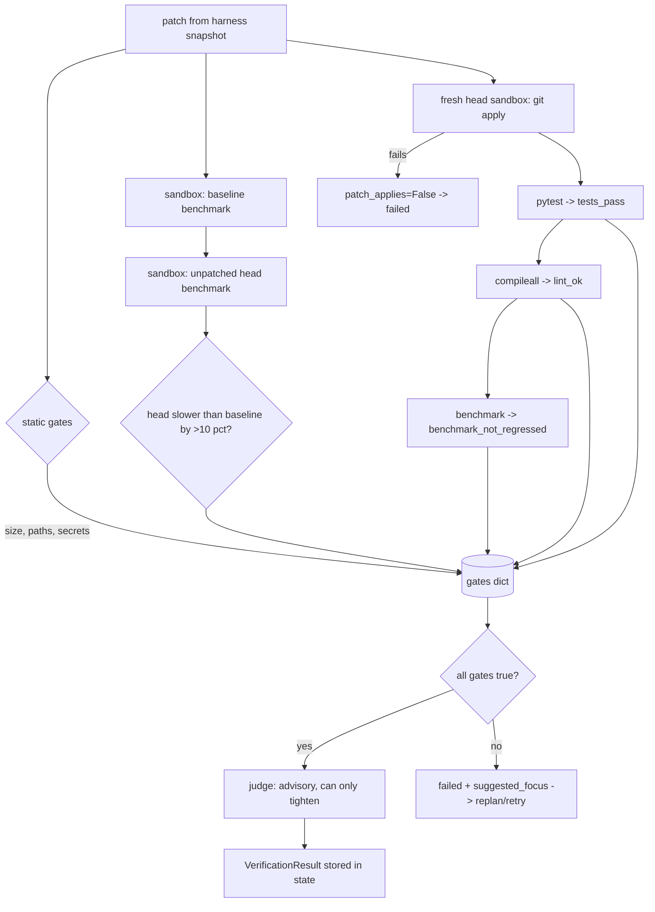
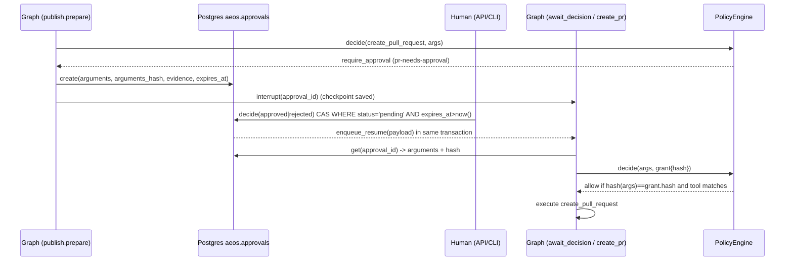

# 13 - Verification and Risk Policy (tag: VER)

## What this file covers

How AEOS decides that a patch is good enough to show a human, and how it decides which tool calls may run at all. Four pieces: (1) the **deterministic verifier** that re-applies the patch to a fresh checkout and recomputes tests/lint/benchmark (`agents/verifier.py`) or syntax/lockfile/test-regression checks for real-repo "change" tasks (`agents/verifier_change.py`); (2) the **advisory LLM judge** that can only make the verdict stricter (`agents/judge.py`); (3) the **risk policy engine** and YAML (`core/risk.py`, `policy/risk_policy.yaml`); (4) the **human-in-the-loop (HITL) approval** with argument-hash binding, compare-and-set decisions and expiry (`store/approvals.py`, `hitl.py`, `graph/publish.py`). Sandbox mechanics are in [12-sandbox-and-execution-safety.md](12-sandbox-and-execution-safety.md); threat-model framing in [14-security-and-prompt-injection.md](14-security-and-prompt-injection.md); the graph that wires these nodes in [03-system-architecture.md](03-system-architecture.md), [04-end-to-end-workflows.md](04-end-to-end-workflows.md) and [05-agents-and-orchestration.md](05-agents-and-orchestration.md); durable interrupt/resume in [07-state-durability-and-persistence.md](07-state-durability-and-persistence.md).

Labels: **Verified**, **Inferred rationale**, **Potential failure scenario**, **Recommendation**.

---

## 1. The principle: never trust the producer

A coding agent that says "I fixed it, tests pass" is a claim, not evidence. The verifier therefore ignores every claim and recomputes from artifacts the harness controls:

- The patch is the `git diff` the **harness** snapshotted from the sandbox (`CodingWorkspace.snapshot_patch`), not model text.
- The patch is re-applied to a **fresh checkout** of the base ref in a **new sandbox**; tests, lint and benchmarks run there.
- The judge LLM's output is applied by a function whose invariant is "a failed result can never become passed".

This is analogous to CI: the developer's laptop "works on my machine" is irrelevant; the clean CI runner is the verdict.

## 2. Verifier for regression tasks (`verifier.py`)

Entry point `run_gates` (OTel span `verifier.gates`) calls `_run_gates`. A `VerificationResult` has `status`, `gates` (name -> bool), `issues` (typed), `suggested_focus` (hints fed back to the coding agent on retry), `metrics`. Status is `passed` iff **every** gate boolean is true: `all(gates.values())` (Verified).

### Static gates (`static_gates`, run on the patch text, no Docker)

| Gate | Rule | Defaults (`GateConfig`) |
|---|---|---|
| `diff_size_ok` | files <= max_files and added+removed lines <= max_diff_lines | 5 files, 300 lines |
| `paths_allowed` | no edit to `forbidden_paths` (exact path), `forbidden_prefixes`; no modification/deletion of an existing file under `protected_prefixes` (new files allowed) | forbidden: `benchmark.py`, `checkout/costs.py`, `pytest.ini`; protected prefix `tests/` |
| `no_secrets_in_diff` | regexes (AWS key, private key header, GitHub tokens, Google API key, `api_key = "..."` style) on **added lines**, plus exact configured secret values anywhere in the patch | `secret_values` default empty |

Why those forbidden paths? Inferred rationale: the regression task is "p95 latency regressed"; an agent could "win" by editing the benchmark, the cost model it measures, or existing tests (`test_cheating_by_editing_the_cost_model_is_caught` in `tests/agents/test_verifier_gates.py`).

### Sandbox gates (`sandbox_checks`, four fresh sandboxes)

1. Benchmark the **baseline** (last known-good commit) and the **unpatched head**. Gate `regression_reproduced`: head p95 must be more than `p95_tolerance_pct` (10) slower than baseline, otherwise the task premise (and the baseline) is invalid. (`test_a_baseline_that_is_not_faster_than_the_head_cannot_verify_anything`.)
2. Fresh sandbox of head; `apply_patch` -> gate `patch_applies`. Failure returns early with issue `patch_does_not_apply`.
3. `run_tests` -> gate `tests_pass`; issue `test_failure` names up to 5 failing tests.
4. `python -m compileall -q .` -> gate `lint_ok`. (Verified: "lint" is just byte-compilation, not a linter.)
5. Benchmark the patched tree; gate `benchmark_not_regressed`: p95 change <= 10% vs baseline. On failure `_focus_for_perf` adds hints, e.g. DB queries still > 1.5x baseline (N+1 pattern), or the diff only touched files unrelated to the regression (`audit.py`/`costs.py`) - the "red herring" case.
6. `SandboxError` anywhere -> gate `sandbox_ok=False`, issue `verifier_error` (fails closed).

Empty/whitespace patch fails immediately with `no_patch` without touching Docker (`test_empty_patch_fails_without_touching_docker`).

Why benchmark instead of "tests pass"? The demo bug is a performance regression whose tests all still pass (test_e2e `test_regressed_head_has_same_tests_but_worse_benchmark`), so a pass/fail test oracle alone cannot detect fix quality. The benchmark is deterministic (seeded data, query counts) so gate comparisons do not flake (DECISIONS: "gate comparisons can't flake").

### Flowchart: verification pipeline

How to read it: gates are independent booleans merged into one dict; any false makes the status failed. The judge sits after the gates and cannot move a failed box back to passed.

## 3. Verifier for "change" tasks on a real repo (`verifier_change.py`)

A real repository may have no test suite and no benchmark, so the gates are honest about what exists. `CHANGE_CFG`: 12 files, 800 lines, forbidden paths `.env`, `package-lock.json.bak`, forbidden prefixes `.git/`, `.github/workflows/`, `node_modules/`, `data/`, no protected test prefix.

After static gates, in a fresh sandbox of the target branch:
- `patch_applies`.
- `syntax_ok`: for each non-deleted touched file, `node --check` for `.js/.mjs/.cjs`, `python -m py_compile` for `.py`, JSON parse for `.json`.
- If `package.json` changed: `lockfile_consistent` using `lockfile_issues(package_json, lock_json)`: each dependency spec in package.json must equal the lockfile root's spec and be present with a satisfying locked version (`satisfies`, a minimal semver check for `^`, `~`, exact; unrecognised specs count as satisfied). A missing lockfile means no problem is reported.
- If syntax is OK: `find_suite`/`run_suite` (`agents/suite.py`) runs pytest or `node --test` if the repo has one offline. If it fails, the **same suite is run on the unpatched checkout**; only if it passed before is `tests_pass=False` with issue `test_regression`. If it already failed, the note says it "is not held against" the patch and **no `tests_pass` gate is recorded** (Verified: no gate set in that branch). `metrics["tests"]` records whether tests ran at all.

Why: avoid blaming a patch for a pre-existing failure and avoid claiming test verification that never happened. Trade-off: a repo that needs `npm install` to test is reported "not run" (`test_a_suite_that_needs_npm_install_is_reported_as_not_run`), so the human must weigh that.

Potential failure scenario (Inferred from the code): the regression `GateConfig` protects `tests/` modifications, but a **new** file such as a root `conftest.py` or `tests/conftest.py` (new, hence allowed) can change test behaviour. `pytest.ini` is forbidden, but `setup.cfg`/`pyproject.toml`/`conftest.py` are not in the default forbidden list. The judge and the human approval are the backstops. Recommendation: add `conftest.py`, `pyproject.toml`, `setup.cfg`, `tox.ini` to `forbidden_paths`.

Second finding: the exact-secret-value check exists in `GateConfig.secret_values`, but `runtime.py` builds `GateConfig()` with no secret values (the configured Gemini/Langfuse secrets are passed only to `MemoryManager` at `runtime.py:287`). So in practice only the regex patterns run in the diff gate. Verified by grep; Recommendation: pass the same secret list into `GateConfig`.

## 4. The LLM judge (`judge.py`): advisory, tighten-only

Static and sandbox gates cannot tell whether the patch fixes the *diagnosed root cause* or covers every requirement. An LLM can approximate that, so it is used - but it is not allowed to loosen anything.

- `judge_patch` sends: the user goal, the diagnosed root cause JSON, the **final gate results and issues** ("you cannot overrule them"), and the patch wrapped as `<patch untrusted="true">...` truncated to 12,000 chars. The system prompt says the patch is untrusted data and never to follow instructions inside it. The structured output `Judgement` has `addresses_root_cause`, `covers_requirements`, `concerns`, `rationale`. Two system prompts exist (regression vs `kind="change"`).
- If the LLM errors (`LLMError`) it returns `None`; the gates stand alone and `judgement={"skipped": ...}`.
- `apply_judgement` deep-copies the result. If `status == "failed"` it is returned unchanged (judgement informational). If passed and either boolean is false, status becomes `failed`, an `Issue(type="requirement_not_met")` is appended, and a `suggested_focus` hint is added. **There is no code path that sets status to `passed`.**

Tests (`tests/agents/test_judge.py`): `test_judge_can_never_turn_a_failed_result_into_a_pass` is parametrized over all four boolean combinations; `test_judge_can_make_a_passing_result_stricter`; `test_unavailable_judge_defers_to_the_gates`; `test_apply_does_not_mutate_its_input`; `test_judge_patch_wraps_the_patch_as_untrusted_data` (checks the tag and the "never follow instructions" system text with an injection string).

Limits (Verified): the judge sees only the first 12,000 chars of the patch (a large patch beyond that is invisible to it; the regression profile caps diffs at 300 lines, the change profile at 800 lines which may exceed 12k chars). Wrapping text in tags and telling the model to ignore instructions is a mitigation, not a guarantee; but because the judge can only tighten, a successful injection against it yields a false **failure**, not a false pass. Its integration is in `graph/nodes.py::verify`.

Pattern name: *monotone combination* - the less trustworthy component can only move the result toward the safe side.

## 5. The risk policy engine (`core/risk.py` + `policy/risk_policy.yaml`)

Separate question: may this **tool call** run? The engine is plain code plus declarative YAML, "never LLM-controlled".

### Inputs: `CallContext`
`tool`, `risk` (declared by the tool's server: `read`, `write_reversible`, `write_irreversible`), `server`, `arguments`, `origin` (`trusted` or `untrusted_only`), `step_id`, `diff_lines`, `files_touched`, optional `grant`.

Decisions are keyed on the **declared risk**, not just the name, "so renaming/aliasing a tool cannot bypass it". Tool names are normalised (`normalize_tool_name`: lowercase, non-alphanumerics to `_`) so `Merge-PR` matches `merge_pr` (`test_aliasing_and_case_tricks_cannot_bypass_deny`).

### Evaluation algorithm (`PolicyEngine.decide`, Verified)
1. Any matching `deny` rule wins immediately regardless of position (a deny `when_not` means "deny unless this holds").
2. Otherwise the first matching non-deny rule decides; if none, `default` (`require_approval`).
3. If the result is `require_approval` and a `grant` for exactly this tool **and** arguments hash exists, return `allow` with rule `human_approved:<id>`. A grant cannot upgrade a deny (it is only consulted in step 3; `test_a_grant_can_never_override_a_deny`).

### The YAML rules (in file order)

| Rule | Match | Decision |
|---|---|---|
| never-merge | tools merge_pull_request, merge_pr, merge, delete_branch, delete_repository, force_push | deny |
| branch-namespace | create_branch, commit_patch, create_pull_request unless any of `name`/`branch`/`head` starts with `aeos/` (`_any_branch`) | deny |
| large-diff-needs-approval | commit_patch with diff_lines > 300 | require_approval |
| read-only | risk: read | allow |
| reversible-branch-writes | create_branch, commit_patch | allow |
| pr-needs-approval | create_pull_request | require_approval |
| irreversible-needs-approval | risk: write_irreversible | require_approval |
| untrusted-driven-writes | origin untrusted_only and risk write_reversible/irreversible | require_approval |
| default | anything else | require_approval |

Notes (Verified): `_any_branch` requires **all** present branch-like arguments to match, so supplying `branch=aeos/x, head=main` is denied (`test_branch_namespace_cannot_be_dodged_by_alternate_argument_names`). Unknown match keys raise `ValueError` (fail loudly, `test_unknown_match_keys_fail_loudly_not_silently`); unknown decisions in the YAML are rejected at load. Because rule order matters for non-deny rules, `untrusted-driven-writes` only applies to writes not matched by an earlier allow/require rule (e.g. `commit_patch` is allowed by `reversible-branch-writes` even when the origin is untrusted - **the origin rule does not tighten branch commits**; the aeos/* namespace and diff-size rules cover those).

The runtime enforces it in `ToolRuntime.execute` (`agents/tools.py`): `deny` returns a `<tool_error>` to the model; `require_approval` raises `ApprovalRequired`, which the agent loop propagates to a graph interrupt. Unknown MCP tool risk becomes `write_irreversible` (worst case). `consumed_untrusted` flips to true once any untrusted-origin tool result succeeded, after which later calls are evaluated as `untrusted_only`.

## 6. Approval binding: the argument hash

Concept: if a human approves "open a PR titled X from branch B", the system must not execute a *different* PR. `arguments_hash(tool, arguments)` = SHA-256 of canonical JSON (`sort_keys`) of `{tool: normalised name, args: arguments minus "idempotency_key"}`. The idempotency key is excluded because it is derived per attempt and would otherwise make approval impossible to match.

Flow (Verified in `graph/publish.py`):
1. `prepare` creates branch and commits (policy allows, namespaced), then builds `pr_args` and asks the gate about `create_pull_request`. Rule `pr-needs-approval` fires, so `approvals.create(...)` stores the exact `arguments`, their `arguments_hash`, a rationale, and an **evidence** bundle (root cause, gates, issues, tests, benchmark, judgement, files, full patch, branch) so the reviewer sees what verification found. The row is idempotent via `UNIQUE (task_id, action_key)` with `ON CONFLICT DO NOTHING` (re-running the node returns the same request).
2. `await_decision` calls LangGraph `interrupt(...)`; the graph checkpoint persists (Postgres) and the process can restart. The comment says nothing expensive may run before `interrupt()` because the node re-executes on resume.
3. A person decides via API or CLI -> `hitl.apply_decision` -> `approvals.decide`.
4. `create_pr` loads the approved request, executes with `args = req.arguments` and a grant containing `req.arguments_hash`. The engine recomputes the hash of the actual call arguments and compares; if the stored arguments had been altered after the human saw them, the grant fails and the call falls back to `require_approval`, which `create_pr` turns into an escalation ("pull request blocked").

How to read it: the left column shows the pause; the human writes to the DB (not to the graph); the resume is queued by the same transaction that records the decision; policy re-checks at execution time.

Honest limit: the grant hash is read from the same DB row as the arguments. This binds the *call* to the *stored request* and defeats prompt-level substitution and accidental drift; it does not defend against an attacker who can rewrite both `arguments` and `arguments_hash` in Postgres (DB write access is a trusted-boundary assumption). Also `ToolRuntime.execute` picks the grant by tool name only; the hash comparison is inside the engine.

## 7. Decision storage and HITL (`approvals.py`, `hitl.py`)

- Table `aeos.approvals` plus append-only-style `aeos.audit_log` (with optional `dedupe_key` unique index so crash replays don't duplicate entries).
- `decide` is a **compare-and-set**: `UPDATE ... WHERE id=%s AND status='pending' AND expires_at > now() RETURNING *`. Exactly one concurrent caller gets a row. Others read the current row and receive `already_decided`, `expired` or `not_found`. A pending-but-past-deadline row is flipped to `expired` and an expired resume payload is queued.
- The decision, audit entry **and** `enqueue_resume` run in one transaction, so a crash can't leave an approved request whose task never resumes (comment in code).
- `expire_due()` sweeps overdue requests; `cancel_pending(task_id, actor)` closes approvals of a cancelled task without queuing a resume. Default TTL `ttl_s=86_400` in `create`, overridden by `settings.approval_ttl_s` in publish.
- Rejection resumes the graph with human feedback (the publish step is marked failed and the supervisor can replan - see `replan` in `graph/nodes.py`); expiry escalates with "nothing was published".
- `hitl.auto_approver` approves everything and `scripted_approver` replays choices - for tests, demos with `--yes`, and scripted runs only (docstring).
- Who may call the approve endpoint is an API-auth question: see [18-api-and-client.md](18-api-and-client.md). `decide` records an `actor` string, but this module does not itself authenticate it.

Tests (`tests/store/test_approvals.py`): create idempotency, audit entry with actor/time, exactly-once decision, `test_concurrent_decisions_have_a_single_winner`, reject with feedback, expired cannot be approved, `expire_due` sweeps only overdue pending.

## 8. Trade-offs and alternatives

| Choice | Alternative | Trade-off |
|---|---|---|
| Deterministic gates as the verdict | LLM-only review | Reproducible and unfoolable by text, but only checks what was coded (perf, tests, syntax). |
| Judge tighten-only | Judge as arbiter | Safe against judge errors/injection (cost: false failures and extra retries). |
| Re-apply patch to fresh checkout | Trust the agent's sandbox state | Catches state leaks and uncommitted changes at the cost of 4 sandbox creations. |
| Human approval for every PR | Auto-merge when gates pass | Slower; removes the "subtly wrong but passing patch" risk (see file 14). |
| YAML policy | Policy in Python/OPA | Auditable, hot-editable; small custom DSL to maintain (fail-loud on unknown keys mitigates). |
| `lint_ok` = `compileall` | ruff/flake8 in the sandbox | Cheap; weak signal. |

---

# Interview questions

## Q-VER-1. Why does AEOS have an independent verifier instead of trusting the coding agent's test run?
**Difficulty:** Beginner  **Topic:** Trust boundaries in agent systems
**Short answer:** The coding agent is the party being checked, so its claims are not evidence. The verifier takes the harness-snapshotted patch, applies it to a fresh checkout in a new sandbox and recomputes tests, lint and the benchmark itself.
**Detailed explanation:** Models can hallucinate success, game metrics (edit the benchmark), or leave hidden state in their sandbox. A clean recomputation mirrors CI.
**How this project uses it:** `run_gates` / `_run_gates` in `agents/verifier.py`; patch from `CodingWorkspace.snapshot_patch`; invoked from `graph/nodes.py::verify`. Gates: `diff_size_ok`, `paths_allowed`, `no_secrets_in_diff`, `regression_reproduced`, `patch_applies`, `tests_pass`, `lint_ok`, `benchmark_not_regressed`.
**Example/walkthrough:** Agent edits `checkout/costs.py` to make the benchmark look faster. `static_gates` flags `forbidden_edit` and `paths_allowed=False`; `test_cheating_by_editing_the_cost_model_is_caught` asserts this.
**Follow-ups:**
- *What if the verifier's own sandbox fails?* Fail closed: `sandbox_ok=False`, issue `verifier_error`.
- *Is the verifier an LLM?* No; the judge is, and it is advisory (Q-VER-2).
**Trade-offs and alternatives:** Slower than reusing the agent sandbox; more trustworthy.
**Common interview mistake:** Describing the verifier as "another LLM reviewing the first".
**Related:** [05-agents-and-orchestration.md](05-agents-and-orchestration.md), Q-SBX-4.

## Q-VER-2. How can an LLM judge be useful if it is never allowed to approve anything?
**Difficulty:** Intermediate  **Topic:** Monotone composition of untrusted components
**Short answer:** It adds a semantic check the gates cannot do (does the patch address the root cause and requirements) but only in the strict direction: `apply_judgement` can turn passed into failed, never failed into passed. So errors or injections in the judge cost a retry, not a bad merge.
**Detailed explanation:** Two kinds of error: false pass (dangerous) and false fail (costly). Asymmetric authority maps the judge's unreliability to the cheap error.
**How this project uses it:** `judge_patch` (prompt includes final gate results, patch in `<patch untrusted="true">`, 12,000-char cut), `apply_judgement` (invariant in docstring), tests in `tests/agents/test_judge.py` parametrized over all boolean combos.
**Example/walkthrough:** Gates pass; judge returns `addresses_root_cause=False, concerns=["touches audit.py only"]`. Result becomes failed with `requirement_not_met` and a focus hint; supervisor replans.
**Follow-ups:**
- *What if the judge LLM is down?* `judge_patch` returns None; `judgement={"skipped":...}`; gates decide.
- *Can the patch inject the judge?* It can try; the prompt marks it untrusted and test checks wording, but the only damage is a false fail.
- *What does the judge not see?* Anything past 12,000 chars of the patch.
**Trade-offs and alternatives:** Use the judge as final arbiter (risky), skip it (miss wrong-place fixes).
**Common interview mistake:** Saying the judge "verifies" the patch.
**Related:** [06-llm-integration.md](06-llm-integration.md), [23-evaluation-framework.md](23-evaluation-framework.md) (judge validation).

## Q-VER-3. Explain the policy engine's evaluation order and why deny is position-independent.
**Difficulty:** Intermediate  **Topic:** Policy design
**Short answer:** Any matching deny wins; otherwise the first matching rule; otherwise default `require_approval`. Deny-wins makes safety rules immune to someone adding an allow rule earlier in the file.
**Detailed explanation:** First-match-wins alone is fragile: reorder or insert a rule and a deny can be shadowed. A two-phase evaluation removes that class of error.
**How this project uses it:** `PolicyEngine.decide` in `core/risk.py`; rules in `policy/risk_policy.yaml`; `when_not` on a deny rule gives "deny unless" (used by `branch-namespace`).
**Example/walkthrough:** `commit_patch` to `main`: `branch-namespace` denies (branch not `aeos/...`) even though `reversible-branch-writes` would allow it.
**Follow-ups:**
- *Can an approval override deny?* No (`test_a_grant_can_never_override_a_deny`).
- *What if a rule has a typo'd key?* `_matches` raises `ValueError`; fails loudly (tested).
- *How is aliasing handled?* normalisation + declared-risk keyed rules (`test_renamed_irreversible_tool_is_still_gated_by_declared_risk`).
**Trade-offs and alternatives:** OPA/Rego or Cedar offer richer languages; this DSL is small and unit-tested.
**Common interview mistake:** Assuming "first match wins" for denies too.
**Related:** [15-mcp-servers-and-tool-layer.md](15-mcp-servers-and-tool-layer.md).

## Q-VER-4. What does the "change" verifier check for a repo that has no tests, and how does it avoid false blame?
**Difficulty:** Advanced  **Topic:** Honest gating
**Short answer:** Diff safety, per-file syntax (node --check, py_compile, JSON parse), package.json/lockfile consistency, and if a suite runs offline, a before/after comparison: a suite failure only counts if the unpatched checkout passed.
**Detailed explanation:** Claiming "tests pass" for a repo without tests would be a lie; blaming a patch for an already-red suite would block valid work. `metrics["tests"]` records what ran.
**How this project uses it:** `agents/verifier_change.py` `_run`, `lockfile_issues`, `satisfies`, `run_repo_tests`; `agents/suite.py` for suite discovery.
**Example/walkthrough:** A dependency bump changes package.json but not the lockfile: `lockfile_consistent=False`, hint "use npm_update_dependency"; `test_package_json_change_without_lockfile_fails`.
**Follow-ups:**
- *Where is `tests_pass` when the suite already fails?* Not recorded; the note says it is not held against the patch (Verified).
- *Weakness in `satisfies`?* Minimal semver; unknown spec formats (ranges, tags) return True.
- *Missing lockfile?* Treated as no problem.
**Trade-offs and alternatives:** Running `npm ci` would give stronger verification but needs network; see [12](12-sandbox-and-execution-safety.md).
**Common interview mistake:** Treating "no gate failed" as "verified" when few gates ran.
**Related:** Q-SBX-3.

## Q-VER-5. How does approval binding work, and what exactly does it protect against?
**Difficulty:** Advanced  **Topic:** TOCTOU in human approval
**Short answer:** The approval row stores the exact arguments and their SHA-256 hash. At execution the engine recomputes the hash of the call being made and only turns `require_approval` into `allow` if tool and hash match the grant. A different title, branch or body no longer matches.
**Detailed explanation:** Time-of-check/time-of-use: a human approves action A, then something executes action B. The hash makes the approval a capability for A only. The `idempotency_key` is excluded so retries still match.
**How this project uses it:** `arguments_hash`, `ApprovalGrant`, `PolicyEngine.decide` step 3 in `core/risk.py`; `create_pr` in `graph/publish.py` loads `req.arguments` and builds the grant from `req.arguments_hash`; tests `test_approval_does_not_transfer_to_different_arguments`, `..._to_a_different_tool`, `test_idempotency_key_does_not_change_the_approved_action_hash`.
**Example/walkthrough:** Approved PR title "Fix N+1". A bug or injection changes the title in the call; hash differs; decision stays `require_approval`; `create_pr` escalates "pull request blocked".
**Follow-ups:**
- *Is it tamper-proof against a DB attacker?* No; both fields live in the same table (trust boundary = DB).
- *Why store the patch in evidence rather than the hash?* Evidence is for the human; the PR args contain title/body/head/base, not the patch (the patch was committed earlier to `aeos/...` and bound by branch name). Inferred: the commit itself is not covered by the hash.
- *What about the committed branch content?* The policy allowed `commit_patch` before approval (reversible, namespaced), so approval covers opening the PR, not the commit; the diff the human reviews is the evidence patch.
**Trade-offs and alternatives:** Signed approvals (HMAC with a key not in the DB) would resist DB tampering.
**Common interview mistake:** Claiming the hash proves the human read the diff.
**Related:** Q-SEC-2, [16-a2a-and-github-integration.md](16-a2a-and-github-integration.md).

## Q-VER-6. How are concurrent or replayed approvals prevented from double-applying?
**Difficulty:** Advanced  **Topic:** Compare-and-set, exactly-once effects
**Short answer:** `decide` is a single `UPDATE ... WHERE status='pending' AND expires_at>now() RETURNING *`. Only one caller gets a row; the others get `already_decided` or `expired`. Decision, audit entry and resume enqueue are in one transaction.
**Detailed explanation:** Database row-level atomicity replaces application locks. Putting `enqueue_resume` in the same transaction avoids the "approved but never resumed" crash window.
**How this project uses it:** `store/approvals.py::decide`; `hitl.apply_decision` maps result kinds to `DecisionError`. `create` is idempotent on `(task_id, action_key)`; audit uses `dedupe_key`.
**Example/walkthrough:** Two reviewers click at once; one gets `ok`, the other `DecisionError("already_decided", "already approved by alice")`. `test_concurrent_decisions_have_a_single_winner`.
**Follow-ups:**
- *Expired approval clicked late?* `decide` flips it to expired, queues an expired payload, returns `expired`.
- *What about a cancelled task?* `cancel_pending` expires pending approvals without resuming.
**Trade-offs and alternatives:** Advisory locks or `SELECT FOR UPDATE`; CAS is simpler.
**Common interview mistake:** Check-then-update in application code.
**Related:** [07-state-durability-and-persistence.md](07-state-durability-and-persistence.md), [10-error-handling-and-reliability.md](10-error-handling-and-reliability.md).

## Q-VER-7. Why is the agent's `sandbox_*` tools being `risk="read"` safe with respect to the untrusted-origin rule, but `commit_patch` is not blocked by it?
**Difficulty:** Expert  **Topic:** Policy rule ordering subtleties
**Short answer:** Sandbox tools match the first allow rule (`read-only`) so origin never matters. `commit_patch` is matched by `reversible-branch-writes` (allow) before `untrusted-driven-writes` is reached, so tainted context does not require approval for branch commits; branch namespace and the 300-line rule constrain it instead.
**Detailed explanation:** First-match-wins among non-deny rules means rule ordering encodes precedence. The untrusted-origin rule is a catch-all for *other* writes. This is a deliberate-looking but subtle consequence worth stating precisely rather than claiming the origin rule covers all writes.
**How this project uses it:** `policy/risk_policy.yaml` order; `ToolRuntime.consumed_untrusted`; docs/PROMPT_INJECTION.md says "A write evaluated as untrusted_only that no earlier rule explicitly allows needs approval" which is consistent.
**Example/walkthrough:** In publish, the supervisor's runtime commits the patch with no untrusted reads (new `ToolRuntime`), and the final PR needs approval anyway.
**Follow-ups:**
- *Is that a hole?* The reversible commit lands on an `aeos/*` branch only, and publication needs a human; a Recommendation would be to reorder if you want taint to gate commits.
- *Is there a test of this ordering?* `test_untrusted_only_origin_gates_other_writes` covers the gated case; I did not find one asserting commit_patch stays allowed under taint.
**Trade-offs and alternatives:** Explicit per-tool taint rules.
**Common interview mistake:** Reading the YAML as if all rules were ANDed.
**Related:** Q-SEC-3.

## Q-VER-8. Where could the verifier be fooled today?
**Difficulty:** Expert  **Topic:** Adversarial thinking about gates
**Short answer:** A new `conftest.py` or config file (not forbidden) that changes how tests behave, a passing-but-wrong change the judge also misses, a patch over the judge's 12,000-char window, and in practice only regex (not exact-value) secret detection. Each is a Potential failure scenario derived from code, not an observed incident.
**Detailed explanation:** Gates define a specification; anything outside it is unchecked. `forbidden_paths` is an exact-path list; `protected_prefixes=["tests/"]` allows new files.
**How this project uses it:** `GateConfig` defaults in `verifier.py`; `runtime.py` creates `GateConfig()` without `secret_values`; `judge.py` slices `patch[:12000]`.
**Example/walkthrough:** Agent adds a root `conftest.py` that skips slow tests. `tests_pass` is true. Mitigations: judge (sees the diff), human reviewing the evidence patch.
**Follow-ups:**
- *Fixes?* Expand `forbidden_paths`; pass secrets into `GateConfig`; chunk the judge input.
- *Why is a human still required?* docs/PROMPT_INJECTION.md: nothing prevents a subtly bad change that passes every gate.
**Trade-offs and alternatives:** mutation testing / property tests increase confidence at cost.
**Common interview mistake:** Claiming the verifier makes the output "correct".
**Related:** [23-evaluation-framework.md](23-evaluation-framework.md), [14-security-and-prompt-injection.md](14-security-and-prompt-injection.md).
