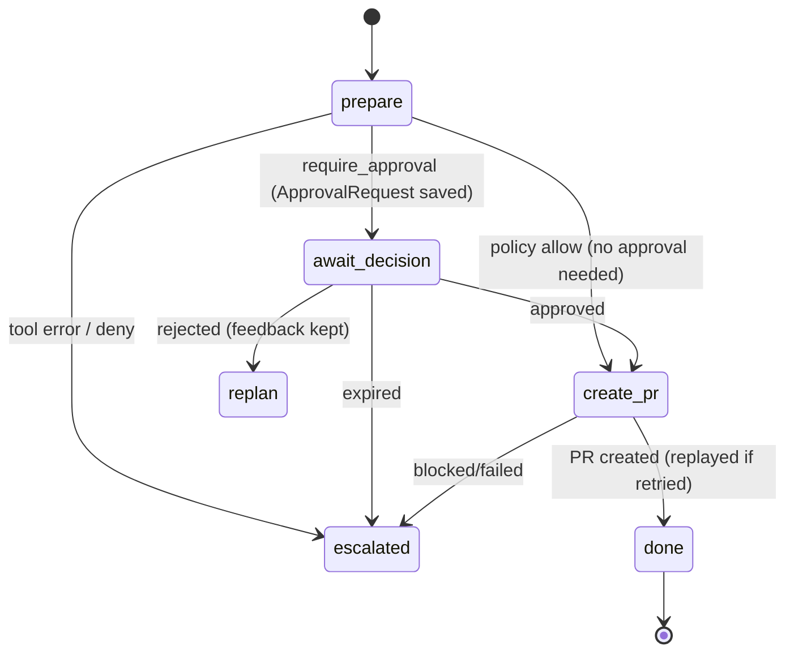

# 16 - A2A and GitHub Integration (tag: A2A)

## What this file covers

Three things that sit at the edge of the system. (1) **A2A** (Agent2Agent protocol): how AEOS can run each specialist (analytics, research, coding) as an independent network service and delegate to it, versus the default in-process mode. (2) **GitHub integration**: the local bare-repo backend, the `aeos/*` branch rule, `commit_patch`, the human-approved pull-request publish flow, idempotency at every layer, and token handling for the optional real-GitHub mirror and the "change" (real target repo) mode. (3) **`demo_target/`**: the seeded `checkout-service` with a planted regression, and its role as ground truth for tests and evals. For the MCP layer these build on see [15-mcp-servers-and-tool-layer.md](15-mcp-servers-and-tool-layer.md); for approval/risk see [13-verification-and-risk-policy.md](13-verification-and-risk-policy.md); for the graph see [04-end-to-end-workflows.md](04-end-to-end-workflows.md) and [05-agents-and-orchestration.md](05-agents-and-orchestration.md).

Labels: **Verified**, **Inferred rationale**, **Potential failure scenario**, **Recommendation**.

---

## Part A. A2A

### A.1 A2A vs MCP, from first principles

| | MCP | A2A |
|---|---|---|
| Connects | agent <-> tools/data | agent <-> agent |
| Peer is | passive function with a schema | autonomous agent with its own LLM loop, tools and state |
| Call shape | request -> result (usually fast) | **task** with a lifecycle (working, completed, failed, canceled, rejected) and streamed progress, possibly long |
| Discovery | `tools/list` after connecting | **Agent Card** at `/.well-known/agent-card.json` (name, skills, interfaces, security schemes) |
| Result | content / structuredContent | **artifacts** (here a JSON data part) |
| AEOS use | 4 servers, 23 tools | 3 optional specialist services |

Why delegate to an agent over A2A instead of just calling a function? The remote agent owns its own tools, credentials, sandbox and model budget, can be deployed, scaled, upgraded or replaced independently, and could even be implemented by someone else in another framework. The price is network failure modes (down, hung, slow, partially done) that an in-process call doesn't have.

### A.2 Specialist-as-service in AEOS

Verified in `src/aeos/a2a/`:

- `service.py`: `python -m aeos.a2a.service <owner> --port N` (also `aeos agent <owner>` in `cli.py`) runs ONE specialist. `serve()` calls `open_specialist(owner, settings)` (in `runtime.py`), which opens that specialist's own MCP connections (and for coding its sandbox access), builds an Agent Card via `build_card`, wraps it with `create_specialist_app`, and serves with uvicorn. `DESCRIPTIONS` defines one skill per owner (`investigate-regression`, `find-culprit-commit`, `implement-fix`). `--replay <scenario>` swaps in a scripted LLM so no model API is needed.
- `server.py`: `build_card(...)` builds the card (JSONRPC binding, protocol version "1.0", streaming capability, JSON in/out, a `bearer` HTTP security scheme). `SpecialistExecutor(AgentExecutor)` is the adapter: it receives a message, creates a task, reads the typed `SpecialistRequest` from a data part (`REQUEST_KEY = "request"`), reads `trace` and `budget` from message metadata, runs the wrapped specialist inside `remote_context(meta["trace"])` + `traced("a2a.serve ...")`, streams progress via `_ProgressSink`, and emits the `SpecialistResult` as an artifact named `result`, with usage deltas (`llm_calls, tool_calls, tokens, steps, cost_usd`) measured by comparing the budget before and after. `cancel()` cancels the running asyncio task. A specialist crash becomes `up.failed(...)`, a failed task, not a hang.
- `create_specialist_app(...)`: FastAPI app with agent-card routes (public by design) and JSON-RPC routes at `/a2a`, an HTTP middleware requiring `Authorization: Bearer <key>` on `/a2a` when `api_key` is set, and `/healthz`.
- `client.py`: `A2ASpecialist` implements the same `Specialist` protocol as the in-process classes, so the supervisor's graph does not know which one it has. `run()` loops over `endpoints` in failover order; `_delegate()` does discovery (`discover` verifies `card.name == f"aeos-{owner}"`), builds a streaming client, sends a message containing the request plus trace context and the **current budget**, consumes events (task / status_update / artifact_update), and on success adds the remote usage to the local `BudgetTracker`. Any failure (`A2AUnavailableError`, timeout, httpx/OS/LLM error) emits an `a2a_failover` event and tries the next endpoint; if all fail it returns `SpecialistResult(status="error")`, an ordinary step failure that enters the normal retry/escalation machine (decision D-040).
- Config (`core/config.py`): `a2a_mode` (`inprocess` default | `a2a`), `a2a_endpoints` (JSON owner -> comma-separated URLs, parsed by `parse_endpoints`), `a2a_api_key`, `a2a_timeout_s=900` (whole delegation), `a2a_stall_s=120` (read timeout: no event for this long = dead). In `a2a` mode the supervisor only opens the `github` MCP server (to publish); specialists own the rest (`runtime.py`: `names = ("github",) if a2a else (...)`).

```mermaid
sequenceDiagram
    participant S as Supervisor (A2ASpecialist)
    participant R as Research service :9102
    participant M as Research's MCP servers
    S->>R: GET /.well-known/agent-card.json
    R-->>S: AgentCard (name=aeos-research, skills, bearer scheme)
    S->>R: POST /a2a SendMessage (Bearer key; data part = SpecialistRequest; metadata = trace + budget)
    R-->>S: task created, status WORKING (streamed)
    R->>M: specialist.run -> MCP tool calls (github reads, web)
    R-->>S: status_update "progress text" (streamed)
    R-->>S: artifact_update name=result (SpecialistResult JSON)
    R-->>S: status COMPLETED
    S->>S: add remote usage to local budget; return result
    Note over S,R: on timeout/stall/connection error: best-effort CancelTask, then try next endpoint
```

How to read it: the supervisor treats the remote agent like a function returning a typed result, but the protocol carries lifecycle (task states), progress (status text, for humans/dashboards only), the structured outcome (artifact), and cross-process observability (trace id) and cost accounting (budget in, usage out).

### A.3 Design decisions and honest limits

- Typed artifact for the result; free-text status only for humans (D-039). Prevents parsing prose to drive control flow.
- Trust: Bearer auth is checked with `!=` string comparison (not constant-time) in `require_bearer`; the card advertises the scheme but the Agent Card endpoint is intentionally public. There is a single shared key for all services, no per-caller identity, no TLS in the code (transport security is a deployment concern; see [21-deployment-and-infrastructure.md](21-deployment-and-infrastructure.md)). Recommendation: `hmac.compare_digest`, TLS termination, per-service keys.
- State: `InMemoryTaskStore`; a service restart loses in-flight tasks. The supervisor treats that as a failure and retries; durable state lives in the supervisor's Postgres checkpoints, not in A2A services.
- The inbound request from the supervisor is trusted by the service (it validates shape with Pydantic, `SpecialistRequest.model_validate`), but the remote specialist still applies its own risk gate to its tool calls because it is the same `Specialist` class built with a gate (`open_specialist`). I did not verify which policy file/gate configuration a service process loads beyond the default.
- Budget: the remote side starts from the supervisor's `Budget` snapshot sent in metadata; usage deltas are added back on success. On failure no usage is added (Potential failure scenario: spend on a failed remote attempt is not charged to the local budget).
- Default is in-process; A2A is an opt-in deployment mode, proven by tests, not by the main demo path.

### A.4 What the tests verify (`tests/a2a/test_a2a.py`, marked `docker`)

Agent cards discoverable and correct; wrong-agent endpoint rejected; a generic SDK client can call a specialist without AEOS's supervisor; calls without the bearer token fail; a full task across three separate specialist processes; killing the only research service mid-run escalates without hanging; a second instance takes over; unreachable service reported not hung; silent service treated as dead after the stall timeout; overall deadline cancels remote work; trace context and budget cross the process boundary.

---

## Part B. GitHub integration

### B.1 Two backends, one tool surface

Concept: agents should never hold GitHub credentials or talk to GitHub's API. AEOS interposes a **local bare git repository** (a repo without a working tree, what a server stores) as the agents' "remote", and mirrors to real GitHub only at the very end.

| | Local bare remote ("demo") | Real GitHub mirror ("remote") |
|---|---|---|
| Code | `mcp_servers/github/backend.py::GitBackend` | `mcp_servers/github/remote.py::GitHubRemote`, `aeos/target.py` |
| Used for | all reads, branch creation, commits | only `create_pull_request` after human approval |
| Data | `demo_target/build/remote/checkout-service.git` (default `git_remote_path`) or the target mirror | repo named by `AEOS_GITHUB_REPO` |
| Credential | none | `AEOS_GITHUB_TOKEN`, only inside the github MCP child process |
| Enabled by | always | `github_publish` + `github_repo` + `github_token` (off by default) |

Metadata (PR numbers, status, dedupe keys) lives in Postgres schema `vcs` (`store.py`): `pull_requests` with `UNIQUE (repo, idempotency_key)`, and `branch_creations` keyed by `(repo, idempotency_key)`.

### B.2 The branch namespace rule `aeos/*`

Enforced three times (Verified): (1) `validate_branch` in `backend.py` (regex `^aeos/...`, no `..`, no `.lock`, <=120 chars) called by `create_branch`, `commit_patch`, `create_pull_request` and `GitHubRemote.open_pr`, so even a direct MCP caller can't use other names; (2) policy rule `branch-namespace` denies `create_branch/commit_patch/create_pull_request` unless every branch-like argument (`name`, `branch`, `head`) matches `^aeos/`; (3) the remote layer only ever pushes `refs/heads/<aeos/...>` and never forced (`git push <url> src:refs/heads/dst`, no `+`). Also: no merge tool exists, and `GitHubRemote.validate_branch_name` refuses `main`/`master` as the demo base.

### B.3 `commit_patch`

Agents (the coding specialist) produce a unified diff in the sandbox; the **supervisor** commits it (`publish.py` `calls` list). `GitBackend.commit_patch`: validate branch/key; find a prior commit on that branch whose message contains the trailer `AEOS-Idempotency-Key: <key>` (`git log --grep -F`, last 50) and return it as a replay; else validate message and patch size (500 KB), clone the branch into a temp dir (`--single-branch`), `git apply --index`, commit as `AEOS Agent <aeos-agent@localhost>` with the trailer, and `git push origin HEAD:refs/heads/<branch>`. All git calls use a scrubbed env (`GIT_CONFIG_GLOBAL=/dev/null`, `GIT_CONFIG_NOSYSTEM=1`, no prompts) and a 60s timeout. Idempotency is stored **in the git history itself**, so it survives loss of the database.

Limits: the replay lookup scans only the last 50 commits (fine for single-fix branches). A patch that doesn't apply returns `conflict`; the supervisor treats a failed tool record as escalation (`fail(...)` in `publish.prepare`).

### B.4 The PR publish flow (`src/aeos/graph/publish.py`)

Three LangGraph nodes, intentionally separate so resuming from a checkpoint never repeats earlier effects:

1. `prepare`: branch name `aeos/<task_id>-v<plan.version>`; run `create_branch` then `commit_patch` through `ToolRuntime` (so the risk gate and budget apply; keys injected deterministically); then ask the gate about `create_pull_request` with the final arguments. Outcome: `deny` -> escalate; `allow` -> proceed; `require_approval` (the normal case: rule `pr-needs-approval`) -> create an `ApprovalRequest` row (`approvals.create`, with evidence: root cause, gates, tests, benchmark, judgement, full patch, branch; TTL from settings) and set `status="awaiting_approval"`.
2. `await_decision`: calls LangGraph `interrupt()` first, with nothing expensive before it, because the node is re-entered on resume. The human's decision (`approved` / `rejected` / expired) is applied; emits an `approval.wait` span with real wall-clock bounds; rejected marks the publish step failed and records human feedback for replanning; expired escalates ("nothing was published").
3. `create_pr`: loads the approval, builds `ApprovalGrant(approval_id, tool, arguments_hash=req.arguments_hash)`, and executes `create_pull_request` through `ToolRuntime` so the policy engine, not the node, decides. The grant only turns `require_approval` into `allow` if the hash of (normalized tool name + arguments minus `idempotency_key`) equals the hash recorded when the human saw the request (`core/risk.py::PolicyEngine.decide`). Result is stored in `artifacts.pull_request`, an audit row `pr_created` is written with a replay-safe key, and a `pr_created` event is emitted.

PR content is generated by `pr_body` / `pr_body_change`: summary, root cause with commit and evidence, independent verification gates, p95/db-query before/after, or for change tasks the tests that ran (or an explicit note that none could be run), judge concerns, and a footer "Not merged; merging needs a human."



How to read it: the only edge that creates a visible external artifact is `create_pr`, and it is reachable only via an allow decision, which for the normal path means a human approved exactly these arguments. State names are node/outcome names from `publish.py`, simplified (replan is handled by the surrounding graph, see [04-end-to-end-workflows.md](04-end-to-end-workflows.md)).

### B.5 `create_pull_request` server-side and mirroring

`server.create_pull_request`: validate key and branch; if a row exists for the key, **replay** (retrying the GitHub mirror if the earlier attempt crashed before it); else validate title; require the head branch to exist, differ from base and have a non-empty diff; reject a second open PR for the same head/base with a different key (`conflict`); insert the row (atomic `ON CONFLICT DO NOTHING ... RETURNING`, falling back to select); then `_mirror`. `_mirror` calls `GitHubRemote.open_pr` only when publishing is configured and the row has no `remote_url` yet. `open_pr`: `validate_branch(head)`; resolve base (the repo default branch in real-target mode, or the demo branch `aeos-demo`); **`find_open_pr(head)`** (GitHub API list with `head=owner:branch`) and return it if present; `ensure_base` (demo mode: push the base branch once, fast-forward only; real mode: push nothing to the default branch); push the head branch; `POST /pulls`. The returned PR number/url are saved with `store.set_remote`. `_to_result` reports `remote_number or number` and URL `local://<repo>/pull/<n>` when there is no GitHub PR.

Idempotency layers (Verified): runtime-injected deterministic key -> unique DB row -> `find_open_pr` on GitHub -> `ON CONFLICT`. A crash after the local row but before the GitHub POST is healed by the retry; a crash after POST but before `set_remote` is healed because `find_open_pr` finds the PR.

### B.6 Token scope and secret handling

- Token is read once into `GitHubRemote._token` (from `SecretStr`), delivered to `git push` through `GIT_CONFIG_COUNT/KEY_0/VALUE_0=http.extraHeader` (Basic `x-access-token:<token>`), **not** in the URL or argv, with `HOME=/nonexistent` and no inherited env. API calls use a Bearer header. `_scrub` replaces the token with `***` in error text; `tests/mcp/test_github_remote.py::test_publish_failure_is_reported_without_leaking_the_token` checks it.
- It reaches only the github MCP child, passed explicitly by `_github_publish_env` because `stdio_server` strips env names matching KEY/TOKEN/SECRET/PASSWORD. Specialists and the LLM never see it.
- What scope does the token need? The code needs: read repo metadata, push branches, create pull requests. It does not itself restrict the token; whatever scope the operator gives is the limit (a classic PAT with `repo` could also delete branches, which the code never does). Recommendation: a fine-grained PAT limited to one repo with Contents: read/write and Pull requests: read/write, plus branch protection on the default branch. (Recommendation, not enforced by code.)
- `target.py` (`sync_mirror`) uses the token to fetch the default branch into a bare mirror (`+refs/heads/<default>:refs/heads/<default>`, forced) and never touches local `aeos/*` branches. In the test configuration `github_git_url` points to a local repo and `default_branch` returns `"main"`.

### B.7 "Change" mode vs the demo

`runtime._open_target`: if `target_ready` (repo and token set), sync the real repo's mirror, then start a second github MCP server on that mirror with `github_base_branch="@default"` and `github_publish=True`; `rt.target_tools` holds its tools, and `PublishNodes._gh(state)` picks `target_tools` for `state.kind == "change"` and the demo's tools otherwise. Agents still read only the mirror. Failure to reach GitHub at startup sets `rt.target_error` instead of crashing the API. The docs name `Shrihari-Nair/broadcast-server` as the live target used (DECISIONS D-009; the mirror directory name in the build tree also reflects it).

---

## Part C. `demo_target/`: the seeded service and ground truth

### C.1 What it is

A deterministic fixture that makes "find and fix a perf regression" gradeable. Components (Verified, files in `demo_target/`):

- `history.py`: ~20-commit history (source of truth), incl. benign decoys and the **planted bad commit** `refactor(catalog): simplify product lookup` (SHA `b166e05c...`) that turned a batched cache-aside lookup into one SELECT per product (N+1, bypassing the cache). `build_repo.py` builds a real git repo with fixed authors/dates so SHAs are reproducible (`test_rebuild_gives_identical_shas`).
- `templates.py`: six regression templates sharing the first 16 commits: `cache_disabled`, `serialization_quadratic`, `audit_every_request`, `missing_index`, `pricing_per_item_query`, `n_plus_one`. Each defines the bad commit, deploy list, reference fix files, acceptable fixes, how it shows in telemetry (`Profile`), and the `expected_tools`.
- `datagen.py` + `seed.py`: seeded random logs/metrics/spans/deployments into Postgres schema `demo`; `seed.py` also creates the read-only role `aeos_readonly` used by the database and observability servers. Latency uses a deterministic cost meter (counted work, not wall-clock), so benchmarks are reproducible and not flaky.
- Red herrings: `inventory_audit` slow scan (constant rate before and after the deploy, in `checkout/audit.py`) and an unrelated cache-timeout error burst ~6h before the deploy. A correct investigator must rule these out.
- `web_corpus/*.md`: four offline research documents served to the web MCP server.
- `GROUND_TRUTH.json` (original scenario) and `truth/<template>.json` (per template, generated by `truth.py`): root-cause commit/file/category, last-good SHA, deploy range, red herrings, acceptable fixes, benchmark baseline/regressed/reference-fix, pass rule `fixed p95_ms <= baseline p95_ms * 1.10`.
- `truth.py` computes truth by **measuring**: builds the template, benchmarks the last good and regressed head, applies the reference fix, and asserts: regression >= `min_p95_ratio`, unit tests pass at the regressed head (the regression is invisible to unit tests), and the fix restores baseline. Numbers are never typed in.

Measured values in `truth/n_plus_one.json`: baseline p95 4.52 ms and 520 DB queries; regressed p95 27.92 ms and 3770 queries; reference fix p95 4.52 ms. (These are cost-meter "ms", not wall-clock.) Note the older `GROUND_TRUTH.json` has `p95_ms_before_approx: 127` and `after_approx: 399`, which are *production-scale telemetry* values in the seeded Postgres data, a different scale from the benchmark's cost meter. They are not contradictory but are easy to mix up in an interview.

### C.2 Its role

- **Telemetry for analytics**: seeded Postgres data so the analytics specialist can find the step change, correlate with the deploy and rule out red herrings.
- **Repo for research/coding**: the bare remote served by the GitHub MCP.
- **Benchmark for verification**: the independent verifier runs `benchmark.py --json` on baseline vs candidate and checks the p95 rule (see [13-verification-and-risk-policy.md](13-verification-and-risk-policy.md)).
- **Ground truth for evals**: the eval harness compares the agent's root cause SHA/file and fix against the JSON (see [23-evaluation-framework.md](23-evaluation-framework.md)).
- Tests (`tests/demo_target/`): history/SHA reproducibility, service tests pass at head and at the bad commit, benchmark deterministic, bad commit regresses p95 >= 2.5x, correct fix restores baseline within 5%, red-herring-only fix does **not** pass the p95 gate, datagen reproducible by seed and shows the step change, per-product queries only after deploy, red herring rate unchanged, error burst exists, seed loading idempotent, ground-truth SHAs match the build.

Limitation (inferred): a synthetic, single-service fixture with planted bugs measures whether the system can find *these* bugs; it says little about generalization to arbitrary repositories. The "change" mode on a real repo exists partly to address this; its results are not covered by ground truth.

---

## Interview questions

## Q-A2A-1. What is the difference between MCP and A2A, and why does AEOS need both?
**Difficulty:** Beginner  **Topic:** Protocols
**Short answer:** MCP connects an agent to tools and data; A2A connects an agent to another agent. In AEOS, MCP servers give specialists database, git, logs and web access. A2A optionally lets the supervisor delegate a whole sub-task to a specialist running as a separate service with its own tools and model budget.
**Detailed explanation:** A tool call is a short deterministic request/response. An agent delegation is a long task with progress, cancellation, partial failure, and its own reasoning. A2A models that with tasks, states, streamed updates and artifacts, and uses Agent Cards for discovery.
**How this project uses it:** `A2ASpecialist` (client) and `SpecialistExecutor`/`create_specialist_app` (server) in `src/aeos/a2a/`; each service process opens its own MCP clients via `open_specialist`.
**Example/walkthrough:** Supervisor -> A2A -> research service -> MCP `get_blame` against the git server -> result artifact back.
**Follow-ups:**
- *Could MCP alone do delegation?* You could expose "run research" as one big MCP tool, but you'd lose task lifecycle, streaming progress, cancellation and discovery of skills. (Inferred.)
- *Is A2A required to run AEOS?* No; `a2a_mode` defaults to `inprocess`.
**Trade-offs and alternatives:** In-process: simplest/fastest. A2A: independent deploy/scale/fault isolation at the cost of network failure modes.
**Common interview mistake:** Treating A2A as "MCP for LLMs" or saying one replaces the other.
**Related:** Q-MCP-1 in [15-mcp-servers-and-tool-layer.md](15-mcp-servers-and-tool-layer.md), [03-system-architecture.md](03-system-architecture.md)

## Q-A2A-2. Walk through one A2A delegation, including what crosses the process boundary.
**Difficulty:** Intermediate  **Topic:** A2A flow
**Short answer:** The client fetches the Agent Card and checks the name, then sends a streaming message with a typed `SpecialistRequest` data part plus trace context and the current budget in metadata. The service runs the specialist, streams status text, and emits the typed `SpecialistResult` as an artifact followed by a COMPLETED status. The client adds the remote usage to its own budget.
**Detailed explanation:** Four kinds of data cross: the request (typed JSON), observability context (`inject_context()` -> `remote_context()` so spans form one trace), budget (so the remote respects remaining limits), and the result plus usage deltas.
**How this project uses it:** `A2ASpecialist._delegate`, `SpecialistExecutor.execute`, `_ProgressSink`, `data_part`, `REQUEST_KEY`.
**Example/walkthrough:** See the sequence diagram in Part A.2 of this file.
**Follow-ups:**
- *Why is the final result an artifact and not the last status message?* Status text is for humans; control flow must not parse prose (D-039).
- *How is cost accounted?* Server computes `after - before` of its `BudgetTracker`; client adds llm_calls, tool_calls, steps, tokens, cost_usd into the supervisor's budget only on COMPLETED.
- *What if the remote is half done and the client gives up?* `_best_effort_cancel` sends `CancelTask` (5s cap); the server cancels the asyncio task.
**Trade-offs and alternatives:** Passing the whole budget is simple; a lease/reservation model would be stricter.
**Common interview mistake:** Forgetting trace propagation; without it each service starts a separate trace.
**Related:** [20-observability-and-telemetry.md](20-observability-and-telemetry.md)

## Q-A2A-3. What happens when a specialist service dies or hangs mid-task?
**Difficulty:** Advanced  **Topic:** Failure handling
**Short answer:** Every failure mode becomes a normal step failure, never a hung run. Connection errors and failed tasks raise `A2AUnavailableError`; a silent service trips the 120s stall read-timeout; the whole delegation has a 900s deadline. The client tries the next endpoint, and if all fail returns `SpecialistResult(status="error")`, which flows into the usual retry-then-escalate policy.
**Detailed explanation:** Two distinct clocks: stall (no event for N seconds, catches a deadlocked server) and total deadline (catches a service that is alive but endlessly working). On deadline the client cancels the remote task.
**How this project uses it:** `httpx.Timeout(10.0, read=self.stall_s)`, `asyncio.wait_for(..., timeout=self.timeout_s)`, failover loop in `run()`, `a2a_failover` events. Tests: `test_killing_the_only_research_service_mid_run_escalates_without_hanging`, `test_a_second_research_instance_takes_over_when_the_first_dies`, `test_a_silent_service_is_treated_as_dead_after_the_stall_timeout`, `test_overall_deadline_cancels_the_remote_work`.
**Example/walkthrough:** Two research endpoints. First is killed mid-stream -> `httpx` read error -> `A2AUnavailableError` -> failover event -> second endpoint is delegated the same request (same `message_id`) and completes.
**Follow-ups:**
- *Is failover safe for side effects?* The specialists A2A-delegated are the read/analysis ones and the coding specialist works in a sandbox returning a patch; writes (commit, PR) stay with the supervisor, so re-running a specialist doesn't duplicate repo effects. (Inferred from the architecture; the coding service does run the model, so re-running costs money.)
- *Is spend from the failed attempt tracked?* Not added to the supervisor budget (usage only merged on success). Potential failure scenario for cost overruns.
- *What about the service's own state?* `InMemoryTaskStore`: restart loses it; the supervisor's checkpoint is the durable record.
**Trade-offs and alternatives:** Retry-in-protocol vs failover vs queue-based work distribution; AEOS picks the simplest synchronous option.
**Common interview mistake:** Only adding a timeout. A stall detector and a deadline are different failures.
**Related:** [10-error-handling-and-reliability.md](10-error-handling-and-reliability.md)

## Q-A2A-4. How is an A2A service authenticated, and is it secure enough?
**Difficulty:** Advanced  **Topic:** Service auth
**Short answer:** A shared bearer token, enforced by FastAPI middleware on the `/a2a` path; the Agent Card is public so clients can discover the scheme. It's adequate for a trusted network, not for hostile ones: single shared secret, non-constant-time compare, no TLS or per-caller identity in the code.
**Detailed explanation:** Discovery being public is the A2A norm (the card says how to authenticate). Authorization here is binary: has the key or not.
**How this project uses it:** `create_specialist_app.require_bearer`; the card's `security_schemes` and `security_requirements` in `build_card`; client sends `Authorization: Bearer` when `api_key` set. Tests: `test_service_rejects_calls_without_the_bearer_token`, card test asserts `"bearer" in securitySchemes`.
**Example/walkthrough:** `curl /a2a` with no header -> 401 "unauthorized".
**Follow-ups:**
- *Is `/healthz` protected?* No, it returns status and agent name only.
- *What if `a2a_api_key` is unset?* The middleware allows everything (`if api_key and ...`): auth is optional by default. A deployment mistake would silently run open services (Potential failure scenario; Recommendation: refuse to start without a key unless explicitly told).
- *Improvements?* `hmac.compare_digest`, mTLS or OAuth client credentials, per-service keys, rate limits.
**Trade-offs and alternatives:** Simplicity vs real identity; fine for a portfolio/local deployment, would need work for multi-tenant.
**Common interview mistake:** Calling it "secure" without naming the threat model.
**Related:** [14-security-and-prompt-injection.md](14-security-and-prompt-injection.md), [21-deployment-and-infrastructure.md](21-deployment-and-infrastructure.md)

## Q-A2A-5. Why do the agents write to a local bare git repo instead of GitHub directly?
**Difficulty:** Intermediate  **Topic:** GitHub design
**Short answer:** It keeps GitHub credentials and side effects out of the agent path. Agents read and commit to a local bare repo behind an MCP server with strict validation; only the final, human-approved `create_pull_request` pushes the `aeos/*` branch and opens a PR on real GitHub. Everything before that is cheap to throw away and testable offline.
**Detailed explanation:** The local repo is a staging area. A bad agent run leaves a local branch nobody sees. It also makes tests hermetic (a local "GitHub" URL replaces the network) and lets the demo run without any token.
**How this project uses it:** `GitBackend` (local), `GitHubRemote` (mirror), `store.py` (PR metadata); `target.sync_mirror` for real repos; `runtime._open_target`.
**Example/walkthrough:** `commit_patch` pushes `HEAD:refs/heads/aeos/...` to the *local* bare repo; at approval `open_pr` pushes that ref to GitHub and POSTs `/pulls`.
**Follow-ups:**
- *Does the real repo's default branch ever receive agent writes?* No code path pushes to it in real-target mode (`ensure_base` returns early when `use_default_base`).
- *In demo mode?* A dedicated `aeos-demo` branch is pushed fast-forward-only; `main`/`master` are refused by `validate_branch_name`.
**Trade-offs and alternatives:** An extra mirror to keep fresh (`sync_mirror` refreshes before tasks) vs. direct API use (stale-free but credential in the loop).
**Common interview mistake:** Saying "the agent pushes to GitHub". The supervisor's publish step does, after approval, via the MCP server.
**Related:** Q-A2A-6

## Q-A2A-6. Explain the human-approval publish flow and how an approval is bound to the exact action.
**Difficulty:** Expert  **Topic:** Human-in-the-loop, authorization
**Short answer:** `prepare` makes the branch and commit, then asks the policy about the PR; the normal outcome is `require_approval`, so it stores an approval request with the evidence and pauses via LangGraph `interrupt()`. After a human approves, `create_pr` builds a grant containing the hash of the tool name plus arguments recorded at request time; the policy only turns require_approval into allow if the hash of the actual call matches.
**Detailed explanation:** Binding to an arguments hash defeats time-of-check/time-of-use: if the stored arguments were altered after the human reviewed them, the hash differs and the call is blocked. The hash excludes `idempotency_key` so replay with a recomputed key still matches. Splitting into three nodes ensures resuming after the pause doesn't redo the branch/commit and that nothing expensive precedes `interrupt()`.
**How this project uses it:** `PublishNodes.prepare/await_decision/create_pr`, `approvals.create/get/audit`, `ApprovalGrant`, `arguments_hash`, `PolicyEngine.decide` step 3.
**Example/walkthrough:** PR title "fix: ..." body, head `aeos/<task>-v1`, base `main` -> hash H stored. Reviewer approves in the dashboard. `create_pr` loads `req.arguments` and `req.arguments_hash`; `decide` recomputes hash of the call, equals H -> `allow` with rule `human_approved:<id>`.
**Follow-ups:**
- *What if the human rejects?* Step marked failed, feedback appended to `human_feedback`, status back to running so the planner can revise.
- *What if nobody answers?* Approval has a TTL; expiry escalates with "nothing was published".
- *Where is the audit trail?* `approvals.audit` writes `pr_created` with a replay-safe key; approval events and spans are emitted. See [07-state-durability-and-persistence.md](07-state-durability-and-persistence.md).
- *Can the approval be used for a different PR?* No: different arguments, different hash.
**Trade-offs and alternatives:** Approving a hash means the human must see the same arguments that are hashed (the dashboard shows the evidence incl. patch); approving a diff hash separately from the PR body would be stricter, since `commit_patch` already ran before approval (the commit is on a local `aeos/*` branch; visible only locally until approval).
**Common interview mistake:** Describing approval as a boolean flag rather than a grant tied to exact arguments.
**Related:** [13-verification-and-risk-policy.md](13-verification-and-risk-policy.md), [18-api-and-client.md](18-api-and-client.md), [19-web-dashboard.md](19-web-dashboard.md)

## Q-A2A-7. How is exactly-once PR creation achieved when processes can crash anywhere?
**Difficulty:** Expert  **Topic:** Idempotency
**Short answer:** It's at-least-once calls with idempotent handlers at four layers: a deterministic key injected by the runtime, a unique `(repo, idempotency_key)` DB row, a git commit trailer for `commit_patch`, and a `find_open_pr` lookup on GitHub before POSTing. Whatever step a crash interrupts, the retry converges to one commit and one PR.
**Detailed explanation:** Enumerate crash points: (a) before DB row: retry creates it. (b) after row, before GitHub: replay path finds the row and re-runs `_mirror`. (c) after GitHub POST, before `set_remote`: `find_open_pr` returns the existing PR. (d) after `set_remote`: replay returns the stored PR with `replayed=True`.
**How this project uses it:** `idempotency_key()` in `agents/tools.py`; `store.create` (`ON CONFLICT DO NOTHING`); `IDEMPOTENCY_TRAILER` and `_find_keyed_commit`; `GitHubRemote.find_open_pr`; `maybe_crash("tool:create_pull_request:after")` can inject a SIGKILL right after the effect.
**Example/walkthrough:** `test_pull_request_flow_is_idempotent_and_never_touches_main`: two calls with key p1 give the same PR number with `replayed` false then true; a third with key p2 for the same head/base gets `conflict`. `test_approved_pr_is_mirrored_to_github_idempotently` covers the GitHub side with a fake API.
**Follow-ups:**
- *Weak spot?* `find_open_pr` only finds **open** PRs; if a human closed the PR between crash and retry, a new PR could be created. Also `create_branch` replays return the original SHA even if the branch moved, by design (documented in the server comment and test).
- *Why a trailer in the commit message instead of DB-only?* It's visible in the repo and survives DB loss; DB-only dedupe would fail if the DB row weren't written yet.
- *Why does the same PR get a different number locally and remotely?* `_to_result` returns `remote_number or number`; `get` finds by either.
**Trade-offs and alternatives:** A transactional outbox would be more rigorous; the four-layer approach is pragmatic.
**Common interview mistake:** Claiming exactly-once without describing the crash windows.
**Related:** Q-MCP-5 in [15-mcp-servers-and-tool-layer.md](15-mcp-servers-and-tool-layer.md), [10-error-handling-and-reliability.md](10-error-handling-and-reliability.md)

## Q-A2A-8. How is the GitHub token protected, and what scope should it have?
**Difficulty:** Advanced  **Topic:** Secrets
**Short answer:** The token only exists inside the github MCP child process, passed explicitly because the generic env passthrough strips secret-looking names. It reaches `git push` through an environment-supplied HTTP header, never the URL or argv, errors are scrubbed, and no agent or model ever sees it. The code does not limit token scope; the operator should use a fine-grained single-repo token with only contents and pull-request write.
**Detailed explanation:** URLs and argv leak in logs and process lists. `GIT_CONFIG_COUNT/KEY_0/VALUE_0` injects `http.extraHeader` for one process. The environment is otherwise nearly empty (`PATH`, `HOME=/nonexistent`).
**How this project uses it:** `GitHubRemote._push`, `_scrub`, `_github_publish_env`, `stdio_server` regex; `target.py::_auth_env` repeats the pattern for fetch.
**Example/walkthrough:** push fails -> stderr with token text replaced by `***` -> `GitError("github_push_failed")`.
**Follow-ups:**
- *Is the token ever logged or stored?* Not by these modules; it's a `SecretStr` in `Settings`. `AEOS_GITHUB_TOKEN` is passed to the child via env, so it is visible to same-user processes via `/proc/<pid>/environ` (Potential failure scenario).
- *What damage could a leaked `repo`-scope PAT do?* Anything the scope allows, including pushing and deleting branches; the code's restrictions don't apply to someone holding the token. Hence least-privilege and branch protection (Recommendation).
**Trade-offs and alternatives:** A GitHub App installation token (short-lived, per-repo) would be better than a PAT; not implemented.
**Common interview mistake:** Saying "the token is secure because it's in .env".
**Related:** [14-security-and-prompt-injection.md](14-security-and-prompt-injection.md)

## Q-A2A-9. How does `commit_patch` stay safe when the patch comes from an LLM?
**Difficulty:** Advanced  **Topic:** Git safety
**Short answer:** It is applied in a throwaway clone with `git apply --index`, only to an `aeos/*` branch that already exists, after size and message checks, with a scrubbed git environment and strict argument validation; the push is `HEAD:refs/heads/<branch>` to the local bare repo and never forced.
**Detailed explanation:** Attack surface: option injection (`--upload-pack=...` as a ref), path traversal (`../../etc/passwd` in a patch path or `.git/hooks`), huge patches, config-based code execution (user git config, hooks). `validate_ref` forbids leading `-`, `..` and odd characters; `validate_path` rejects `..` and `.git` segments; `git apply` itself rejects paths outside the work tree; `GIT_CONFIG_GLOBAL=/dev/null`, `GIT_CONFIG_NOSYSTEM=1`; the temp clone is deleted.
**How this project uses it:** `backend.py` validators, `_git`, `commit_patch`; tests `test_get_file_abuse_is_rejected`, `test_search_code_rejects_bad_ref`, `test_commit_patch_guards`, `test_create_branch_rejects_bad_names`.
**Example/walkthrough:** patch targeting `.git/config` -> `git apply` refuses (hooks/config in the work tree's `.git` are not applicable paths). I did not verify this specific path in a test; `test_commit_patch_guards` covers other guards.
**Follow-ups:**
- *What code runs from the patch?* None at commit time; the patch is data. It is executed (tests/benchmark) only later inside the Docker sandbox, see [12-sandbox-and-execution-safety.md](12-sandbox-and-execution-safety.md).
- *Does it run repo hooks?* The temp clone doesn't copy hooks from the source repo; `commit.gpgsign=false` is set explicitly.
**Trade-offs and alternatives:** Using the GitHub API's contents/commits endpoints would avoid local git but couple the tool to GitHub.
**Common interview mistake:** Forgetting that "an LLM-produced diff" is untrusted input at the git layer too.
**Related:** Q-MCP-3, [14-security-and-prompt-injection.md](14-security-and-prompt-injection.md)

## Q-A2A-10. What is `demo_target` and why is it central to evaluating the system?
**Difficulty:** Intermediate  **Topic:** Ground truth
**Short answer:** It's a seeded checkout-service with a deterministic git history and matching Postgres telemetry, where one commit plants a performance regression and decoys create red herrings. Because the bad commit, benchmark numbers and acceptable fixes are recorded (and measured, not typed), the evals and tests can mechanically score whether the agents found the right commit and produced a fix that restores baseline.
**Detailed explanation:** Real-world incidents lack an answer key. Here the answer key is computed by `truth.py`: benchmark last-good vs regressed vs reference fix, with assertions that unit tests still pass at the regression (so tests alone can't catch it) and that the reference fix works. Determinism comes from fixed git dates/authors and a cost meter instead of wall-clock.
**How this project uses it:** `history.py`, `templates.py` (6 templates), `build_repo.py`, `datagen.py`, `seed.py`, `truth.py`, `GROUND_TRUTH.json`, `truth/*.json`; tests in `tests/demo_target/`.
**Example/walkthrough:** n_plus_one: baseline p95 4.52 vs regressed 27.92 (cost-meter ms), 520 vs 3770 DB queries; red herring `inventory_audit` fix leaves p95 regressed (`test_red_herring_only_fix_does_not_pass_the_p95_gate`).
**Follow-ups:**
- *Why a cost meter?* Wall-clock benchmarks are noisy; counted work is deterministic, so a gate "p95 <= baseline x 1.10" is reproducible in CI.
- *Overfitting risk?* The agent (or prompts) could be tuned to these six scenarios; evals report results on this fixture, not general capability (Inferred).
- *Does the benchmark in verification run the candidate in the sandbox?* Yes, see [13-verification-and-risk-policy.md](13-verification-and-risk-policy.md).
**Trade-offs and alternatives:** Real incident datasets (e.g. SWE-bench style) are broader but noisy and lack telemetry.
**Common interview mistake:** Treating demo success as proof of general ability.
**Related:** [23-evaluation-framework.md](23-evaluation-framework.md), [02-repository-tour.md](02-repository-tour.md)

## Q-A2A-11. How do the red herrings make the problem hard, and how can an agent rule them out?
**Difficulty:** Advanced  **Topic:** Root-cause analysis
**Short answer:** The audit scan runs at a constant rate before and after the deploy, and the cache-timeout error burst happens hours before it. Anything that doesn't change at the deploy boundary can't explain the step change. `compare_time_windows` surfaces this directly: metric ratios, log-message rate changes, and deployments between windows.
**Detailed explanation:** A naive agent sees "slow query log" or "ERROR burst" and blames it. The right method is differential: compare window A (before) vs B (after), find what changed (db queries per request up, cache hits down), then map to deploys and diff those commits; `get_blame` shows which commit introduced the current line value.
**How this project uses it:** observability `compare_time_windows`, `list_deployments`; github `get_blame`, `get_diff`; the ground truth lists `red_herrings` with `expected_verdict: not_root_cause`; test `test_compare_windows_finds_cause_and_the_red_herring`.
**Example/walkthrough:** `db_queries_per_request` ratio ~3.7x after deploy; `inventory_audit` rate per hour same in both windows -> excluded; deploy v1.2.0 contains commit `b166e05c...`; diff shows per-product SELECTs.
**Follow-ups:**
- *Why does `get_blame` exist?* A suspicious line's current value may have been changed by a later commit than the one that created the file; blame points to the commit that last changed it (docstring in `server.py`).
- *Template with an audit red herring that applies?* `audit_every_request` is the case where the audit really is the cause (`red_herring_applies` flag in `templates.py`), preventing the agent from learning "audit is always a red herring".
**Trade-offs and alternatives:** A purely LLM-read approach vs structured comparison tools; the tools bake in the differential method.
**Common interview mistake:** Blaming the biggest absolute number rather than the thing that changed.
**Related:** [05-agents-and-orchestration.md](05-agents-and-orchestration.md), [15-mcp-servers-and-tool-layer.md](15-mcp-servers-and-tool-layer.md)

## Q-A2A-12. What would you change before running the A2A mode and GitHub publishing for real users?
**Difficulty:** Expert  **Topic:** Critical evaluation
**Short answer:** Auth hardening for A2A (mandatory key, constant-time compare, TLS, per-service keys); durable task store; budget accounting for failed remote attempts; a least-privilege GitHub App token; mark commit-message-derived tool output untrusted; handle closed PRs in idempotency; pin `mcp>=2` in dependencies.
**Detailed explanation:** Each item maps to a verified gap: `require_bearer` is optional and uses `!=`; `InMemoryTaskStore`; usage merged only on COMPLETED; the token is a PAT with operator-chosen scope; `list_commits` in `_TRUSTED_RESULTS`; `find_open_pr` is `state=open`; `pyproject.toml` says `mcp>=1.2`.
**How this project uses it:** Files cited above.
**Example/walkthrough:** Start `aeos agent research` without `AEOS_A2A_API_KEY`: `api_key=None`, the middleware lets every request through.
**Follow-ups:**
- *Which is most urgent?* Auth defaults, because the failure is silent.
- *Which is most likely to bite in the demo?* Probably none; they are deployment hardening issues rather than correctness bugs for the intended local flow.
**Trade-offs and alternatives:** Hardening costs complexity; scope it to the deployment you actually run.
**Common interview mistake:** Listing generic "add monitoring" items instead of repo-specific gaps.
**Related:** [21-deployment-and-infrastructure.md](21-deployment-and-infrastructure.md), [24-technical-challenges-and-history.md](24-technical-challenges-and-history.md)
