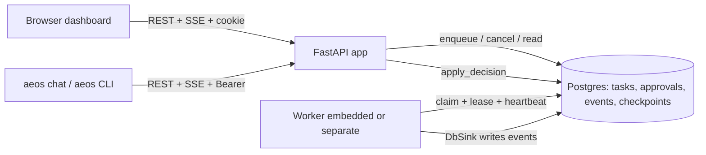
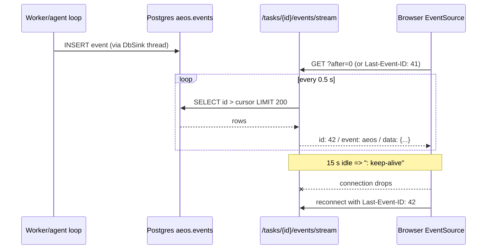

# 18 - API and terminal client (tag: API)

## What this file covers

The HTTP surface of AEOS (`src/aeos/api/app.py`, `auth.py`, `evals.py`), how login and the audit "actor" work, how live updates are streamed (Server-Sent Events), how task cancel/retry work, and the two terminal front ends: the `aeos` CLI (`src/aeos/cli.py`) and the interactive `aeos chat` client (`src/aeos/client/*`). The web dashboard that consumes the same API is in [19-web-dashboard](19-web-dashboard.md); the durable queue and checkpointing behind it are in [07-state-durability-and-persistence](07-state-durability-and-persistence.md); the approval gate semantics are in [13-verification-and-risk-policy](13-verification-and-risk-policy.md). Labels used: **Verified** (read in code/tests), **Inferred**, **Potential failure scenario**, **Recommendation**.

---

## 1. The API in one picture

Concept: an API in front of a long-running, crash-prone job system should be a *thin control plane*. It accepts requests and reads state; it must not own the work, otherwise restarting the API loses tasks.

How AEOS does it (Verified, `create_app` in `api/app.py`):

- `POST /tasks` does not run anything. It calls `tasks.enqueue(...)` (a Postgres row in `aeos.tasks`) and returns `202 {"task_id"}`.
- A `Worker` (`aeos/worker.py`) claims rows. By default the API process embeds one worker (`embedded_worker=True`, started in `lifespan` as an `asyncio.create_task(ctx.worker.run_forever(...))`). `aeos serve --no-worker` plus separate `aeos worker` processes is the scaled-out shape.
- Reads (`GET /tasks/{id}`) rebuild the LangGraph graph object and call `graph.aget_state(...)` on the Postgres checkpointer, then project it through `task_view(...)` into JSON. The API therefore shows the same state a worker would resume from.
- On shutdown the lifespan does `ctx.worker_task.cancel()` with the comment "like a crashed worker: its lease will expire" - shutdown deliberately reuses the crash-recovery path rather than a bespoke graceful drain.

How to read it: both front ends talk only to the API; the API and the worker never talk to each other directly - Postgres is the only channel. That is why a worker can crash or the API can restart without a lost task.

### Endpoint table (Verified against `app.py`, `auth.py`, `evals.py`)

| Method + path | Purpose | Notes |
|---|---|---|
| `POST /tasks` | enqueue | body `TaskRequest`: `goal` 3-4000 chars, optional `max_cost_usd` in (0, 50], optional `kind` (`regression`/`change`). `change` without GitHub repo+token => 409 |
| `GET /tasks`, `GET /tasks/{id}` | list / full view | queued-but-unstarted tasks return a minimal dict (no checkpoint yet) |
| `POST /tasks/{id}/cancel` | stop a task | needs an actor; 404 unknown, 409 already finished |
| `POST /tasks/{id}/retry` | re-run as a NEW task | only for terminal tasks, else 409; response has `retry_of` |
| `GET /tasks/{id}/stats` | cost/tokens/etc. | from `core/stats.py::task_stats`; 409 if not started |
| `GET /tasks/{id}/audit` | approval audit log | |
| `GET /tasks/{id}/events`, `/events/stream` | history + SSE | see section 3 |
| `GET /approvals`, `GET /approvals/{id}` | list / one | default `status=pending` |
| `POST /approvals/{id}/approve` / `reject` | decide | `X-Actor` header; optional `?wait=true` |
| `POST /approvals/expire` | sweep overdue approvals | (the worker also does this in housekeeping) |
| `GET /meta`, `GET /healthz` | deployment info / liveness | `/healthz` is exempt from auth |
| `GET /evals`, `GET /evals/{run_id}` | read-only eval results | `api/evals.py`, regex-validated run id |
| `/auth/me`, `/auth/login`, `/auth/logout` | session | `api/auth.py` |

Design notes worth knowing:

- Every blocking DB call is wrapped in `asyncio.to_thread(...)`. The store modules (`aeos/store/*`) use synchronous psycopg; this keeps the event loop free (Inferred rationale: simpler than making the store async).
- `view()` handles three cases explicitly: unknown (404), queued without checkpoint (minimal dict), and cancelled (the checkpoint still says "running", so `out["status"]` is overridden from the queue row). That override is the kind of dual-source-of-truth wrinkle a reviewer may probe: task status lives in two places, the queue row (`aeos.tasks.status`) and the graph state.
- `?wait=true` on approve/reject calls `wait_idle`, polling the queue row every 0.2 s up to 600 s, then returns the refreshed task. Useful for scripts and tests; the UI uses the non-blocking form (`status: "resuming"`).

---

## 2. Authentication and the "actor" design

Concept: an *audit log* is only useful if the recorded name is trustworthy. Two separate problems: (1) is the caller allowed in at all (authentication), (2) whose name goes in the log (attribution).

How AEOS does it (Verified, `api/auth.py`):

- **Off by default.** If `AEOS_AUTH_USERS` is empty, `Auth.enabled` is False, `AuthGate` passes everything through, and the actor is whatever the client sends in `X-Actor`. The module docstring says this explicitly.
- **On when users are configured.** `AuthGate` is a *pure ASGI middleware* (not Starlette's `BaseHTTPMiddleware`) because, per its docstring, it must not buffer the SSE streams. Everything except `/healthz`, `/auth/*` and `OPTIONS` needs either:
  - a session cookie `aeos_session` (HttpOnly, SameSite=Lax, `Secure` only if `AEOS_AUTH_COOKIE_SECURE`), or
  - `Authorization: Bearer <AEOS_API_TOKEN>` (the "service" identity, for the terminal client and scripts).
- **Session format:** `base64url(json{u, exp}).hex(HMAC-SHA256(secret, json))`, 12 h TTL. Stateless: no server-side session table. `read_session` verifies the HMAC with `hmac.compare_digest`, checks expiry, and checks the user still exists in `AEOS_AUTH_USERS`.
- **Passwords:** `hashlib.scrypt` (n=2^14, r=8, p=1) with a random 16-byte salt, stored as `scrypt.<salt>.<hash>`. The separator is `.` on purpose because `$` gets mangled by docker compose `.env` parsing (comment in the docstring).
- **Timing hygiene:** an unknown username still burns one scrypt computation against `_DUMMY`, so response time does not reveal which usernames exist.
- **Lockout:** 5 failures per `(client ip | lowercased username)` => 60 s of 429s, held in an in-process dict `_fails`.
- **Attribution:** `actor_for(request, claimed)` returns the logged-in name for a *session* identity regardless of any `X-Actor` header; a *token* identity (scripts) names itself via `X-Actor`. Test `test_logged_in_name_cannot_be_spoofed_with_a_header` pins this.
- **CORS:** `CORSMiddleware` allows only the configured origins (`AEOS_CORS_ORIGINS`, default dashboard on :3100), methods GET/POST, `allow_credentials=True`. It is added *after* `AuthGate` so that CORS wraps it and 401 responses still carry CORS headers (test: `test_401_still_carries_cors_headers_so_the_browser_can_read_it`).

Honest limits (Verified or Inferred, labelled):

| Limit | Label | Consequence |
|---|---|---|
| With no users configured, `/approvals/{id}/approve` is open to anyone who can reach the port; the "actor" is just a string | Verified | Fine on localhost demo, not a production posture |
| `AEOS_AUTH_SECRET` unset => random key per process; sessions die on restart (it logs a warning) | Verified | Multiple API replicas without a shared secret would reject each other's cookies |
| Lockout state, sessions are per process | Verified | Not shared across replicas; lockout resets on restart |
| No CSRF token; protection relies on SameSite=Lax and the CORS origin list | Inferred | POSTs carry JSON bodies and a non-simple content type, which helps, but approve/cancel with only a header and no body is a "simple-ish" request; review before internet exposure |
| No roles: any logged-in user can approve, cancel, retry | Verified (no RBAC code) | The module docstring of `app.py` mentions "Authentication/RBAC is added in Phase 13" but only authentication exists; the docstring is stale on RBAC |
| Cancel's actor check and approve's: any `X-Actor` string is accepted for token callers | Verified | The token holder can impersonate any name in the audit log |
| `Auth.login` has a redundant double-write of `_fails` (sets then overwrites when `fails >= MAX_FAILURES`) | Verified | Harmless; code smell |

---

## 3. Streaming: Server-Sent Events (SSE)

Concept (first principles): SSE is a one-way HTTP response that never ends. The server writes text frames (`id:`, `event:`, `data:` lines separated by a blank line); the browser's built-in `EventSource` parses them and, if the connection drops, automatically reconnects sending a `Last-Event-ID` header with the last `id` it saw. It is simpler than WebSockets when you only need server-to-client push.

How AEOS does it (Verified, `stream_events` in `app.py`):

- The source of truth is a Postgres table `aeos.events` with a `bigserial id` (`store/events.py`). Agents emit `Event` objects into an `EventSink`; `DbSink` writes them on a background thread so the agent loop never blocks on the DB.
- The endpoint is a *polling tail over the table*, not a pub/sub: every 0.5 s it runs `events.list_events(task_id, cursor, 200)`, yields any new rows as `id: <id>\nevent: aeos\ndata: <json>`, and sends a `: keep-alive` comment after 15 s idle so proxies do not drop the connection.
- Resume: the cursor starts at the `Last-Event-ID` header if it is digits, else the `?after=` query param. So a refresh or reconnect replays only what was missed. Because ids are monotonic per table (global bigserial, filtered by task), there are no duplicates.
- Headers `Cache-Control: no-cache` and `X-Accel-Buffering: no` stop nginx-style buffering.
- Loop ends when `request.is_disconnected()` is true.

How to read it: the stream is "replay-then-follow" over a durable log. Reconnecting is cheap and lossless because the cursor is the primary key, not in-memory buffer state.

Trade-offs:

| Choice | Benefit | Cost |
|---|---|---|
| Poll the DB every 0.5 s per open stream | No extra infrastructure; works across API + separate workers; durable | Latency up to ~0.5 s; one query per second-ish per viewer per task; does not scale to thousands of viewers |
| Postgres `LISTEN/NOTIFY` or Redis pub/sub (alternatives) | Push, lower load | More moving parts. Redis is provisioned in compose and `Settings.redis_url` exists, but no code under `src/` uses it (Verified by grep), so the push option is available but not built |
| SSE instead of WebSocket | Auto-reconnect + `Last-Event-ID` for free; plain HTTP through the auth middleware | One-way only (fine, writes are normal POSTs) |

Potential failure scenario (Inferred): browsers cap HTTP/1.1 connections per origin at ~6; many dashboard tabs each holding an SSE stream plus polling requests could starve each other. Not observed, just a known SSE property.

---

## 4. Task control: cancel and retry

Concept: cancelling a distributed job is hard because the work is running in another process. AEOS avoids killing it directly and instead uses the *lease* it already has for crash recovery (see [07-state-durability-and-persistence](07-state-durability-and-persistence.md)).

Cancel (Verified, `cancel_task` + `store/tasks.py::cancel` + `Worker._heartbeat`):

1. Require an actor (400 otherwise): the audit log must say who.
2. `tasks.cancel(task_id, "cancelled by <actor>")` does one SQL `UPDATE ... SET status='cancelled', worker_id=NULL, lease_expires_at=NULL, pending_resume=NULL WHERE status IN ('queued','running','paused') RETURNING *`. Zero rows => 409 "task already finished". The `WHERE` makes it atomic and idempotent-safe.
3. `approvals.cancel_pending` closes outstanding approvals (test shows status becomes `expired`), then writes an audit row `task_cancelled` and an `events` row.
4. `rt.sandbox.reap_task(task_id)` removes the task's sandbox container; wrapped in `contextlib.suppress(Exception)` so a missing sandbox cannot fail the cancel.
5. The worker is *fenced*: its next heartbeat (`lease_s / 3`, so ~10 s at the default 30 s lease) calls `tasks.heartbeat`, which now returns False because `worker_id` is NULL; the worker then does `work.cancel()` and abandons the run.

So cancel is **cooperative with up-to-a-heartbeat latency**. Potential failure scenario (Inferred from the code): within that window the worker could still complete a tool call or LLM call and spend money; `cancelled` is still final because `tasks.finish` is fenced by worker id. What is not verified here is whether a side effect already in flight (for example a push in `publish_pr`) can be interrupted; see [16-a2a-and-github-integration](16-a2a-and-github-integration.md) and [10-error-handling-and-reliability](10-error-handling-and-reliability.md).

Retry (Verified): `retry_task` refuses non-terminal tasks (409), then enqueues a *new* task id with the same `goal`, `budget`, `kind`. The original keeps its history. This is a design choice: a new task id means a new LangGraph thread and a new trace, so you can compare attempts, instead of mutating a failed checkpoint.

Note: retry in the API is `Run again` in the dashboard (shown for terminal non-completed tasks). The CLI/chat client has **no** cancel or retry command (grep of `client/` and `cli.py` finds none; `aeos approve|reject` exist). Cancel/retry are API + dashboard only.

---

## 5. The CLI and its three modes

`src/aeos/cli.py` is one `argparse` entry point (`aeos = "aeos.cli:main"` in `pyproject.toml`) with three families of command:

| Family | Commands | Talks to | Verified detail |
|---|---|---|---|
| Inline / process | `run`, `worker`, `serve`, `agent` | runs the graph / server in this process | `run` uses `open_runtime` + `open_checkpointer` directly with a `ConsoleSink`; `--yes` swaps in `auto_approver` ("demos only"); otherwise `_console_approver` uses `input()` and records actor `cli-user` |
| Direct-DB legacy | `submit`, `status`, `approvals`, `approve`, `reject` | Postgres directly (no API) | become API-backed if `--api`, `AEOS_API_URL`, or `--all/--json` is given (`LEGACY_CMDS` logic in `main`) |
| API client | `tasks`, `new`, `show`, `watch`, `events`, `stats`, `open`, `chat` | HTTP API | `CLIENT_CMDS`; `AeosClient` in `client/api.py` |

Things to know:

- `--replay <scenario>` / `AEOS_REPLAY` swaps the LLM for a scripted fake (`demo.trajectories.SCENARIOS`) so a full run is free and deterministic; see [06-llm-integration](06-llm-integration.md).
- Exit codes (client mode, `commands.EXIT`): completed 0, failed/escalated/cancelled 1, awaiting_approval 3, unreachable API 2, Ctrl+C 130. Useful for scripting.
- `--yes` in `aeos new` requires `--actor` explicitly so the audit log names a person; and prints a warning that a real PR will be opened for `change` tasks.
- Port default mismatch (Verified): `aeos serve` defaults to `--port 8000`, while the client default `AEOS_API_URL` is `http://localhost:8800`. Compose maps `8800:8000` and sets `AEOS_API_URL=http://localhost:8000` inside the api container (so `./scripts/aeos chat` works there). Running `aeos serve` locally and `aeos tasks` from the host needs `--api http://localhost:8000`.

## 6. The terminal client: `AeosClient`, `watch`, `chat`

- **`client/api.py::AeosClient`**: synchronous `httpx.Client`. Sends `Authorization: Bearer $AEOS_API_TOKEN` if set. Errors are normalised: `ApiError(status, detail)` for 4xx/5xx, `ApiUnreachable` for transport errors *and* for non-JSON answers ("wrong service", e.g. an HTML page from the dashboard port). `default_actor()` = `$AEOS_ACTOR` or `$USER`.
- **`stream_events`**: reads SSE lines, parses only `data:` lines, tracks `last` id, skips `ev["id"] <= last` (dedupe), reconnects up to 5 times with 0.5-3 s backoff, resets the counter on any progress. It is the client twin of the browser's `EventSource` logic.
- **`watch_task` (`client/watch.py`)**: fetches *history before the task snapshot* (a documented ordering: a finish or approval that lands in between is then visible in the status rather than missed on the stream), prints the header and past events, then follows the stream. On `approval_requested` it calls `_handle_approval`, which prompts inline (interactive) or prints `aeos approve <id> | aeos reject <id>` (non-interactive). Ctrl+C *detaches* - the task keeps running; `aeos watch <id>` rejoins.
- **`client/prompts.py::ask_approval`**: `[a]pprove [r]eject [d]iff [f]indings [s]kip`. Reject asks for a reason (sent as feedback to the planner). 409 ("already decided") and 410 ("expired") are mapped to friendly messages and return `stale`.
- **`client/chat.py::run_chat`**: a REPL (`aeos> `). Plain text starts a task (target `change` if the API reports a `target_repo`, else `regression`), then `watch_task`; `/tasks /show /watch /approvals /approve /reject /stats /events /diff /open /target /actor /help /quit` reuse the same handlers as one-shot commands (`C.HANDLERS`, `C.cmd_show`) via a small `argparse.Namespace` shim (`_ns`). One code path, two front ends.
- **Rendering (`client/render.py`)**: every dashboard view is a *pure function* (API JSON in, `rich` renderable out, nothing prints), which makes it unit-testable (`tests/client/test_render.py`). The plan view reproduces the dashboard's dependency-depth columns (`_depths`, with cycle guard via a `seen` set).

### Terminal-injection defence (Verified, `client/sanitize.py`)

Concept: a terminal interprets escape sequences. If the agent summarises a malicious web page or repo file that contains `ESC]0;...` (set window title) or CSI sequences, printing it raw could clear the screen, forge UI, or on some terminals worse. Task data is *untrusted* because agents read untrusted repos and pages (see [14-security-and-prompt-injection](14-security-and-prompt-injection.md)).

AEOS: `clean()` strips OSC, CSI and other ESC sequences and control characters (keeps `\t`, `\n`); `safe()` wraps the result in a `rich.text.Text` so `[bold]`-style markup inside it is never interpreted; the console is created with `markup=False, highlight=False, emoji=False`. Renderers pass agent/tool/repo-influenced text through `safe`. A sloppy detail the authors already fixed: `_panel` wraps titles in `Text` because a `str` title is parsed as markup and swallowed `[pending]`.

Verified by `tests/client/test_sanitize.py` (4 tests) and `test_review_fixes.py`. Not verified: that *every* print path is covered (e.g. `cli.py::_summarize` and `_console_approver` for `aeos run` print `req.arguments.get('title')` with plain `print`, not `clean`; that is the legacy inline path, flagged here as a Potential gap).

---

## 7. What the tests verify

| Area | Tests | What they pin |
|---|---|---|
| Auth | `tests/api/test_auth.py` (9) | hash round trip, tamper/expiry, gate blocks all but health/auth, no header spoofing, token identity, lockout, CORS on 401, no-users = unchanged |
| Task control | `tests/api/test_task_control.py` (3) | cancel is final and fences a worker, cancel endpoint closes approvals + audits + reaps, retry only for finished tasks |
| Evals API | `tests/api/test_evals.py` | newest first, bad files skipped, bad ids 404 |
| CLI | `tests/cli/test_cli.py` (4) | replay flag/env selects scripted LLM, `fake` provider without replay fails loudly |
| Client | `tests/client/*` (~60 tests incl. a real-uvicorn e2e in `test_e2e_terminal.py`) | API client, SSE resume, chat commands, rendering, sanitising, watch/approval flow |

Not covered by tests in scope (Verified by absence): SSE endpoint behaviour under load, `/approvals/expire` auth, API replicas with shared sessions.

---

## Interview questions

## Q-API-1. Why does `POST /tasks` return 202 and not run the task?
**Difficulty:** Beginner  **Topic:** API design, durable queue
**Short answer:** Because the API is only a control plane. It inserts a row into a Postgres queue and returns `202 Accepted` with a task id; a worker claims and runs it. That way an API restart or crash cannot lose a task, and long agent runs never hold an HTTP request open.
**Detailed explanation:** 202 means "accepted for processing, not done". Agent runs take minutes and pause for human approval for hours, so a synchronous request/response model would break on timeouts and restarts. The queue row plus LangGraph checkpoints in Postgres hold all state.
**How this project uses it:** `create_task` in `api/app.py` generates `t-<8 hex>`, picks `kind`, validates a `change` task needs a configured repo (409 otherwise), calls `tasks.enqueue` via `asyncio.to_thread`, returns `{"task_id"}`. An embedded `Worker` or separate `aeos worker` picks it up.
**Example/walkthrough:** `aeos new "bump ws" --watch` -> POST /tasks -> 202 `t-ab12cd34` -> the client opens `/tasks/t-ab12cd34/events/stream` -> worker claims -> events appear.
**Follow-ups:**
- *What if the worker dies mid-task?* The lease expires; another worker reclaims and continues from the last Postgres checkpoint ([07-state-durability-and-persistence](07-state-durability-and-persistence.md)).
- *Why does `GET /tasks/{id}` special-case a queued task?* No checkpoint exists yet, so `aget_state` returns empty values; `view()` returns a minimal dict built from the queue row.
**Trade-offs and alternatives:** Celery/RQ would work but add a broker; here Postgres is already the system of record. The cost is polling (`poll_s=0.2`) instead of push.
**Common interview mistake:** Saying "it runs in a background thread of the API". It is an embedded *worker* with a durable lease, not fire-and-forget.
**Related:** [03-system-architecture](03-system-architecture.md), [04-end-to-end-workflows](04-end-to-end-workflows.md)

## Q-API-2. Explain the login/session design. Why not JWT or a session table?
**Difficulty:** Intermediate  **Topic:** Authentication
**Short answer:** Sessions are a signed cookie: base64 JSON `{user, exp}` plus an HMAC-SHA256 signature, 12 h long, HttpOnly. Passwords are scrypt hashes from an env var. It is stateless, needs no table, and is deliberately minimal for a single-tenant tool. It is off unless users are configured.
**Detailed explanation:** HMAC signing gives integrity (tamper detection) but not secrecy; the payload is only a username and expiry, so that is fine. Verification uses constant-time compare, checks expiry and that the user still exists. Compared with a JWT library this is ~30 lines and has no algorithm-confusion surface; compared with a DB session table it cannot be revoked individually.
**How this project uses it:** `Auth.make_session/read_session` in `api/auth.py`; cookie set in `/auth/login` with `httponly=True, samesite="lax", secure=auth.secure_cookie`. Scripts use a static bearer token (`AEOS_API_TOKEN`) mapped to identity `service`.
**Example/walkthrough:** POST /auth/login {alice, pw} -> scrypt verify -> `Set-Cookie: aeos_session=...` -> browser sends it with `credentials: "include"` -> `AuthGate.identify` -> `request.state.identity`.
**Follow-ups:**
- *How do you log someone out everywhere?* You cannot individually; change `AEOS_AUTH_SECRET` (invalidates all) or remove the user from `AEOS_AUTH_USERS` (checked on every read). Verified: `read_session` rejects names not in `self.users`.
- *What happens with two API replicas?* Without a shared `AEOS_AUTH_SECRET`, each generates a random key at start and rejects the other's cookies (Verified: warning in `Auth.__init__`). Lockout counters are also per process.
- *Is there CSRF protection?* No token. SameSite=Lax and an explicit CORS origin list are the defences (Inferred); a production deployment should add a CSRF token or require a custom header on state-changing calls.
**Trade-offs and alternatives:** OAuth/OIDC via a proxy (oauth2-proxy, Auth0) is the production answer for SSO and roles; this design trades features for zero dependencies.
**Common interview mistake:** Claiming "JWT" or claiming it has RBAC. There is one role: any signed-in user can approve.
**Related:** [14-security-and-prompt-injection](14-security-and-prompt-injection.md), [19-web-dashboard](19-web-dashboard.md), [21-deployment-and-infrastructure](21-deployment-and-infrastructure.md)

## Q-API-3. How do you stop a header from spoofing who approved a PR?
**Difficulty:** Intermediate  **Topic:** Audit attribution
**Short answer:** `actor_for` ignores `X-Actor` when the caller authenticated with a session cookie and uses the login name instead. Only token (script) callers name themselves. So with login enabled, a person cannot approve as someone else.
**Detailed explanation:** The audit log is the accountability record for a real GitHub PR. Attribution therefore must come from the authenticated identity, not from client-supplied data.
**How this project uses it:** `Identity(kind="session"|"token")` is set on `scope["state"]["identity"]` by `AuthGate`; `approve`, `reject`, `cancel_task` call `actor_for(request, x_actor)`. `decide()` rejects blank actors with 400. `apply_decision` (in `aeos/hitl.py`) records actor and the resume request in one transaction.
**Example/walkthrough:** Logged in as `alice`, `curl -H 'X-Actor: bob' -b cookie POST /approvals/ap-1/approve` records `alice` (`test_logged_in_name_cannot_be_spoofed_with_a_header`).
**Follow-ups:**
- *And with no login configured?* Anyone can send any name. Verified; acceptable for local demo only.
- *Can a token holder impersonate?* Yes, any name. A per-script token with a fixed name would close that (Recommendation).
**Trade-offs and alternatives:** mTLS or signed per-user API tokens give non-repudiation for scripts.
**Common interview mistake:** Believing the actor field is authenticated in all modes.
**Related:** [13-verification-and-risk-policy](13-verification-and-risk-policy.md)

## Q-API-4. Walk through how the dashboard/terminal gets live updates and survives a dropped connection.
**Difficulty:** Intermediate  **Topic:** SSE, resumability
**Short answer:** Events are rows in Postgres with an increasing id. The SSE endpoint replays rows after a cursor, then keeps polling every 0.5 s and emits new rows as `id:`/`data:` frames. On reconnect the client sends `Last-Event-ID`; the server resumes from that id, so nothing is missed or duplicated.
**Detailed explanation:** The durable log makes the stream stateless: the server holds no per-client buffer. The cursor is the primary key. A 15-second keep-alive comment prevents idle proxy timeouts.
**How this project uses it:** `stream_events` in `api/app.py`; `useEvents` in `web/lib/hooks.ts` (fetch history with `api.events`, then `EventSource` with `withCredentials`, de-duplicating by id in a `Set`); `AeosClient.stream_events` for the terminal.
**Example/walkthrough:** Events 1-41 delivered, Wi-Fi drops, `EventSource` auto-reconnects with `Last-Event-ID: 41`; the server's cursor becomes 41; event 42 onward arrives.
**Follow-ups:**
- *Why does the client dedupe if the server resumes exactly?* Defensive: the browser first loads history over REST and then opens SSE, and the two can overlap; `seen` and `ev["id"] <= last` make it idempotent.
- *Why a pure ASGI middleware?* A buffering `BaseHTTPMiddleware` would hold the stream; the docstring in `AuthGate` calls this out.
- *What would you change at scale?* Replace per-stream polling with `LISTEN/NOTIFY` or Redis pub/sub (Recommendation).
**Trade-offs and alternatives:** WebSockets are bidirectional but need their own reconnect/resume protocol.
**Common interview mistake:** Saying events are pushed from the worker to the browser. They go worker -> Postgres -> polled by the API.
**Related:** [20-observability-and-telemetry](20-observability-and-telemetry.md), [07-state-durability-and-persistence](07-state-durability-and-persistence.md)

## Q-API-5. How does cancelling a running task actually stop it?
**Difficulty:** Advanced  **Topic:** Cooperative cancellation, leases
**Short answer:** The API flips the queue row to `cancelled` and clears the worker's lease in a single SQL UPDATE, closes pending approvals, and reaps the sandbox. The worker is not signalled; its next heartbeat fails and it cancels its own asyncio task. So cancel is final immediately but the work stops within about a third of the lease.
**Detailed explanation:** Heartbeats extend a lease and double as a "do I still own this task?" probe (a fencing mechanism). Setting `worker_id=NULL` revokes ownership. `tasks.finish` is also owner-fenced, so a zombie worker cannot overwrite `cancelled`.
**How this project uses it:** `cancel_task` (`app.py`), `tasks.cancel` (`store/tasks.py`), `Worker._heartbeat` (`worker.py`, sleeps `lease_s/3`), `rt.sandbox.reap_task`.
**Example/walkthrough:** Task running on worker w1; user clicks Cancel; row -> cancelled; w1's heartbeat at +10 s returns False -> `work.cancel()` -> `run_once` logs "lost lease or cancelled". Test `test_cancel_queued_task_is_final_and_fences_a_worker` shows `heartbeat(...) is False` and `claim` returns None afterward.
**Follow-ups:**
- *What can go wrong in the window?* The worker may complete an in-flight LLM/tool call (cost) before noticing (Potential failure scenario, Inferred). Whether an in-flight GitHub push is safe is covered in [16-a2a-and-github-integration](16-a2a-and-github-integration.md).
- *Why ignore sandbox errors?* A missing/dead container must not turn a user's cancel into a 500; the worker's housekeeping also reaps orphans (`Worker` sweep).
- *Why 409 on a second cancel?* The `WHERE status IN (...)` matches no rows; the API maps None to 409.
**Trade-offs and alternatives:** Pushing a cancel signal (Redis pub/sub, `asyncio` cancel over RPC) reduces latency but requires a channel; lease fencing needs none.
**Common interview mistake:** Saying "it kills the process". It never does; it revokes ownership.
**Related:** [10-error-handling-and-reliability](10-error-handling-and-reliability.md), [12-sandbox-and-execution-safety](12-sandbox-and-execution-safety.md)

## Q-API-6. Why is "retry" a new task instead of resuming the failed one?
**Difficulty:** Intermediate  **Topic:** Design trade-off
**Short answer:** Retry enqueues a fresh task with the same goal, budget and kind and a new id, leaving the failed one intact. Failed checkpoints may be in a state you do not want to resume (budget spent, bad plan), and separate ids give separate traces and audit trails to compare.
**Detailed explanation:** True resume already exists for the case it fits: crash recovery and approval resume use the same checkpoint. A *terminal* task (completed/failed/escalated/cancelled) is finished by definition; re-running from scratch is the honest semantics.
**How this project uses it:** `retry_task` returns `{"task_id": new_id, "retry_of": task_id}`; 409 if the original is still active; the dashboard shows "Run again" for terminal non-completed tasks and navigates to the new task.
**Example/walkthrough:** `t-1` escalated after two failed verifications; Run again -> `t-2` with the same `max_cost_usd`; `t-2` plans fresh (long-term memory may now recall the earlier failure, see [08-memory-system](08-memory-system.md)).
**Follow-ups:**
- *Is the new task's trace linked to the old one?* No link beyond `retry_of` in the response (Verified; it is not persisted).
- *Does it re-use the budget used so far?* No, a fresh `Budget` from the stored cap.
**Trade-offs and alternatives:** Resume-from-checkpoint-with-edit (time travel) is a LangGraph capability but is not implemented here.
**Common interview mistake:** Confusing retry (new task) with the worker's automatic re-claim after a crash (same task).
**Related:** [05-agents-and-orchestration](05-agents-and-orchestration.md)

## Q-API-7. Why does the terminal client sanitise output, and how?
**Difficulty:** Advanced  **Topic:** Untrusted output, terminal escape injection
**Short answer:** Task text can contain content from web pages, repos and tool output, which an attacker influences. Printing raw ANSI/OSC escape sequences can rewrite the screen or window title and spoof an approval prompt. `clean()` strips escapes and control characters and `safe()` wraps text in a rich `Text` so markup is not interpreted.
**Detailed explanation:** This is output-side prompt-injection defence: the agent might faithfully relay hostile text into the human's approval UI. Stripping at the single render boundary is easier to audit than sanitising at each source.
**How this project uses it:** `client/sanitize.py` (regexes for OSC, CSI, other ESC, control chars; keeps tab/newline), console built with `markup=False`, all dynamic text through `safe`/`say`, and `console.input(..., markup=False)`.
**Example/walkthrough:** A file summary contains `\x1b[2J\x1b]0;APPROVED\x07`; `clean` removes both; `safe("[red]x[/red]")` prints the brackets literally.
**Follow-ups:**
- *What does it not cover?* The legacy `aeos run` console approver (`_summarize`/`_console_approver` in `cli.py`) prints with bare `print`. Not routed through `clean` (Verified by reading; Potential gap, Recommendation: reuse `clean`).
- *What about the web UI?* React escapes text by default and no `dangerouslySetInnerHTML`/`innerHTML` appears in `web/` (Verified by grep).
**Trade-offs and alternatives:** Allow-list rendering (only known fields) vs deny-list stripping; the latter is simpler but must track escape forms.
**Common interview mistake:** Treating terminal output as safe because "it's just text".
**Related:** [14-security-and-prompt-injection](14-security-and-prompt-injection.md)

## Q-API-8. How do the one-shot commands and the interactive chat share code?
**Difficulty:** Intermediate  **Topic:** Client architecture
**Short answer:** Rendering is pure functions (JSON in, rich renderable out) and each command is a handler `(args, client, console) -> exit_code`. `aeos chat` builds an `argparse.Namespace` shim and calls the same handlers, so `/show` and `aeos show` cannot drift.
**Detailed explanation:** Separating "fetch" (`AeosClient`), "format" (`render.py`) and "act" (`commands.py`) lets tests inject a fake `AeosClient` (the `_client` and `_console` params of `main`) and assert on rendered output with no network.
**How this project uses it:** `commands.HANDLERS` dict; `chat._ns(...)` fills defaults; `run_command` maps `ApiUnreachable` to exit 2, `ApiError` to 1.
**Example/walkthrough:** `/show t-ab plan` -> `C.cmd_show(_ns(cmd="show", task_id="t-ab", plan=True))` -> `render.render_task(..., {"plan"})`.
**Follow-ups:**
- *Why check history before the task snapshot in `watch_task`?* To avoid a race where a finish or approval request lands between the two reads and is waited for forever on the stream.
- *What are the exit codes for?* CI/scripts: 3 means "waiting for human".
**Trade-offs and alternatives:** A TUI framework (Textual) would be richer but heavier; `rich` + `input()` was enough.
**Common interview mistake:** Describing it as a separate implementation of the dashboard logic.
**Related:** [19-web-dashboard](19-web-dashboard.md)

## Q-API-9. What would you fix before putting this API on the internet?
**Difficulty:** Expert  **Topic:** Production gaps (Recommendation-heavy)
**Short answer:** Mandatory auth (the default is open), roles so not everyone can approve a PR, a shared session secret and shared lockout store for multiple replicas, CSRF protection, rate limiting, a push mechanism for events, and TLS with `AUTH_COOKIE_SECURE=true`.
**Detailed explanation:** Everything below is checked against the code; the "fix" column is Recommendation.

| Gap (Verified) | Fix |
|---|---|
| Auth optional; `/approvals/expire`, cancel, retry open without it | Fail closed: refuse to start without users unless an explicit `--insecure-dev` |
| No roles | Separate `viewer` / `approver` / `admin` |
| Per-process secret, sessions, lockout | Required `AEOS_AUTH_SECRET`, Redis/DB for counters |
| Token callers pick any actor | One token per script, actor bound to token |
| 0.5 s DB polling per stream | LISTEN/NOTIFY |
| `X-Actor` accepted with no auth | Remove outside dev |

**How this project uses it:** see the sections above.
**Example/walkthrough:** n/a (review list).
**Follow-ups:**
- *Which gap is the worst?* The approval gate is the project's main safety control; an unauthenticated approve endpoint can defeat it. Conversely, with login on, only the lack of roles and CSRF remain.
**Trade-offs and alternatives:** Put oauth2-proxy/OIDC in front and trust a forwarded identity header.
**Common interview mistake:** Over-claiming "enterprise-ready auth".
**Related:** [21-deployment-and-infrastructure](21-deployment-and-infrastructure.md), [14-security-and-prompt-injection](14-security-and-prompt-injection.md)
