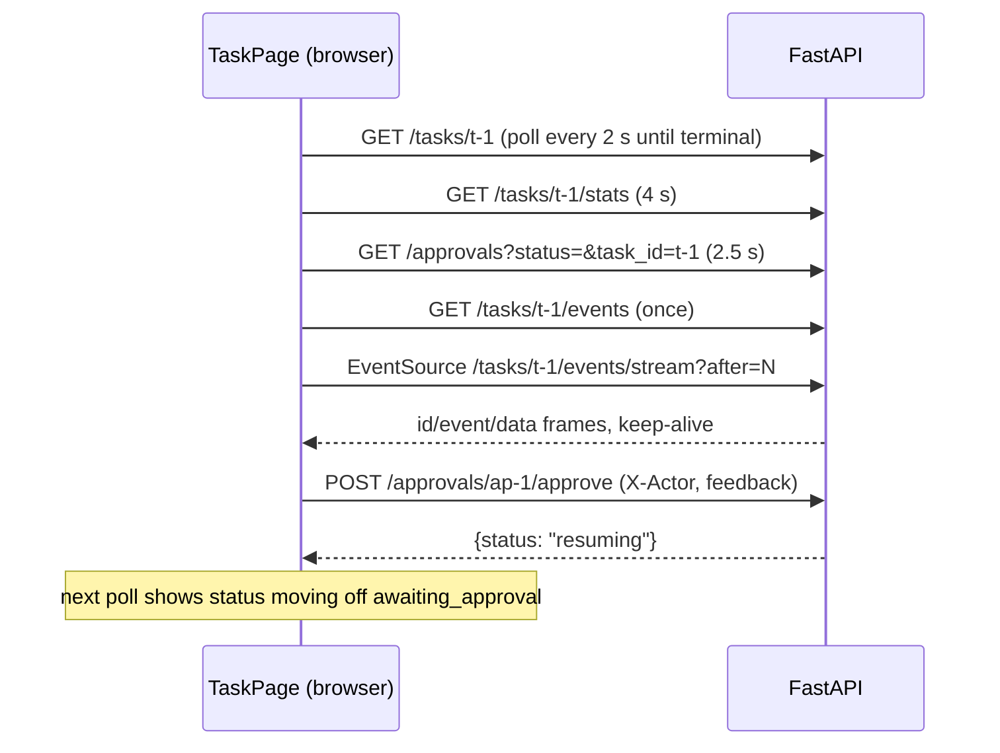

# 19 - Web dashboard (tag: WEB)

## What this file covers

The Next.js dashboard in `web/`: its structure, how it talks to the FastAPI backend (polling plus Server-Sent Events), the pipeline strip, plan graph, trace waterfall, approval card with per-line diff comments, the budget meters, the eval page, and the client-side auth gate. The API it calls is in [18-api-and-client](18-api-and-client.md); the span/trace concepts the "Trace" card imitates are in [20-observability-and-telemetry](20-observability-and-telemetry.md); build/run is in [21-deployment-and-infrastructure](21-deployment-and-infrastructure.md). Labels: **Verified**, **Inferred**, **Potential failure scenario**, **Recommendation**.

Headline facts to remember (Verified):
- It is a small app: ~3.3k lines of TS/TSX/CSS, only `next`, `react`, `react-dom`, `typescript` plus type packages in `package.json` - no state library, no chart library, no CSS framework.
- Every page is a Client Component (`"use client"`); there is no server-side rendering of data and no Next.js API routes. The browser calls FastAPI directly.
- The "Trace" waterfall is **not** an OpenTelemetry trace view. It is reconstructed from the event log and tool-call records (see section 5). The real trace lives in Langfuse and is linked from the page.

---

## 1. Structure

```
web/
  app/                    Next.js App Router
    layout.tsx            fonts + <AuthGate> around every page
    page.tsx              home: composer, live pipeline, stat tiles, task table
    tasks/[id]/page.tsx   the task detail page (most of the UI)
    approvals/page.tsx    pending approvals across tasks
    evals/page.tsx        eval results (charts)
    login/page.tsx        login form
  components/             AuthGate, Nav, Palette (Ctrl+K), Pipeline, PlanGraph,
                          TraceWaterfall, ApprovalCard, StepDrilldown, Timeline,
                          BudgetMeters, StatsPanel, EvalCharts, ui.tsx, fx.tsx
  lib/                    api.ts (typed fetch client), hooks.ts, auth.ts, trace.ts
  Dockerfile              two-stage node:20-alpine build, `next start -p 3100`
```

Concept: Next.js App Router normally mixes server and client components. Here the author chose the *simplest* use: static shell, all data fetched in the browser. Consequence: the `NEXT_PUBLIC_AEOS_API` URL is inlined into the JS bundle at build time (Dockerfile `ARG NEXT_PUBLIC_AEOS_API` -> `ENV` before `npm run build`), so changing the API URL needs an image rebuild (documented in `CONTRIBUTING.md`: "the image bakes the build in"). The browser, not the web container, calls the API, which is why compose passes `http://localhost:8800` (the host-mapped port), not `http://api:8000`.

## 2. How it talks to the API

`lib/api.ts` is a typed wrapper over `fetch`:

- One `request<T>()` helper: `cache: "no-store"`, `credentials: "include"` (the session cookie, see [18-api-and-client](18-api-and-client.md)), JSON error detail extraction into `ApiError(status, message)`.
- Global 401 handling: any 401 except `/auth/login` and `/auth/me` redirects to `/login` ("session expired").
- Types (`TaskDetail`, `Approval`, `AeosEvent`, `Stats`, `EvalRun`...) are hand-written mirrors of the Python Pydantic models. Inferred risk: nothing generates them from the OpenAPI schema, so a backend field rename silently becomes `undefined` in the UI (TypeScript cannot see it). `npx tsc --noEmit` only checks the front end against itself.

Two data patterns in `lib/hooks.ts`:

| Hook | Mechanism | Used for |
|---|---|---|
| `usePoll(fn, ms, deps, stop?)` | `setInterval` re-fetch; `stop(data)` ends polling (task reached a terminal status) | task detail 2 s, stats 4 s, approvals 2.5-5 s, task list 3 s, meta 15-60 s |
| `useEvents(taskId)` | REST `GET /tasks/{id}/events` for full history, then `EventSource` on `/events/stream?after=<last>` with `withCredentials: true`; de-dupes by id in a `Set` | Timeline and Trace |

Design point (Inferred rationale): the comment on `usePoll` says "State lives in the backend". The UI keeps no authoritative state. A page refresh, a second tab, or the terminal client approving the same task all converge because every screen re-reads Postgres-backed endpoints. SSE is used only where latency matters (the event feed); everything else is plain polling, which is simple and robust but wasteful (a task page can run four pollers plus one SSE stream, and `Nav` adds two more on every page).



How to read it: reads are repeated pulls; the only push channel is the SSE stream; a write (approve) returns immediately and the UI learns the result from the next poll.

## 3. Pages and components

### Home (`app/page.tsx`)
- Composer textarea (Ctrl/Cmd+Enter submits), target selector (`Change request on <repo>` is offered only if `/meta` reports `target_repo`; else the demo `regression` target), optional cost cap (`max_cost_usd`, validated 0.01-50 in the input and by the API).
- "Live pipeline" shows the most recent task's `Pipeline`; stat tiles count tasks by status group; the table filters by group (`running` = queued/running/planning/executing/verifying, `awaiting`, `done`, `failed` = failed/escalated/cancelled).

### Pipeline strip (`components/Pipeline.tsx`)
`stageStates(task)` derives five stages (Research, Analyze, Code, Verify, Approve) from the *actual plan*: steps are grouped by `owner`. Rules (Verified): any failed step => `failed`, or `retry` if the task is still live; any running => `active`; all done/skipped => `done`; the Verify stage with no verifier step falls back to the last verification verdict; `Approve` is `active` when status is `awaiting_approval`, `done` when `completed`. If a stage has no steps in a plan that exists, it is `omit`ted: a change request never runs the analytics agent, so "Analyze" disappears instead of showing as skipped.

### Plan graph (`components/PlanGraph.tsx`)
Not a graph library. It computes each step's depth = 1 + max depth of its `depends_on` (memoised, with a `seen` set to avoid infinite recursion on cycles), groups steps into columns, and renders cards with CSS. Clicking a card sets `sel`, which opens `StepDrilldown` (observations, and each tool call with arguments and result preview in `<details>`). Plan versions appear as `v1, v2...` tabs, with "Replanned because: ..." from `reason_for_change`. The Python terminal client has the same algorithm in `client/render.py::_depths` - the logic is duplicated across languages (Verified), kept consistent by hand.

### Approval card (`components/ApprovalCard.tsx`)
Shows tool and title (`create_pull_request`, head into base), the rationale, verifier gate chips, the benchmark (p95 before/after, DB query counts), the root cause, and the diff (`DiffView` in `ui.tsx`). Hovering a diff line shows a `+` to attach a review comment; comments are folded into the `feedback` string as ``On `<line>`: <text>`` (line trimmed to 80 chars, whole feedback capped at 2000 to match the API's `DecisionRequest.max_length`) and sent with the decision. A reject's feedback reaches the planner (see [13-verification-and-risk-policy](13-verification-and-risk-policy.md) and [05-agents-and-orchestration](05-agents-and-orchestration.md)). `Acting as` is an editable box stored in `localStorage` (`aeos.actor`), or read-only and forced to the login name when auth is on (`useActor` returns `me.user`).

### Budget meters and stats
`BudgetMeters` renders cost, tokens, steps and wall time against the task's caps from `TaskDetail.budget`, turning amber above 75% and red above 90%, with `role="meter"` and ARIA values. `StatsPanel` shows `/tasks/{id}/stats` (computed by `core/stats.py`, see [20-observability-and-telemetry](20-observability-and-telemetry.md)).

### Evals page (`app/evals/page.tsx`, `EvalCharts.tsx`)
Reads `GET /evals` and `/evals/{id}`, defaults to the newest run whose `meta.llm == "gemini"`, and draws bars and delta tables with hand-written components (no chart library). Metric definitions live in [23-evaluation-framework](23-evaluation-framework.md).

### Command palette
`Palette.tsx` (Ctrl/Cmd+K) lists pages, pending approvals and tasks (fetched when opened) and navigates with `router.push`.

### Accessibility touches (Verified)
Skip link in `layout.tsx`, `aria-live="polite"` on the event list, `role="progressbar"`/`meter`, keyboard-focusable waterfall bars with `aria-label`, `role="tablist"` on filters, a screen-reader state word in each Pipeline stage.

## 4. The auth gate

`AuthGate.tsx` wraps every page (from `layout.tsx`). On mount it calls `/auth/me`:

1. If the call fails (API unreachable) it still renders ("the app renders as usual"), so an offline API shows the "API offline" pill instead of a blank page.
2. If `auth_required && !user` and the path is not `/login`, it `router.replace("/login")` and renders nothing meanwhile.
3. Otherwise it provides `AuthCtx` (`ready, authRequired, user, refresh`) to children; `Nav` shows the user and Sign out.

Important (Verified/Inferred): this gate is **UX only**. It decides which screen to show; the real enforcement is the server's `AuthGate` middleware returning 401, and `request()` redirects to `/login` on any 401. Because pages are static client bundles with no secrets, hiding them is not a security boundary. The cookie is HttpOnly, so JavaScript cannot read it; cross-origin cookie sending relies on `credentials: "include"` plus the API's explicit CORS origin and `allow_credentials=True`. If dashboard and API are on different *sites* (not just ports on localhost), SameSite=Lax cookies will not be sent on cross-site `fetch` POSTs; the supported topology is same-site (localhost ports, or a shared parent domain behind HTTPS) (Inferred).

## 5. The trace waterfall (`lib/trace.ts`, `components/TraceWaterfall.tsx`)

Concept: a waterfall chart draws each operation as a horizontal bar positioned by start time with width = duration, one row per lane, so you see overlap, gaps and the critical path.

How AEOS builds it (Verified): `buildTrace(events, calls)` takes the SSE event list and the `tool_calls` from the task detail.
- `step_started` events (message regex `^(\S+) → (\w+)`) set a lane's start; `step_done`/`step_failed` (regex `^(\S+) \((\w+)\)`) set its end and state. Lanes are keyed by step id and labelled "id agent".
- Each `ToolCall` becomes a small bar inside its step lane, placed by `ts - t0` with `duration_ms`.
- `approval_requested` to `approval_decided` becomes the "human approval" lane (`wait`).
- Plan created, verification pass/fail, replan, PR created and task completed become "moments" listed below the chart.
- A step with no start/finish event is drawn from its own tool calls; a step that started but has not finished extends to the latest event ("still running").

Trade-offs (read these before an interview):

| Aspect | This approach | A real trace view (Langfuse/Jaeger) |
|---|---|---|
| Data source | event log + tool-call records already in Postgres | OTel spans via collector |
| Granularity | step lanes and tool calls only | every span: `llm.call`, `mcp.call`, `sandbox.exec`, `node ...` |
| Fragility | parses human-readable event messages with regexes; if event text changes the lanes silently break (Potential failure scenario) | structured parent/child IDs |
| Works with telemetry off / Langfuse down | yes | no |
| Cost/tokens per call | not shown | shown |

The page shows a link "Open trace in Langfuse" built from `/meta.langfuse_url` and `trace_id` (`<langfuse_public_url>/traces/<trace_id>`). The `trace_id` comes from the stored W3C `traceparent` in the task state (`task_view` splits `state.trace["traceparent"]`).

## 6. Task control in the UI

On the task page (Verified): a "Cancel task" button with an inline confirmation ("Stop this task?" - "Yes, cancel"/"Keep running") appears for non-terminal tasks and calls `api.cancel(id, actor || "anonymous")`. For terminal non-completed tasks, "Run again" calls `api.retry` and navigates to the new task id. Errors surface in `ctlErr`. There is no UI for `/approvals/expire`.

## 7. What is and is not tested

There are **no front-end tests** in the repo (no jest/vitest/playwright configuration; the only script besides dev/build/start is `typecheck`). Verified by `web/package.json`. The Python side verifies the API contract the UI uses (`tests/api/*`) and the terminal analogue of the same views (`tests/client/*`). The dashboard's logic (pipeline derivation, `buildTrace`, line-comment aggregation) is therefore untested - a Recommendation target: `buildTrace` and `stageStates` are pure functions and the cheapest to unit-test. See [22-testing-strategy](22-testing-strategy.md).

---

## Interview questions

## Q-WEB-1. How does the dashboard stay in sync with a running agent?
**Difficulty:** Intermediate  **Topic:** Polling vs SSE
**Short answer:** It combines interval polling for state with one SSE stream for the event feed. Full state (plan, budget, approvals) is re-read from the API every 2-4 seconds until the task is terminal; the live timeline gets pushed events over `EventSource`. Nothing authoritative is kept in the browser, so refresh or a second tab just works.
**Detailed explanation:** Polling is trivially robust (a missed response is repaired next tick) but is wasteful and adds latency; SSE gives immediacy where it matters visually. Using both means the SSE stream never has to carry full state, only append-only events.
**How this project uses it:** `usePoll` and `useEvents` in `web/lib/hooks.ts`; `TaskPage` runs `usePoll(api.task, 2000, ..., stop=TERMINAL)`, stats at 4 s, approvals at 2.5 s, plus `useEvents`.
**Example/walkthrough:** Approve on the CLI; within 2.5 s the dashboard's `approvalsFor` poll shows the approval decided, and the Timeline receives `approval_decided` through SSE.
**Follow-ups:**
- *What does the `stop` callback do?* Sets a ref so the interval stops refetching after a terminal status (`completed/failed/escalated/cancelled`), saving requests.
- *What happens if SSE drops?* The `live` badge flips to "offline" (`es.onerror`), the browser auto-reconnects with `Last-Event-ID`, and `add()` de-dupes.
- *Weakness?* Many pollers per page and per tab (Nav adds two); fine for one user, wasteful for many.
**Trade-offs and alternatives:** WebSockets or one multiplexed SSE for all topics; React Query/SWR would give caching and dedup of identical requests.
**Common interview mistake:** Claiming everything is pushed over SSE.
**Related:** [18-api-and-client](18-api-and-client.md) (Q-API-4)

## Q-WEB-2. Why call the API from the browser instead of Next.js server components or API routes?
**Difficulty:** Intermediate  **Topic:** Architecture choice
**Short answer:** The project already has a real backend (FastAPI) that owns auth, state and streaming, so the Next.js app is a static client that fetches directly. That avoids a second proxy layer, lets SSE reach the browser without buffering, and keeps one source of truth for auth. The price is a build-time API URL and CORS/cookie configuration.
**Detailed explanation:** A BFF (backend-for-frontend) would hide the API origin and could attach the service token server-side. The authors chose directness; the consequence is that the browser must hold a credential (cookie) valid for the API's origin.
**How this project uses it:** `API = process.env.NEXT_PUBLIC_AEOS_API` in `lib/api.ts` (inlined at build via Dockerfile `ARG`); FastAPI `CORSMiddleware` with explicit origins and credentials; every page `"use client"`.
**Example/walkthrough:** Change the public API URL -> `docker compose build web` is required because the value is in the bundle.
**Follow-ups:**
- *Could the web container call `http://api:8000`?* Not from the browser; the browser is outside the compose network, hence `http://localhost:8800`.
- *Security upside/downside?* Upside: no secrets in the front end. Downside: relies on SameSite=Lax + CORS allow-list rather than same-origin.
**Trade-offs and alternatives:** Next.js rewrites to proxy `/api/*` to FastAPI would make it same-origin and remove CORS (Recommendation).
**Common interview mistake:** Saying "SSR for performance" - nothing here is server-rendered.
**Related:** [21-deployment-and-infrastructure](21-deployment-and-infrastructure.md)

## Q-WEB-3. Explain the trace waterfall. Is it showing OpenTelemetry spans?
**Difficulty:** Advanced  **Topic:** Observability UI honesty
**Short answer:** No. It reconstructs a timeline from the persisted event log and tool-call records: step start/finish events make lanes, each tool call is a bar inside its lane, and approval request/decision form a "human approval" lane. The real span tree is in Langfuse, linked from the page.
**Detailed explanation:** The advantage is the chart works without any telemetry stack and uses data the API already serves. The disadvantage is coarser granularity and regexes over event message text (`^(\S+) → (\w+)`), which would break silently if message wording changed.
**How this project uses it:** `buildTrace` in `web/lib/trace.ts`, rendered by `TraceWaterfall.tsx` with pointer/focus tooltips; link built from `/meta.langfuse_url`.
**Example/walkthrough:** Steps s1 (research) 0-8 s, s2 (coding) 8-40 s with 14 tool-call ticks, verifier 40-52 s, approval wait 52-190 s: the long final bar immediately shows that human latency dominates wall time.
**Follow-ups:**
- *How would you make it robust?* Emit structured fields (`step_id`, `owner`) in `Event.data` and read those instead of parsing `message`; or fetch spans from Langfuse's API.
- *What is not drawn?* LLM calls, MCP calls, sandbox execs (they exist as spans only in OTel).
- *Why does an unfinished step extend to the latest event?* So a running step is visibly "in progress" instead of zero-width.
**Trade-offs and alternatives:** Embed Langfuse's trace view or Jaeger (richer, but needs the observability profile running).
**Common interview mistake:** Calling it "distributed tracing in the UI".
**Related:** [20-observability-and-telemetry](20-observability-and-telemetry.md)

## Q-WEB-4. How does the pipeline strip decide each stage's state?
**Difficulty:** Intermediate  **Topic:** Deriving UI from domain state
**Short answer:** It groups plan steps by owner agent and applies fixed rules: any failed step is `failed` (or `retry` while the task is still running), any running step is `active`, all done/skipped is `done`. Stages with no steps are omitted, so change requests do not show an Analyze stage.
**Detailed explanation:** The UI does not keep a parallel state machine; it projects the single source of truth (the plan in the checkpoint) each time it polls. The `retry` state matters: a failed step on a live task is being retried by the supervisor, so showing red would mislead.
**How this project uses it:** `stageStates` in `components/Pipeline.tsx`, input `TaskDetail.plans` and `plan_version`, verifications, and status.
**Example/walkthrough:** Plan v1: research done, coding failed, task running -> Code shows `retry`; replan produces v2 with a new coding step -> `active`.
**Follow-ups:**
- *Why does Verify look at `verifications` when there is no verifier step?* Verification is a graph node, not always a plan step; the last verdict decides.
- *Edge case?* With no plan yet every stage is `pending`; the Approve stage depends only on task status.
**Trade-offs and alternatives:** Server-computed stage states would remove the logic duplication but add API surface.
**Common interview mistake:** Thinking the strip reflects LangGraph node names; it reflects plan owners.
**Related:** [05-agents-and-orchestration](05-agents-and-orchestration.md)

## Q-WEB-5. How does the approval UI turn per-line diff comments into feedback the planner can use?
**Difficulty:** Advanced  **Topic:** Human-in-the-loop UX
**Short answer:** Each commented line becomes a quoted note, "On `<line>`: <comment>", appended to the free-text feedback, truncated to 2000 characters, and sent with the reject (or approve) call. The backend stores it as human feedback, which the replanning path includes in context.
**Detailed explanation:** The API contract only has one `feedback` string, so structure is encoded as text. Quoting the line (first 80 characters, diff marker stripped) preserves what each comment refers to even though line numbers in a regenerated patch would differ.
**How this project uses it:** `ApprovalCard.decide` builds `notes`; `DiffView(onComments)` lifts comment state; `api.decide(..., feedback)`; server side `DecisionRequest.feedback` max 2000, `apply_decision(..., body.feedback)`.
**Example/walkthrough:** Comment "use a prepared statement" on a `+ cursor.execute(f"...")` line -> feedback "On `cursor.execute(f"...")`: use a prepared statement" -> rejected -> planner sees it as `human_feedback` (shown in the "Human feedback" card).
**Follow-ups:**
- *What if the text exceeds the limit?* The client does `.slice(0, 2000)` so the API's 422 is avoided, but later comments can be silently lost (Potential failure scenario).
- *Is the feedback trusted?* It is human input, but still flows into an LLM prompt, so it is subject to the same prompt-handling as other context ([14-security-and-prompt-injection](14-security-and-prompt-injection.md)).
**Trade-offs and alternatives:** A structured `comments: [{path, line, text}]` field would be cleaner; not implemented.
**Common interview mistake:** Assuming comments are applied as patches; they are guidance for the next attempt.
**Related:** [18-api-and-client](18-api-and-client.md), [13-verification-and-risk-policy](13-verification-and-risk-policy.md)

## Q-WEB-6. Is the login gate in the web app a security control?
**Difficulty:** Intermediate  **Topic:** Client vs server enforcement
**Short answer:** No. It only chooses which screen to render. Enforcement is the API's ASGI middleware, which returns 401 for any request without a valid session cookie or bearer token. The UI redirects to `/login` on any 401.
**Detailed explanation:** Anything shipped to the browser can be bypassed. The bundle contains no secrets and every data call is checked server-side, so skipping the gate yields only empty error states.
**How this project uses it:** `AuthGate.tsx` (`/auth/me` bootstrap, redirect), `request()` 401 hook in `lib/api.ts`, server `AuthGate` in `api/auth.py`.
**Example/walkthrough:** Open `/tasks/t-1` unauthenticated: `me` says `auth_required, user null` -> redirect; or if the UI is bypassed, `GET /tasks/t-1` -> 401.
**Follow-ups:**
- *Why render if `/auth/me` fails?* So an unreachable API shows "API offline" instead of a blank screen.
- *Cookie visible to JS?* No, HttpOnly.
**Trade-offs and alternatives:** Next.js middleware could redirect before load but cannot read the API's cookie across origins without a proxy.
**Common interview mistake:** Pointing at the React gate when asked "how is it secured?".
**Related:** [18-api-and-client](18-api-and-client.md) (Q-API-2)

## Q-WEB-7. What would you test and change in the dashboard before relying on it?
**Difficulty:** Advanced  **Topic:** Quality gaps (Recommendation)
**Short answer:** There are no front-end tests, API types are hand-copied, and the waterfall parses event text. I would unit-test `buildTrace` and `stageStates`, generate types from FastAPI's OpenAPI, move stable fields into `Event.data`, and consolidate pollers.
**Detailed explanation:** The risky seams are all contract seams between Python and TypeScript: model fields, event message formats, status strings (`GROUPS` on the home page hard-codes `planning/executing/verifying`, statuses that the queue (`queued/running/paused/...`) and task state may or may not emit).
**How this project uses it:** see sections 2, 5, 7. `usePoll` has no request de-duplication; `Nav` and each page poll `/meta` and `/approvals` separately.
**Example/walkthrough:** Rename `EVENT "step_done"` text format and the waterfall lanes lose end times.
**Follow-ups:**
- *Cheapest high-value test?* A table-driven vitest on `buildTrace` with a recorded event list.
- *Would you adopt React Query?* Yes for shared cache and dedupe; at this size it is optional.
**Trade-offs and alternatives:** Playwright e2e against the replay-scripted stack (`AEOS_DASHBOARD_REPLAY`) would give deterministic UI tests with no LLM cost.
**Common interview mistake:** Claiming the UI is "tested" because the backend is.
**Related:** [22-testing-strategy](22-testing-strategy.md)
