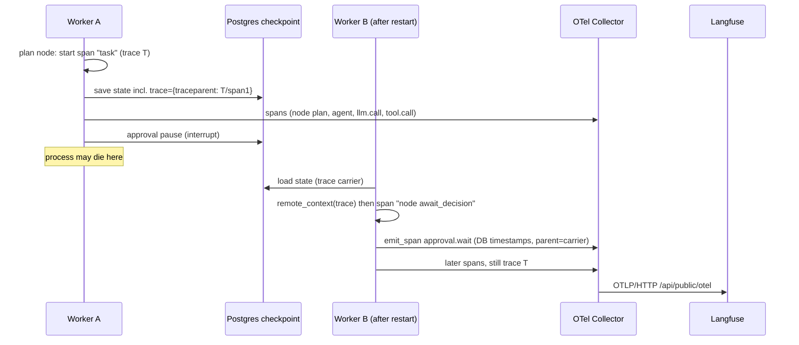

# 20 - Observability and telemetry (tag: OBS)

## What this file covers

How AEOS makes a multi-process, pausable, crash-prone agent run *debuggable*: OpenTelemetry tracing (explained from first principles), the span schema, one-trace-per-task across restarts and processes, Langfuse via an OTel collector, the redaction layer, OTel metrics, structured JSON logging, the persisted event log, per-task cost/token stats, and a practical "how to debug a task" guide. Files: `src/aeos/telemetry/{tracing,metrics,setup,__init__}.py`, `src/aeos/llm/traced.py`, `src/aeos/core/logging.py`, `src/aeos/core/stats.py`, `infra/otel-collector.yaml`. The dashboard's timeline is in [19-web-dashboard](19-web-dashboard.md); the infrastructure is in [21-deployment-and-infrastructure](21-deployment-and-infrastructure.md). Labels: **Verified**, **Inferred**, **Potential failure scenario**, **Recommendation**.

Four separate "signals" exist, and mixing them up is the most common explanation error:

| Signal | What it is | AEOS implementation | Where you look |
|---|---|---|---|
| Traces | tree of timed operations for one request/task | OTel spans via `traced()` | Langfuse UI (via collector) |
| Metrics | numeric time series (counters, histograms) | OTel instruments in `telemetry/metrics.py` | collector `debug` exporter only (see gaps) |
| Logs | discrete text/JSON lines | `JsonFormatter` to stderr | `docker compose logs` |
| Events | product-level audit/timeline records | `aeos.events` table via `DbSink` | dashboard, `aeos events` |
| (derived) Stats | per-task summary | `core/stats.py::task_stats` from checkpointed state | `/tasks/{id}/stats`, dashboard, `aeos stats` |

---

## 1. Tracing from first principles

**Problem.** One AEOS task touches the supervisor, several specialist agents, LLM calls, MCP tool servers (separate processes), A2A services (separate containers), a Docker sandbox, a human approval that may take hours, and possibly a worker crash in the middle. When something is slow or wrong, logs from five processes interleave and you cannot tell which line belongs to which task or why.

**Core idea.** A *span* is one timed operation: `{name, start, end, attributes, status, parent_span_id, trace_id}`. Spans form a tree by pointing at a parent. All spans of one logical request share a `trace_id`. Draw the tree by time and you get a waterfall: you can see what ran inside what, what overlapped, and where the time or the error is.

**Context propagation.** Inside one process, "who is my parent?" is tracked by a context variable (OTel's `Context`, built on Python `contextvars`), so `with span:` nesting works across `await`. Across processes the parent identity must travel *with the message*. The W3C standard header is `traceparent: 00-<trace_id 32 hex>-<span_id 16 hex>-<flags>`. The receiver extracts it and starts its spans as children, so one trace spans many processes.

**Export pipeline.** The app creates spans through an SDK `TracerProvider`; a `BatchSpanProcessor` buffers finished spans and an exporter ships them (OTLP over gRPC) to a *collector*, which can fan out to backends. Doing that through a collector (instead of straight to Langfuse) keeps the app vendor-neutral and moves retries/auth out of app code.

**Trace vs log vs metric.** A log says "something happened". A metric aggregates ("p95 of tool duration"). A trace answers "for *this* task, what happened in what order, how long, and under which parent".

---

## 2. The `traced()` seam (Verified, `telemetry/tracing.py`)

All instrumentation goes through one context manager:

```python
with traced("tool.call grep", attributes={...}) as span:   # SpanHandle
    span.set("aeos.tool.is_error", False)
```

What `traced` adds beyond raw OTel:

1. **Task binding.** `bind_task(task_id)` sets a `ContextVar`; every span started inside automatically carries `aeos.task.id` and `langfuse.session.id` (so Langfuse groups all traces/observations of a task into one *session*).
2. **Redaction at the sink.** Every attribute passes through `_coerce`: non-primitives are JSON-dumped, then `redact(...)`, then truncated to `MAX_ATTR_CHARS = 4000` with a `…[truncated]` marker. `redact` removes (a) exact secret strings registered at startup (`register_secrets`, fed by `init_telemetry` with the Gemini key, Langfuse keys and A2A key), (b) regex families (AWS key, PEM private key, GitHub tokens, Google `AIza` keys, `Bearer ...`), (c) `key=value` pairs where the key looks like api_key/secret/token/password (keeps the key name, hides the value).
3. **Control flow is not an error.** If the exception type name is in `_CONTROL_FLOW` (`GraphInterrupt`, `GraphBubbleUp`, `ParentCommand`, `CancelledError`) the span gets an `interrupted` event and the exception propagates *without* ERROR status. This matters: LangGraph implements the human-approval pause by raising an interrupt; without this rule every approval wait would show as a red failed span. Type *names* are compared (strings) rather than imported classes, a pragmatic choice that avoids importing LangGraph into the telemetry layer (Inferred).
4. **Real errors.** Other exceptions set `error.type`, `record_exception`, `StatusCode.ERROR` with a redacted 500-char message, and `handle["error"]`.
5. **A log line per span.** In `finally`, it logs `name` with `span`, `duration_ms` and the handle fields at WARNING if errored else DEBUG. So spans also leave a JSON log breadcrumb (visible only if log level is DEBUG; see section 6).

`SpanHandle` is a `dict` subclass so older call sites that treated the yielded value as a dict still work, plus `.set()` and `.event()`.

`emit_span(name, start_s, end_s, parent=carrier, ...)` records a span with explicit wall-clock bounds, used for `approval.wait` because the process that records it did not live through the wait (see section 4).

## 3. Span schema (Verified by grep of `traced(` call sites)

| Span name | Created in | Key attributes |
|---|---|---|
| `task` (root) | `graph/nodes.py::plan` | `langfuse.trace.name="aeos task"`, `aeos.task.goal`; later `aeos.task.status`, `aeos.task.llm_calls` (via `annotate`) |
| `node <name>` | `graph/build.py::_crashable` wrapper for every node except `plan` | `aeos.node` |
| `agent <owner>` | `agents/loop.py` | `aeos.agent`, `aeos.step.id`, `aeos.step.attempt`, `aeos.agent.status` |
| `llm.call <model>` | `llm/traced.py::TracedLLM.complete` | `gen_ai.*` (system, request model/max_tokens, response model, finish reason, input/output tokens), `aeos.llm.cost_usd`, `aeos.llm.tools_offered`, `langfuse.observation.{type=generation,input,output,model.name,usage_details,cost_details}` |
| `tool.call <name>` | `agents/tools.py` | `aeos.tool.{name,server,risk,result_origin,arguments,is_error}`, `aeos.policy.rule`, `aeos.agent`, `aeos.step.id` |
| `mcp.call` | `mcp_client.py` | `server`, `tool`, `attempt` |
| `a2a.delegate` / server span | `a2a/client.py`, `a2a/server.py` | `owner`, `endpoint` |
| `sandbox.exec` | `sandbox/manager.py` | `sandbox`, `cmd`, `argv` (+ exit code, timeouts per docs) |
| `verifier.gates` | `agents/verifier.py`, `verifier_change.py` | `aeos.verification.attempt`, status, gates |
| `approval.wait` | `graph/publish.py::await_decision` via `emit_span` | `aeos.approval.{id,decision,actor,tool}` |

Two attribute namespaces coexist on purpose: `gen_ai.*` follows the OTel GenAI semantic conventions (portable to any backend), and `langfuse.*` are Langfuse's own OTLP attribute names (Verified in `traced.py`) so Langfuse renders generations with prompt, completion, tokens and cost instead of generic spans. `aeos.*` are project-specific.

`docs/ARCHITECTURE.md` lists `memory.*` spans in the module docstring of `tracing.py`; a grep of `traced(` call sites in `src/` finds no `memory.*` span, so that item in the schema docstring is aspirational or implemented elsewhere than `traced(` (Verified absence, Potential doc/code mismatch).

## 4. One trace per task, across crashes, workers and processes

Problem: LangGraph runs each node as a separate call, and after an approval pause the continuation may run in a different process hours later. Naively every node would start a *new* trace.

AEOS solution (Verified):

1. The `plan` node opens the root span `task`, calls `inject_context()` (W3C carrier `{"traceparent": ...}`) and returns it in its state update: `return {**update, "trace": carrier}`. The carrier is therefore *checkpointed in Postgres* with the rest of `TaskState`.
2. Every other node, wrapped by `_crashable`, runs inside `remote_context(state.trace)` + `traced("node <name>")`, so its spans are children of the root, regardless of process or wall-clock time.
3. A2A calls inject the context into message metadata (`meta.update({"trace": inject_context(), ...})` in `a2a/client.py`) and the server uses `remote_context(meta.get("trace"))`; MCP calls propagate through `_meta` (test `test_trace_context_crosses_the_mcp_process_boundary` shows an echo MCP server reporting the *caller's* trace id).
4. The wait for a human approval is recorded by `emit_span("approval.wait", created_at, decided_at, parent=state.trace)` using the DB timestamps, because the original process may be gone.
5. `trace_id` is exposed to users: `task_view` and `task_stats` split `state.trace["traceparent"]` to get the 32-hex id, which the dashboard and `aeos open <id>` turn into a Langfuse URL.



How to read it: the trace id is part of durable state, not of any process. Whoever runs the next node re-attaches to it, so Langfuse shows one tree even though two workers produced it.

Caveat (Potential failure scenario, Inferred): the root `task` span is *closed* when the `plan` node returns (it wraps only `_plan`), while later nodes attach as its children after it has ended. Backends accept children that outlive their parent, but the root span's duration will show only the planning phase, not the task's total duration; total task duration is available as the `aeos.task.duration_s` metric and in `/stats`. Also after a crash *inside* the plan node the carrier is never saved and the retry creates a new root.

## 5. LLM spans, tokens and cost

`TracedLLM` (`llm/traced.py`) is a decorator over any `LLMProvider`: it forwards `complete()` and `__getattr__` (so `.model`, `.routes` still work), wraps the call in `llm.call <model>`, records prompt (each message truncated to 3000 chars) and completion as JSON, and sets token counts. Cost = `estimate_cost(model, in_tokens, out_tokens)` from `llm/pricing.py`, a hard-coded `PRICES` table in USD per million tokens with a default of (1.00, 8.00) for unknown models. The module docstring says "estimates for budgeting, not billing", and some entries are marked `# estimates`. `runtime.py::_traced` wraps the provider once (idempotent via `isinstance`), so both the normal and "strong" model routes are traced. Metrics `aeos.llm.{calls,tokens,cost_usd,duration_ms}` are recorded after the span closes.

Two cost numbers exist (Verified): the span attribute / metric computed in `TracedLLM`, and `Budget.cost_usd` / `tokens_used` in the checkpointed `TaskState` (updated by the budget tracker, enforced with `max_cost_usd`, default 5.0, API cap 50). `task_stats` reports the **Budget** numbers, so `/stats`, the dashboard meters and `aeos stats` agree with what the budget gate used; Langfuse shows the span-level estimate. They use the same pricing function by design but are separate code paths (Inferred: they can drift if one path changes).

## 6. Logging (Verified, `core/logging.py`)

`JsonFormatter` emits one JSON object per line: `ts` (UTC ISO), `level`, `logger`, `message`, `task_id`, `run_id`, `agent` (from ContextVars), any `extra={...}` fields, and `exc_info`. `configure_logging(level)` installs a single stderr handler (tagged so repeated calls replace it rather than duplicate).

Findings (Verified):

- **`run_context(task_id=..., agent=...)` is never called in `src/`** (grep: only `core/logging.py` and `tests/core/test_logging.py`). So in production the `task_id`/`run_id`/`agent` fields are always `null`. The only correlation currently is explicit `extra={"task_id": ...}` at some call sites (e.g. the worker's `claimed task` log). `bind_task` in `tracing.py` is a *different* ContextVar and does not feed the logger.
- **`Settings.log_level` (`AEOS_LOG_LEVEL`) is defined and tested but not read by the CLI**: `cli.main` calls `configure_logging("INFO" if args.verbose else "ERROR")`, and only `aeos run` has `-v`. Result: `aeos serve` and `aeos worker` (the compose `api` container) log at ERROR; uvicorn is set to `log_level="warning"`. INFO lines such as "claimed task" are therefore suppressed in the default stack. The A2A service uses `configure_logging("WARNING")`.
- Span breadcrumb logs are at DEBUG on success, so they also do not appear by default.

Net: logs are structured but currently thin; traces and the events table are the primary debugging tools.

## 7. Metrics (Verified, `telemetry/metrics.py`)

Instruments (created against the global meter, no-ops until a `MeterProvider` is set): `aeos.llm.calls`, `aeos.llm.tokens` (attr `direction`), `aeos.llm.cost_usd`, `aeos.llm.duration_ms`, `aeos.tool.calls` (attr `outcome`), `aeos.tool.duration_ms`, `aeos.approvals` (attr `decision`), `aeos.step.retries`, `aeos.replans`, `aeos.verifications` (attr `status`), `aeos.tasks.finished` (attr `status`), `aeos.task.duration_s`. Call sites: `llm/traced.py`, `agents/tools.py`, `graph/nodes.py`, `graph/publish.py`.

`setup_telemetry` exports metrics every 10 s over OTLP/gRPC, but `infra/otel-collector.yaml` routes the `metrics` pipeline only to the `debug` exporter (and `logs` likewise). **There is no Prometheus/Grafana or other metric backend**, so metrics are emitted but effectively only visible in the collector's own stdout (Verified). Likewise the collector has a `logs` pipeline although the app never emits OTLP logs.

## 8. Telemetry bootstrap and failure behaviour

`init_telemetry(service)` (`telemetry/setup.py`) is called by `cli.main` for every non-client command (service names `aeos-run`, `aeos-serve`, `aeos-worker`, `aeos-agent-<owner>`) and by MCP servers (`mcp_servers/common.py`). It *always* registers secrets for redaction, and only starts exporting if `AEOS_TELEMETRY_ENABLED` (default true) and not already configured. The exporter endpoint defaults to `http://localhost:4317`; compose sets `http://otel-collector:4317`.

Behaviour with no collector (Inferred from the OTel SDK design, not tested here): `BatchSpanProcessor` exports on a background thread, so the agent loop is not blocked; failed exports are logged by the SDK and dropped. Tests set `AEOS_TELEMETRY_ENABLED=false` in an autouse fixture (`tests/conftest.py`) so nothing exports during tests, and a `spans` fixture swaps in an in-memory exporter (`reset_for_tests` pokes private OTel globals `_TRACER_PROVIDER_SET_ONCE`, a fragile but documented hack).

`TracerProvider` is global and first-call-wins per process. Langfuse is never imported by the app: Langfuse keys are used by the *collector* (`LANGFUSE_BASIC_AUTH` = base64 `public:secret`, see [21-deployment-and-infrastructure](21-deployment-and-infrastructure.md)). `Settings.langfuse_host` exists but the app only uses `langfuse_public_url` for deep links.

## 9. The event log is a fourth channel

`aeos.events` (Postgres) holds product-level events (`step_started`, `tool_called`, `verification`, `approval_requested`, `task_completed`...) emitted through `EventSink` (`core/events.py`: `Event`, `ConsoleSink`, `ListSink`, `CompositeSink`; `store/events.py::DbSink`). These drive the dashboard timeline, the SSE stream and the CLI `watch`. They are not spans: no parent/child, no durations, free-text message. They are durable and cheap, and work with telemetry disabled. See [18-api-and-client](18-api-and-client.md).

## 10. How to debug a bad task with these tools (practical)

1. `aeos show <id>` or the dashboard task page: status line, plan versions, error, verifications. Is it `escalated`, `failed`, or `awaiting_approval`?
2. `aeos events <id>` / the Timeline: the ordered story, including `replan` and `approval_*`.
3. `aeos stats <id>`: did it hit a budget (cost/tokens/steps/time) - check "Replans / retries" and tool error counts.
4. `aeos open <id>` or the "Open trace in Langfuse" link: find the failed span (status ERROR, `error.type`). Open the preceding `llm.call` to read the exact prompt and completion; open `tool.call` for arguments, `aeos.policy.rule` (which policy decision allowed or blocked it) and `aeos.tool.result_origin` (trusted vs untrusted). Filter by session = task id to see all attempts.
5. `docker compose logs api` for ERROR-level lines (default level), or run `aeos run -v` for INFO logs locally.
6. For a worker crash: look for two `node ...` spans with the same name in one trace (re-executed after resume); approval pauses show as `approval.wait` with human actor.

---

## Interview questions

## Q-OBS-1. Explain distributed tracing and how AEOS gets one trace per task even across restarts.
**Difficulty:** Advanced  **Topic:** Trace context propagation, durable state
**Short answer:** A trace is a tree of timed spans sharing a trace id. Normally the parent link lives in process memory. AEOS serialises the W3C `traceparent` of the root `task` span into the checkpointed `TaskState.trace`, and every later node re-attaches with `remote_context(state.trace)`. So any worker, at any time, continues the same trace.
**Detailed explanation:** Context propagation inside a process uses `contextvars`; across processes, a header carries `trace_id` and parent `span_id`. The unusual piece here is that the "message" being carried between hops is the LangGraph checkpoint in Postgres, so propagation crosses time as well as space.
**How this project uses it:** `GraphNodes.plan` wraps `_plan` in `traced("task")`, calls `inject_context()` and returns `{"trace": carrier}`. `_crashable` in `graph/build.py` wraps every other node in `remote_context(state.trace)` and `traced("node <name>")`. A2A (`a2a/client.py`, `a2a/server.py`) and MCP (`mcp_client.py`) propagate similarly. `approval.wait` uses `emit_span(parent=state.trace)`.
**Example/walkthrough:** Worker A plans and pauses for approval (trace T). Worker B resumes 3 h later: its `node await_decision` span has trace id T and parent = root; `approval.wait` spans the 3 h with DB timestamps.
**Follow-ups:**
- *What breaks the chain?* A crash inside the plan node before the checkpoint write: the carrier was never saved, the retry opens a new root (Potential failure scenario, Inferred).
- *Why is the root span short?* It wraps only the plan node; children arrive after it ended. Total duration is in `/stats` and the `aeos.task.duration_s` histogram.
- *How is it tested?* `test_remote_context_continues_a_trace_from_another_process_or_time` and `test_trace_context_crosses_the_mcp_process_boundary`.
**Trade-offs and alternatives:** OTel span *links* between per-node traces, or a long-lived root span emitted at `finish` with explicit bounds via `emit_span`.
**Common interview mistake:** Saying "we use Langfuse for tracing". The app emits standard OTel; Langfuse is a backend behind a collector.
**Related:** [07-state-durability-and-persistence](07-state-durability-and-persistence.md), [16-a2a-and-github-integration](16-a2a-and-github-integration.md), [15-mcp-servers-and-tool-layer](15-mcp-servers-and-tool-layer.md)

## Q-OBS-2. Why does `traced()` treat `GraphInterrupt` and `CancelledError` specially?
**Difficulty:** Intermediate  **Topic:** Span status semantics
**Short answer:** LangGraph pauses for human approval by raising an interrupt exception, and asyncio cancels tasks with `CancelledError`. Neither is a failure. If they set ERROR status, every approval wait and cancel would show as a red failed span and poison error dashboards. So `traced` records an `interrupted` event and re-raises without ERROR.
**Detailed explanation:** Span status is what alerting keys off. Control-flow exceptions are normal outcomes in this system, so they must be excluded.
**How this project uses it:** `_CONTROL_FLOW = {"GraphInterrupt", "GraphBubbleUp", "ParentCommand", "CancelledError"}` compared with `type(exc).__name__`; other exceptions get `error.type`, `record_exception`, `Status(ERROR, redact(str(exc))[:500])`. `record_exception=False, set_status_on_exception=False` is passed to OTel so `traced` owns the policy.
**Example/walkthrough:** `await_decision` calls `interrupt(...)`, raising through `node await_decision`: span ends OK with an `interrupted` event.
**Follow-ups:**
- *Why compare names not classes?* Avoids importing LangGraph in telemetry; the cost is that a renamed class would silently become an "error" (Inferred).
- *Tested?* `test_exceptions_mark_the_span_as_error_and_propagate` covers the error path; I did not find a test asserting the interrupt path (Verified by reading test names).
**Trade-offs and alternatives:** Import the real exception types in a lazy `isinstance` check.
**Common interview mistake:** Not realising HITL pauses are exceptions in LangGraph.
**Related:** [05-agents-and-orchestration](05-agents-and-orchestration.md), [13-verification-and-risk-policy](13-verification-and-risk-policy.md)

## Q-OBS-3. How do you stop secrets from leaking into traces, and how far does the protection go?
**Difficulty:** Advanced  **Topic:** Redaction
**Short answer:** Every span attribute goes through `_coerce`, which JSON-serialises, runs `redact`, and truncates at 4000 chars. `redact` removes exact registered secrets (API keys loaded from settings at startup), well-known token shapes (AWS, GitHub, Google, PEM, Bearer) and `password=`-style key/value pairs. It is a defence in depth layer, not a guarantee.
**Detailed explanation:** Traces are exported to a third-party-capable backend and contain prompts and tool arguments, which can include secrets read from repos or environment. Redacting at the single `traced`/`annotate`/`emit_span` choke point is easier to audit than at call sites.
**How this project uses it:** `register_secrets` is fed by `init_telemetry` (Gemini, Langfuse public/secret, A2A keys); GitHub token is **not** in that list but is covered by the `gh[pousr]_`/`github_pat_` regexes (Verified: `setup.py` list). `test_secrets_never_reach_a_span` checks exact, regex, key-value and a value set later through `s.set`.
**Example/walkthrough:** Tool args `{"api_key": "sk-live-abcdef123456"}` -> `"api_key": "[REDACTED]"` (key kept).
**Follow-ups:**
- *What does it miss?* Secrets with no known shape and not registered, or split across attributes; also the event log and JSON logs are separate channels: the event `message`/`data` is not passed through `redact` in the code I read (Potential gap, Recommendation: redact in `DbSink`).
- *Why also truncate?* Bounds cost/size, and limits the blast radius of an unredacted blob.
**Trade-offs and alternatives:** Secret scanners (e.g. detect-secrets patterns) at the collector with an OTel processor.
**Common interview mistake:** Claiming "traces never contain secrets".
**Related:** [14-security-and-prompt-injection](14-security-and-prompt-injection.md), [21-deployment-and-infrastructure](21-deployment-and-infrastructure.md)

## Q-OBS-4. How are tokens and cost measured, and which number is the "real" one?
**Difficulty:** Intermediate  **Topic:** Cost accounting
**Short answer:** `TracedLLM` reads token usage from each provider response and estimates dollars from a hard-coded per-million-token price table. That estimate goes onto the `llm.call` span and into OTel counters. Separately the budget tracker accumulates the same into the checkpointed `Budget`, and `/stats`, the dashboard and the CLI show the Budget numbers. All are estimates, not billing.
**Detailed explanation:** Estimates are good enough for a cap and for comparing runs, but providers change prices and models; an unknown model falls back to $1/$8 per million.
**How this project uses it:** `llm/pricing.py::estimate_cost`, `llm/traced.py`, `core/stats.py::task_stats` (reads `state.budget`), `Budget.max_cost_usd` default 5.0, API-level cap `le=50` in `TaskRequest`.
**Example/walkthrough:** 10k input + 2k output tokens on `gemini-2.5-flash` = (10000*0.30 + 2000*2.50)/1e6 = $0.008.
**Follow-ups:**
- *Why report Budget numbers in stats?* They are checkpointed with the task so they survive restarts and work for paused tasks, with no dependency on telemetry being enabled.
- *Failure scenario?* A new model missing from `PRICES` is priced at the default and may under- or over-count against the cap (Potential failure scenario).
**Trade-offs and alternatives:** Use provider-reported billing usage or a pricing service.
**Common interview mistake:** Presenting the dashboard cost as an invoice.
**Related:** [06-llm-integration](06-llm-integration.md), [23-evaluation-framework](23-evaluation-framework.md)

## Q-OBS-5. Why route telemetry through an OTel collector instead of exporting straight to Langfuse?
**Difficulty:** Intermediate  **Topic:** Collector architecture
**Short answer:** The app speaks only standard OTLP to one local endpoint; the collector owns backend auth, retries and fan-out. Swapping or adding a backend is a config change, and the app has no Langfuse SDK or credentials.
**Detailed explanation:** Collector config (`infra/otel-collector.yaml`): OTLP receiver on 4317/4318, a `health_check` extension on 13133, exporters `debug` and `otlphttp/langfuse` (to `http://langfuse-web:3000/api/public/otel` with a Basic auth header from `LANGFUSE_BASIC_AUTH`, 30 s retry). Traces go to both; metrics and logs go only to `debug`.
**How this project uses it:** `AEOS_OTEL_EXPORTER_ENDPOINT=http://otel-collector:4317` in compose; the collector is in the default profile while Langfuse is in the `observability` profile.
**Example/walkthrough:** `docker compose up -d` (default): collector runs, Langfuse does not, so the `otlphttp/langfuse` exporter fails and retries; spans still reach the `debug` exporter. `--profile observability` brings Langfuse up (Inferred behaviour from config; not run here).
**Follow-ups:**
- *Why does compose require `LANGFUSE_BASIC_AUTH` even for the default stack?* Because the collector service uses `${LANGFUSE_BASIC_AUTH:?...}`; the `init_env.py` script generates it (Verified).
- *Extra hop cost?* One more container and a hop; tolerable.
- *Gap?* No metrics backend: metrics go to `debug` only.
**Trade-offs and alternatives:** Direct OTLP/HTTP exporter to Langfuse; Tempo/Jaeger for traces, Prometheus for metrics.
**Common interview mistake:** Saying Langfuse receives data from a Langfuse SDK.
**Related:** [21-deployment-and-infrastructure](21-deployment-and-infrastructure.md)

## Q-OBS-6. Your logs are JSON. Can I filter all log lines for one task?
**Difficulty:** Advanced  **Topic:** Structured logging, honest gaps
**Short answer:** Not reliably today. The formatter supports `task_id`, `run_id` and `agent` from context variables, but the code that sets them (`run_context`) is never called outside tests, so those fields are null unless a call site passes `extra={"task_id": ...}`. Also the default log level in the api container is ERROR.
**Detailed explanation:** Structured logging only helps if correlation fields are populated. The tracing layer has its own `bind_task` ContextVar, which does not feed logging.
**How this project uses it:** `core/logging.py::JsonFormatter`, `configure_logging`; `cli.main` chooses ERROR/INFO via `-v`; worker logs use explicit `extra`.
**Example/walkthrough:** `{"level":"WARNING","message":"lost lease or cancelled","task_id":"t-1",...}` appears because the worker passes `extra`; most others have `task_id: null`.
**Follow-ups:**
- *Minimal fix?* In `_crashable` also enter `run_context(task_id=state.task_id)`; or make `bind_task` set both vars. And read `settings.log_level` in `main` (setting exists but is unused) (Recommendation).
- *Why does `AEOS_LOG_LEVEL` not work?* It is defined in `Settings` and tested for validation, but `cli.py` does not read it (Verified).
- *Alternative for correlation?* Add `trace_id` to logs so a log line links to a trace.
**Trade-offs and alternatives:** structlog; OTel logs bridge with the collector's `logs` pipeline (already defined, unused).
**Common interview mistake:** Claiming full log-to-trace correlation.
**Related:** [10-error-handling-and-reliability](10-error-handling-and-reliability.md)

## Q-OBS-7. Why is the human approval wait emitted with `emit_span` instead of a normal span?
**Difficulty:** Advanced  **Topic:** Spans with explicit time bounds
**Short answer:** A normal `with traced()` measures wall time inside one process. The approval wait may span a restart or hours, and the code that learns the decision runs later in a different process. So `await_decision` reconstructs the span afterwards from the approval row's `created_at` and `decided_at` (or `expires_at`) and attaches it to the task's stored trace context.
**Detailed explanation:** OTel allows `start_span(start_time=...)` and `span.end(end_time=...)` in nanoseconds, so you can emit a span retroactively.
**How this project uses it:** `graph/publish.py::await_decision` after `interrupt()` returns; `emit_span("approval.wait", req.created_at.timestamp(), (req.decided_at or req.expires_at).timestamp(), parent=state.trace, **{"aeos.approval.*": ...})`; counter `aeos.approvals` incremented.
**Example/walkthrough:** Request at 10:00, approved at 13:10 by alice: a 3 h 10 min span in the trace, with `aeos.approval.actor=alice`.
**Follow-ups:**
- *Where is the human wait visible to non-Langfuse users?* In the dashboard waterfall's "human approval" lane built from events (see [19-web-dashboard](19-web-dashboard.md)).
- *Rule:* "Nothing expensive may run before interrupt()" - the node re-executes from the top on resume, so side effects before `interrupt` would repeat (comment in the code).
**Trade-offs and alternatives:** Span events on the node span; start/stop markers.
**Common interview mistake:** Not knowing the node re-runs on resume.
**Related:** [13-verification-and-risk-policy](13-verification-and-risk-policy.md), [07-state-durability-and-persistence](07-state-durability-and-persistence.md)

## Q-OBS-8. A task failed overnight. Walk me through debugging it with what this repo provides.
**Difficulty:** Intermediate  **Topic:** Operational debugging
**Short answer:** Start with the status and error (`aeos show`), read the event timeline, check stats for budget exhaustion, then open the Langfuse trace to find the failed span and inspect the exact prompt, tool arguments, policy rule and result origin. Use container logs only for ERROR-level lines.
**Detailed explanation:** Layered approach: product events (what), stats (how much), trace (why/where), logs (infrastructure errors).
**How this project uses it:** commands `aeos show/events/stats/open`, dashboard task page, Langfuse trace link from `trace_id`, span attributes `aeos.policy.rule`, `aeos.tool.result_origin`, `error.type`.
**Example/walkthrough:** See section 10.
**Follow-ups:**
- *What if Langfuse was not running?* Events, stats and checkpoints are in Postgres and still work; spans exported while the backend was down are lost (the collector retries for 30 s only).
- *How do you tell a re-executed node after a crash?* Duplicate `node X` spans under one trace.
**Trade-offs and alternatives:** Persist spans in Postgres/Tempo for retention.
**Common interview mistake:** Reading only logs.
**Related:** [10-error-handling-and-reliability](10-error-handling-and-reliability.md), [24-technical-challenges-and-history](24-technical-challenges-and-history.md)

## Q-OBS-9. What observability gaps would you close first?
**Difficulty:** Expert  **Topic:** Recommendations
**Short answer:** (1) A metrics backend and alerts, since metrics currently only go to the collector's debug exporter; (2) log correlation (`task_id`, `trace_id`) and honouring `AEOS_LOG_LEVEL`; (3) redaction in the event log; (4) a root span that covers the whole task; (5) retention for traces beyond local Docker volumes.
**Detailed explanation:** Each item is a Verified gap from sections 4, 6, 7 and Q-OBS-3. Highest value per effort: wire `run_context` into `_crashable` and read `log_level`.
**How this project uses it:** n/a (all Recommendations).
**Example/walkthrough:** Alert example: `aeos.tasks.finished{status="failed"}` rate over 15 min, `aeos.llm.cost_usd` per hour.
**Follow-ups:**
- *What would an SLO be here?* e.g. "approval-requested within N minutes for 95% of change requests"; no such SLO exists in the repo (do not claim one).
**Trade-offs and alternatives:** Managed observability (Grafana Cloud, Datadog) vs self-hosted Langfuse + Prometheus.
**Common interview mistake:** Listing tools instead of the specific gaps.
**Related:** [21-deployment-and-infrastructure](21-deployment-and-infrastructure.md)
