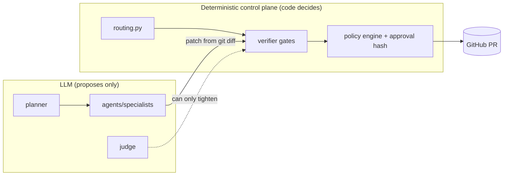

# 25. Design decisions and trade-offs

**What this file covers.** The ~18 most consequential design decisions in AEOS, each analysed the same way: what the code does today, the problem it solves, the evidence in the repo, the rationale (labelled **Documented** when it is written in `docs/DECISIONS.md`, **Inferred** when I am reconstructing the reason from the code), pros/cons, alternatives, when to revisit, and what a skeptical interviewer will ask. Then a set of cross-cutting interview questions (tag `DEC`). Cross-checked against the `D-nnn` entries in `autonomous-engineering-os/docs/DECISIONS.md` (D-001..D-050).

Label legend: **Verified** = I read the code/test; **Documented** = stated in DECISIONS.md / docs; **Inferred rationale**; **Potential failure scenario**; **Recommendation**.

Honesty note that matters for every decision below: the git history is 8 snapshot commits, not a development log (see [24-technical-challenges-and-history.md](24-technical-challenges-and-history.md)). Where DECISIONS.md says "found via a real failure in tests" (D-014, D-018, D-019) that is the author's documented claim; I cannot corroborate it from history. Never narrate extra incidents in an interview.

Sibling deep-dives: [03](03-system-architecture.md), [05](05-agents-and-orchestration.md), [07](07-state-durability-and-persistence.md), [12](12-sandbox-and-execution-safety.md), [13](13-verification-and-risk-policy.md), [14](14-security-and-prompt-injection.md), [15](15-mcp-servers-and-tool-layer.md), [16](16-a2a-and-github-integration.md), [26 scalability](26-scalability-and-system-design.md).

---

## 0. Decision map

| # | Decision | DECISIONS.md | Core files |
|---|---|---|---|
| 1 | LangGraph state machine with plain-function routing | D-023, D-001/D-033 | `graph/build.py`, `graph/routing.py` |
| 2 | Postgres checkpointer + own lease queue (not Temporal) | D-001, D-033, D-032 | `graph/checkpoint.py`, `store/tasks.py`, `worker.py` |
| 3 | Re-run the interrupted node, no mid-node checkpoint | D-032 | `worker.py::_execute` |
| 4 | Docker sandbox: no network, read-only root, caps dropped | D-017..D-020 | `sandbox/manager.py`, `sandbox/policy.py` |
| 5 | Patch comes from sandbox `git diff`, never model text | D-021, D-035 | `agents/sandbox_tools.py` |
| 6 | Independent deterministic verifier + monotone LLM judge | D-025, D-049 | `agents/verifier.py`, `agents/judge.py` |
| 7 | Human approval bound to an arguments hash | D-030, D-031 | `core/risk.py`, `store/approvals.py` |
| 8 | Deny-wins policy engine, default require_approval | D-028, D-029 | `core/risk.py`, `policy/` |
| 9 | Tools over MCP (stdio child processes) vs in-process | D-011, D-014, D-022 | `mcp_client.py`, `mcp_servers/*` |
| 10 | A2A is optional; in-process specialists are the default | D-038..D-041 | `a2a/*`, `runtime.py` |
| 11 | Gemini as the only real provider (+ FakeLLM) | D-002, D-024 | `llm/gemini.py`, `llm/fake.py` |
| 12 | Memory: advisory, write-gated, provenance computed | D-036, D-037 | `memory/*` |
| 13 | GitHub: local-bare-remote mirror, real PR only at approval | D-009, D-012, D-013, D-045 | `mcp_servers/github/*`, `graph/publish.py` |
| 14 | Idempotency keys derived by runtime, hidden from model | D-013, D-022 | `agents/tools.py`, `mcp_servers/github/*` |
| 15 | Escalate (not fail); forced strategy change in code | D-026, D-027 | `core/retry.py`, `graph/routing.py` |
| 16 | FastAPI + SSE-by-DB-polling + Next.js dashboard | D-046..D-050 | `api/app.py`, `store/events.py`, `web/` |
| 17 | Observability at seams, one trace per task | D-042..D-044 | `telemetry/*`, `llm/traced.py` |
| 18 | Cancel by lease fencing, not by killing workers | D-047 | `store/tasks.py::cancel` |
| 19 | Budgets as a shared tracker with escalation | D-023, D-026 | `core/state.py::Budget`, `agents/loop.py` |

How to read it: the recurring design principle is that the LLM proposes and deterministic code disposes. Decisions 5, 6, 7, 8, 14, 15 are all instances. If asked "what is the one idea behind AEOS?" this is it. **Inferred rationale** for the unification (the docs state each instance separately, not this summary).

---

## 1. LangGraph state machine with plain-function routing

- **Current implementation (Verified).** `build_graph` in `graph/build.py` registers nodes `plan, dispatch, synthesize, verify, replan, publish_prepare, await_decision, publish_pr, finish, reflect` (each wrapped by `_crashable`), and attaches `route` as a conditional edge from eight of them; `finish -> reflect -> END` is static. The routing function is ordinary Python in `graph/routing.py`. State is one pydantic `TaskState` (`core/state.py`).
- **Problem.** An agent loop with retries, replans, a human pause and crash recovery needs explicit states. A free-form "agent decides what to do next" loop is hard to test, hard to make durable and hard to audit.
- **Evidence.** Routing is unit-tested without a framework; checkpoints give pause/resume (`interrupt()` in `await_decision`). D-023: "routing are plain functions ... instead of hidden in the framework."
- **Rationale.** Documented (D-023, D-001: roadmap fixed LangGraph). Inferred: LangGraph buys checkpoint/resume/interrupt for free and a graph that can be drawn.
- **Pros.** Auditable control flow; resume semantics from the checkpointer; deterministic tests via `FakeLLM`. **Cons.** Framework coupling (serialiser allowlist `state_types()`, checkpoint schema owned by LangGraph, [Q-STATE-10]); the graph is mostly linear-with-loops, so a hand-rolled `while` loop plus a Postgres row could express it; langgraph version upgrades can break stored checkpoints (**Potential failure scenario**, untested).
- **Alternatives.** Hand-written state machine + own table (more code, full control); Temporal workflows (see 2); an "agent framework" with implicit control flow (less auditable).
- **Revisit when.** You need long-lived versioned workflows (code changes while tasks are paused for days), or multiple workflow types with different shapes.
- **Skeptical questions.** "What did LangGraph give you that a table and a `while` loop would not?" Answer: interrupt/resume and per-step checkpoints are real, but be honest that the graph is small. "What happens to paused tasks when you deploy new node code?" Not handled: no graph versioning (Recommendation: record a graph/schema version in `aeos.tasks`).

## 2. Postgres checkpointer + own lease queue instead of Temporal

- **Current implementation (Verified).** `graph/checkpoint.py::open_checkpointer` wraps `AsyncPostgresSaver.from_conn_string(database_url, serde=JsonPlusSerializer(allowed_msgpack_modules=state_types()))`. Separately, `store/tasks.py` implements a queue: `claim` does `UPDATE ... WHERE task_id = (SELECT ... FOR UPDATE SKIP LOCKED LIMIT 1)` over `status='queued' OR (status='running' AND lease_expires_at < now())`; `heartbeat` renews only if `worker_id` still matches; `finish`/`consumed_resume` are fenced the same way. A crash-loop guard escalates when `attempts >= max_attempts` (5).
- **Problem.** Survive `kill -9` mid-task and keep two workers from running the same task.
- **Evidence.** `tests/chaos/test_chaos.py` (chaos suite; docs claim 27/27 pass, I did not re-run). Details and fencing in [Q-STATE-4], [Q-STATE-7].
- **Rationale.** Documented D-001 ("tentative"), D-033: "chaos suite passes on LangGraph checkpoints + our own lease queue; Temporal would add an operational dependency for the same guarantees at this scale. Revisit at 100x."
- **Pros.** One datastore (Postgres already needed for memory, approvals, events); transparent SQL you can read in 200 lines; no new service. **Cons.** You now own a queue: no fairness, priorities, rate limits, retries with backoff, visibility into stuck leases; polling not push ([Q-STATE-8]); `claim` increments `attempts` on *every* claim including approval resumes (Verified discrepancy) so a task with many approval cycles consumes crash-loop budget; no graceful shutdown means deploys look like crashes ([Q-REL-7]).
- **Alternatives.** Temporal/Cadence (durable timers, versioning, retries as platform features, but a cluster to run), Celery/RQ + Redis (Redis is provisioned but unused, see [21](21-deployment-and-infrastructure.md)), Postgres queue libraries (pgmq, Procrastinate, `pg-boss`-style).
- **Revisit when.** Multi-tenant fairness, scheduled/delayed work, many workflow versions, or lease-sweep latency becomes a user-visible problem. See [26 section 4](26-scalability-and-system-design.md).
- **Skeptical.** "You reinvented a job queue." Answer: yes, narrowly, with a reason (one dependency), and I know exactly which features I skipped. Never claim exactly-once; claim at-least-once execution with idempotent effects.

## 3. Crash recovery by re-running the interrupted node

- **Current implementation (Verified).** `Worker._execute` branches on the checkpoint snapshot: no values -> start; `snap.interrupts` + `pending_resume` -> `Command(resume=payload)`; `snap.next` -> `graph.ainvoke(None, config)`. Nodes are restartable because side effects carry idempotency keys and DB unique constraints.
- **Problem.** Mid-node state (e.g. half-done sandbox edits) cannot be checkpointed by LangGraph, which snapshots between nodes.
- **Rationale.** Documented D-032: "Simpler and verifiably correct; costs repeated LLM work only for the interrupted node."
- **Cons (Potential failure scenarios, derived from Verified code).** Budget accrued inside the crashed node is lost (tracker lives in memory until node returns, [Q-REL-4]); stale `pending_resume` if a crash lands after resume but before `consumed_resume`; the interrupted *coding* node can be the most expensive one in the graph, so crash cost is not small.
- **Alternatives.** Step-level checkpointing inside the agent loop (write each tool call to DB; more complex replay), or deterministic replay of recorded LLM responses (needs response log).
- **Revisit when.** Median node cost exceeds what you will tolerate to redo (measure: p95 node duration x crash rate).

## 4. Docker sandbox with no network, read-only root, dropped capabilities

- **Current implementation (Verified).** `SandboxManager.create_sandbox` (`sandbox/manager.py`) starts containers with `network_mode="none"`, `read_only=True`, size-capped `tmpfs`, `cap_drop=["ALL"]`, `security_opt=["no-new-privileges"]`; `Limits` in `sandbox/policy.py`: 512m memory, 1 cpu, 128 pids, 60 s exec timeout, 1800 s TTL. Commands are argv lists checked by `check_command` against allow/deny lists. Files move via `exec` + tar, not `docker cp` (D-017). Leftover-process check after every exec (D-019). A second, networked container only for npm (`sandbox/npm.py`, [Q-SBX-3]).
- **Problem.** LLM-written code must run without being able to touch the host or exfiltrate data.
- **Rationale.** Documented D-017..D-020; allow/deny lists are described in code as defense in depth, "the container is the security boundary" (`sandbox/policy.py` docstring).
- **Pros.** Strong default isolation; abuse tests exist (fork bomb, etc.). **Cons.** Shared host kernel (container, not VM); the services that create sandboxes mount `/var/run/docker.sock` (documented risk D-041: whoever owns that service owns the host Docker daemon); network allowlist deferred (D-020); npm container *does* have network.
- **Alternatives.** gVisor/runsc, Kata/Firecracker microVMs, sysbox/rootless Docker (the mitigation D-041 itself names), remote sandbox services (E2B-style), WASM.
- **Revisit when.** Multi-tenant or untrusted users; then a dedicated sandbox fleet without the socket in the API process ([26 section 3](26-scalability-and-system-design.md)).
- **Skeptical.** "Is a container a security boundary?" Honest answer: reasonable against accidents and low-effort abuse, not against a kernel exploit; defence is layered but the kernel is shared ([Q-SBX-1], [Q-SBX-6]).

## 5. The patch is the sandbox's own `git diff`, never model text

- **Current implementation (Verified/Documented).** D-021: the harness snapshots `git diff` itself after the coding agent edits files in the sandbox. D-035: hard facts (baseline commit `<suspect>~1`) are computed by code.
- **Problem.** Models claim changes they did not make, or hide ones they did; models also mis-state git ancestry (documented as observed live).
- **Pros.** Verifier tests the thing that will actually ship. **Cons.** A model can still make a *bad* change; this only guarantees honesty about what changed. Also diff-based publishing means binary files and mode changes are edge cases (**Recommendation**: verify; not tested by me).
- **Alternatives.** Trust the model's summary (cheap, unsafe); full commit objects produced in-sandbox.
- **Interview line.** "Facts come from tools, judgment comes from the model." Same principle as 6.

## 6. Independent verifier + judge that can only tighten

- **Current implementation (Verified).** `agents/verifier.py` runs deterministic gates (tests, benchmark compare, scope/lint-style checks) in a *fresh* sandbox over the patch artifact; `agents/judge.py::apply_judgement` is monotone: if gates failed the status stays failed; if gates passed the judge may fail it (`addresses_root_cause` / `covers_requirements`); if the judge is unavailable gates decide. D-049: the repo's own test suite is run on the patched tree and, on failure, on the unpatched baseline; only *new* failures are blamed on the patch.
- **Correction to a common phrasing.** The judge is "advisory" only in the sense that it can never *loosen* a verdict. It is not advisory in effect: a judge "no" fails a patch that passed all gates. Say "monotone" or "tighten-only", not "advisory-only".
- **Problem.** The coding agent will declare success; something other than the author must decide.
- **Pros.** Verification is not the author grading its own work; LLM nondeterminism cannot cause a false pass. **Cons (Verified discrepancies).** The `lint` gate is `compileall` only; `GateConfig.secret_values` is never populated, so the secret-scan gate has no values to look for in production wiring; judge sees `patch[:12000]` (truncation hides the tail of big diffs, so a judge "yes" is weakest on big patches); the judge is the same model family as the coder, so correlated blind spots; the claimed judge-validation Spearman 0.80 has no stored output (do not cite it).
- **Alternatives.** Different-vendor judge, multiple judges with voting, property-based/mutation testing as a stronger gate, human review only.
- **Revisit when.** False-pass rate matters more than latency: add held-out tests the agent never sees. See [13](13-verification-and-risk-policy.md).
- **Skeptical.** "If the tests are weak, the verifier is weak." Yes: gates are only as good as the test suite and the benchmark; the judge is a partial hedge.

## 7. Human approval bound to a hash of the arguments

- **Current implementation (Verified).** `core/risk.py` computes `sha256` over canonical JSON of `{"tool": normalized_name, "args": args}` (`sort_keys=True`); `ApprovalGrant{approval_id, tool, arguments_hash}` travels with the call and the gate checks it. `store/approvals.py::decide` stores the decision and enqueues the task's `pending_resume` in one transaction (D-031), so "approved but never resumed" cannot occur.
- **Problem.** Approve "open PR titled X" must not authorise "open PR titled Y"; an approval must not be replayable on different arguments.
- **Pros.** Closes the confused-deputy/time-of-check problem for the one irreversible action. **Cons (Verified discrepancy).** The hash and the arguments live in the same DB row, so a writer with DB access can change both; D-030 says "even tampering with the DB row after approval is caught" - that holds only if the *hash* was recorded at request time and the arguments are re-hashed at call time from the runtime's own values, which is the intended path, but a DB-level attacker who updates both columns is not stopped. Partial approval of hunks is impossible by design (D-050).
- **Alternatives.** Signed approvals (HMAC/asymmetric over the request), separate approval service, two-person rule.
- **Revisit when.** Approvals become a compliance artefact: sign them and store the signature outside the writable row. See [Q-STATE-6], [13](13-verification-and-risk-policy.md).

## 8. Deny-wins policy with default `require_approval`

- **Current implementation (Verified).** `PolicyEngine.decide` (`core/risk.py`): any matching `deny` wins; otherwise first match; otherwise default `require_approval`. Unknown match keys raise instead of silently never matching (D-028). Sandbox tools are risk `read` (D-029) because risk describes *external* side effects.
- **Rationale.** Documented. Pros: fail-closed, `merge_pull_request: deny` is effective wherever written. Cons: D-029 can surprise: editing/executing in the sandbox is "read"; it is only correct because the sandbox has no network ([Q-SBX-4]); the untrusted-origin write rule depends on provenance tagging being correct.
- **Alternatives.** OPA/Cedar policy engines (more expressive, more infrastructure), pure first-match (simpler, order-fragile).

## 9. MCP (stdio child processes) vs in-process tool functions

- **Concept.** MCP (Model Context Protocol) is a JSON-RPC protocol letting a client discover and call tools hosted by a separate server process, so tools are language-neutral and independently deployable.
- **Current implementation (Verified).** `runtime.py` builds one `McpClient(stdio_server(name, ...))` per server (github, database, observability, web) as stdio *child processes of each runtime*; `agents/tools.py::mcp_tooldefs` converts schemas into `ToolDef`s. `McpClient` owns the SDK connection in its own task because anyio cancel scopes must exit in the task that entered them (D-014).
- **Problem solved.** Uniform tool interface, per-server hardening (DB server has sqlglot allowlist + read-only role, D-015), and a boundary where risk/idempotency/redaction are enforced (`ToolRuntime`).
- **Pros.** Seam for policy and tracing (D-043); servers testable alone. **Cons.** Process-per-server-per-runtime overhead (each API/worker process spawns four children); JSON-RPC serialisation for what could be a function call; the `mcp>=1.2` pin versus the v2 API used (Verified discrepancy; D-011 says MCP v2 `MCPServer`), so a fresh resolve could break; stdio ties tool servers to the worker's lifetime, so one cannot be scaled independently.
- **Alternatives.** Plain Python functions (fastest, simplest; loses the protocol seam), MCP over streamable HTTP (independently scalable; needs auth), LangChain tools.
- **Honest framing.** For a single-team project all tools are first-party; MCP's main payoff here is a clean policy/telemetry seam and being able to say the tool layer is standards-based, not interoperability with third-party servers. **Inferred**.
- **Revisit when.** Tools need independent scaling or other teams' tools; then HTTP transport + auth. See [15](15-mcp-servers-and-tool-layer.md).

## 10. A2A optional, in-process specialists by default

- **Current implementation (Verified).** `AEOS_A2A_MODE` is `inprocess` (default) or `a2a`. In `a2a` mode `A2ASpecialist` (`a2a/client.py`) delegates to analytics/research/coding services (`aeos agent <name>`), parses endpoint lists with failover order, and applies a whole-delegation deadline (`a2a_timeout_s=900`) and a stall detector (`a2a_stall_s=120`). Results come back as a typed JSON artifact (D-039); remote failure becomes `SpecialistResult(status="error")` so the same retry/escalate machine applies (D-040). Compose: `a2a` profile.
- **Problem.** Demonstrate/allow agents as separately deployable services without making local runs and evals depend on the network.
- **Pros.** Same interface both ways (tests and evals use fast mode); failure semantics unified. **Cons (Verified).** A2A auth is optional, compared non-constant-time; the A2A server's task store is in memory (`SpecialistExecutor._running`), so a service restart loses in-flight delegations (the client then sees a failure and retries); the coding service mounts the Docker socket (D-041). Operationally this triples the moving parts for no throughput benefit at current scale.
- **Alternatives.** Direct HTTP/gRPC between services; a queue per specialist; just keep in-process.
- **Honest framing.** A2A's benefit here is a demonstrated protocol boundary and the ability to place the coding service on a different host. Do not claim cross-vendor interoperability was exercised. See [16](16-a2a-and-github-integration.md).

## 11. Gemini as the sole real provider

- **Current implementation (Verified).** `llm/factory.py::get_llm` supports `llm_provider` in `{"gemini","fake"}`; anything else raises. Default model `gemini-2.5-flash`, `gemini_strong_model` defaults `gemini-3.1-pro-preview`, thinking budget 1024 tokens added to `max_output_tokens` (D-024, [Q-LLM-10]). `GeminiProvider` retries 429/5xx with exponential backoff plus jitter (`min(2**attempt,20)+U(0,0.5)`), and retries "unusable" empty/garbled turns.
- **Problem / rationale.** Documented D-002: the user's chosen provider; "two providers" in the roadmap was relaxed to one real plus Fake.
- **Pros.** One thing to tune and test; `FakeLLM` makes CI deterministic ([Q-LLM-8]). **Cons.** Single-vendor outage = full outage; no fallback model; the "provider-agnostic interface" has exactly one real implementation, so its abstraction quality is untested (**Inferred**: Gemini-isms like function-call format conversion live in `gemini.py`); `strong_llm` wiring exists but is unused in production (Verified discrepancy) although D-024 says planner/synthesis use the strong model; prices are an estimate table (`llm/pricing.py`, "estimates, not billing").
- **Alternatives.** Add an Anthropic/OpenAI provider behind the same interface (the real test of the abstraction), a router with fallback.
- **Revisit when.** Quota/outage hits, or model quality matters (live eval success 15/30 = 50% on `gemini-2.5-flash` in `evals/results/20261003T024031Z_live-gemini-full.json`; a model upgrade is the first lever, but attribution needs a controlled eval, see [23](23-evaluation-framework.md)).

## 12. Memory: advisory, write-gated, provenance computed

- **Current implementation (Verified).** `memory/` stores episodes and facts in Postgres+pgvector (`vector(DIM)` with HNSW cosine indexes, `memory/store.py`); `MemoryManager` recalls within a token budget (`memory_token_budget=1200`) into planning only. `memory/gate.py` rejects facts that contain secrets or look like instructions. Provenance is computed from tool-call origins (D-037), not self-reported.
- **Rationale.** Documented D-036: memory is advisory; benefit is a measured claim - first live comparison (n=3/arm) showed no effect and the repo says so.
- **Cons (Verified).** Gate covers only lessons (facts), not all stored text paths; memory rows do not record which embedder produced them (hash vs Gemini embeddings are incompatible vector spaces: **Potential failure scenario** after switching embedders); no benefit demonstrated. **Pros.** Poisoning surface reduced; honest claim.
- **Alternatives.** No memory (simplest; arguably what the evidence supports so far), RAG over past runs only, per-tenant memory with review queue. See [08](08-memory-system.md).
- **Skeptical.** "Does memory help?" The truthful answer is "not shown yet".

## 13. GitHub: work on a local bare remote, mirror to GitHub only at approval

- **Current implementation (Verified/Documented).** Agents use a local bare remote (`git_remote_path`); only `create_pull_request` (risk `write_irreversible`) pushes the `aeos/*` head branch and base to GitHub and opens a PR via REST (D-045). `main`/`master` rejected as base, no force pushes, no merge tool; token via env-supplied git header, scrubbed from errors; off unless `AEOS_GITHUB_PUBLISH`, repo and token set. `commit_patch` (D-012) applies a diff to `aeos/*` only.
- **Problem.** Reproducible evals and tests need a stable local remote; production needs a real PR with a human in the loop.
- **Pros.** Evals unaffected by GitHub; a very small blast radius (one branch, one PR). **Cons.** Mirror drift (the local copy vs real repo must be synced: `target.sync_mirror`); `aeos/*` branches are never cleaned up (Verified); a partial publish can leave a pushed branch with no PR ([Q-REL-9]). The `aeos-demo` base branch means PRs target a purpose-made branch, not real `main`.
- **Alternatives.** Work directly against GitHub via a GitHub App (webhooks, fine-grained tokens), fork-based PRs.
- **Revisit when.** Real repositories and multiple users: GitHub App with per-installation tokens instead of one PAT.

## 14. Idempotency keys derived by the runtime and hidden from the model

- **Current implementation (Verified/Documented).** D-013/D-022: write tools require `idempotency_key`; the schema shown to the model omits it; the runtime derives it from `(task, step, attempt, tool, args)`. GitHub branches are naturally idempotent, commits carry an `AEOS-Idempotency-Key` trailer so replay is detected from git itself, PRs use a unique `(repo, key)` row.
- **Problem.** Replay after a crash must not duplicate writes, and a model must not be able to forge keys.
- **Trade-off.** Including `attempt` means a deliberate retry produces a *new* key (retries can re-write by design; [Q-STATE-5]).
- **Revisit when.** New non-idempotent tools (email, payments) are added: each needs its own dedupe story.

## 15. Escalate rather than fail; strategy change enforced in code

- **Current implementation (Verified).** `core/retry.py` / `graph/routing.py`: retries exhausted, budget exhausted, or 3 failed verifications -> `escalated`; after the 2nd failed verification the replan must include a re-investigation step, else the LLM plan is rejected and a deterministic replan is used (D-026, D-027). **Gap (Verified).** `cancelled` is never set in `TaskState` (only the `aeos.tasks` row), so the checkpoint still says `running` and `view()` patches it up in `api/app.py`.
- **Pros.** Humans see "needs help" distinctly from "broke"; loops are bounded. **Cons.** Escalation is only useful if someone is watching; there is no notification channel (**Recommendation**: webhook/Slack on `escalated`).

## 16. FastAPI + Server-Sent Events by DB polling + Next.js

- **Current implementation (Verified).** `api/app.py`: REST endpoints, an embedded `Worker` started in the lifespan (`embedded_worker=True`), `GET /tasks/{id}/events/stream` as SSE which loops `events.list_events` every 0.5 s with `Last-Event-ID` resume; `DbSink` (`store/events.py`) writes events on a background thread. Auth is optional and off by default (D-048): pure ASGI middleware so SSE is not buffered.
- **Rationale.** Documented for auth (D-048); the polling design is **Inferred** (no pub/sub dependency; replay from `id` is trivial because events are rows).
- **Pros.** Refresh-proof timeline, one datastore. **Cons.** Each open stream is a DB poll (2 queries/s) with a fresh connection per call; embedded worker means API restarts abort running tasks (lease then expires); `/healthz` is constant so it proves process liveness only. See [26 section 2](26-scalability-and-system-design.md) for the effect at scale.
- **Alternatives.** Postgres `LISTEN/NOTIFY`, Redis pub/sub (Redis is already provisioned, unused), WebSockets.

## 17. Observability at seams; one trace per task

- **Verified/Documented.** `traced()`, `TracedLLM`, `ToolRuntime` are the choke points (D-043); trace context stored in `TaskState.trace` and re-attached per node so a paused/migrated task is one trace (D-042); redaction on span attributes (D-044) but prompts/completions recorded up to 4000 chars.
- **Cons (Verified).** `run_context` never called, so log ids are null; `AEOS_LOG_LEVEL` is ignored; metrics only go to a debug exporter. So "one trace" is solid, "correlated logs" is not. See [20](20-observability-and-telemetry.md).

## 18. Cancel via lease fencing

- **Verified/Documented.** `tasks.cancel` sets `cancelled`, clears `worker_id`; the running worker's next `heartbeat` (WHERE `worker_id` matches AND `status='running'`) returns false and `_heartbeat` cancels the work (D-047).
- **Pros.** No cross-process signalling needed. **Cons.** Cancellation latency up to `lease_s/3` (10 s default) plus whatever an in-flight LLM/tool call takes; external effects already done are not undone.

## 19. Budgets as a shared tracker

- **Verified.** `Budget` (`core/state.py`): defaults 200 steps, 1.5M tokens, $5.00, 1800 s wall. Gated only in `agents/loop.py`; wall-clock includes approval wait; budget is lost if a node crashes; D-023 says parallel agents share one tracker. Cost is an estimate (`llm/pricing.py`).
- **Consequence.** The $5 cap bounds a task only roughly; see [Q-REL-4] and [26 section 7](26-scalability-and-system-design.md).

---

## Decision-quality scorecard (my assessment, not from the repo)

| Decision | Strength of evidence in repo | Biggest honest weakness |
|---|---|---|
| 2 Postgres lease queue | chaos tests | `attempts` counts approval resumes; no graceful shutdown |
| 4 Sandbox | abuse tests | docker.sock in app services; npm has network |
| 6 Verifier/judge | gate tests, evals | weak `lint`, truncated judge input, same-family judge |
| 7 Approval hash | tests, DB txn | hash and args in one row |
| 9 MCP | integration tests | pin mismatch, per-runtime child processes |
| 10 A2A | integration tests | auth optional, in-memory task store |
| 11 Gemini only | live eval | single vendor; strong model unused |
| 12 Memory | gate tests | no demonstrated benefit |

---

# Interview questions

## Q-DEC-1. What is the single design principle behind AEOS, and where does it show up?
**Difficulty:** Intermediate  **Topic:** Architecture philosophy
**Short answer:** The model proposes, deterministic code decides. The patch comes from a sandbox `git diff`, verification is a separate gate run, the judge can only tighten a verdict, risky tool calls need a human approval bound to a hash of the exact arguments, and strategy changes after repeated failure are enforced in routing code. Anything irreversible is gated by code the model cannot edit.
**Detailed explanation:** LLM output is untrusted input. A system that lets the model self-report success, choose its own idempotency keys or declare its own baseline commit inherits the model's failure modes. Pulling each fact or permission into code makes it testable and auditable.
**How this project uses it:** D-021 (patch from `git diff`), D-025 (`apply_judgement` monotone), D-027 (forced re-investigation), D-030 (hash binding), D-035 (baseline commit by code), D-022 (idempotency keys derived by runtime).
**Example/walkthrough:** the red-herring demo: the model "fixes" the slow query; unit tests pass; the benchmark gate fails; routing forces re-investigation; the replan finds the real cause. No prompt change makes the gate pass.
**Follow-ups:**
- *Where does the principle leak?* The judge is an LLM input to the verdict, but monotone; planner output feeds everything but is validated. Weak spots: `lint` gate is `compileall`; `GateConfig.secret_values` unpopulated.
- *What if the test suite is weak?* Then the verifier is weak; the judge is a partial hedge, not a guarantee.
**Trade-offs and alternatives:** more code and rigidity versus autonomy; "let the agent decide" is faster to build.
**Common interview mistake:** claiming the system "guarantees correct patches". It guarantees that failing gates block, not that passing gates imply correctness.
**Related:** [13](13-verification-and-risk-policy.md), [Q-STATE-6].

## Q-DEC-2. Why LangGraph + a Postgres lease queue instead of Temporal? When does that stop being right?
**Difficulty:** Advanced  **Topic:** Durable execution
**Short answer:** At this scale one Postgres gives checkpoints, a queue with leases and approvals with no new service, and the chaos suite passes. I own the cost: no fairness, no scheduling, polling, no workflow versioning. At multi-tenant or much higher scale, or when I need durable timers and versioned workflows, Temporal earns its operational cost. D-033 says to revisit at 100x.
**Detailed explanation:** Temporal gives deterministic replay of workflow code, timers, retries, versioning and visibility. AEOS replaces the core of it with: checkpoint after each node (LangGraph), `FOR UPDATE SKIP LOCKED` claim, lease + heartbeat, fencing by `worker_id`, and a crash-loop guard.
**How this project uses it:** `store/tasks.py::claim/heartbeat/finish`, `worker.py::_execute`, `graph/checkpoint.py`.
**Example/walkthrough:** kill -9 a worker mid-`dispatch`: lease expires in <= `lease_s` (30 s default), next worker's `claim` takes the row because `status='running' AND lease_expires_at < now()`, `_execute` sees `snap.next` and calls `graph.ainvoke(None, config)`; the interrupted node re-runs.
**Follow-ups:**
- *Is it exactly-once?* No: at-least-once node execution; effects are made idempotent (D-013).
- *What breaks first in the queue?* Connection-per-call and polling ([26](26-scalability-and-system-design.md)); `attempts` inflated by approval resumes.
- *How would you deploy new graph code safely?* Not supported today; drain workers, or add a graph version column and route old tasks to old workers (Recommendation).
**Trade-offs and alternatives:** Celery/RQ, pgmq/Procrastinate, Temporal.
**Common interview mistake:** saying "exactly-once".
**Related:** [Q-STATE-4], [Q-STATE-8], [Q-REL-7].

## Q-DEC-3. Defend running agent code in Docker. What would make you move off it?
**Difficulty:** Advanced  **Topic:** Isolation
**Short answer:** Containers with no network, read-only root, all capabilities dropped, no-new-privileges, CPU/memory/pid limits and command allowlists give strong isolation against accidents and unsophisticated abuse. They share the host kernel, and my app services mount the Docker socket, which is a documented risk. For untrusted multi-tenant use I would move to gVisor/microVMs on a dedicated sandbox host, away from the API.
**How this project uses it:** `sandbox/manager.py::create_sandbox`, `policy.py::Limits/check_command`, D-041.
**Follow-ups:**
- *Why not an allowlist for the network?* Needs an egress proxy to be real (D-020); a fake allowlist is worse than none.
- *npm?* A separate, networked container in `sandbox/npm.py`, so the code-executing sandbox stays offline.
- *Who can escape most easily?* Anyone who reaches the Docker socket from the app services: that is a host-root equivalent.
**Common interview mistake:** "Docker is a VM". It is namespaces + cgroups on a shared kernel.
**Related:** [Q-SBX-1], [Q-SBX-6], [Q-DEP-3].

## Q-DEC-4. The judge is "advisory". Is it?
**Difficulty:** Intermediate  **Topic:** Verification design
**Short answer:** It can never loosen a verdict, but it can fail a patch that passed the gates, so it is not merely advisory. `apply_judgement` is monotone: failed stays failed; passed may become failed; no judge means gates decide.
**Detailed explanation:** This makes the verdict safe against LLM flakiness in one direction (no false passes from the judge) and costs an occasional false fail.
**How this project uses it:** `agents/judge.py::apply_judgement`; judge sees `patch[:12000]`.
**Follow-ups:**
- *Weakness?* Truncation, same model family as the coder, and the Spearman 0.80 validation claim has no stored output.
- *How to validate a judge?* Label a set of good/bad patches, measure agreement and false-pass/false-fail rates, store the output.
**Common interview mistake:** calling it advisory-only, then being caught by the code.
**Related:** [Q-VER-2], [Q-VER-8] in [13](13-verification-and-risk-policy.md), [23](23-evaluation-framework.md).

## Q-DEC-5. Why bind approvals to an arguments hash, and how could it still be bypassed?
**Difficulty:** Advanced  **Topic:** Authorization
**Short answer:** So approving one PR cannot authorise a different one: the grant carries `sha256(canonical({tool,args}))` and the gate re-derives it from the actual call. Bypass paths: anyone who can write the DB can change both hash and arguments in the row, and there is no signature.
**How this project uses it:** `core/risk.py` (hash, `ApprovalGrant`), `store/approvals.py::decide` (decision + `pending_resume` in one transaction).
**Follow-ups:**
- *Why one transaction?* A crash between "decided" and "task woken" would strand an approved request (D-031).
- *Fix?* Sign the request, keep the key outside the DB, verify at call time.
**Common interview mistake:** overstating D-030's "tampering is caught".
**Related:** [Q-STATE-6], [14](14-security-and-prompt-injection.md).

## Q-DEC-6. Is MCP worth it for first-party tools? What does it cost?
**Difficulty:** Advanced  **Topic:** Tool layer
**Short answer:** The honest value is a standard seam where policy, idempotency, redaction and tracing are enforced, plus independently testable tool servers. The cost is a stdio child process per server per runtime, JSON-RPC overhead and a coupling of tool lifetime to the worker. It does not buy interoperability here because every tool is first-party.
**How this project uses it:** `runtime.py` (loop over server names, `McpClient(stdio_server(...))`), `agents/tools.py::mcp_tooldefs`, D-014.
**Follow-ups:**
- *Why does `McpClient` own a task?* anyio cancel scopes must exit in the entering task (D-014).
- *Scaling implication?* Each worker/API process spawns the servers; see [26](26-scalability-and-system-design.md).
- *Dependency risk?* `pyproject` pins `mcp>=1.2` while code targets v2 (D-011).
**Related:** [15](15-mcp-servers-and-tool-layer.md).

## Q-DEC-7. A2A is optional. Why have it at all?
**Difficulty:** Intermediate  **Topic:** Protocol choice
**Short answer:** It lets specialists run as separate services (notably the coding service on its own host) behind the same `Specialist` interface, with failure mapped onto the same retry/escalate machine. Default mode is in-process, which keeps tests and evals fast and deterministic. It is a demonstrated seam, not a performance feature.
**How this project uses it:** `a2a/client.py::A2ASpecialist`, `a2a/server.py::SpecialistExecutor`, config `a2a_mode`, `a2a_endpoints`, `a2a_stall_s`.
**Follow-ups:**
- *What breaks if the service restarts mid-task?* In-memory task store: the client sees failure/stall and retries (D-040).
- *Security?* Auth optional, token compare not constant-time.
**Common interview mistake:** claiming interoperability with third-party agents was tested.
**Related:** [16](16-a2a-and-github-integration.md).

## Q-DEC-8. Single provider (Gemini): risks and mitigations?
**Difficulty:** Intermediate  **Topic:** LLM strategy
**Short answer:** One vendor means outage, quota and price risk with no fallback. Mitigations present: provider interface, `FakeLLM` for deterministic tests, retry with jittered backoff on 429/5xx. Missing: a second real provider (which would be the true test of the abstraction) and a fallback path. `strong_llm` is wired but unused in production.
**Follow-ups:**
- *Cost control?* `Budget` caps tokens/cost/steps/wall, but cost is an estimate from `llm/pricing.py`.
- *Live eval quality?* 15/30 success on `gemini-2.5-flash` in the stored live run; not a controlled comparison with the 26/30 figure elsewhere.
**Related:** [06](06-llm-integration.md), [23](23-evaluation-framework.md).

## Q-DEC-9. Memory exists, but the repo says it did not help. Why keep it?
**Difficulty:** Intermediate  **Topic:** Engineering honesty
**Short answer:** It is gated, advisory and off the critical path, and D-036 reports that the first comparison (n=3/arm) showed no effect. Keeping it is defensible as infrastructure plus an open experiment, but I should not claim it improves success. Evidence would need the Phase 11 eval harness at larger n.
**Follow-ups:**
- *Poisoning?* Gate rejects secrets/instruction-like text, but covers lessons only; provenance computed from tool origins (D-037).
- *Embedder change?* Rows do not record the embedder, so mixing hash and Gemini embeddings would silently corrupt recall.
**Related:** [08](08-memory-system.md).

## Q-DEC-10. Which three decisions would you change first and why?
**Difficulty:** Expert  **Topic:** Self-critique
**Short answer:** (1) Remove the Docker socket from the API and run sandboxes on a dedicated host/rootless runtime. (2) Replace connection-per-call with a pool and stop SSE polling per client, since those are the first scaling limits. (3) Add graceful shutdown plus recording budget per node so deploys and crashes do not lose work or cost accounting.
**Detailed explanation:** (1) is the largest security exposure (D-041). (2) is the first bottleneck estimate in [26](26-scalability-and-system-design.md) (a derived estimate, not measured). (3) closes verified gaps in [10](10-error-handling-and-reliability.md).
**Follow-ups:**
- *What would you not change?* The monotone verdict and hash-bound approvals; they are cheap and effective.
- *How would you decide order?* Risk x likelihood: security exposure first, then correctness gaps, then scaling work triggered by measured load.
**Common interview mistake:** proposing a rewrite (Temporal, microservices) before measuring.
**Related:** [Q-REL-10], [Q-DEP-8].

## Q-DEC-11. How do you handle "decision drift" between docs and code?
**Difficulty:** Intermediate  **Topic:** Documentation integrity
**Short answer:** I verify. Examples found: D-024 says planner/synthesis use the strong model but `strong_llm` is unused in production; D-018..D-019 are described as "found by tests" which history cannot confirm; the docs describe a sandbox reaper but no shipped process schedules the standalone `python -m aeos.sandbox.reaper` (though `Worker.housekeeping` does call `sandbox.reap` every `sweep_s`); D-030's tamper claim is narrower than it reads.
**How this project uses it:** `worker.py::housekeeping` -> `self.rt.sandbox.reap(active_tasks=..., grace_s=reap_grace_s)`.
**Follow-ups:**
- *So is the reaper scheduled?* Partly: the worker sweeps containers whose task is no longer queued/running/paused and older than `reap_grace_s` (120 s). The standalone TTL-based CLI is not scheduled; verify before repeating the earlier "never scheduled" statement from [12](12-sandbox-and-execution-safety.md) (Q-SBX-7), which appears to overstate this. Caveat: a worker reaps only containers on its own Docker daemon.
**Common interview mistake:** quoting the design doc as if it were the implementation.
**Related:** [24](24-technical-challenges-and-history.md).

## Q-DEC-12. Why is `attempts` incremented on every claim and what does that imply for the design?
**Difficulty:** Advanced  **Topic:** Queue semantics
**Short answer:** `claim` does `attempts = attempts + 1` whenever a worker takes the row, including when a task is resumed after an approval. The guard `attempts >= max_attempts (5)` was meant for crash loops, so a task that legitimately pauses/resumes often can be escalated as a "crash loop". It conflates "claims" with "failures".
**Follow-ups:**
- *Fix?* Count only claims taken from an expired lease (`running` with lease expired) or reset `attempts` in `enqueue_resume`.
- *Is this proven by a test?* I verified the SQL; I did not find a test that exercises more than five approval cycles (Potential failure scenario).
**Related:** [Q-STATE-4], [Q-REL-3].
