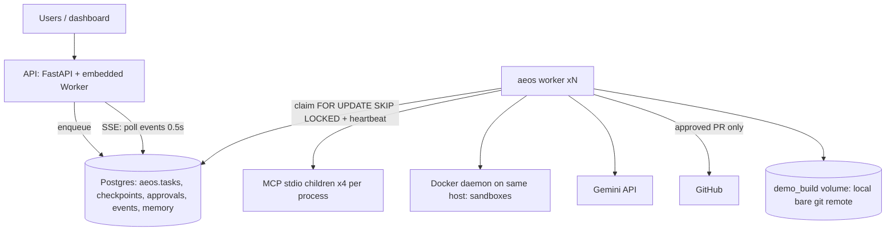
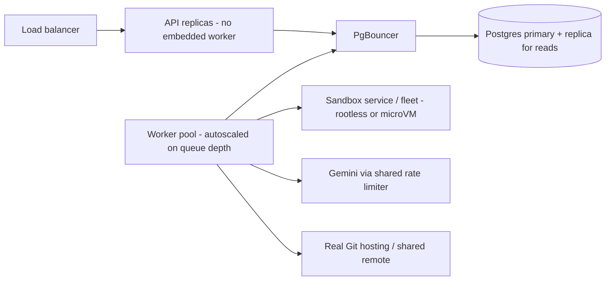

# 26. Scalability and system design

**What this file covers.** How AEOS would behave at 10x and 100x its current load, where it breaks first, how to scale workers and API horizontally, whether it is correct with many instances, availability, cost levers, zero-downtime migration, and how to benchmark it. AEOS today is a single-team system run mostly via `docker compose`; it has never been load-tested (Verified: no load/benchmark of the platform itself exists in `tests/` or `evals/`; the evals measure agent quality, not throughput). Everything about future load below is therefore analysis, not measurement.

**Label discipline used here**
- **Measured (stored)** = read from `evals/results/20261003T024031Z_live-gemini-full.json` (one live-Gemini eval run, 30 tasks, model `gemini-2.5-flash`, memory off, 1 trial). Costs in it are *estimates* from `llm/pricing.py`, not invoices.
- **Verified (code)** = read from source.
- **Assumption** = a number I chose so a calculation can be shown; change it and recompute.
- **Estimate** = derived from assumptions; never evidence.
- **Recommendation** = what I would do.

Related: [03 architecture](03-system-architecture.md), [07 durability](07-state-durability-and-persistence.md), [10 reliability](10-error-handling-and-reliability.md), [12 sandbox](12-sandbox-and-execution-safety.md), [21 deployment](21-deployment-and-infrastructure.md), [25 design decisions](25-design-decisions-and-tradeoffs.md).

---

## 1. What a "unit of load" is here

A task is not a request. It is a long-running (minutes), LLM-heavy, stateful workflow that: makes ~tens of Gemini calls, runs tool calls over MCP stdio children, holds one or two Docker containers while coding/verifying, writes a checkpoint after every graph node, and may pause for hours at a human approval (a paused task releases its worker: `Worker.run_once` calls `tasks.finish(... "paused")` and the lease is cleared).

**Measured (stored), live eval, n=30:**

| Metric | Value |
|---|---|
| Success rate | 0.50 (15/30) |
| Mean LLM calls per task | 35.7 |
| Mean agent steps per task | 32.1 |
| Mean estimated cost per task | $0.0926 |
| Median estimated cost (computed from per-run rows) | $0.0755 (range $0.00 to $0.223) |
| Mean latency per task | 321.7 s |
| Median latency (computed) | 141.9 s |
| Max latency (computed) | 1714 s |

Caveats: one run, one trial, `happy` scenario, memory off, a seeded demo repo; success rate is 50%, so a large share of spend buys failed attempts; whether the eval ran tasks sequentially is not recorded in the file, so its latency may or may not include queueing (Unknown). The mean (322 s) is dominated by a long tail (max 1714 s versus median 142 s). Treat 142 s to 322 s as the plausible range for a busy worker's time per task.

### Derived per-worker figures (Estimates; assumption: production tasks look like the eval tasks)

- Tasks/hour per continuously busy worker: 3600/322 = 11 (mean-based) to 3600/142 = 25 (median-based).
- LLM calls/minute per busy worker: 35.7 calls / (322 s/60) = 6.7 per minute (mean-based); 35.7/(142/60) = 15 per minute (median-based). These are averages; agent loops burst.
- Cost: $0.0926 x 11 tasks/h = about $1.0 per busy worker-hour at the mean (uses mean cost with mean latency; consistent pairing).
- Cost per *successful* task if cost were spread uniformly over outcomes: 0.0926 / 0.5 = about $0.185. This is crude: failed tasks are not uniform (some cost $0.00 because they failed before an LLM call), so treat as a rough upper-middle figure.

---

## 2. What happens at 10x and 100x

Define "1x" as **one continuously busy worker** (**Assumption**; the repo has no production traffic number). Then:

| Load | Busy workers | Tasks/hour (Estimate) | Gemini calls/min (Estimate) | LLM spend/hour (Estimate) |
|---|---|---|---|---|
| 1x | 1 | 11 to 25 | 7 to 15 | about $1 |
| 10x | 10 | 110 to 250 | 67 to 150 | about $10 |
| 100x | 100 | 1,100 to 2,500 | 670 to 1,500 | about $100 |

The cost row uses the mean pairing only (about $1 per worker-hour); the median pairing would be $0.0755 x 25 = $1.9 per worker-hour, so the honest range is **$1 to $2 per busy worker-hour** at current model prices and success rate. Gemini quotas are tier-specific and I did not look them up; the check is "is 670 to 1,500 requests/minute (100x) under my account's limit for this model?" (Recommendation: read the quota page for your tier; do not assume.)

How to read it: every arrow ending at the Postgres cylinder is a place that scales with worker count or viewer count; the Docker daemon, the `demo_build` volume and the MCP children are all *per host*, which is what constrains horizontal scaling beyond one machine (section 5).

### 2.1 Resource-by-resource analysis

**(a) Worker concurrency (Verified).** `Worker.run_once` claims one task and `await`s it; there is no per-process concurrency (no semaphore/pool; `asyncio.gather` in `graph/nodes.py::dispatch` parallelises *specialists inside one task*, not tasks). Concurrency therefore equals the number of worker processes, plus one more per API replica because `create_app(embedded_worker=True)` starts a `Worker` in the lifespan. The first limit you hit is not capacity, it is that you must start more processes to go faster. This is an operational simplicity, and each extra process also starts its own four MCP stdio children (`runtime.py`: github, database, observability, web) and a corpus HTTP server thread.

**(b) Gemini rate limits (Estimate, external).** Calls/minute scale linearly with busy workers (table above). `GeminiProvider` retries 429/5xx with backoff `min(2**attempt,20)+jitter`, up to `_max_retries`, then raises `LLMTransientError` which becomes a step failure and consumes retry/escalation budget. **Potential failure scenario:** with many workers hitting a quota at once, retries synchronise only weakly (jitter is 0 to 0.5 s on a 1 to 20 s backoff), failures cascade into step retries, then escalations, wasting tokens already spent. There is no shared client-side rate limiter across processes (Verified: none in `llm/`), so each worker is unaware of the others' usage.

**(c) Docker sandboxes (Verified limits, Estimate totals).** Per sandbox: 512 MB memory, 1 CPU, 128 pids, tmpfs 256 + 64 MB, TTL 1800 s (`sandbox/policy.py::Limits`). **Assumption:** up to 1 sandbox per busy task at a time (coding or verify; the npm container is extra when used). Worst-case reserved ceilings on one host: 10x = 5 GB, 10 CPUs; 100x = 51 GB, 100 CPUs. These are *limits*, not typical use (not measured), but they set the host size you must plan for. Everything depends on one Docker daemon per host: `SandboxManager` talks to the local daemon (and the app containers mount `/var/run/docker.sock`, D-041). A single daemon creating/destroying containers at hundreds per hour is fine; at higher rates daemon latency and image-layer disk are the things to measure.

**(d) Postgres (Verified patterns, Estimate magnitudes).** Everything shares one database `aeos`: queue (`aeos.tasks`), checkpoints (LangGraph tables), approvals, audit log, events, memory (pgvector, HNSW), plus the read-only demo schema the database MCP tool queries.
- *Connection-per-call.* Each `store/*` function does `psycopg.connect(...)` inside `with` (Verified in `store/tasks.py::_connect`, `store/approvals.py`, `store/events.py`, `mcp_servers/observability/server.py`); no pool exists (grep for `pool` finds only a sandbox `ThreadPoolExecutor`). Each Postgres connection is a server process, so connect/teardown cost is real CPU.
- *Idle polling.* A standalone `aeos worker` polls every `--poll` 1.0 s; the embedded API worker polls every 0.2 s (`create_app(poll_s=0.2)`). Each poll is a new connection running two statements (crash-loop `UPDATE`, claim `UPDATE ... SKIP LOCKED`). Estimate: N idle standalone workers = N connects/s; N embedded = 5N connects/s.
- *Housekeeping.* Every worker, every `sweep_s` (10 s standalone, 5 s in API) runs `approvals.expire_due`, `tasks.active_task_ids` and a Docker `reap`: N workers do N redundant sweeps per interval (harmless correctness-wise, wasteful).
- *SSE.* Each open dashboard stream runs `events.list_events` every 0.5 s (a new connection each time) = 2 connects/s per viewer.
- *Heartbeat.* Each busy worker: one update per `lease_s/3` = per 10 s.
- *Checkpoints.* One per node transition; `TaskState` carries observations, tool calls, plans and verifications, so checkpoint size grows over a task. Retention: none (Verified by grep: no delete/prune/TTL for checkpoint tables). Size per task is **unmeasured**; measure with `pg_total_relation_size` on the checkpoint tables after a batch.
- **Estimate (explicit assumptions):** 100 standalone workers (100 idle polls/s) + 50 concurrent dashboards (100 SSE queries/s) = about 200 connection setups/s, versus Postgres's default `max_connections=100` which bounds *simultaneous* connections, not churn. Short-lived connections rarely reach 100 at once, but 200 backend process spawns/s is wasteful and a pooler is the standard fix. This is arithmetic on assumed counts, not a measured limit.

**(e) Cost (Estimate).** See the table: roughly $1 to $2 per busy worker-hour, so 100x is on the order of $100 to $200/hour of Gemini spend if every worker is saturated. Budgets: `Budget` default $5.00 per task caps the worst case per task, but it is only gated in `agents/loop.py`, resets nothing on crash (budget lost if a node crashes), and includes approval wait in wall-clock. Worst-case bound per task is therefore "$5 plus whatever the interrupted nodes spent". At 100 concurrent tasks the theoretical ceiling is 100 x $5 = $500 per task generation, but note this ignores crashes.

### 2.2 What breaks first (reasoned ranking; **Inferred**, validate by benchmark)

| Rank | Constraint | Why it is first | Trigger point (Estimate) |
|---|---|---|---|
| 1 | Gemini quota / 429s | External, linear in workers, no shared limiter, retries waste money | depends on your tier; check at about 10 busy workers (67 to 150 RPM) |
| 2 | Single-host coupling (Docker daemon, `demo_build` volume, MCP children) | Blocks adding hosts, regardless of DB | the moment you want a second machine |
| 3 | Postgres connection churn (polling + SSE, no pool) | Cheap to fix, hits before row-count limits | hundreds of connects/s: tens of workers plus tens of viewers |
| 4 | Checkpoint/event table growth with no retention | Silent; shows as slow queries and disk | depends on checkpoint size (unmeasured) |
| 5 | Queue semantics (no fairness/priority; attempts counter inflated by approval resumes) | Correctness/fairness under mixed load | many tenants or long approval chains |

Honest caveat: rank 1 vs 2 depends on whether you are single-host (then rank 1 hits first) or multi-host (rank 2 hits first). Postgres rows themselves (a few thousand tasks per day) are nowhere near a limit for this workload; the pain is connections and polling.

---

## 3. Horizontal scaling plan

### 3.1 Workers (works today, within one host)
Start more `aeos worker` processes (`cli.py`: `--lease`, `--poll`, `--sweep`). Correctness is by Postgres: `claim` uses `FOR UPDATE SKIP LOCKED`, `heartbeat`/`finish`/`consumed_resume` require `worker_id` to match (fencing), `enqueue` is `ON CONFLICT DO NOTHING`, `approvals.decide` is one transaction with the resume enqueue. See [Q-STATE-4].

### 3.2 API
Run the API with `aeos serve --no-worker` (`create_app(embedded_worker=False)`) behind a load balancer and run dedicated workers. Is the API stateless? Mostly: session cookies are signed with `AEOS_AUTH_SECRET` (set it, else sessions do not survive restarts or span replicas; **Verified** in config comment), approvals/tasks/events are in Postgres, SSE resumes from `Last-Event-ID`. The CLI exposes this as `aeos serve --no-worker` (Verified: `cli.py` passes `embedded_worker=not args.no_worker`).

### 3.3 Beyond one host: what must change (Verified couplings)
1. **Docker daemon is per host.** A task's sandbox and its reaping happen on the worker's own daemon; `reap` uses container labels on that daemon. This is fine if each worker host has its own daemon, because tasks (and sandboxes) stay on the host of the worker that claimed them. But a task resumed on a different host after a crash rebuilds its sandbox from the base ref (D-032), so it works.
2. **The local bare git remote (`git_remote_path`) lives on the `demo_build` named volume.** A named volume is local to one Docker host. Workers on different hosts would each have a different remote unless this is on shared storage (NFS) or replaced by a real Git service. Idempotency by commit trailer relies on seeing prior commits in the same remote (D-013), so a split remote could duplicate or lose branches. This is the main reason the current design is single-host.
3. **MCP stdio children** are per process: scale-out multiplies them (4 children per worker). Moving to HTTP-transport MCP servers would let them be shared (see [25 section 9](25-design-decisions-and-tradeoffs.md)).
4. **A2A mode** (`a2a` compose profile) can move specialists to other hosts, but the A2A task store is in memory (`SpecialistExecutor._running`) and auth is optional.
5. **Docker socket exposure** (D-041) multiplies with hosts; the real fix is a dedicated sandbox service/fleet (rootless/sysbox/microVM) with a narrow API, so worker hosts need not mount the socket.

### 3.4 Target shape (Recommendation)

How to read it: the changes versus today are a pooler between everything and Postgres, a sandbox service replacing the Docker socket, a shared limiter in front of the LLM, and a real shared Git remote replacing the host-local volume. Workers stay stateless and are scaled on queue depth.

---

## 4. Multi-instance correctness review

| Concern | Status | Evidence / note |
|---|---|---|
| Two workers claim the same task | Safe | `FOR UPDATE SKIP LOCKED`; one `UPDATE ... RETURNING` |
| Zombie worker keeps writing after losing its lease | Safe | writes filtered on `worker_id`; `_heartbeat` cancels work when `heartbeat` returns False |
| Zombie worker's external side effects | Mitigated | idempotency keys (D-013/D-022); a zombie can still make LLM calls and spend money until its next heartbeat (up to `lease_s/3`) |
| Approval granted twice / lost wakeup | Safe | `approvals.decide` one transaction; `consumed_resume` compare-and-clear |
| Concurrent `ensure_schema` at startup | **Potential failure scenario** | DDL is `CREATE ... IF NOT EXISTS` run by every process on start (`worker.run_forever`, `api lifespan`); concurrent execution of `CREATE TABLE/SCHEMA IF NOT EXISTS` can raise unique-violation errors in Postgres under a race; and `ALTER TABLE ... ADD COLUMN IF NOT EXISTS` needs a table lock. Not tested here; the compose stack starts a single API and a bring-up ordering via `depends_on` |
| Schema migrations | No tool | Verified: no alembic/migration framework; schema evolution is in-place `ALTER ... IF NOT EXISTS` strings in `store/*.py` |
| Duplicate sweeps | Benign | `expire_due` is an `UPDATE ... WHERE status='pending'` so concurrent sweeps are serialised by row locks |
| Attempts counter | Imprecise | `claim` increments `attempts` on every claim including approval resumes; with many replicas and many approval cycles you can hit the crash-loop guard (5) without any crash (Verified SQL) |
| In-memory state | Per-process | `get_settings` lru_cache; A2A `_running`; `DbSink` queue thread; `runtime.grants` set during a publish (`graph/publish.py`) - fine because they are rebuilt per node/run, but verify when adding features |
| Fairness | None | `ORDER BY created_at` FIFO; one tenant can starve others |
| Graceful shutdown | Absent | no signal handler (Verified); a deployment = a crash from the queue's view; recovery is by lease expiry (30 s default) |
| Cancel | Works across instances | row-level fencing (D-047); latency up to `lease_s/3` plus in-flight call duration |

---

## 5. Availability and failure domains

- **Postgres is the single point of failure** for queue, checkpoints, approvals, events and memory. Postgres HA (managed service with failover, or Patroni) is the first availability investment. During a Postgres outage workers cannot heartbeat; when it returns, leases may have expired and tasks are reclaimed and resumed from checkpoints (at-least-once, idempotent effects). A **Potential failure scenario**: a brief DB blip longer than `lease_s` (30 s) makes every in-flight task look dead, so another worker could re-run nodes while the original is still running (the original is fenced at its next heartbeat, but both may have called Gemini and tools in between).
- **Gemini outage**: all tasks stall in retry then escalate; no fallback model or provider (Verified: single provider). Recommendation: add a second provider behind `LLMProvider` and a circuit breaker so tasks wait (`queued` with delay) rather than burn retries.
- **GitHub outage**: only affects `create_pull_request` after approval; the mirror publish is idempotent (existing open PR reused, D-045), partial states are described in [Q-REL-9].
- **Docker daemon down**: coding/verify steps fail; tasks retry then escalate.
- **API restart** with the embedded worker: running tasks are abandoned and recovered after lease expiry; with a split API/worker deployment API restarts are invisible to tasks.
- **Health checks**: `/healthz` is constant (Verified), so orchestrators cannot detect a wedged worker or lost DB; a readiness probe that does `SELECT 1` and checks a worker heartbeat age would be needed.
- **Redis** is provisioned in compose but unused by AEOS code (Verified: only `redis_url` in `core/config.py`); it is a candidate for a shared rate limiter/queue wakeups if wanted, not a current dependency.

---

## 6. Cost reduction levers (ranked by expected impact; all Recommendations unless stated)

1. **Stop spending on doomed tasks.** 50% success in the stored live run (Measured) means about half of spend buys no merged value. Cheaper early-exit checks (does the repo build? is the request in scope?), and escalation after fewer retries when verification is failing identically, attack this first.
2. **Model routing.** `strong_llm` is wired (`runtime.py`, `gemini_strong_model`) but unused in production (Verified discrepancy); the inverse is also possible: use `gemini-2.5-flash-lite` (listed in `llm/pricing.py` at $0.10/$0.40 per million tokens vs flash $0.30/$2.50) for low-risk calls (summaries, tool-argument formatting) and measure quality with the eval harness. Output tokens dominate price (flash: $2.50 per M output vs $0.30 per M input), and thinking tokens count as output (D-024), so the 1024-token thinking budget is a direct cost lever.
3. **Context discipline.** Fewer observations per prompt lowers input tokens on every one of ~36 calls/task; `memory_token_budget=1200` and the loop's truncation are existing levers ([Q-LLM-3]).
4. **Prompt caching** (provider feature; **not implemented** here: no cache usage in `llm/gemini.py`) for the stable system prompt and tool schemas.
5. **Dedupe repeated tool results** within a task (agents re-fetch the same file; unmeasured).
6. **Budget accuracy.** Fix budget lost-on-crash and wall-clock including approval wait so caps mean what they say.
7. **Infrastructure cost** is small relative to LLM cost under the assumptions above (a few containers plus Postgres); do not optimise it first. Langfuse's stack (ClickHouse, MinIO, Redis, Postgres) is the heaviest piece and is already behind a compose profile (D-004).

---

## 7. Zero-downtime deployment and migration

**Today (Verified):** schema = `DDL` strings with `IF NOT EXISTS` in `store/tasks.py`, `store/approvals.py`, `store/events.py`, `memory/store.py`; the LangGraph checkpointer manages its own tables; no graceful shutdown; no graph/state versioning; `TaskState` is a pydantic model deserialised from stored checkpoints with an allowlist (`state_types()`).

**Risks when deploying new code while tasks are in flight**
- *State-shape change.* Adding an optional field to `TaskState` is generally safe for old checkpoints (pydantic default). Renaming/removing fields or changing the types in `state_types()` can break `model_validate(snap.values)` for paused or mid-run tasks (**Potential failure scenario**, no migration test exists). See [Q-STATE-10].
- *Graph shape change.* LangGraph stores `next` node names in the checkpoint; renaming or removing a node can strand paused/interrupted tasks (**Potential failure scenario**).
- *Worker kill during deploy.* Looks like a crash; the lease expires within `lease_s` (30 s) and another worker resumes; the interrupted node re-runs (D-032), re-spending its LLM cost. The `attempts` counter increases.

**Recommended procedure (expand/contract):**
1. Make the schema change additive and backwards compatible (new nullable column, new table); deploy migration first.
2. Add graceful shutdown: on SIGTERM stop claiming (`stop` event already exists on the worker loop), finish or checkpoint the current node, release the lease via `release_with_error`-like path, exit. Then rolling restarts cost nothing but time.
3. Add a `graph_version` (and state schema version) column to `aeos.tasks`; workers only claim versions they support, so old workers drain old tasks while new workers take new ones.
4. Roll workers (blue/green or rolling) with the pause being cheap because `paused` tasks hold no lease.
5. Contract (drop old columns) only after no task of the old version exists.
6. Replace ad hoc DDL with a migration tool (Alembic or plain numbered SQL with an advisory lock so only one process migrates).

---

## 8. How to benchmark (a plan; none of this has been run)

Goal: replace every "Estimate" above with a measurement.

| Question | Method | Metric / pass criterion |
|---|---|---|
| Throughput per worker | Enqueue N tasks with `FakeLLM` (replay) or a stub Gemini server with fixed latency; measure completed/hour for 1, 2, 4, 8 workers | tasks/hour vs workers; linear until a resource saturates. Caveat: replay workers handle one task per process (D-034); use a stub-latency LLM instead |
| Real cost per task | Re-run the live eval with n larger than 30 and multiple trials; use provider billing (not `pricing.py`) | cost distribution (p50/p90), success-adjusted cost |
| Gemini limits | Ramp concurrent live tasks; count 429s and retried calls | RPM at which 429 rate exceeds a threshold; wasted tokens per 429 |
| Postgres connection churn | `pg_stat_activity` and `pg_stat_database` (xact_commit, numbackends) while running 10/50/100 idle workers and k SSE clients | connects/s, CPU; compare before/after adding PgBouncer |
| Queue claim latency | Time from `enqueue` to `status='running'` under load | p50/p99 queue wait; confirm `tasks_status_idx` is used (`EXPLAIN`) |
| Sandbox capacity | Run M concurrent coding tasks on one host | container start time, host CPU/mem, daemon latency, failed creates |
| Checkpoint growth | After a batch, `pg_total_relation_size` of checkpoint tables / tasks | bytes per task; project retention need |
| Recovery | Extend `tests/chaos/test_chaos.py` style: kill -9 random workers under load | time-to-resume, duplicate side effects (should be 0), wasted LLM cost per crash |
| SSE fan-out | k concurrent streams for one active task | DB QPS, API CPU, event delivery lag |

Rules: report medians and tails, not only means (the stored eval shows mean 322 s vs median 142 s); keep experiments reproducible (pin model, prompts, dataset hash as `evals/` already records in its `meta.version`); state n and variance; never mix a replay (Fake) run with a live run when comparing.

---

# Interview questions

## Q-SCALE-1. Your load goes up 10x. What breaks first?
**Difficulty:** Advanced  **Topic:** Bottleneck analysis
**Short answer:** First I would find out whether I am single-host. On one host, Gemini rate limits and spend arrive first because they scale linearly with busy workers and there is no shared limiter. Next, Postgres connection churn from per-call connections, 1 s idle polling and 2 queries/s per SSE viewer. Postgres data volume is not the first problem. I have not load-tested it, so this is an analysis I would then benchmark.
**Detailed explanation:** Concurrency equals worker processes (one task per `run_once`). A busy worker averages about 7 to 15 Gemini calls per minute from the stored eval (35.7 calls over 142 to 322 s), so 10 busy workers is about 67 to 150 calls/min (Estimate). Every `store/*` call opens a new connection; polling and SSE multiply that.
**How this project uses it:** `worker.py::run_once`, `store/tasks.py::_connect/claim`, `api/app.py::stream_events`, `llm/gemini.py` retry loop.
**Example/walkthrough:** 10 standalone workers + 5 dashboards: 10 polls/s + 10 SSE queries/s = about 20 connects/s plus heartbeats; trivial for Postgres. At 100 workers + 50 dashboards it is about 200/s (Estimate) and worth a pooler.
**Follow-ups:**
- *How do you know it's the first bottleneck?* I do not; section 8 lists the experiments. State it as a hypothesis ranked by reasoning.
- *Would the queue table itself be a bottleneck?* Unlikely at thousands of tasks/day: it is indexed on `status`, claims are single-row `SKIP LOCKED`. The cost is connection setup, not row contention.
- *What if Gemini quota is fine?* Then single-host coupling (Docker daemon, `demo_build` volume) is next.
**Trade-offs and alternatives:** pool with PgBouncer, `LISTEN/NOTIFY` instead of polling, a push-based queue.
**Common interview mistake:** "Postgres won't scale". The workload is tiny for Postgres; the inefficient access pattern is the issue.
**Related:** [Q-STATE-8], [Q-DEC-2].

## Q-SCALE-2. How do you horizontally scale workers, and why is it safe?
**Difficulty:** Intermediate  **Topic:** Queue correctness
**Short answer:** Run more worker processes. Claiming is a single `UPDATE ... WHERE task_id = (SELECT ... FOR UPDATE SKIP LOCKED LIMIT 1)`, so two workers cannot take the same task. A lease plus heartbeat detects dead workers and every later write is fenced by `worker_id`, so a zombie cannot overwrite a newer owner's state.
**Detailed explanation:** `SKIP LOCKED` makes concurrent claimers skip rows locked by others rather than block. The lease expiry makes a crashed worker's `running` row claimable again. `heartbeat` returns False if the row no longer matches, and `_heartbeat` cancels the work.
**How this project uses it:** `tasks.claim/heartbeat/finish/consumed_resume`, `Worker._heartbeat`.
**Example/walkthrough:** W1 stalls (GC pause 40 s > lease 30 s). W2 claims. W1 wakes, its next heartbeat sees `worker_id` changed, returns False, cancels its node. Side effects W1 already performed are protected by idempotency keys.
**Follow-ups:**
- *Is the zombie harmless?* Not entirely: it may have spent LLM money and made idempotent tool calls before fencing, up to `lease_s/3` of wasted work.
- *What can still go wrong across hosts?* The local git remote on a host volume; section 3.3.
- *What about the `attempts` guard?* It counts approval resumes too, so heavy approval use can trip it.
**Trade-offs and alternatives:** Temporal task queues, pgmq, Redis streams.
**Common interview mistake:** claiming exactly-once processing.
**Related:** [Q-STATE-4], [Q-DEC-12].

## Q-SCALE-3. Can you run several API replicas? What about the embedded worker?
**Difficulty:** Intermediate  **Topic:** Statelessness
**Short answer:** Mostly yes: state is in Postgres, SSE resumes via `Last-Event-ID`, and sessions are signed cookies (set `AEOS_AUTH_SECRET` so replicas agree). But by default each API process also runs a worker (`embedded_worker=True`) and spawns its own MCP children, so replicas multiply workers unintentionally and an API restart interrupts running tasks. For scale I would run API replicas with `embedded_worker=False` and separate worker deployments.
**How this project uses it:** `api/app.py::create_app` lifespan; `api/auth.py` cookie signing.
**Follow-ups:**
- *Is there a CLI flag for no embedded worker?* Yes: `aeos serve --no-worker` (`cli.py`). Compose runs the API with the embedded worker by default.
- *What happens to SSE on API restart?* Clients reconnect with `Last-Event-ID` and resume; events live in the DB.
- *Does the AuthGate work behind a load balancer?* It is a pure ASGI middleware on cookies/tokens; sticky sessions are unnecessary if the secret is shared.
**Common interview mistake:** assuming "stateless" because it's FastAPI.
**Related:** [18](18-api-and-client.md), [Q-DEC-10].

## Q-SCALE-4. Walk me through the per-task cost and how you'd cut it.
**Difficulty:** Intermediate  **Topic:** Cost
**Short answer:** In the stored live run, the mean was 35.7 LLM calls and an estimated $0.093 per task with 50% success (about $0.185 per success if spread uniformly, crude). Levers in order: avoid spending on doomed tasks, route cheap calls to a cheaper model, reduce thinking and context tokens, add prompt caching, and fix budget accounting so caps are real.
**Detailed explanation:** `pricing.py` shows output tokens cost about 8x input for flash; thinking tokens count as output, so the thinking budget is a lever. `strong_llm` is unused in production, so routing exists as a stub only.
**How this project uses it:** `llm/pricing.py::estimate_cost`, `core/state.py::Budget`, `llm/gemini.py` (thinking budget in `max_output_tokens`).
**Example/walkthrough:** 100 busy workers at about $1 to $2 per worker-hour (Estimate) = $100 to $200/hour; a 20% reduction in calls per task saves about $20 to $40/hour at that scale.
**Follow-ups:**
- *Is $0.093 real money?* No, it is the code's estimate from a price table; check provider billing.
- *Why does the per-task cap not bound spend?* Budget is gated only in `agents/loop.py` and lost when a node crashes.
- *Cost per successful PR?* Not measurable from this data: the eval counts task success, not merged PRs.
**Common interview mistake:** quoting the estimated cost as measured billing.
**Related:** [Q-LLM-6], [Q-REL-4], [06](06-llm-integration.md).

## Q-SCALE-5. How would you deploy a new version with no downtime while tasks are paused or running?
**Difficulty:** Expert  **Topic:** Migration
**Short answer:** Expand/contract schema changes, graceful worker shutdown, and a version tag on tasks so old workers drain old tasks. Today none of the latter two exist: a deploy kills workers like a crash (recovery by lease expiry in about 30 s, re-running the interrupted node) and a renamed graph node or incompatible `TaskState` change could strand paused tasks.
**How this project uses it:** DDL strings in `store/*.py`, LangGraph checkpoints, `state_types()` serialiser allowlist, `Worker` loop `stop` event.
**Follow-ups:**
- *Why are paused tasks cheap to migrate?* They hold no lease or worker; only a checkpoint and row.
- *How do you test a state-shape change?* Load checkpoints produced by the old version in a test and `TaskState.model_validate` them with the new code (not present today).
- *Concurrent migrations?* Use a migration tool with an advisory lock; today every process runs `ensure_schema`.
**Common interview mistake:** forgetting in-flight workflows; deploying stateless web apps is easier.
**Related:** [Q-STATE-10], [Q-REL-7].

## Q-SCALE-6. What is your availability story and single points of failure?
**Difficulty:** Advanced  **Topic:** Availability
**Short answer:** Postgres is the single point of failure for everything; Gemini is a single-vendor dependency with no fallback; `/healthz` is a constant so orchestrators cannot detect a wedged worker. Crash recovery of workers is good (leases + checkpoints). A DB blip longer than the lease makes in-flight tasks look dead and can cause duplicate node runs, made safe by idempotency but not free.
**How this project uses it:** `store/tasks.py` leases, `graph/checkpoint.py`, `llm/gemini.py` retries.
**Follow-ups:**
- *Improve it?* Managed HA Postgres, readiness probe doing `SELECT 1` plus worker-heartbeat age, second LLM provider with circuit breaker.
- *Why not lengthen the lease?* Slower detection of real crashes; trade-off between false positives and recovery time.
- *Recovery objectives?* None are defined in the repo; I would not claim an SLO.
**Related:** [Q-REL-7], [Q-DEP-6].

## Q-SCALE-7. Why can't you just add a second machine today?
**Difficulty:** Advanced  **Topic:** Single-host coupling
**Short answer:** The local bare git remote lives in a Docker named volume (`demo_build`) that is local to one host, sandboxes live on the host's Docker daemon, and the app containers mount that daemon's socket. Workers on a second host would have a separate git remote and the commit-trailer idempotency would no longer see prior work. The fix is a shared or real Git remote and a sandbox service, not more Postgres.
**How this project uses it:** `docker-compose.yml` volumes `demo_build:/app/demo_target/build`; `config.git_remote_path`; `sandbox/manager.py`.
**Follow-ups:**
- *Does Postgres coordination still work cross-host?* Yes; it is network-based.
- *Where does the idempotency check read from?* Git itself (commit trailer), D-013, which is why the remote must be shared.
**Common interview mistake:** assuming "stateless workers" because state is in Postgres.
**Related:** [Q-DEC-3], [21](21-deployment-and-infrastructure.md).

## Q-SCALE-8. How would you design fairness and multi-tenancy?
**Difficulty:** Expert  **Topic:** Queue design
**Short answer:** Today the queue is FIFO by `created_at` with no tenant column, so one tenant can starve others. I would add `tenant_id`, per-tenant concurrency caps and budgets, claim with a fair ordering (round-robin by tenant), per-tenant Gemini rate limiting, and isolated sandboxes. At that point Temporal's task queues or a purpose-built queue become attractive (D-033's 100x revisit).
**How this project uses it:** `claim` ordering; `Budget` per task only; approvals have an actor but no tenant boundary.
**Follow-ups:**
- *Memory isolation?* Memory has no tenant scoping (Verified: no tenant field); cross-tenant leakage is a hazard.
- *Auth model?* Login is optional with no roles (D-048).
**Common interview mistake:** only talking about throughput, not isolation.
**Related:** [Q-DEC-2], [14](14-security-and-prompt-injection.md).

## Q-SCALE-9. How would you benchmark this system and what would you refuse to claim?
**Difficulty:** Advanced  **Topic:** Measurement
**Short answer:** Use a stub LLM with fixed latency to isolate the platform from Gemini, ramp worker counts and watch tasks/hour, queue wait, connection churn and sandbox capacity; separately measure live cost and 429 rates with a larger n. I would refuse to claim throughput, cost at scale or limits that I derived from the single 30-task eval run, and I would not compare replay and live runs.
**How this project uses it:** `evals/` meta records code/prompt/policy/dataset hashes; `tests/chaos` as a basis for recovery-under-load tests.
**Follow-ups:**
- *Why not use FakeLLM replay for throughput?* Replay workers handle one task per process (D-034) and replay has no latency, so it misrepresents timing.
- *What statistic?* Medians and tails; stored eval shows mean 322 s vs median 142 s.
**Common interview mistake:** reporting a mean from one run as "the" latency.
**Related:** [23](23-evaluation-framework.md), [22](22-testing-strategy.md).

## Q-SCALE-10. SSE by polling the database: good or bad?
**Difficulty:** Intermediate  **Topic:** Real-time design
**Short answer:** Good for simplicity and correctness (events are rows with ids, so replay and `Last-Event-ID` resume are trivial, and no new infrastructure). Bad for scale: every open stream does 2 queries/s with a fresh connection each. Replace with `LISTEN/NOTIFY` or a pub/sub fan-out in front of a single poller per task, plus a pooler.
**How this project uses it:** `api/app.py::stream_events` (0.5 s sleep loop, 15 s keep-alive), `store/events.py::list_events`, `DbSink` writing on a background thread.
**Follow-ups:**
- *Does `events.id` ordering guarantee no lost events?* `bigserial` ids can commit out of order across concurrent transactions, so a poller using `id > cursor` can in theory skip an event that commits later with a lower id (Potential failure scenario; with one writer thread per process and a few writers it is unlikely but not impossible).
- *Alternative to avoid it?* Poll by `(task_id, id)` with a small overlap window, or use `LISTEN/NOTIFY` as a trigger and re-query.
**Common interview mistake:** claiming SSE guarantees delivery; the guarantee here comes from the DB cursor.
**Related:** [Q-STATE-11], [19](19-web-dashboard.md).
