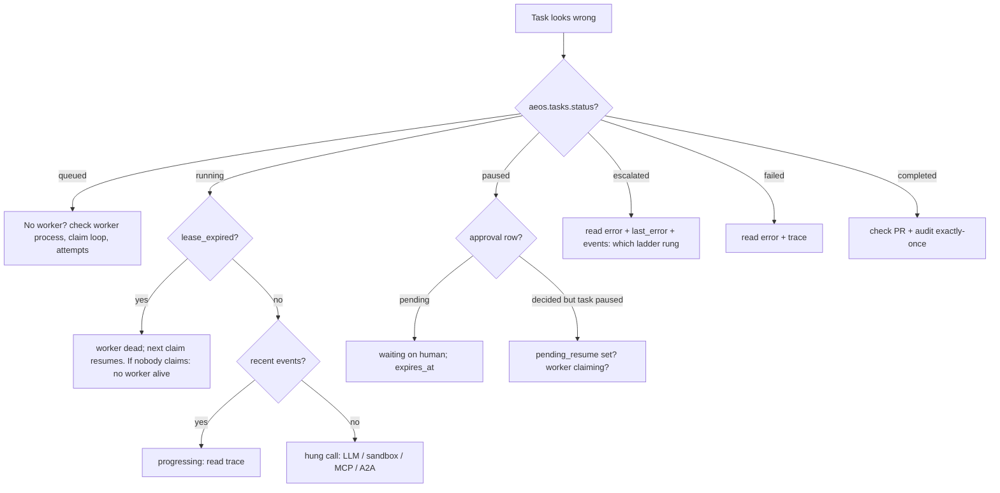

# 27 - Debugging and Incident Scenarios (tag: DBG)

**What this file covers.** Thirteen realistic production incidents for AEOS, each worked as a runbook: symptoms, what to inspect (real tables, endpoints, CLI commands, span names), a safe local reproduction, root-cause reasoning, fix, and prevention. Every scenario is a **Potential failure scenario** derived by reading the code; none is a recorded incident (the git history is eight snapshot commits, not an ops log, and no production deployment is claimed). Where a test already proves the mechanism it is cited. Where I reasoned from code without a test, I say so. At the end are interview questions (`Q-DBG-n`) that turn the runbooks into spoken answers.

Read first for context: [07-state-durability-and-persistence](07-state-durability-and-persistence.md) (leases, checkpoints, idempotency), [10-error-handling-and-reliability](10-error-handling-and-reliability.md) (retry layers, Q-REL-11), [20-observability-and-telemetry](20-observability-and-telemetry.md) (Q-OBS-8). This file does not repeat their explanations; it applies them.

Labels used: **Verified** (read in code or proven by a test), **Inferred** (my reasoning), **Potential failure scenario**, **Recommendation**.

---

## 0. The investigator's toolkit (all Verified to exist)

### 0.1 Where the truth lives

| Question | Source of truth | How to read it |
|---|---|---|
| Is the task queued/running/paused/terminal? Who owns it? Is the lease alive? | `aeos.tasks` row (`store/tasks.py`) | SQL below, `GET /tasks/{id}` (`queue_status`, `attempts`), `aeos status <id>` |
| What step is the graph on? What is in the state? | LangGraph checkpoint in Postgres, `thread_id = task_id` (`graph/build.py::_config`) | `GET /tasks/{id}` (calls `graph.aget_state`), `aeos show <id> --json` |
| What happened, in order? | `aeos.events` (written by `DbSink`, `store/events.py`) | `GET /tasks/{id}/events?after=N`, `aeos events <id> [--follow]`, SSE `/tasks/{id}/events/stream` |
| Who approved what, when? Did a PR get created exactly once? | `aeos.approvals` + `aeos.audit_log` (`store/approvals.py`) | `GET /approvals?task_id=..&status=..`, `GET /tasks/{id}/audit` |
| Which PR/branch exists? | `vcs.pull_requests`, `vcs.branch_creations` (`mcp_servers/github/store.py`), the bare repo at `AEOS_GIT_REMOTE_PATH`, real GitHub | SQL, `git -C <remote> branch --list 'aeos/*'` |
| Why did the model do that? What was the prompt? | Langfuse/OTel trace (one trace per task, id in `GET /tasks/{id}` `trace_id`) | `aeos open <id>`, Langfuse UI |
| How much did it cost? | `GET /tasks/{id}/stats`, `aeos stats <id>` | `core/stats.py::task_stats` |
| What does memory contain? | `aeos.episodes`, `aeos.facts` (`memory/store.py`) | SQL |
| Infrastructure errors | container stderr (JSON lines from `core/logging.JsonFormatter`) | `docker compose logs api` |

### 0.2 Copy-paste SQL (run inside the compose Postgres: `docker compose exec postgres psql -U aeos -d aeos`)

```sql
-- the queue: lease health at a glance
SELECT task_id, status, worker_id, attempts, heartbeat_at, lease_expires_at,
       lease_expires_at < now() AS lease_expired, pending_resume IS NOT NULL AS has_resume, last_error
FROM aeos.tasks ORDER BY updated_at DESC LIMIT 10;

-- the timeline
SELECT id, ts, type, agent, left(message, 100) FROM aeos.events WHERE task_id = 't-xxxx' ORDER BY id;

-- approvals and the audit trail
SELECT id, status, actor, created_at, expires_at, decided_at FROM aeos.approvals WHERE task_id = 't-xxxx';
SELECT id, ts, actor, event, data FROM aeos.audit_log WHERE task_id = 't-xxxx' ORDER BY id;

-- side effects of the publish
SELECT number, head_branch, head_sha, status, idempotency_key, remote_number, remote_url FROM vcs.pull_requests ORDER BY number DESC LIMIT 5;
SELECT * FROM vcs.branch_creations ORDER BY created_at DESC LIMIT 5;
```

The checkpoint tables are created by the LangGraph library (`saver.setup()` in `graph/checkpoint.py::open_checkpointer`). Their column names are library details I did not inspect; read state through the API or `aeos show`, not raw SQL.

### 0.3 Event vocabulary (Verified by grep of `_emit`/`Event(type=...)`)

`plan_created`, `step_started`, `step_done`, `step_retry`, `step_failed`, `root_cause`, `baseline_corrected`, `verification`, `replan`, `approval_requested`, `approval_decided`, `pr_created`, `task_escalated`, `task_failed`, `task_completed`, `task_cancelled`, `memory_recalled`, `memory_error`, `memory_written`, `target_synced`, `a2a_failover`, `a2a_progress`, `agent_started`, `agent_finished`, `tool_call`. Note `llm_call` is deliberately **not** persisted (`DbSink.emit` drops it); per-call token detail lives only in the trace.

### 0.4 Triage flow



Read it top to bottom: the queue row decides the branch; the lease timestamps separate "dead worker" from "slow worker", and the event timeline separates "slow" from "hung".

---

## Scenario 1. Task stuck in `running`

**Potential failure scenario.** A task shows `running` for 40 minutes and the dashboard timeline has not moved.

**Symptoms.** `GET /tasks/{id}` returns `queue_status: running`; last event is minutes old.

**Inspect.**
1. The `aeos.tasks` query above. Two very different cases:
   - `lease_expired = true`: the owning worker is gone. Any live worker's `claim()` takes the task (`status='running' AND lease_expires_at < now()`) and resumes from the checkpoint. If nothing happens, **no worker is alive** (the API's embedded worker dies with the API; `create_app` cancels it on shutdown on purpose, "like a crashed worker").
   - `lease_expired = false` and `heartbeat_at` fresh: the process is alive and the event loop is healthy (the heartbeat is an asyncio task, `Worker._heartbeat`, renewing every `lease_s/3` = 10 s). So something *inside* the run is waiting.
2. Last event type. `agent_started` with no `agent_finished` means an LLM or tool call is outstanding. `step_started` with nothing after: a specialist is in flight. `approval_requested` would mean it is actually paused, not running.
3. The Langfuse trace: an open `llm.call <model>`, `mcp.call`, `sandbox.exec` or `a2a.delegate` span with a long duration.

**Root-cause reasoning (Inferred from code).** Every external wait is bounded *except one*:

| Wait | Bound | Where |
|---|---|---|
| MCP tool call | 30 s default, `asyncio.timeout` | `mcp_client.McpClient.call` |
| Sandbox command | `timeout --signal=KILL` plus host-side `limit + 5` | `sandbox/manager.py::exec` |
| A2A delegation | 900 s whole, 120 s silence | `a2a/client.py` |
| Whole task | 1800 s wall clock, but checked only **before** each LLM call in `agents/loop.py` | `Budget.exhausted` |
| **Gemini request** | **none set by AEOS** (retries exist, a per-request timeout does not) | `llm/gemini.py::complete` |

`grep -n timeout src/aeos/llm/*.py` finds only a comment, so a hung HTTP request to Gemini blocks that await with a healthy heartbeat, which keeps renewing the lease. I did not verify whether the `google-genai` SDK applies a default HTTP timeout; check its installed version before asserting either way. Because the wall-clock budget is evaluated between calls, it cannot interrupt a call already in flight.

**Reproduce locally (safe, fake LLM, no spend).**
```bash
# 1. a dead worker: lease expiry and takeover (this mechanism is proven by tests/store/test_tasks.py::test_dead_worker_lease_expires_and_another_worker_takes_over)
uv run pytest tests/store/test_tasks.py -k "lease or heartbeat" -q
# 2. real kill -9 mid-run, takeover by a second worker (needs docker + postgres up: make up)
uv run pytest -m chaos tests/chaos -k "verify" -q
# 3. watch the queue while you do it
watch -n1 "docker compose exec -T postgres psql -U aeos -d aeos -c \"select task_id,status,worker_id,attempts,lease_expires_at from aeos.tasks order by updated_at desc limit 3\""
```
To simulate the hung-LLM case, wrap `FakeLLM.complete` in a test with `await asyncio.sleep(10**6)` and watch `heartbeat_at` keep advancing while events stop. That is a local experiment I am proposing, not an existing test.

**Fix.** For the dead worker: nothing, the design heals itself. For a hung LLM call: `asyncio.timeout(...)` around `generate_content` raising `LLMTransientError` so the existing retry/step-retry/escalation ladder handles it (**Recommendation**, ~10 lines).

**Prevention.** A "no event for N minutes" detector on `aeos.events` (none exists, Q-REL-11 says the same); a per-call deadline in `GeminiProvider`.

---

## Scenario 2. Worker killed mid-publish

**Potential failure scenario.** The worker is OOM-killed (or the node is preempted) after the branch was created and the patch committed, before the PR approval was even requested; or after the PR was created, before the checkpoint recorded it.

**Symptoms.** Task stays `running`, lease expires, another worker claims it, `attempts` goes up by one. The worry: duplicate branch, duplicate commit, duplicate PR.

**Inspect.** `aeos.tasks.attempts`; `aeos.events` shows a repeated `plan`/`step` boundary only if a node re-ran; `aeos.audit_log` event counts; `vcs.branch_creations`; `git -C $AEOS_GIT_REMOTE_PATH log --oneline aeos/<task>-v1`; duplicate `node publish_prepare` spans under one trace id mean the node ran twice (Q-OBS-8).

**Root-cause reasoning (Verified).** Publish is three nodes (`graph/publish.py`): `prepare` (branch, commit, approval request), `await_decision` (`interrupt`), `create_pr`. A kill leaves the work of a node done and its checkpoint unwritten, so on resume the whole node re-runs. That is safe because every write carries a key derived from `idempotency_key(ctx, tool, args)` = sha256 of `task_id|step_id|attempt|tool|canonical args` (`agents/tools.py`), and the server honours it:

| Kill point | What the replay does | Why it is safe |
|---|---|---|
| after `create_branch` | `create_branch` finds `vcs.branch_creations` row for the key and branch exists, returns `created=False` with the original sha | `mcp_servers/github/server.py::create_branch` |
| after `commit_patch` | `commit_patch` returns the original commit (`replayed=True`) | `GitBackend.commit_patch` with the key (see [16](16-a2a-and-github-integration.md)) |
| after approval row insert | `approvals.create` is `ON CONFLICT (task_id, action_key) DO NOTHING`, returns the same row | `store/approvals.create`, `action_key=open_pr:{step}:{attempt}` |
| after `create_pull_request` local row, before GitHub call | key exists, `_mirror` retried; `find_open_pr` makes it idempotent | `server.py::create_pull_request` comment |
| after GitHub PR, before `set_remote` | same path: row has no `remote_url`, `find_open_pr` finds the open PR | `remote.py::open_pr` |
| after `create_pull_request` returned, before checkpoint | `create_pr` re-runs; same key; `replayed=True` | `idempotency_key` includes `step.attempts` which is unchanged because the earlier increment was never checkpointed |
| audit write | `approvals.audit(... dedupe_key=f"pr_created:{task}:{step}:{attempt}")` with a partial unique index | `audit_dedupe_idx` |

`maybe_crash("tool:create_pull_request:after")` is exactly this case: effect happened, record not checkpointed. `tests/chaos/test_chaos.py` parametrizes kill points over every node boundary plus `create_branch:after`, `commit_patch:after`, `create_pull_request:before/after` and then runs `assert_exactly_once` (1 PR row, 1 branch, branch has exactly one extra commit, 1 approval, each audit event once, no leftover sandbox).

**What the chaos test does not cover (Inferred).** It uses the local bare repo and the fake LLM; real GitHub is replaced by a `fake_github` fixture (`tests/mcp/test_github_remote.py`). Also a *human-initiated* change on GitHub between crash and replay is not modelled (see Scenario 3).

**Reproduce locally.**
```bash
make up                                    # postgres etc.
uv run pytest -m chaos tests/chaos -k "publish" -q      # kill -9 at publish_* nodes and create_branch/commit_patch/create_pull_request
# by hand: first worker dies at the worst moment, second one finishes
AEOS_CRASH_AT=tool:create_pull_request:after uv run aeos worker --replay happy --yes --lease 3 &
uv run aeos submit "Investigate the checkout latency regression"
# once the process is gone:
uv run aeos worker --replay happy --yes --once
```
Keep `AEOS_CRASH_AT` out of anything but local shells: it SIGKILLs the process (`failure/crash.py`).

**Fix/Prevention.** None needed for the verified cases. See Scenario 3 for the gap.

---

## Scenario 3. Duplicate (or missing) PR on real GitHub

**Potential failure scenario.** A reviewer sees two open PRs for one task, or the dashboard says "PR created" but GitHub has none.

**Inspect.** `vcs.pull_requests` (`idempotency_key`, `remote_number`, `remote_url`), `aeos.audit_log` `pr_created` rows, `GET /tasks/{id}` `pull_request`, GitHub PR list for head `aeos/<task>-v<plan version>`.

**Root-cause reasoning.**
- *Verified protection against double submission:* `UNIQUE (repo, idempotency_key)` on `vcs.pull_requests`, `store.create` with `ON CONFLICT DO NOTHING`, `store.get_open(repo, base, head)` raising `conflict` if an open PR for the same head/base exists locally, and on GitHub `GitHubRemote.open_pr` calling `find_open_pr(head)` first. `_push` is never forced.
- *Legitimate second PR (not a bug):* a rejection leads to replan, then `new.branch, new.pull_request = None, None` in `GraphNodes.replan` and a new plan version, so the next publication uses branch `aeos/<task>-v2`, a new approval (`action_key=open_pr:<step>:<attempt>` differs) and a new PR. Two PRs for one task is expected after a human rejection.
- *Potential gap (Inferred, no test):* `find_open_pr` filters `state=open`. If a human **closes** the first PR on GitHub and the worker later replays `create_pull_request` for the same key, the local row exists without a matching open remote PR only if `remote_url` is empty; if `remote_url` is set, `_mirror` returns early (`pr.remote_url` truthy) and nothing new is opened. If the row had no `remote_url` (crash before `set_remote`) and the PR was closed meanwhile, `open_pr` would push again (same sha, allowed) and open a *new* PR. Narrow window, but real.
- *"Missing PR":* `create_pull_request` fails with `github_push_failed`/`github_error`/`github_unreachable` (`GitError` codes) which become a tool error, so `create_pr` returns `escalate("create_pull_request failed: ...")`. The local `vcs.pull_requests` row **already exists** (written before mirroring). The task is `escalated`, and the local PR number exists without a remote one. Replaying (it is idempotent) completes the mirror, but nothing automatically replays an escalated task; `POST /tasks/{id}/retry` creates a *new* task instead.

**Reproduce locally.** `uv run pytest tests/mcp/test_github.py tests/mcp/test_github_remote.py -q` (replay idempotency; mirror against a `fake_github` server; token not leaked on failure) and `tests/graph/test_hitl.py::test_concurrent_approvals_create_exactly_one_pull_request` (two reviewers approve at once, one PR). Real GitHub needs `AEOS_GITHUB_PUBLISH=true`, repo and token: do not point this at a repo you care about.

**Fix.** Treat "approved, publish failed" as a retryable state (a `publish_pr` retry with backoff before escalating) (**Recommendation**). **Prevention.** Alert on `vcs.pull_requests WHERE remote_url IS NULL AND created_at < now() - interval '10 min'` when publishing is enabled.

---

## Scenario 4. Approval never arrives, or arrives and nothing happens

**Potential failure scenario A: the human never answers.** Verified path: `approvals.expire_due()` runs in `Worker.housekeeping` every `sweep_s` (10 s CLI worker, 5 s embedded in the API), marks the request `expired`, writes `approval_expired` to the audit log, and calls `enqueue_resume` with `EXPIRED_PAYLOAD`. The task is woken, `await_decision` sets the publish step failed and the task `escalated` with "approval expired before a human decided; nothing was published". TTL is `approval_ttl_s` = 86 400 s. A late click gets HTTP 410 (`DecisionError("expired")`).

**Subtlety (Verified).** Expiry only happens if **some worker process is running its loop**. With no worker, nothing sweeps; `POST /approvals/expire` is the manual trigger.

**Potential failure scenario B: the human approved, the task is still `paused`.**
Inspect: `SELECT status, pending_resume FROM aeos.tasks WHERE task_id=...` and `aeos.approvals.status`.
- `approvals.status='approved'`, `tasks.pending_resume` set, `tasks.status='queued'`: it is waiting for a worker claim (decision and wake-up are one transaction, `approvals.decide` + `enqueue_resume`). Find out why no worker is claiming.
- `pending_resume` set but status still `running`: the run was winding down; `Worker.finish` converts `paused` to `queued` when `pending_resume IS NOT NULL` (Q-FLOW-5, test `test_a_decision_that_races_the_pause_is_not_lost`).
- Approved but the PR does not appear: `create_pr` re-reads the request and builds an `ApprovalGrant` bound to `arguments_hash`. If the stored `arguments` were altered after approval the gate refuses and the task escalates "pull request blocked" (test `test_tampering_with_the_approved_arguments_is_blocked`). This is the intended behaviour, but it looks like "approval ignored" to a user.
- **Stale resume payload (known, found by reading, see Q-FLOW-5):** a crash after delivering a resume but before `consumed_resume`, followed by a second approval in the same task, can replay the first (rejected) payload against the second interrupt. Failure direction is safe (a spurious rejection), not an unauthorised publish.

**Reproduce locally.** `uv run pytest tests/graph/test_hitl.py tests/store/test_tasks.py -q`. Or by hand with the fake LLM: `uv run aeos worker --replay happy` (no `--yes`), submit, then `uv run aeos approvals`, `uv run aeos approve <id>`, and watch `aeos.tasks` flip `paused -> queued -> running -> completed`.

**Fix.** Compare `decision["approval_id"]` with `state.pending_approval_id` in `await_decision` (**Recommendation**). **Prevention.** Alert on `aeos.approvals WHERE status='pending' AND expires_at < now()` (means no sweeper).

---

## Scenario 5. Flaky verifier

**Potential failure scenario.** The same patch passes verification once and fails the next time with `perf_regression`, `baseline_not_faster`, or `verifier_error`.

**Inspect.** The `verification` event (gates and issue types), `GET /tasks/{id}` `verifications[*].metrics.benchmark` (baseline vs candidate p50/p95/p99, `p95_change_pct`, `tolerance_pct`), `aeos show <id> --verify`, the `verifier.gates` span attributes, `sandbox.exec` span `timed_out`/`exit_code`/`duration_s`.

**Root-cause reasoning (Verified code, Inferred cause).**
- The regression-kind gates compare p95 of **three separate sandbox runs** (baseline, unpatched head, patched head) against a **10 % tolerance** (`GateConfig.p95_tolerance_pct`). Measurement noise on a loaded Docker host (CPU limit `nano_cpus`, shared with Postgres and Langfuse) can exceed 10 % on a small benchmark. Noise shows up in two gates: `benchmark_not_regressed` (candidate slower than baseline by >10 %) and `regression_reproduced` (head must be >10 % slower than baseline, else `baseline_not_faster`).
- `run_benchmark` raises `SandboxError("benchmark_failed")` on non-zero exit (including timeout 120 s), which `_run_gates` converts into `gates["sandbox_ok"]=False` and a `verifier_error` issue, i.e. infrastructure failure looks like a verification failure and **counts toward the 3-failure escalation** (`GraphNodes.replan`: `failures = failed verifications + human_feedback`). Verified: nothing distinguishes "verifier broke" from "patch is bad" in that counter.
- The `lint_ok` gate is `python -m compileall` only, and `patch_applies` can fail if `base_ref` moved (it is pinned per task, so unlikely).
- The judge (LLM) is nondeterministic at temperature 0.2 and sees `patch[:12000]`; it can flip a borderline patch to `requirement_not_met`, but it can only make the verdict stricter (`apply_judgement` invariant).
- Evidence the demo benchmark was designed to be deterministic: it counts DB queries as well as latency (`BenchmarkResult.db_queries`) and `tests/demo_target/test_service_benchmark.py` exists; I did not measure variance on a loaded machine and make no claim about it.

**Reproduce locally.** `uv run pytest tests/agents/test_verifier_gates.py tests/agents/test_verifier_static.py tests/agents/test_judge.py -q` (needs Docker for the gate tests). To feel the noise, run the benchmark repeatedly inside a sandbox while stressing the CPU (`stress-ng` or a parallel build) and compare p95 spread; this is an experiment, no result is recorded in the repo.

**Fix.** Run the benchmark N times and compare medians; widen tolerance for the head-vs-baseline gate; exclude `verifier_error` from the failure counter and retry it once (**Recommendations**).

**Prevention.** Log benchmark spread in the event; add a dedicated `verifier_infra_error` outcome distinct from `failed`.

---

## Scenario 6. Gemini 429s, timeouts and garbled tool calls

**Potential failure scenario.** Free-tier or burst traffic triggers `429 RESOURCE_EXHAUSTED`; the model returns `MALFORMED_FUNCTION_CALL`; or the model is down.

**Inspect.** `llm.call` spans (`gen_ai.response.finish_reasons`), the `agent_finished` event message `... error: LLM error: ...` or `malformed`, `step_retry`/`step_failed` events, `aeos.tasks.last_error`, container stderr for `gemini transient error, retrying` (**WARNING level; hidden by default, see Scenario 9**).

**Root-cause reasoning (Verified, `llm/gemini.py`).**
1. Transient codes `429, 500, 502, 503, 504`, `TimeoutError`, `ConnectionError`: up to `max_retries=4` retries, delay `min(2**attempt, 20) + jitter` (so about 1, 2, 4, 8 s) then `LLMTransientError`.
2. Non-transient `APIError` (400 bad schema, 401/403 key, 404 model name) raises `LLMError` immediately (no retry).
3. Unusable turn (`malformed_function_call`, `other`, `unexpected_tool_call`) with no content and no tool call: retried with `0.5*(attempt+1)` s sleeps.
4. The agent loop catches `LLMError`: `LoopResult("error")`. In `GraphNodes.dispatch` that becomes a specialist failure, `RetryPolicy.on_step_failure`: retry once (`max_step_attempts=2`) then `escalate`. Each retry re-runs the whole specialist from scratch (no loop state is persisted).
5. Where the LLM is called outside a specialist: `create_plan`/`replan` catch `LLMError` and **fall back to deterministic default plans** (`default_plan_steps`, `fallback_replan_steps`); `judge_patch` returns `None` (gates stand alone); `synthesize_root_cause` is *not* wrapped for fallback, `GraphNodes.synthesize` catches any exception and fails the task (`synthesis failed`); memory `reflect` swallows errors.
6. A raised exception that escapes a node (for example a Docker error during `verify`, which only catches `SandboxError`) goes to `Worker.run_once` -> `release_with_error` -> requeue, bounded by `max_attempts=5`.

Budget consequences: a retry consumes steps, tokens and cost again; 429 storms can burn the wall-clock budget (30 min).

**Reproduce locally (no API).** `uv run pytest tests/llm tests/agents/test_loop.py -q` (Verified by grep: `tests/llm` has `test_gemini_conversion.py`, `test_fake.py` and a `live` test, and **no test for the 429/retry loop**; `tests/agents/test_loop.py` covers the loop's `LLMError` handling). Provoke a transient failure by passing a stub `client` to `GeminiProvider(client=...)` that raises `errors.APIError` with code 429.

**Fix.** Respect `Retry-After` (not read today); a per-request timeout; fall back to the cheaper model on 429 (the `gemini_strong_model` setting exists but production wiring never uses it, see [06-llm-integration](06-llm-integration.md)).

**Prevention.** A token-bucket or concurrency limit per provider; surface `finish_reason` in the `agent_finished` event; alert on `llm.call` error rate.

---

## Scenario 7. Sandbox leak

**Potential failure scenario.** `docker ps -a` shows dozens of `aeos-sbx-*` containers, the host runs out of memory or pids.

**Inspect.** `docker ps -a --filter label=aeos.sandbox --format '{{.Names}} {{.Label "aeos.task_id"}} {{.Status}}'`; compare task ids with `aeos.tasks.status`.

**Root-cause reasoning.**
- Normal paths clean up: `SandboxManager.sandbox()` context manager `finally: destroy`; `create_sandbox` destroys on setup failure; `CodingSpecialist.run` closes its workspace in `finally`; `Worker.run_once` calls `reap_task` after any non-paused finish; the API cancel endpoint calls `reap_task`.
- A `kill -9` skips every `finally`. Recovery is `Worker.housekeeping` (`worker.py`), which calls `self.rt.sandbox.reap(active_tasks=..., grace_s=120)` every `sweep_s`, removing sandboxes whose `aeos.task_id` label is not in `{queued, running, paused}` and older than the grace period. The chaos test asserts the crashed worker's container disappears.
- **Doc/code correction.** File [12-sandbox-and-execution-safety](12-sandbox-and-execution-safety.md) says nothing outside tests calls `.reap(`; that is true only of the standalone CLI `python -m aeos.sandbox.reaper` (it is not scheduled anywhere). `Worker.housekeeping` does call `reap` (`src/aeos/worker.py` line 65), so a running worker sweeps. The leak window is therefore: **no worker running**, or a sandbox whose task is still `running`/`paused` (a live but stuck task keeps its sandboxes, because "active" protects them; a hung `exec` is bounded by the exec timeout, not by the sweeper).
- The npm install container (`sandbox/npm.py`) carries the same label (see [12](12-sandbox-and-execution-safety.md)); the reaper covers it by label.
- `sandbox.exec` leftovers: `_ensure_clean` kills the sandbox user's processes and destroys the container if it cannot get back to a clean state (`ExecResult.sandbox_destroyed`).

**Reproduce locally.** `uv run pytest tests/sandbox/test_reaper.py -q`; by hand, `AEOS_CRASH_AT=node:verify:before` kills a worker before verify; `uv run python -m aeos.sandbox.reaper --ttl 0` removes everything labelled (careful: this removes *all* AEOS sandboxes on the host).

**Fix/Prevention.** Keep a worker running (it already sweeps); add a periodic alert on container count; cap concurrent sandboxes (no cap exists, **Recommendation**). Mounting the Docker socket means a leaked process in the app container can also create containers (see [12](12-sandbox-and-execution-safety.md)).

---

## Scenario 8. Memory returns garbage

**Potential failure scenario.** The planner is nudged toward an irrelevant file or a wrong "known fact" that appeared in a hint.

**Inspect.** `memory_recalled` event (`items`: kind, id, similarity), `GET /tasks/{id}` `memory_trace`, `SELECT id, outcome, left(goal,80), summary->>'root_cause_file' FROM aeos.episodes`, `SELECT subject, predicate, value, confidence, status FROM aeos.facts`.

**Root-cause reasoning (Verified + Inferred).**
1. *Embedder mismatch.* `open_runtime` picks `GeminiEmbedder` only if `llm_provider == "gemini"` and a key is set, otherwise `HashEmbedder` (signed feature hashing). Both emit 768-dim L2-normalised vectors (`DIM = 768`), so the pgvector column accepts either, but they live in **different vector spaces**. Rows written under one embedder and queried under the other return arbitrary similarity. Memory rows do not record which embedder wrote them (known discrepancy). Switching `AEOS_LLM_PROVIDER` between runs on one database is the trigger.
2. *Thresholds.* `min_similarity` 0.3 for episodes, 0.2 for facts are low; with the hash embedder (lexical only) any shared words can pass. Top-k 3 episodes and 6 facts are injected within `memory_token_budget=1200` tokens.
3. *Failed episodes are recalled.* `episode_from_state` saves an episode for every outcome (`completed`, `escalated`, `failed`); recall renders "Past task (escalated...)" with its root-cause file even when that diagnosis was wrong, though `rejected_diagnoses` and `failed_attempts` are included as warnings.
4. *Gate scope.* `gate_fact` protects the **facts** (secret/instruction patterns, confidence >= 0.7, evidence or verifier confirmation, 5 per task). Only `lessons` get `gate_episode_text`; the other episode fields (goal, root cause summary, fix summary) are written without that gate (known discrepancy: "memory gate only covers lessons").
5. *Mitigation present.* Memory text is framed as hints that "may be stale or wrong", agents are told fresh evidence wins (`MEMORY_RULE`), and research output is separately checked by code (`_check_research` validates the suspect commit exists and recomputes the baseline).

**Reproduce locally.** `uv run pytest tests/memory tests/graph/test_memory_e2e.py -q`. Disable to isolate: `AEOS_MEMORY_ENABLED=false`.

**Fix.** Store `embedder` name and dim on each row and filter on it at query time; raise `min_similarity`; exclude `failed`/`escalated` episodes or prefix them as negative evidence; add a `invalidate_fact` workflow (the store has `invalidate_fact`; nothing calls it from a UI). **Prevention.** A memory eval (see [23-evaluation-framework](23-evaluation-framework.md) for what exists).

---

## Scenario 9. Missing logs and trace ids

**Potential failure scenario.** An incident happens, you open the container logs and see almost nothing; or a log line has `"task_id": null`; or there is no Langfuse trace.

**Inspect and reason (all Verified).**
- *Log level is effectively fixed.* `cli.main` calls `configure_logging("INFO" if getattr(args, "verbose", False) else "ERROR")`. Only the `run` subcommand has `-v`; `worker` and `serve` never get it, so they log at ERROR. `Settings.log_level` / `AEOS_LOG_LEVEL` is never read (`grep -rn log_level src` finds only the field and uvicorn's hard-coded `"warning"`). Consequences: `log.info("claimed task")`, `log.info("resuming after crash...")`, Gemini retry warnings, and the `traced()` span-end log lines (WARNING on error, DEBUG otherwise) are all invisible. What *is* visible: `log.exception("task run failed")` and `log.exception("housekeeping failed")` (ERROR).
- *Correlation ids.* `JsonFormatter` adds `task_id/run_id/agent` from context variables set by `run_context`, but `run_context` is never called anywhere in `src`, so those fields are `null` **except** where code passes `extra={"task_id": ...}` (the worker does, because `extra` keys overwrite). Telemetry uses a different mechanism (`bind_task` in `telemetry/tracing.py`, set in `_crashable` for every node), which is why spans carry `aeos.task.id` while logs do not.
- *Trace ids.* Stored in `TaskState.trace` (W3C traceparent) by the `plan` node; `GET /tasks/{id}` derives `trace_id` from it. `GraphNodes.plan` creates the root span; every later node joins via `remote_context(state.trace)`. If telemetry is disabled (`telemetry_enabled=false`) or the collector is down, spans are lost (exporter retries about 30 s per [20](20-observability-and-telemetry.md)); the `trace` carrier is then empty/invalid and `trace_id` is `null`. Metrics only reach a debug exporter.
- *Lost exception detail.* If a node raises, `Worker.run_once` stores `repr(exc)[:500]` in `aeos.tasks.last_error` and requeues. When the crash-loop guard later escalates the task, it **overwrites** `last_error` with `'worker died or failed N times; needs a human'` (`tasks.claim` SQL). The original exception text then survives only in the ERROR-level `task run failed` log line (with traceback) and in the trace (`error.type`, `record_exception`). `TaskState.error` is never set for this path because the node never returned. Verified by reading `claim` and `run_once`.
- *Event persistence is best-effort.* `DbSink._run` swallows DB errors and drops that event (`except Exception: conn = None`); the queue is unbounded and the thread is a daemon, so events queued at `kill -9` are lost. The audit log, in contrast, is written synchronously in the decision transaction.

**Reproduce locally.** `uv run aeos worker --replay happy --yes --once` and compare stderr with `docker compose exec postgres psql ... select type,message from aeos.events`; `uv run pytest tests/core/test_logging.py -q`.

**Fix (Recommendations).** Honour `Settings.log_level`; call `run_context(task_id=...)` in `Worker._execute` (or reuse `bind_task`'s context variable in the formatter); persist the exception in the event stream (`task_failed`) before requeue; preserve the first error when escalating. **Prevention.** A test that asserts a worker log line contains `task_id`.

---

## Scenario 10. Task escalated with "worker died or failed N times"

**Potential failure scenario.** A task that was never crashing shows `escalated` with `last_error = worker died or failed 5 times; needs a human`.

**Root-cause reasoning (Verified).** `tasks.claim` increments `attempts` on **every** claim (`attempts = attempts + 1`), including legitimate re-claims: after a human decision wakes a paused task, after a crash resume, and after `release_with_error` requeues. The guard escalates when `attempts >= max_attempts (5)` at the **next** claim of a `queued` or expired-`running` task. A long-lived task can therefore accumulate: claim 1 (first run, pauses), 2 (approval, rejection leads to replan, pauses again), 3 (second approval), plus two transient crashes, and the 6th claim escalates even though the work was progressing. This is the known discrepancy "attempts increments on every claim including approval resumes". I constructed the sequence by reading; no test covers it.

**Inspect.** `attempts`, `aeos.audit_log` for decision count, `aeos.events` for `approval_decided` and `replan` counts; compare with `last_error` (the real error may have been overwritten, Scenario 9).

**Fix.** Reset `attempts` when a task is woken by a decision (in `enqueue_resume`), or count only crash-style claims (expired lease or `release_with_error`) (**Recommendation**). **Prevention.** Unit test: 4 approval resumes do not trip the guard.

---

## Scenario 11. Budget exhaustion that is really "the human was slow"

**Potential failure scenario.** After a reviewer rejects a PR with feedback, the replanned task immediately dies with `wall-clock budget exhausted (1800s)` even though the AI worked only a few minutes.

**Root-cause reasoning (Verified).** `Budget.exhausted()` compares `time.time() - started_at` with `max_wall_seconds=1800`; `started_at` is set once. The approval wait (up to 24 h) is inside that window. It is enforced only in `agents/loop.py` (before each LLM step). So after a >30 min wait, `publish_pr` still works (it does not check the budget) but a replan after rejection starts a specialist whose first loop iteration returns `LoopResult("budget")`, and `dispatch` treats budget as `escalate`. Also, a node that crashes loses its `BudgetTracker` increments because the budget is only written back in the node's return value (known discrepancy), so cost can be under-counted after crashes.

**Inspect.** `GET /tasks/{id}/stats` (approval wait is reported), `budget.started_at`, event `step_failed ... budget`.

**Reproduce locally.** `tests/agents/test_loop.py` covers budget exhaustion in the loop; to see the approval-wait effect, set `Budget(max_wall_seconds=5)` in a test using `scripted_approver` that sleeps 6 s before rejecting (an experiment, not an existing test).

**Fix.** Subtract approval wait (use `approvals.created_at/decided_at`) from the wall-clock budget; reset `started_at` on replan (see Q-REL-10).

---

## Scenario 12. An MCP server or A2A specialist dies

**Potential failure scenario.** One of the stdio MCP child processes (github, database, observability, web) crashes, or an A2A specialist container is down.

**Root-cause reasoning.**
- *MCP (Inferred from `mcp_client.py`, no test of child death that I found).* `McpClient` owns the stdio connection in a background task started once (`__aenter__`). If the child dies, `call_tool` raises `anyio.ClosedResourceError`/`BrokenResourceError`; read tools and keyed writes retry (2 retries, backoff 0.2 s), then `McpTransportError`, which `mcp_tooldefs.run` converts to a tool error `[transport_error]`. There is **no reconnect or respawn**; every later call on that client fails until the worker/API process is restarted (the `AsyncExitStack` in `open_runtime` opened it once). Symptom: all tool calls for one server fail with `transport_error` while other servers work; tasks escalate via `step_failed` after two attempts.
- *A2A (Verified).* `A2ASpecialist.run` tries each endpoint in `a2a_endpoints` order, emits `a2a_failover`, treats a silent service (no event for `a2a_stall_s=120`) as dead, tries to cancel the remote task, and returns `SpecialistResult(status="error")` when every endpoint fails, which feeds the normal step retry. The coding service's remote task store is in-memory (`InMemoryTaskStore`), so a restarted specialist forgets in-flight work; the supervisor simply re-delegates (message id `{task}-{step}-{attempt}`).

**Inspect.** `a2a_failover` events, `mcp.call` spans with `attempt` > 1, `docker compose ps`, `curl <endpoint>/.well-known/agent-card.json`.

**Reproduce locally.** `uv run pytest tests/a2a tests/mcp -q`. Kill a child by hand: find the `python -m aeos.mcp_servers.github` PID under the API process and `kill -9` it, then submit a task with the fake LLM (expect `transport_error`; I have not run this, it follows from the code).

**Fix.** Respawn on `ClosedResourceError` (reconnect inside `McpClient.call`) (**Recommendation**); a `/readyz` that probes MCP clients (today `/healthz` returns a constant `ok`).

---

## Scenario 13. Resume fails after a deploy (checkpoint deserialization)

**Potential failure scenario.** After deploying a new version, paused or in-flight tasks fail on claim with a deserialization or validation error.

**Root-cause reasoning (Inferred, flagged in Q-STATE-3/Q-STATE-10).** Checkpoints serialize pydantic models via `JsonPlusSerializer(allowed_msgpack_modules=state_types())`; `state_types()` allowlists every pydantic class in `aeos.core.state`. Renaming/removing a model or changing a field type breaks `TaskState.model_validate(snap.values)` for old checkpoints. Adding fields with defaults is tolerated. Tasks can sleep up to 24 h at an approval, so a deploy during a pause is a real exposure. The worker would raise inside `_execute`, `release_with_error` requeue, five attempts, then escalation with the `last_error` overwritten (Scenario 9), so the first symptom is "worker died or failed 5 times".

**Inspect.** ERROR log `task run failed` with traceback, `aeos.tasks.attempts`.
**Fix/Prevention.** Version the state, keep deprecated model names allowlisted, drain paused tasks before breaking changes. A small test that loads a stored checkpoint fixture from the previous release (**Recommendation**).

---

## Quick reference: symptom to first command

| Symptom | First look | Typical cause |
|---|---|---|
| `running`, no events | `aeos.tasks` lease columns | dead worker (self-heals) or hung call (no Gemini timeout) |
| `queued` forever | any worker alive? `attempts` | no worker process; or crash guard pending |
| `paused` after approve | `pending_resume`, worker claims | no worker; stale payload |
| `escalated` at once after reject | `GET /tasks/{id}/stats`, budget | wall-clock includes approval wait |
| `escalated` "worker died ... times" | ERROR logs, trace | repeated node exception, or attempts counting resumes |
| verifier fails sometimes | `verifications[*].metrics.benchmark` | benchmark noise vs 10 % tolerance |
| PR on local but not GitHub | `vcs.pull_requests.remote_url` | `github_*` error after local row |
| dozens of containers | `docker ps -a --filter label=aeos.sandbox` | no worker sweeping |
| odd hints in plan | `memory_recalled` event | embedder switch / failed episodes recalled |
| empty logs | -- | log level hard-coded ERROR for worker/serve |

---

## Interview questions

## Q-DBG-1. A task has been `running` for an hour. Walk me through what you check and in what order.
**Difficulty:** Intermediate  **Topic:** Operational triage
**Short answer:** First the `aeos.tasks` row: if `lease_expires_at` is in the past, the worker died and any live worker will reclaim it, so I check a worker is alive. If the lease is fresh, the process is healthy and the run is waiting on something, so I read the last event and the open span in the trace to see whether it is an LLM call, a sandbox command, an MCP call or an A2A delegation. Every one of those is bounded except the Gemini request, which has no AEOS-level timeout.
**Detailed explanation:** The heartbeat is an asyncio task that renews the lease every `lease_s/3`; it proves the event loop is alive, not that the graph is progressing. So "fresh heartbeat plus no events" localises the problem to an awaited external call. See Scenario 1 for the timeout table.
**How this project uses it:** `store/tasks.claim/heartbeat`, `Worker._heartbeat`, `aeos.events`, spans `llm.call`, `mcp.call`, `sandbox.exec`, `a2a.delegate`.
**Example/walkthrough:** `SELECT status, lease_expires_at < now(), heartbeat_at FROM aeos.tasks WHERE task_id='t-...'` returns `running, false, 3s ago`; `aeos events t-... --follow` shows nothing for 40 min after `agent_started coding`; the trace shows `llm.call gemini-2.5-flash` open for 40 min.
**Follow-ups:**
- *Why does the lease keep being renewed during a hang?* Because the heartbeat and the work are separate tasks on one event loop; an awaited network call yields the loop, so the heartbeat runs. Only a blocked loop (synchronous code) would stop it, and AEOS pushes sync work through `asyncio.to_thread`.
- *Would the wall-clock budget rescue it?* No. `Budget.exhausted` is checked before each LLM call in `agents/loop.py`; it cannot interrupt a call in flight.
- *What would you add?* A request timeout in `GeminiProvider` raising `LLMTransientError`, and a stuck-task alert on event silence.
**Trade-offs and alternatives:** Lease timeout vs progress heartbeat: a lease only detects process death; a "progress" heartbeat (renew only when an event was emitted) would also detect hangs but could kill legitimately long sandbox commands.
**Common interview mistake:** Restarting the worker first; that destroys the evidence and bumps `attempts`.
**Related:** [10-error-handling-and-reliability](10-error-handling-and-reliability.md) Q-REL-11, [07](07-state-durability-and-persistence.md) Q-STATE-4.

## Q-DBG-2. The worker is `kill -9`'d between creating the PR and checkpointing. Why is there not a duplicate PR?
**Difficulty:** Advanced  **Topic:** Idempotency under crash
**Short answer:** On resume the node re-runs, but the write carries a deterministic idempotency key (task, step, attempt, tool, canonical args). The GitHub MCP server looks that key up in `vcs.pull_requests` (unique on repo plus key) and returns the original PR with `replayed=True`. The mirror to real GitHub is itself idempotent because it first looks for an open PR on the head branch.
**Detailed explanation:** The key excludes anything that changes on replay and includes `attempt`, which does not change because the increment inside the killed node was never checkpointed. The audit entry uses a `dedupe_key` with a partial unique index, so it is also written once.
**How this project uses it:** `agents/tools.py::idempotency_key`, `mcp_servers/github/server.py::create_pull_request`, `store.create` (`ON CONFLICT DO NOTHING`), `GitHubRemote.open_pr/find_open_pr`, `approvals.audit(dedupe_key=...)`.
**Example/walkthrough:** `AEOS_CRASH_AT=tool:create_pull_request:after` kills the process after the tool returned. Second worker: `publish_pr` re-runs, `get_by_key` finds the row, result `replayed=True`; `assert_exactly_once` in `tests/chaos/test_chaos.py` checks one PR row, one branch, one approval, `pr_created` once.
**Follow-ups:**
- *What kill point is hardest and why?* After the GitHub PR exists but before `set_remote`: the local row has no `remote_url`; `_mirror` retries and `find_open_pr` finds the existing PR. Covered by reasoning in the code comments; the chaos test hits the local-repo variant.
- *What does the test not cover?* A human closing the PR on GitHub between crash and replay (Scenario 3), and real GitHub rate limits.
- *Why is `attempt` in the key?* A deliberate retry after a failed attempt is a new action and must not be deduplicated against the old one.
**Trade-offs and alternatives:** Idempotency keys vs exactly-once via a transactional outbox; keys are simpler but need server cooperation, which AEOS controls because it owns the MCP server.
**Common interview mistake:** Saying "the checkpoint prevents duplicates"; the checkpoint is what *fails* to exist in this scenario.
**Related:** [07-state-durability-and-persistence](07-state-durability-and-persistence.md), [16-a2a-and-github-integration](16-a2a-and-github-integration.md), [29-code-walkthroughs](29-code-walkthroughs.md) walkthrough 7.

## Q-DBG-3. A task is escalated and `last_error` just says "worker died or failed 5 times". How do you find the real error?
**Difficulty:** Advanced  **Topic:** Observability gaps
**Short answer:** The original exception text is overwritten by the crash-loop guard in `tasks.claim`. I look in the worker's ERROR-level log line `task run failed` (it has the traceback) and in the Langfuse trace for the span with `error.type`. I would also fix it so the first error is preserved.
**Detailed explanation:** `run_once` stores `repr(exc)[:500]` in `last_error` via `release_with_error` and requeues. The next `claim()` runs the guard `UPDATE ... SET last_error = 'worker died or failed ' || attempts || ' times; needs a human'` for rows at the attempt limit, replacing it. No event is emitted for this path and `TaskState.error` is not set (the node never returned).
**How this project uses it:** `worker.py::run_once`, `store/tasks.py::release_with_error/claim`, `telemetry/tracing.py::traced` (records exception on the failing span).
**Example/walkthrough:** A Docker daemon error in `verify` (not a `SandboxError`) escapes `GraphNodes.verify`; five requeues later the row says "worker died...". `docker compose logs api | grep "task run failed"` shows five tracebacks.
**Follow-ups:**
- *Why might you not see those log lines?* Only ERROR is emitted by worker/serve (log level hard-coded), but `log.exception` is ERROR so it is visible; INFO lines are not.
- *Is it also possible the attempts count is inflated by legitimate resumes?* Yes (Scenario 10).
- *Fix?* `last_error = coalesce(last_error, ...)` or append; emit a `task_failed`/`node_error` event on each requeue.
**Trade-offs and alternatives:** Error-tracking service (Sentry) vs events table; the events table is already there.
**Common interview mistake:** Blaming the model without checking infrastructure exceptions.
**Related:** [20-observability-and-telemetry](20-observability-and-telemetry.md), [30-limitations-and-improvements](30-limitations-and-improvements.md).

## Q-DBG-4. The verifier rejected a patch that you believe is fine. How do you decide if the verifier is wrong?
**Difficulty:** Intermediate  **Topic:** Verifier forensics
**Short answer:** Open the `verification` result: it lists gate booleans and typed issues. Hard gates are deterministic, so I re-run them in a sandbox; perf gates are the only likely source of noise. If `benchmark_not_regressed` or `baseline_not_faster` failed, I check the p95 spread in `metrics.benchmark`; if the issue is `requirement_not_met`, it came from the LLM judge.
**Detailed explanation:** `apply_judgement` can only make a verdict stricter, so a judge failure is an advisory that was applied; a gate failure is code. `verifier_error` means the sandbox/benchmark itself broke, which is infrastructure, but it still counts toward the 3-failure escalation limit.
**How this project uses it:** `agents/verifier.py::_run_gates`, `agents/judge.py::apply_judgement`, `GateConfig.p95_tolerance_pct=10`.
**Example/walkthrough:** `p95 +14% vs baseline (62 ms vs 54 ms)` on a loaded machine: re-run the benchmark three times; if it swings across the 10 % line the gate is noise-limited, not the patch.
**Follow-ups:**
- *Which gates are weak?* `lint_ok` is `compileall` only; the judge sees only `patch[:12000]`.
- *How would you de-flake?* Median of N runs, separate infra errors from patch failures.
- *Can the judge ever let a bad patch through?* No, by the `apply_judgement` invariant: failed stays failed.
**Trade-offs and alternatives:** Stricter tolerance gives fewer false passes but more false fails.
**Common interview mistake:** Treating the LLM judge as the decider.
**Related:** [13-verification-and-risk-policy](13-verification-and-risk-policy.md), [22-testing-strategy](22-testing-strategy.md).

## Q-DBG-5. The human approved a PR but nothing was created. List the possible causes.
**Difficulty:** Advanced  **Topic:** HITL failure modes
**Short answer:** (1) No worker claimed the resumed task; (2) the approval had expired, the click got 410 and the task escalated; (3) the stored arguments no longer match the hashed grant so the policy blocked the call; (4) `create_pull_request` failed against GitHub and the task escalated; (5) a stale resume payload was applied. I distinguish them with `aeos.approvals`, `aeos.tasks.pending_resume`, the audit log and events.
**Detailed explanation:** The decision and the task wake-up are written in one transaction, so "approved but never woken" cannot be caused by a crash between them; only a missing worker can leave it `queued`.
**How this project uses it:** `store/approvals.decide`, `store/tasks.enqueue_resume`, `graph/publish.py::create_pr` (`ApprovalGrant`, `arguments_hash`), `hitl.apply_decision`.
**Example/walkthrough:** `approvals.status=approved`, `tasks.status=queued`, `pending_resume` not null, no worker process: start `aeos worker`; it resumes. Versus `escalated: pull request blocked: ... requires approval` which means the hash check failed.
**Follow-ups:**
- *Why is approval hash and arguments in the same row a problem?* Someone with write access to the DB can alter both (known limitation); the control protects against code paths, not against DB admins.
- *How is double approval handled?* `UPDATE ... WHERE status='pending'` compare-and-set; second caller gets 409.
- *How does a rejection differ?* It marks the publish step failed and goes to replan; three failures including human feedback escalate.
**Trade-offs and alternatives:** Signed approvals (HMAC with a key outside the DB) would close the same-row weakness.
**Common interview mistake:** Assuming approval equals execution; it only authorises one exact call.
**Related:** [13](13-verification-and-risk-policy.md), [14-security-and-prompt-injection](14-security-and-prompt-injection.md), [04](04-end-to-end-workflows.md).

## Q-DBG-6. Your logs show nothing useful during an incident. Why, and what would you change?
**Difficulty:** Intermediate  **Topic:** Logging design
**Short answer:** Worker and API processes configure the root logger at ERROR (only the `run` command has `-v`), the `log_level` setting is never read, and the correlation context (`run_context`) is never set, so most lines have `task_id: null`. Trace spans and the events table are the real diagnostic channels. I would honour the setting and bind the task id in the worker.
**Detailed explanation:** The design intent is: product events for "what happened", traces for "why", logs for infrastructure faults. That is workable, but the code leaves `core/logging.py`'s context machinery unused.
**How this project uses it:** `cli.py` (`configure_logging(...)`), `core/logging.py` (`JsonFormatter`, `run_context`), `core/config.py::log_level`, `telemetry/tracing.py::bind_task`.
**Example/walkthrough:** `docker compose logs api` shows only tracebacks; `claimed task` never appears.
**Follow-ups:**
- *Is that a security benefit?* Incidentally less data in logs, but secrets are redacted in spans via `redact`, not in logs.
- *What is the cheapest fix?* Read `get_settings().log_level` in `configure_logging` and call `run_context` from `Worker._execute`.
- *Do tests cover the formatter?* `tests/core/test_logging.py` exists; I did not check it asserts worker context.
**Trade-offs and alternatives:** OTel logs signal vs stdout JSON.
**Common interview mistake:** Claiming "structured logging with correlation ids" without checking the context is set.
**Related:** [20-observability-and-telemetry](20-observability-and-telemetry.md) Q-OBS-6.

## Q-DBG-7. How would you prove, locally and safely, that the system recovers from a crash?
**Difficulty:** Intermediate  **Topic:** Reproduction
**Short answer:** Run the chaos suite (`pytest -m chaos`), which spawns real worker processes with `AEOS_CRASH_AT=<point>` so they SIGKILL themselves at a named node or tool boundary, lets a second worker take over after the lease expires, and asserts exactly-once side effects. Everything uses the fake LLM and local bare repo, so it costs nothing.
**Detailed explanation:** Crash points are `node:<name>:before|after` and `tool:<tool>:before|after`. The suite covers every node boundary plus the publish tools, a random kill loop, and a crash while awaiting approval then restart then approve.
**How this project uses it:** `failure/crash.py::maybe_crash`, `graph/build.py::_crashable`, `agents/tools.py` (tool crash points), `tests/chaos/test_chaos.py`.
**Example/walkthrough:** `uv run pytest -m chaos tests/chaos -k "publish_pr" -q`.
**Follow-ups:**
- *What can it not prove?* Behaviour under real Gemini failures, network partitions, Postgres failover or clock skew; it simulates process death only.
- *Why is chaos excluded from default runs?* `addopts = "-m 'not live and not chaos'"` because it is slow and needs Docker and Postgres; CI also lacks a Postgres service (known), so DB-backed tests are not run in CI as configured.
- *Is it safe to leave `AEOS_CRASH_AT` set?* No, it kills the process; keep it test-scoped.
**Trade-offs and alternatives:** Fault injection at defined points is deterministic but not exhaustive; random kills add coverage at the cost of reproducibility.
**Common interview mistake:** Calling this "chaos engineering in production".
**Related:** [22-testing-strategy](22-testing-strategy.md), [10](10-error-handling-and-reliability.md).

## Q-DBG-8. Pick the incident you consider most dangerous in this system and explain why.
**Difficulty:** Expert  **Topic:** Judgement
**Short answer:** The stale-resume payload and the attempts-counting-resumes issue are subtle but fail safe (spurious rejection or escalation). The most dangerous in my judgement is operational: the absence of a Gemini request timeout combined with a lease heartbeat, because it produces a task that is "healthy" and silently stuck forever, holding a worker slot, with no alert. The second is the lost root error when the crash-loop guard overwrites `last_error`.
**Detailed explanation:** Safety properties (no unapproved PR, no secrets) are enforced deterministically and tested; the gaps are in liveness and diagnosability, which is where a first real incident would hurt.
**How this project uses it:** see Scenarios 1, 9, 10.
**Example/walkthrough:** One worker, one hung request: the embedded worker processes one task at a time (`run_once` awaits each), so the whole queue stalls behind it.
**Follow-ups:**
- *Does the worker process tasks concurrently?* No: `run_forever` loops `run_once`, which awaits the task; scale is by running more worker processes.
- *Cheapest fix with the most impact?* Request timeout plus event-silence alert.
- *How would you present this in an interview?* As a known gap I found while reading the code, with the fix sized, rather than as a surprise.
**Trade-offs and alternatives:** Fix liveness first vs adding features; liveness wins before any real users.
**Common interview mistake:** Defending the design as complete.
**Related:** [30-limitations-and-improvements](30-limitations-and-improvements.md), [10](10-error-handling-and-reliability.md).
