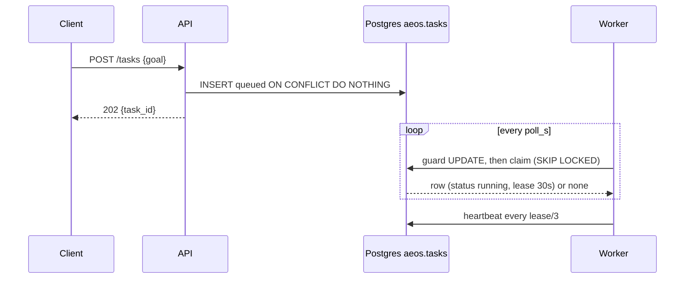
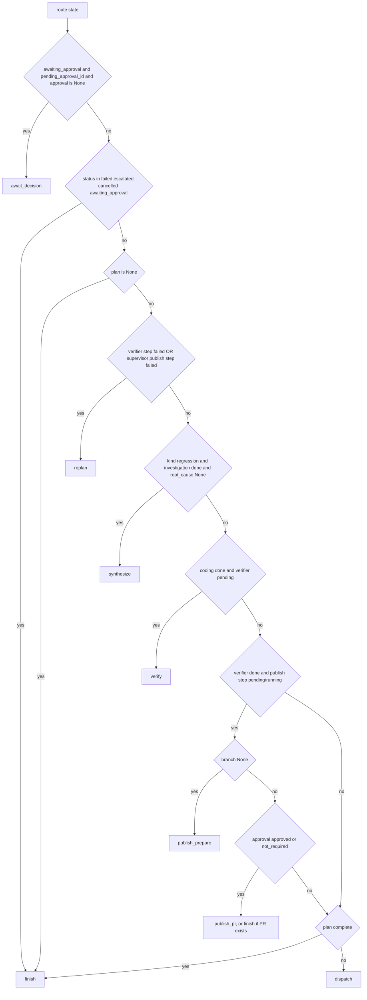
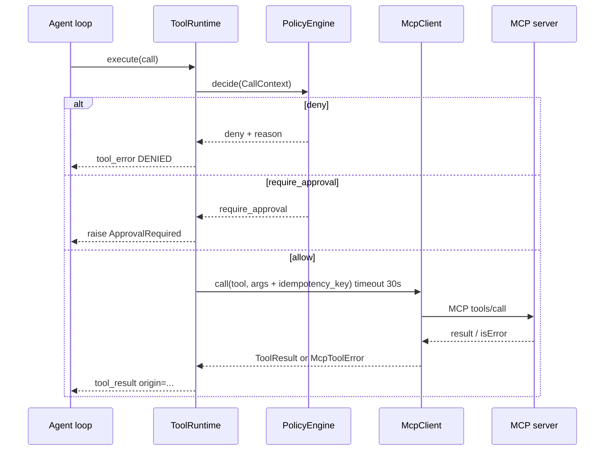
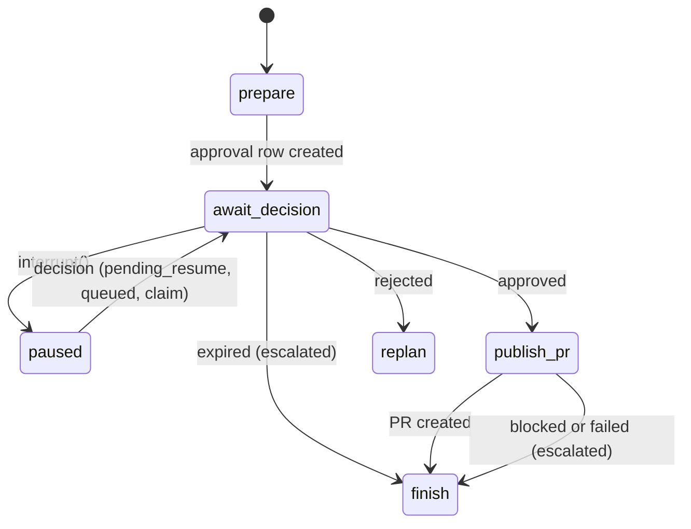

# 29 - Code Walkthroughs (tag: WALK)

**What this file covers.** Step-by-step walkthroughs of the eight execution paths you are most likely to be asked to trace live in an interview, each with entry point, components, data transformations, branches, failure paths, and the questions an interviewer is likely to ask. All excerpts are short and re-verified against the source in this session. Nothing here describes behaviour I did not read in code. For concepts (what a lease is, what a LangGraph checkpoint is, what MCP is) follow the links; this file is about "what runs, in what order, and what changes".

| # | Walkthrough | Entry point |
|---|---|---|
| 1 | Submit a task and get it claimed | `POST /tasks` -> `store/tasks.enqueue` -> `Worker.run_once` -> `tasks.claim` |
| 2 | One worker turn: start, resume, or recover | `Worker._execute` |
| 3 | How the next node is chosen | `graph/routing.py::route` |
| 4 | Planning and dispatching specialists | `GraphNodes.plan` / `dispatch` |
| 5 | One tool call through the runtime | `ToolRuntime.execute` |
| 6 | Verification: gates, then judge | `GraphNodes.verify` |
| 7 | Publishing with human approval | `PublishNodes.prepare` / `await_decision` / `create_pr` |
| 8 | Failure, replan and the escalation ladder | `GraphNodes.replan`, `RetryPolicy` |

Cross-references: overall flow in [04-end-to-end-workflows](04-end-to-end-workflows.md), state design in [07-state-durability-and-persistence](07-state-durability-and-persistence.md), incident runbooks in [27-debugging-and-incident-scenarios](27-debugging-and-incident-scenarios.md).

---

## Walkthrough 1. Submit a task and get it claimed

**Entry point.** `POST /tasks` (`api/app.py::create_task`) or `aeos submit` (`cli._submit`).

**Components.** FastAPI route, `aeos.tasks` table, a `Worker` (embedded in `aeos serve` or standalone `aeos worker`).

**Step by step.**
1. The API validates `TaskRequest` (`goal` 3 to 4000 chars, optional `max_cost_usd` 0 to 50, optional `kind`). If the caller omitted `kind`, it becomes `"change"` when `Settings.target_ready` (repo and token configured) else `"regression"`. A `change` request without a ready target returns 409.
2. A task id is minted (`t-` plus 8 hex chars). `tasks.enqueue` does `INSERT ... ON CONFLICT (task_id) DO NOTHING RETURNING *`, so a repeated insert returns the existing row. The row starts `status='queued'`, `attempts=0`. The response is `202 {"task_id": ...}`; nothing has been executed.
3. Separately, a worker loop (`Worker.run_forever`) calls `run_once` every `poll_s` (1 s CLI, 0.2 s embedded). `run_once` calls `tasks.claim` in a thread (`asyncio.to_thread`), because psycopg is synchronous.
4. `claim` does two statements in one connection. First the crash-loop guard: rows with `attempts >= max_attempts` that are `queued` or `running` with an expired lease become `escalated`. Then the claim itself:

```sql
UPDATE aeos.tasks SET status='running', worker_id=%s,
  lease_expires_at = now() + make_interval(secs => %s), attempts = attempts + 1 ...
WHERE task_id = (SELECT task_id FROM aeos.tasks WHERE status='queued'
   OR (status='running' AND lease_expires_at < now())
   ORDER BY created_at FOR UPDATE SKIP LOCKED LIMIT 1) RETURNING *
```

`FOR UPDATE SKIP LOCKED` is what lets many workers poll the same table without blocking each other and without two of them getting the same row. Dead workers are handled by the same query: a `running` row whose lease has expired is claimable.

**Data transformations.** HTTP body -> `TaskRequest` -> row (`goal`, `budget` JSON, `kind`) -> `TaskRow` -> a `TaskState` the first time the graph is invoked (Walkthrough 2).

**Branches / failure paths.**
- No worker alive: the task sits `queued`; nothing times it out.
- Claim by a worker that then dies: lease expires after `lease_s` (30 s), the row is claimed again, `attempts` increments.
- Guard: at 5 claims the task is escalated. Note `attempts` counts every claim including approval resumes (known discrepancy, [27](27-debugging-and-incident-scenarios.md) Scenario 10).
- API cancel at this stage: `tasks.cancel` sets `cancelled` (fencing a worker: its next heartbeat finds no `running` row under its id and cancels the work).



Read it as: the API only writes a row; all execution is pulled by workers, and "alive" is a lease the worker keeps renewing.

**Likely interview questions.** Why a Postgres queue instead of Redis/Celery? (One datastore already required; `SKIP LOCKED` is correct for multi-consumer; limits: polling, FIFO only.) What stops two workers running one task? (Row lock plus status/lease predicate, and fencing on every later write: `heartbeat`, `finish` require `worker_id` to match.) -> Q-WALK-1.

---

## Walkthrough 2. One worker turn: start, resume, or crash-recover

**Entry point.** `Worker.run_once` -> `Worker._execute(row)` (`worker.py`).

**Components.** `build_graph`, LangGraph `AsyncPostgresSaver` checkpointer (`graph/checkpoint.py`), `drive`, `Worker._heartbeat`.

**Step by step.**
1. `run_once` starts two asyncio tasks: `work = _execute(row)` and `beat = _heartbeat(task_id, work)`. The heartbeat renews the lease every `lease_s/3` via `tasks.heartbeat`; if that returns false (fenced), it calls `work.cancel()`.
2. `_execute` rebuilds the graph (stateless: `build_graph(self.rt, self.saver)`), then asks the checkpointer what exists for `thread_id = task_id`:

| Snapshot | Meaning | Action |
|---|---|---|
| `not snap.values` | never started | `graph.ainvoke(TaskState(task_id, goal, budget, kind), config)` |
| `snap.interrupts` and `row.pending_resume` | paused at approval, decision arrived | `graph.ainvoke(Command(resume=payload), config)`, then `tasks.consumed_resume` |
| `snap.interrupts` and no `pending_resume` | paused, no decision yet | do nothing (re-pauses) |
| `snap.next` (no interrupt) | crashed mid-run | `graph.ainvoke(None, config)`: continue from last checkpoint |

3. `drive(graph, task_id, first, self.approver)` loops: reads the snapshot; if no interrupt or no in-process approver, returns the state. With `--yes` (`auto_approver`) it applies a decision itself and resumes. In the normal deployment `approver is None`, so a paused graph just returns.
4. `_execute` returns `("paused", None)` if `state.status == "awaiting_approval"`, else `(state.status, state.error)`.
5. Back in `run_once`: `tasks.finish(task_id, worker_id, status, error)`. This is also fenced (`WHERE worker_id = %s AND status='running'`). For `paused`, `finish` writes `queued` instead if `pending_resume IS NOT NULL` (the decision arrived while winding down). For any non-paused status the worker calls `sandbox.reap_task`.

**Data transformations.** `TaskRow` -> `TaskState` (pydantic) -> node dict outputs merged by LangGraph into the state -> checkpoint row in Postgres after each node -> final `status` string in `aeos.tasks`.

**Where the crash-safety comes from.** The graph is wrapped per node by `_crashable` (`graph/build.py`), which adds `maybe_crash` hooks, binds the task id for tracing, and re-attaches the stored trace context (`remote_context(state.trace)`). The checkpoint is written *after* a node returns, so a kill mid-node re-runs the node on resume. Hence the rules: writes carry idempotency keys; "nothing expensive before `interrupt()`".

**Failure paths.**
- Exception in `_execute`: caught in `run_once`, `release_with_error` requeues with `repr(exc)[:500]`.
- `CancelledError` (lost lease): logged, returns without writing (the new owner or the cancelling API already owns the row).
- A stale `pending_resume` after a crash between `ainvoke(Command)` and `consumed_resume` (see [27](27-debugging-and-incident-scenarios.md) Scenario 4).

**Likely interview questions.** Why re-run the interrupted node instead of checkpointing mid-node? What happens if the process dies after the PR is created but before the checkpoint? What does "fencing" mean here? -> Q-WALK-2.

---

## Walkthrough 3. How the next node is chosen

**Entry point.** `route(state)` in `graph/routing.py`, wired as a conditional edge after every node except `finish`/`reflect` (`build_graph`).

**Concept.** In LangGraph a conditional edge is a function from state to the name of the next node. AEOS makes it a **pure, deterministic function of `TaskState`**: the LLM never decides control flow.

**Decision order (Verified, top to bottom, first match wins).**



How to read it: the first two diamonds handle pauses and terminal statuses; then failures preempt progress (`replan` beats everything else); then the investigation -> synthesize -> code -> verify -> publish pipeline is encoded as "which steps are done"; `dispatch` is the default for "run whatever is ready".

**Subtleties worth knowing.**
- A single state snapshot drives resumption: after a crash, `route` is evaluated against the checkpointed state and naturally picks the same node again. There is no separate "program counter".
- After `publish_prepare` returns `status="awaiting_approval"` with `pending_approval_id` set and `approval=None`, the first branch sends the graph to `await_decision`, which calls `interrupt()`.
- After approval the node returns `approval={"status":"approved",...}` and `status="running"`; the branch `verifier_done and publishing` with `branch` set and approval approved picks `publish_pr`.
- Rejection: `await_decision` marks the supervisor step `failed`, which makes `publish_failed(state)` true, so `route` sends it to `replan` (and `human_feedback` counts toward the failure limit).
- An expired approval returns `status="escalated"`, so the second branch routes to `finish`.
- `recursion_limit` is 120 (`_config`), a backstop against a routing loop.

**Failure path.** `dispatch` with no ready steps returns `status="failed", error="no runnable steps"` (for example a malformed plan).

**Likely interview questions.** Why not let the LLM choose the next agent? How do you test the routing? (Pure function; `tests/graph/test_e2e.py`, `test_replan_e2e.py`, `test_hitl.py` exercise it end to end with a scripted fake LLM.) -> Q-WALK-3.

---

## Walkthrough 4. Planning and dispatching specialists

**Entry point.** `GraphNodes.plan` then `GraphNodes.dispatch` (`graph/nodes.py`).

**Plan node.**
1. Opens the root span `task` and stores its W3C carrier in `state.trace` (`inject_context`). That single carrier is why one task is one trace across processes.
2. `BudgetTracker(state.budget)` is created (stamps `started_at` on first use).
3. Memory recall (`MemoryManager.recall(goal)`), wrapped in try/except: memory "must never break a task". Result text is injected as hints.
4. For `kind == "change"`: `rt.refresh_target` (git fetch of the real repo's default branch into the local bare mirror); failure ends the task with `status="failed"`, `error="cannot reach the target repository..."`.
5. `create_plan(strong_llm, goal, tracker, memory_text, kind)` (`agents/supervisor.py`): `complete_structured` forces a `submit` tool call whose arguments validate against `PlanSpec`; `validate_steps` checks non-empty, unique ids, known dependencies, a coding step, no analytics for `change`, and no cycles (Kahn). Invalid or `LLMError` falls back to `default_plan_steps(kind)`. `finalize_plan` then **appends** the deterministic tail: verifier step `v{version}` depending on the coding steps, and publish step `p{version}` (owner `supervisor`).
6. Returns `{"plans": [plan], "status": "running", ...}`: only the changed fields.

**Dispatch node.**
1. `plan.ready_steps()` = pending steps whose dependencies are done/skipped and whose owner is in the specialists mapping (regression or change variant). So analytics and research, with no mutual dependency, are both ready and run **in parallel** via `asyncio.gather`.
2. Each ready step is marked `running` and `attempts+1` in a deep copy of the plan; a `SpecialistRequest(task_id, step_id, attempt, goal, context)` is built. `_context` injects previous verifier feedback, rejected diagnoses, human feedback, memory hints, and for coding the research/root cause.
3. `specialists[owner].run(req, tracker, sink)` is either an in-process `LoopSpecialist` or an `A2ASpecialist` over HTTP, same interface. Any exception becomes `SpecialistResult(status="error")`: "a specialist crash must not take down the run".
4. Results are folded into artifacts: analytics -> `artifacts.analytics`; research -> `artifacts.research` and `baseline_ref`; coding -> `artifacts.patch` (taken from the sandbox via `snapshot_patch`, not from the model's words), `patch_summary`, `pr_title`, `base_ref`. For regression research, `_check_research` is a hard-fact check by code: the suspect must resolve to a real commit and the baseline is recomputed as the nearest ancestor that contains `benchmark.py` (`baseline_for`), emitting `baseline_corrected` if the model was wrong.
5. Failures: `res.status == "budget"` always escalates; otherwise `RetryPolicy.on_step_failure(attempts)`: retry (step back to `pending`) if `attempts < 2` else `failed` and `status="escalated"`.
6. The node returns a merged update, including the shared `budget`. Because `BudgetTracker` is a shared mutable object across parallel specialists, they all charge one budget.

**Then `synthesize`** (regression only): when investigation is done and `root_cause is None`, `synthesize_root_cause` makes one structured LLM call combining analytics and research (and prior rejected diagnoses) into a `RootCause`; no baseline -> `escalated`.

**Failure paths.** Specialist error -> retry once -> escalate; `budget` -> escalate immediately; parallel specialists where one fails and one succeeds: the successful step is kept `done` and only the failed one retries (Q-REL-5 in [10](10-error-handling-and-reliability.md)). A node crash mid-dispatch loses all in-flight results (the update is only checkpointed at return) and specialists restart, which is safe for read-only tools; the coding specialist starts from a fresh sandbox (it reads a `resume_patch` context key, but grep finds nothing in `src` that sets it, so that hook is unused).

**Likely interview questions.** Why is verification appended by code, not planned by the LLM? How is parallelism expressed? How do you stop the model lying about the baseline commit? -> Q-WALK-4.

---

## Walkthrough 5. One tool call through the runtime

**Entry point.** `ToolRuntime.execute(call)` (`agents/tools.py`), called from the agent loop for every non-`finish` tool call.

**Components.** `RiskGate` (`PolicyEngine`, `core/risk.py`), `ToolDef`, `McpClient`, `EventSink`, tracing.

**Step by step.**
1. Lookup: unknown tool returns `<tool_error ...>unknown tool; available: [...]</tool_error>` to the model (it can self-correct).
2. `gate.decide(CallContext(tool, risk, server, arguments, origin, step_id, diff_lines, files_touched, grant))`. `origin` is `"untrusted_only"` once this agent has read any untrusted tool result (`consumed_untrusted`). `PolicyEngine.decide`: (1) any matching **deny** rule wins regardless of order (`never-merge`, `branch-namespace` deny unless the head/name matches `^aeos/`); (2) otherwise the first matching non-deny rule; (3) default `require_approval`; (4) a grant whose `arguments_hash` equals the hash of this call turns `require_approval` into `allow`.
3. `deny` returns `<tool_error>DENIED by policy: ...` (the model sees why); `require_approval` raises `ApprovalRequired`, which the specialist loop lets propagate (and publish nodes catch, see Walkthrough 7).
4. `allow`: `tracker.add_tool_call()`, emit a `tool_call` event, `maybe_crash("tool:<name>:before")`, then inside a `tool.call <name>` span run `tool.run(args, ctx)`. For MCP tools (`mcp_tooldefs`), `idempotency_key` is stripped from the schema the model sees and **injected** from `idempotency_key(ctx, name, args)`. `McpClient.call` applies a 30 s timeout and retries (2) only for `read` tools or calls that carry a key.
5. Any exception inside `tool.run` becomes `ToolOutput("[tool_crashed] ...", is_error=True)`.
6. A `ToolCallRecord` (with `origin`, `idempotency_key`, truncated `result_preview`) is appended. The text returned to the model is clipped to 6000 chars and wrapped: `<tool_result tool="x" origin="trusted|untrusted">...</tool_result>` (or `<tool_error>`). Successful untrusted results flip `consumed_untrusted`, tightening later policy decisions.



Read it as: the model proposes, code disposes; only the `allow` branch ever reaches a server, and the model sees denials as text it can react to.

**Known weaknesses (Verified).** `</tool_result>` inside tool output is not escaped, so crafted output can close the wrapper early (known); the origin label is by tool name allowlist (`_TRUSTED_RESULTS`), not by content; sandbox tools declare `risk="read"` because they only affect an ephemeral container (see [12](12-sandbox-and-execution-safety.md) Q-SBX-4).

**Likely interview questions.** Where is the prompt-injection defence enforced, in the prompt or in code? Why inject idempotency keys instead of letting the model pass them? -> Q-WALK-5.

---

## Walkthrough 6. Verification: deterministic gates, then an advisory judge

**Entry point.** `GraphNodes.verify` (`graph/nodes.py`), reached when `coding_done and verifier_pending`.

**Step by step (regression kind).**
1. Mark the verifier step running, `attempt = len(verifications) + 1`.
2. `run_gates` (`agents/verifier.py`) in `asyncio.to_thread`. If there is no patch: `status="failed"`, issue `no_patch`.
3. **Static gates** (`static_gates`, pure code): `diff_size_ok` (<= 5 files, <= 300 changed lines), `paths_allowed` (no edits to `benchmark.py`, `checkout/costs.py`, `pytest.ini`; no modification of existing files under `tests/`; new test files are allowed), `no_secrets_in_diff` (regex families on added lines; `GateConfig.secret_values` exists but is never populated in production, known).
4. **Sandbox gates** (three fresh containers: baseline, unpatched head, patched head): benchmark baseline and unpatched head -> `regression_reproduced` (head must be > tolerance slower than baseline, else the baseline is not a valid known-good); apply patch -> `patch_applies`; `run_tests` -> `tests_pass`; `compileall` -> `lint_ok`; benchmark with patch -> `benchmark_not_regressed` (candidate within +10 % of baseline p95). Any `SandboxError` (benchmark crash, docker problems) becomes `sandbox_ok=False` plus a `verifier_error` issue.
5. `passed = all(gates.values())`; failures carry typed `Issue`s and `suggested_focus` hints (`_focus_for_perf`).
6. If a patch exists, `judge_patch` makes **one** structured LLM call (`Judgement`: `addresses_root_cause`, `covers_requirements`, `concerns`) with the patch (`patch[:12000]`) inside `<patch untrusted="true">`. `LLMError` returns `None` and the gates stand alone.
7. `apply_judgement(gates, judgement, kind)`: **a failed result can never become passed**; if gates passed but the judge says no, status becomes `failed` with issue `requirement_not_met`.
8. The node records metrics/spans (`m.verifications`, `annotate`), emits a `verification` event and returns `{"verifications": [..., result], "plans": [...], "budget": ...}`. The verifier step is `done` or `failed`; `failed` makes `route` choose `replan`.

For `kind == "change"` (`run_change_gates` in `agents/verifier_change.py`): gates are `patch_applies`, `syntax_ok`, `lockfile_consistent`, `tests_pass` (set true if the repo has no suite, with the limitation stated), `sandbox_ok`. Note the regression gates compare performance, the change gates do not.

**Why independent.** The verifier never reads the coding agent's claims (`claims_tests_pass` etc.); it re-applies the patch to a fresh checkout and re-runs everything.

**Failure paths and honest caveats.** Benchmark noise vs the 10 % tolerance can flip results ([27](27-debugging-and-incident-scenarios.md) Scenario 5); `lint_ok` is a syntax compile, not a linter; infra failures and patch failures share the same counter toward escalation.

**Likely interview questions.** Why can the LLM judge only make things stricter? What stops the coding agent editing `benchmark.py` to cheat? Why check `regression_reproduced`? -> Q-WALK-6.

---

## Walkthrough 7. Publishing with human approval

**Entry point.** Three nodes in `graph/publish.py`: `PublishNodes.prepare`, `await_decision`, `create_pr`; plus the decision path `POST /approvals/{id}/approve` -> `hitl.apply_decision` -> `approvals.decide`.

**Why three nodes.** A node is the unit of checkpointing and resume re-runs the interrupted node from the top. Splitting means work before the pause (branch, commit, approval row) is checkpointed and never repeated, and `await_decision` does nothing but `interrupt()`.

**`prepare`.**
1. Branch name `aeos/{task_id}-v{plan.version}`. Builds a `ToolRuntime` limited to the three PR tools; sets `files_touched` and `diff_lines` from the patch so the `large-diff-needs-approval` rule can fire.
2. Runs `create_branch` then `commit_patch` through `ToolRuntime.execute` (policy: reversible, allowed on `aeos/*`). `ApprovalRequired` here is unsupported and escalates; tool errors and denials escalate with a message.
3. Calls `gate.decide` for `create_pull_request` itself. `deny` -> escalate; `allow` -> store `approval={"status":"not_required",...}`; `require_approval` (the default for PRs) -> `approvals.create(...)` with `action_key=open_pr:{step.id}:{step.attempts}`, arguments (title, body, head, base), a rationale and an evidence bundle (root cause, gates, tests, benchmark, judgement, files, **the full patch**, branch). The row stores `arguments_hash` computed from tool plus canonical arguments. It is idempotent on `(task_id, action_key)`.
4. Emits `approval_requested`; returns `status="awaiting_approval"`, `pending_approval_id`.

**`await_decision`.** `interrupt({"approval_id", "action"})` raises `GraphInterrupt`; LangGraph checkpoints and the run ends. The worker sees an interrupt and `status == awaiting_approval`, reports `paused`, and `tasks.finish` sets `status='paused'`.

**The decision.** The reviewer calls the API (needs `X-Actor` or a session user). `approvals.decide` runs one transaction: `UPDATE ... SET status=..., actor, decided_at WHERE id=%s AND status='pending' AND expires_at > now() RETURNING *`; if it matched, write an audit row and `enqueue_resume(conn, task_id, payload)` which sets `pending_resume` and flips `paused -> queued`. If it did not match: not found, already decided (409), or expired (410 and the task is woken with an `expired` payload).

**Resume.** A worker claims the task; `_execute` sees `snap.interrupts` and `pending_resume`, runs `graph.ainvoke(Command(resume=payload))`. Re-entering `await_decision`, `interrupt()` now returns the payload. The node records an `approval.wait` span with true wall-clock bounds (`emit_span` from approval `created_at` to `decided_at`), increments the approvals metric, and returns: approved -> `approval` set, `status="running"`; rejected -> publish step `failed`, feedback appended; expired -> `status="escalated"`.

**`create_pr`.** Loads the request from the DB (`approvals.get`), asserts it is approved, builds `ApprovalGrant(approval_id, tool, arguments_hash=req.arguments_hash)` and calls `create_pull_request` with the **stored** `req.arguments`. The policy engine only converts `require_approval` to `allow` if the hash of the arguments being sent equals the grant's hash. On success it writes `art.pull_request`, marks the step `done`, writes a deduplicated `pr_created` audit row, emits `pr_created`. Then `route` -> `finish`.



Read it as the publish sub-machine: the only edges that reach GitHub go through an `approved` decision, and every other edge ends the task or loops back to planning.

**Failure paths.** See [27](27-debugging-and-incident-scenarios.md) Scenarios 2 to 4 (crash points, duplicates, approval not arriving). Known weaknesses: `arguments_hash` and `arguments` sit in the same row, so someone with DB write access can alter both (the control defends code paths, not DB admins); the stale-resume payload edge case.

**Likely interview questions.** What exactly does "approved" authorise? How do you make approval survive a restart? What if two people click at once? -> Q-WALK-7.

---

## Walkthrough 8. Failure, replan and the escalation ladder

**Entry point.** `route` -> `replan` -> `GraphNodes.replan` (`graph/nodes.py`) with `RetryPolicy` (`core/retry.py`).

**Policy (Verified).** Step failures: retry once (`max_step_attempts=2`), then escalate. Verification failures: counted as `failed verifications + human rejections`; `1 -> replan`, `2 -> replan_new_strategy` (the plan must include analytics/research again), `>= 3 -> escalate`.

**Step by step.**
1. Triggered by a failed verifier step or a failed publish step (human rejection).
2. `failures = number of failed VerificationResults + len(human_feedback)`; `action = retry.on_verification_failure(failures)`.
3. `escalate`: emit `task_escalated`, return `status="escalated"` with an error naming the issues (or the human's feedback).
4. Otherwise build a summary for the planner: goal, previous plan with statuses, the diagnosis acted on, patch summary, human rejection, verifier issues, suggested focus, benchmark, judge. `replan(...)` makes a structured LLM call (`ReplanSpec`) validated by `validate_steps` (and, if re-investigation is required, it must contain an analytics or research step); invalid or `LLMError` -> `fallback_replan_steps` (coding only, or research plus coding).
5. State updates: new `Plan` appended (`plans` is history), `artifacts.branch` and `pull_request` reset so the next publication starts clean (new branch name via the new version), and if investigation is re-opened the current `root_cause` is moved to `rejected_root_causes` and cleared so `synthesize` runs again with "do not pick these again". `approval` and `pending_approval_id` are cleared, `status="running"`.
6. `route` then sends the graph to `dispatch` (or `synthesize` first) for the new steps.

**Terminal outcomes (all Verified in `finish` and nodes).** `completed` (last verification passed and a PR exists), `failed` (ended without PR and not escalated, e.g. target unreachable, synthesis failed), `escalated` (ladder exhausted, specialist failures, budget, approval expired, publish blocked), `cancelled` (set only in `aeos.tasks` by the API; the checkpoint still says `running`, which `view()` patches over).

**Failure paths and caveats.** Budget and wall-clock are checked only in the agent loop (Walkthrough 4/5), and wall-clock includes the human wait ([27](27-debugging-and-incident-scenarios.md) Scenario 11). Replanned coding runs do not reuse the previous sandbox (the `resume_patch` hook in `CodingSpecialist.run` is never populated); each coding attempt starts from the base commit, with the verifier feedback passed only as text context.

**Likely interview questions.** Why escalate instead of retrying forever? Why force a strategy change on the second failure? Where does human feedback enter the loop? -> Q-WALK-8.

---

## Interview questions

## Q-WALK-1. Trace what happens from `POST /tasks` until a worker starts running the task.
**Difficulty:** Beginner  **Topic:** Queue and claim
**Short answer:** The API inserts a `queued` row in `aeos.tasks` and returns 202 with the id. A worker's polling loop calls `claim`, a single `UPDATE ... WHERE task_id = (SELECT ... FOR UPDATE SKIP LOCKED LIMIT 1)` that flips the oldest runnable row to `running`, stamps a 30 s lease and increments `attempts`. The worker then starts the graph and a heartbeat task.
**Detailed explanation:** "Runnable" is either `queued` or `running` with an expired lease, so crash recovery and fresh work use one code path. Before claiming, a guard escalates tasks that have hit `max_attempts`. `SKIP LOCKED` means concurrent claimers skip rows another transaction has locked, so no two workers get the same task and none block.
**How this project uses it:** `api/app.py::create_task`, `store/tasks.py::enqueue/claim`, `worker.py::run_once`.
**Example/walkthrough:** Walkthrough 1.
**Follow-ups:**
- *Why `ON CONFLICT DO NOTHING` on enqueue?* So the same task id cannot create two rows; the API mints ids so conflicts are rare, but the CLI/tests can replay.
- *What if the API crashes right after the insert?* Nothing is lost; the row is committed and any worker will claim it (the API holds no state).
- *What are the queue's limits?* Polling latency (0.2 to 1 s), FIFO by `created_at`, no priorities or tenant fairness, `attempts` counts every claim.
**Trade-offs and alternatives:** Celery/RQ/SQS vs Postgres: extra infrastructure and a second durability story vs simplicity here.
**Common interview mistake:** Saying "a lock prevents double execution"; the lease plus fencing does, because locks are released at commit.
**Related:** [07](07-state-durability-and-persistence.md) Q-STATE-4, Q-STATE-8; [27](27-debugging-and-incident-scenarios.md).

## Q-WALK-2. What does `Worker._execute` do, and how does one function handle start, resume and recovery?
**Difficulty:** Advanced  **Topic:** Durable execution
**Short answer:** It asks the checkpointer what exists for `thread_id=task_id`. No values means a fresh `ainvoke` with a new `TaskState`; an interrupt with a pending decision means `ainvoke(Command(resume=...))`; a pending `next` node without an interrupt means a crash happened and `ainvoke(None)` continues from the last checkpoint. The graph itself carries no program counter beyond the state.
**Detailed explanation:** Because routing is a pure function of the checkpointed state and every node returns only its changed fields, re-invoking from the saved state naturally repeats exactly the unfinished node. Safety of that repetition comes from idempotency keys on writes and the rule that nothing expensive precedes `interrupt()`.
**How this project uses it:** `worker.py::_execute`, `graph/checkpoint.py`, `graph/build.py::_crashable`.
**Example/walkthrough:** Kill at `node:verify:after`: sandboxes ran, verification result not checkpointed; resume re-runs `verify`, which creates fresh sandboxes (verification is pure recomputation, no external side effect).
**Follow-ups:**
- *Why not checkpoint inside a node?* Complexity and a consistency burden; AEOS prefers small nodes and idempotent effects (Q-STATE-3).
- *What does "fenced" mean?* After a lease loss the old worker's writes (`heartbeat`, `finish`) fail the `worker_id` predicate and its next heartbeat cancels its work.
- *What if the same node's side effect is not idempotent?* It would repeat; all write tools in this repo carry keys, which the chaos test exercises at every publish step.
**Trade-offs and alternatives:** Temporal gives the same guarantees via event-sourced replay but needs its own cluster and deterministic workflow code (D-033 rationale in [24](24-technical-challenges-and-history.md)).
**Common interview mistake:** Claiming "exactly-once execution"; the guarantee is at-least-once execution with idempotent effects.
**Related:** [07](07-state-durability-and-persistence.md), [10](10-error-handling-and-reliability.md).

## Q-WALK-3. Why is routing a pure function of state, and what are its priorities?
**Difficulty:** Intermediate  **Topic:** Orchestration design
**Short answer:** So control flow is testable, resumable and not manipulable by model output. `route` checks, in order: pending approval, terminal status, missing plan, failed steps (replan), synthesize, verify, publish stages, completion, else dispatch. Failures preempt progress.
**Detailed explanation:** An LLM-driven router would put the control flow inside a probabilistic component; here the LLM contributes plan content and findings, never the next node. Since the function reads only state, a crash and resume re-derive the same decision.
**How this project uses it:** `graph/routing.py::route` and helper predicates; edges in `graph/build.py`.
**Example/walkthrough:** Walkthrough 3 diagram; rejection path: `await_decision` marks the publish step failed, `publish_failed` is true, `route` returns `replan`.
**Follow-ups:**
- *What is the risk of this style?* The routing rules are implicit in step statuses; a status mismatch can strand the graph (for example a step left `running` is neither ready nor failed) which `dispatch` reports as "no runnable steps".
- *What stops an infinite loop?* The retry policy escalates after 3 failures and `recursion_limit=120`.
- *How is it tested?* Through scripted end-to-end tests (`tests/graph`), not a unit test table of `route` that I verified.
**Trade-offs and alternatives:** LLM supervisor routing is more flexible but harder to bound and verify.
**Common interview mistake:** Calling this "agentic routing"; it is deterministic orchestration around agentic steps.
**Related:** [05-agents-and-orchestration](05-agents-and-orchestration.md).

## Q-WALK-4. How does dispatch run specialists and protect against a model that lies about facts?
**Difficulty:** Advanced  **Topic:** Parallel agents, grounding
**Short answer:** Ready steps (dependencies satisfied) are run together with `asyncio.gather` against one shared budget tracker; results are folded into typed artifacts. Facts that code can establish are re-established by code: the suspect commit must resolve in the repo and the baseline is recomputed as the nearest benchmarkable ancestor; the patch is taken from the sandbox diff, not from the agent's description.
**Detailed explanation:** Failures are converted to `SpecialistResult(status="error")` so one specialist cannot crash the node; retries follow `RetryPolicy`. The deterministic tail (verifier and publish steps) is appended by `finalize_plan`, so the planner cannot omit verification.
**How this project uses it:** `GraphNodes.dispatch/_check_research`, `Runtime.baseline_for`, `CodingSpecialist.run` (`snapshot_patch`), `supervisor.finalize_plan`.
**Example/walkthrough:** The model reports `last_good_commit_sha=X`; `_check_research` computes the parent chain, finds the nearest ancestor containing `benchmark.py`, emits `baseline_corrected`, and uses that. (The code comment records this was observed live.)
**Follow-ups:**
- *Is parallelism real?* Yes for in-process or A2A specialists since both are awaited coroutines; CPU-heavy work is in sandboxes/threads.
- *What if both specialists mutate shared state?* They return results; only `dispatch` merges them in one place.
- *What does a node crash lose?* All in-flight specialist work; results are only checkpointed when the node returns.
**Trade-offs and alternatives:** Pushing more validation into code costs development time but removes whole classes of hallucination.
**Common interview mistake:** Trusting structured output because it validated against a schema; schema-valid is not true.
**Related:** [05](05-agents-and-orchestration.md), [13](13-verification-and-risk-policy.md).

## Q-WALK-5. Walk me through a single tool call and tell me where each security control sits.
**Difficulty:** Advanced  **Topic:** Tool runtime and policy
**Short answer:** `ToolRuntime.execute` asks the policy engine first (deny rules always win; first matching rule otherwise; default is require approval; a hash-bound grant can turn approval into allow), then calls the MCP tool with a timeout, then wraps the result in `<tool_result origin=...>` and records it. Idempotency keys are injected by code, results are truncated, and any untrusted result tightens later decisions for that agent.
**Detailed explanation:** The policy keys on the risk level the tool's server declares in its metadata, with unknown risk treated as `write_irreversible`. Policy is YAML plus code and is not LLM-controlled.
**How this project uses it:** `agents/tools.py`, `core/risk.py`, `policy/risk_policy.yaml`, `mcp_client.py`.
**Example/walkthrough:** `create_pull_request` -> rule `pr-needs-approval` -> `ApprovalRequired`; branch `main` -> `branch-namespace` deny regardless of position.
**Follow-ups:**
- *Where is it weak?* `</tool_result>` is not escaped; origin is by tool name; `risk="read"` for sandbox tools is a judgement call; policy defends the tool boundary, not the model's reading.
- *Why inject idempotency keys?* The model cannot be trusted to produce stable keys, and a stable key is what makes replays safe.
- *What happens on timeouts?* `McpTransportError` -> `[transport_error]` tool error; retried only if safe.
**Trade-offs and alternatives:** Per-tool allowlists vs risk classes; classes scale but depend on honest server declarations (here AEOS owns the servers).
**Common interview mistake:** Saying "the prompt tells the model not to"; the prompt is defence in depth, the gate is the control.
**Related:** [13](13-verification-and-risk-policy.md), [14](14-security-and-prompt-injection.md), [15](15-mcp-servers-and-tool-layer.md).

## Q-WALK-6. Explain verification: what is deterministic, what is LLM, and what can each do?
**Difficulty:** Intermediate  **Topic:** Verifier
**Short answer:** Deterministic gates (diff size, forbidden paths, secret patterns, patch applies, tests, benchmark vs baseline, a compile "lint") decide pass/fail. The LLM judge reads the patch and gate results and can only turn a pass into a fail, never a fail into a pass. Everything is recomputed in fresh sandboxes, never taken from the coding agent's claims.
**Detailed explanation:** The `regression_reproduced` gate checks the premise: if the unpatched head is not meaningfully slower than the baseline, "faster than baseline" proves nothing.
**How this project uses it:** `agents/verifier.py`, `agents/judge.py::apply_judgement`, `GraphNodes.verify`.
**Example/walkthrough:** Walkthrough 6.
**Follow-ups:**
- *Weaknesses?* 10 % tolerance vs noise; `lint_ok` is `compileall`; judge sees the first 12 000 chars of the patch; `secret_values` never populated.
- *Can the coding agent edit the test it must pass?* New test files are allowed; existing tests and `benchmark.py` are not (`paths_allowed`).
- *What about change tasks?* Different gate set, no perf gate, honest "no test suite" handling.
**Trade-offs and alternatives:** More gates mean more false failures; LLM-only verification is cheap but unsound.
**Common interview mistake:** Presenting the judge as the verifier.
**Related:** [13](13-verification-and-risk-policy.md), [23-evaluation-framework](23-evaluation-framework.md).

## Q-WALK-7. What exactly does a human "approve", and how is that bound to what executes?
**Difficulty:** Expert  **Topic:** Approval semantics
**Short answer:** The approver authorises one specific tool call with specific arguments. The request row stores the arguments and a hash of (tool, arguments minus idempotency key). On resume, `create_pr` builds a grant from the stored hash and sends the stored arguments; the policy engine converts `require_approval` to `allow` only if the hash of what is being sent equals the grant. The decision and the task wake-up are one transaction, and a decision applies once (compare-and-set on `status='pending'`).
**Detailed explanation:** The evidence shown to the reviewer includes the full patch and verification results, so the human sees what will be pushed. Expiry (24 h) prevents stale approvals from being applied; a click after expiry gets 410 and the task escalates.
**How this project uses it:** `graph/publish.py`, `store/approvals.py::create/decide`, `core/risk.py::arguments_hash/PolicyEngine.decide`, `hitl.py`.
**Example/walkthrough:** Walkthrough 7.
**Follow-ups:**
- *Can someone edit the arguments after approval?* In the DB, yes: both hash and arguments are in one row, so a DB writer can change both (known). The check stops code paths from sending different arguments than were approved (test `test_tampering_with_the_approved_arguments_is_blocked`).
- *What if two reviewers approve simultaneously?* One wins; the other gets 409 (`test_concurrent_approvals_create_exactly_one_pull_request`).
- *Is the approver authenticated?* Auth is off by default; with no users configured an `X-Actor` header names the actor but is not verified (see [18](18-api-and-client.md), [14](14-security-and-prompt-injection.md)).
**Trade-offs and alternatives:** Signed approvals or an external approval service (GitHub required reviews) for stronger non-repudiation.
**Common interview mistake:** Overstating it as "cryptographically signed approval".
**Related:** [13](13-verification-and-risk-policy.md), [27](27-debugging-and-incident-scenarios.md) Q-DBG-5.

## Q-WALK-8. Describe the escalation ladder and what information the replanner gets.
**Difficulty:** Intermediate  **Topic:** Replanning
**Short answer:** First verification failure: replan. Second: replan that must re-investigate (the plan must include analytics or research). Third (human rejections count too): escalate to a human with the issues. The replanner receives the previous plan with statuses, the diagnosis it acted on, the patch summary, verifier issues and focus hints, the benchmark, the judge's output and any human rejection text; a wrong diagnosis is moved to `rejected_root_causes` so synthesis will not pick it again.
**Detailed explanation:** Invalid or failed LLM replans fall back to a deterministic coding-only or research-plus-coding plan, so the loop cannot stall on a model error.
**How this project uses it:** `core/retry.py`, `GraphNodes.replan`, `supervisor.replan/fallback_replan_steps`.
**Example/walkthrough:** `wrong_fix` demo scenario: first patch fails the perf gate, replan, second patch passes (the Makefile `demo` target).
**Follow-ups:**
- *Why change strategy on the second failure?* Repeating the same diagnosis with a different patch is the common failure mode; forcing re-investigation attacks the diagnosis.
- *What does a human rejection do to the counts?* It is added to the failure total, so two verifier failures plus one rejection escalates.
- *What is lost across replans?* The coding sandbox; each attempt starts from the base commit.
**Trade-offs and alternatives:** More attempts raise success but cost; this is configurable in `RetryPolicy`, not per task.
**Common interview mistake:** Describing "reflection" loops without a bound.
**Related:** [05](05-agents-and-orchestration.md), [10](10-error-handling-and-reliability.md) Q-REL-3.
