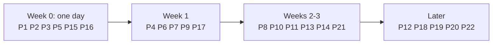

# 30 - Limitations and Improvements (tag: LIM)

**What this file covers.** A verified inventory of what AEOS does *not* do, or does only partly, grouped by severity, with the file evidence for each; a script for talking about each one honestly in an interview; concrete improvement proposals with effort and impact estimates; and a prioritised roadmap. "Verified" means I read the code or ran a grep in this session; "Inferred" means I reasoned from code without a test; effort and impact numbers are **Recommendations** (my estimates, not measurements). Nothing here claims a production deployment or real incidents. The git history is eight snapshot commits, so the limitations below are what the code shows today, not a record of what went wrong.

The goal is not to run the project down. A senior interviewer trusts a candidate more who can say "here is the weakest part of my design, here is how I found it, here is what I would fix first" than one who defends everything. Pair this file with [27-debugging-and-incident-scenarios](27-debugging-and-incident-scenarios.md) (how each limitation would present as an incident) and [24-technical-challenges-and-history](24-technical-challenges-and-history.md) (what the repo's own docs record).

**Severity scale (my definition).**
- **Critical for a real deployment:** could cause harm or loss of control if exposed beyond a trusted laptop.
- **High:** a plausible failure that is hard to diagnose, silently stalls work, or breaks a stated guarantee.
- **Medium:** correctness, cost or diagnosability weaknesses with a workaround.
- **Low / documentation:** claims or tooling that do not match, or polish.

---

## 1. Verified limitations

### 1.1 Critical for a real deployment (security posture)

| ID | Limitation | Evidence (file / symbol) | Impact |
|---|---|---|---|
| L1 | **Auth is off by default.** With no configured users the API is open; decisions only need an `X-Actor` header which names an actor but proves nothing. | `core/config.py` (`auth_users: str = ""`), `api/auth.py` (module docstring and `AuthGate`), `api/app.py::decide` (400 only if `X-Actor` missing), `docker-compose.yml` (`AEOS_AUTH_USERS: ${AEOS_AUTH_USERS:-}`) | Anyone who can reach port 8800 can submit tasks and approve PRs under any name. Fine on localhost, not on a network. |
| L2 | **Docker socket mounted into app services.** | `docker-compose.yml` lines 219, 271, 288 (`/var/run/docker.sock`) | Anything that escapes the app container (or compromises the API) can start privileged containers on the host: host-root equivalent. The sandbox boundary protects *against agent code*, not against a compromised control plane. |
| L3 | **A2A auth is optional, compared with `!=`, and the task store is in memory.** | `a2a/server.py` (`if api_key and ...`, `request.headers.get("authorization") != f"Bearer {api_key}"`, `InMemoryTaskStore()`) | Unauthenticated specialist services if no key is set; timing side channel (low practical risk); remote state lost on restart. (The main API token path *does* use `hmac.compare_digest`, `api/auth.py`.) |
| L4 | **Approval hash and the arguments live in the same DB row.** | `store/approvals.py` DDL (`arguments`, `arguments_hash`) and `graph/publish.py::create_pr` | The hash stops code paths sending different arguments than were approved (test `test_tampering_with_the_approved_arguments_is_blocked`), but a DB writer can change both. Not a signed approval. |
| L5 | **Tool-output wrapper is not escaped.** `<tool_result ...>` text is concatenated without escaping `</tool_result>`. | `agents/tools.py::ToolRuntime.execute` (last lines) | A malicious page/log could close the wrapper early and make following text look like trusted structure. The *enforcement* (policy gate, `origin` tracking, approval) still holds; the label is advisory. |
| L6 | **Web fetch SSRF check blocks only link-local, multicast and unspecified addresses; loopback and private ranges pass** (the host allowlist is the real control; default `localhost,127.0.0.1`). | `mcp_servers/web/server.py::_check_url`; `core/config.py::web_allowed_hosts` | If the allowlist is widened carelessly, internal addresses are reachable. Redirects are blocked (good). |
| L7 | **npm container has network access** (by design, for registry lookup/lockfile regeneration). | `sandbox/npm.py` module docstring (fixed argv, `--ignore-scripts`, no mounts, caps dropped, destroyed afterwards) | Narrow and documented, but it is the one place agent-influenced package names reach the network. |

### 1.2 High (reliability and liveness)

| ID | Limitation | Evidence | Impact |
|---|---|---|---|
| L8 | **No request timeout on Gemini calls.** Retries exist (4, with backoff, for 429/5xx/timeouts), a deadline does not. Whether the SDK has a default timeout was not verified. | `llm/gemini.py::GeminiProvider.complete` (no timeout argument); `grep -n timeout src/aeos/llm/*.py` shows only a comment | A hung request keeps a healthy heartbeat, so the task looks alive but never progresses and blocks that worker (one task at a time). |
| L9 | **A transient Postgres error can kill the heartbeat silently (Inferred, no test).** `_heartbeat` has no `try/except` around `tasks.heartbeat`; each call opens a new connection (`_connect()`, no pool, no retry). If it raises, the heartbeat task ends, the work continues, the lease expires after 30 s, and another worker re-claims and runs the same task concurrently. | `worker.py::_heartbeat`, `store/tasks.py::_connect/heartbeat` | Duplicate execution of a node. Idempotency keys limit external damage and `finish` is fenced by `worker_id`, but cost doubles and events interleave. |
| L10 | **No graceful shutdown.** No signal handlers; the API lifespan *cancels* the embedded worker "like a crashed worker". | `grep -rn "signal\." src` finds only `failure/crash.py`; `api/app.py` lifespan | Every deploy is a crash-recovery event (works, but wastes up to a lease of time and re-runs the current node). |
| L11 | **`tasks.claim` increments `attempts` on every claim**, including legitimate approval resumes. | `store/tasks.py::claim` | A long task with several human interactions plus crashes can be escalated by the crash-loop guard with a misleading message ([27](27-debugging-and-incident-scenarios.md) Scenario 10). |
| L12 | **The first error is overwritten.** `release_with_error` stores `repr(exc)`; when the guard escalates it replaces `last_error` with "worker died or failed N times". | `store/tasks.py::claim`, `worker.py::run_once` | The root cause survives only in an ERROR log line and the trace. |
| L13 | **Stale `pending_resume` edge case.** A crash after delivering a resume but before `consumed_resume`, then a second approval in the same task, can replay the first payload; `await_decision` does not compare `approval_id`. | `worker.py::_execute`, `graph/publish.py::await_decision`, `store/tasks.py::finish` | Fails safe (spurious rejection), not an unauthorised publish (Q-FLOW-5 in [04](04-end-to-end-workflows.md)). |
| L14 | **Budget holes.** Gated only in `agents/loop.py` (not in publish/synthesize/judge); wall-clock includes the human approval wait; the tracker's increments are lost if a node crashes before returning. | `core/state.py::Budget.exhausted`, `agents/loop.py`, `graph/nodes.py` | A slow reviewer can make a replanned task escalate immediately; cost under-counted after crashes ([27](27-debugging-and-incident-scenarios.md) Scenario 11). |
| L15 | **No MCP reconnect (Inferred).** `McpClient` opens the stdio child once; later transport errors are retried (when safe) but the client never respawns the server. | `mcp_client.py::McpClient.__aenter__/call` | One dead MCP child breaks all calls to that server until the process restarts. |
| L16 | **One task per worker process.** `run_forever` awaits `run_once`, which awaits the whole task. | `worker.py::run_forever/run_once` | Throughput scales only by adding processes; a stuck task blocks its worker. |
| L17 | **Cancel is partial.** `cancelled` is set only in `aeos.tasks` (the checkpoint still says `running`; `view()` patches it); an in-flight thread call (sandbox exec) cannot be interrupted; the real GitHub PR/branch is not closed; `aeos/*` branches are never cleaned up. | `api/app.py::cancel_task/view`, `store/tasks.py::cancel`, `grep -rn delete_branch src` finds only the policy deny list | Orphan branches/PRs accumulate; cancelled tasks consume resources until the current call finishes. |
| L18 | **Sandbox cleanup depends on a running worker.** `Worker.housekeeping` reaps; the standalone `python -m aeos.sandbox.reaper` is not scheduled; there is no cap on concurrent sandboxes. (Correction to [12](12-sandbox-and-execution-safety.md), which says `.reap(` is only called in tests: `worker.py` line 65 calls it.) | `worker.py::housekeeping`, `sandbox/reaper.py` | Leaks if no worker runs; no backpressure on container count. |
| L19 | **Redis is provisioned but unused.** | `docker-compose.yml` (`redis:7-alpine`, port 6380), `core/config.py::redis_url`; `grep -rin redis src` finds only the setting | Dead infrastructure; an interviewer may ask what it is for. |
| L20 | **Checkpoint/state schema is unversioned and nothing prunes data.** Renames/removals of pydantic models break resume of old checkpoints; `aeos.events`, `aeos.audit_log` and checkpoints grow without bound. | `graph/checkpoint.py::state_types`, `grep -rn "DELETE FROM\|retention" src` finds nothing | Deploy risk for paused tasks; storage growth ([27](27-debugging-and-incident-scenarios.md) Scenario 13). |

### 1.3 Medium (quality, cost, diagnosability)

| ID | Limitation | Evidence | Impact |
|---|---|---|---|
| L21 | **Logging is largely inert.** Worker/serve log at ERROR (only `run` has `-v`); `Settings.log_level` is never read; `run_context` is never called so `task_id/run_id/agent` are null except where `extra=` is passed; `/healthz` returns a constant. | `cli.py::main`, `core/logging.py`, `core/config.py::log_level`, `api/app.py::healthz` | Thin logs during incidents; liveness probe cannot detect a dead worker or MCP child. |
| L22 | **Metrics go only to a debug exporter**; spans are lost if the collector/Langfuse is down (short retry). | [20-observability-and-telemetry](20-observability-and-telemetry.md) | No dashboards/alerts from metrics. |
| L23 | **Verifier weaknesses.** `lint_ok` is `python -m compileall`; judge sees `patch[:12000]`; `GateConfig.secret_values` is never populated; perf gates rely on 3 single-run benchmarks vs a 10 % tolerance; infra errors and patch failures share one failure counter. | `agents/verifier.py::_run_gates/static_gates`, `agents/judge.py::judge_patch`, `core/retry.py` | Flaky or weaker checks than the name "lint"/"secrets" suggests ([27](27-debugging-and-incident-scenarios.md) Scenario 5). |
| L24 | **Memory limits.** Rows don't record the embedder (switching embedders mixes vector spaces); gate covers facts and `lessons` only, not other episode text; low similarity thresholds (0.3/0.2); failed/escalated episodes are recalled; memory is skipped for `change` tasks. | `runtime.py` (embedder choice), `memory/store.py`, `memory/gate.py`, `memory/manager.py`, `graph/nodes.py::reflect` | Possible irrelevant or stale hints ([08-memory-system](08-memory-system.md), [27](27-debugging-and-incident-scenarios.md) Scenario 8). |
| L25 | **`strong_llm` wiring is not switched on.** `open_runtime` sets `strong = llm` unless a caller injects one; `cli.py` and the API never do; `evals/run_evals.py::make_strong_llm` is defined but never called. | `runtime.py` (`strong = ... else llm`), `grep -rn "make_strong_llm\|strong_llm=" evals src` | The "stronger planning model" described in the README and DECISIONS is not what production or the eval runner actually uses ([06-llm-integration](06-llm-integration.md)). |
| L26 | **Demo-scale scope.** `regression` tasks work on a seeded demo repo with a benchmark; `change` tasks have tooling tilted to JavaScript/npm (`npm_update_dependency`, `node --check`); specialists are 3 fixed roles. | `demo_target/`, `agents/specialists.py::ChangeCodingSpecialist`, `sandbox/npm.py` | Generalisation to arbitrary repos/languages is unproven. |
| L27 | **Dependency pin mismatch.** `mcp>=1.2` allows versions where `from mcp.client import Client` (used in `mcp_client.py`) may not exist; `uv.lock` pins the working version. | `pyproject.toml`, `mcp_client.py` | A fresh `pip install` without the lock could break. |
| L28 | **CI lacks a Postgres service**; DB-backed tests skip when Postgres is unavailable (`tests/conftest.py`), so CI as configured does not run them (I did not enumerate which tests skip vs fail). Chaos tests are excluded by default (`-m 'not live and not chaos'`). | `.github/workflows/ci.yml`, `pyproject.toml`, `tests/conftest.py` | The strongest guarantees (exactly-once, crash recovery) are verified locally, not in CI ([22-testing-strategy](22-testing-strategy.md)). |

### 1.4 Low / claims to word carefully

| ID | Limitation | Evidence | How it bites |
|---|---|---|---|
| L29 | **Live eval 15/30 -> 26/30 is not a controlled comparison.** Different prompts, code and graders; one trial per task; README itself says the improvement is not attributed to one change. The two runs' code hashes do not correspond to git commits. | `README.md` results section, `evals/results/*.md`, [23](23-evaluation-framework.md), [24](24-technical-challenges-and-history.md) | Do not say "the fixes raised success from 50% to 87%". |
| L30 | **Judge validation "Spearman 0.80, 100% pass/fail agreement" has no stored output.** `evals/validate_judge.py` and `judge_validation.yaml` exist; `grep -rl spearman evals/results` finds none. | `README.md`, `evals/` | Present it as "the script exists; I would re-run it before quoting the number". |
| L31 | **Scripted-suite 100% to 0% sensitivity result** is a demonstration that the harness detects a deliberately broken retry policy, not a measure of agent quality. | `evals/results/*recovery*` | Different claim from accuracy. |
| L32 | **Docs/code drift items found while reading:** `docs` say span `graph.node`, code names spans `node <name>` (`graph/build.py::_crashable`); ARCHITECTURE-style statements about "strong model" (L25); [12](12-sandbox-and-execution-safety.md) reaper claim (L18). | cited | Verify before quoting any doc sentence. |

---

## 2. How to talk about each one honestly

A good pattern: **fact, why it is acceptable at this scope, what breaks first at scale, what you would do.** Never say "it is fine"; say what it costs.

| ID | One-breath honest framing |
|---|---|
| L1 | "Auth exists and is real (scrypt, signed cookie, service token, lockout) but is opt-in. The compose default is a local demo, so it is open. Turning it on is configuration; I would make it mandatory outside localhost." |
| L2 | "Mounting the Docker socket is the classic trade: it is how the control plane creates sandbox containers. It makes the control plane host-privileged, so the next step is a socket proxy or a remote container runtime so the API cannot start arbitrary containers." |
| L3 | "A2A bearer auth is optional and uses a plain comparison; I would require the key and `hmac.compare_digest`. The in-memory remote task store means a specialist restart loses remote state, and the supervisor just re-delegates." |
| L4 | "The approval hash defeats code-path tampering, not a database admin. If I needed non-repudiation I would sign the request with a key outside Postgres or move approval to GitHub reviews." |
| L5/L6 | "Defence in depth: the real enforcement is the policy gate and the origin/approval rules; the XML-ish wrapper is a hint to the model. Escaping the closing tag is a five-line fix I have not made." |
| L8/L9 | "Liveness is my weakest area: a hung model request is not time-bounded, and the heartbeat has no error handling around the database call. The safety properties are tested; the liveness ones are not." |
| L10/L11/L12 | "Recovery from kill -9 is tested at every node boundary, which is why I did not build graceful shutdown. The cost is that every deploy is a recovery event, and the attempt counter conflates crashes with approvals." |
| L14 | "Budgets bound agent loops only. Two things I know are wrong: wall-clock includes the human wait, and budget is lost when a node crashes." |
| L17/L18 | "Cancel stops the task, not the external effects. Branch cleanup and closing PRs are not implemented." |
| L19 | "Redis was provisioned for a queue/cache plan that I replaced with a Postgres queue. I should delete it from compose." |
| L21/L22 | "The observability story is traces and the events table; logs and metrics are the least developed." |
| L23 | "The verifier's hard gates are real but modest: `lint` is a syntax compile. I would run ruff in the sandbox and take the median of several benchmark runs." |
| L24 | "Memory is a hinted, gated store, but I did not version embeddings, so switching providers needs a re-index." |
| L25 | "The settings and the wiring for a stronger planner exist, but I found by grep that nothing switches it on in production, so I would not claim the planner model is stronger without wiring it." |
| L28 | "Exactly-once behaviour is proven by local chaos tests; CI doesn't run them because it has no Postgres service yet." |
| L29/L30/L31 | "The live numbers are two single runs with different code versions; I use them to show the harness works and where failures cluster, not to claim causality." |

---

## 3. Improvement proposals

Effort: S = under half a day, M = 1 to 3 days, L = a week or more. Impact: relative value for a real deployment. All are **Recommendations**.

| # | Proposal | Fixes | Effort | Impact | Notes / test |
|---|---|---|---|---|---|
| P1 | `asyncio.timeout` around `generate_content`, raising `LLMTransientError` | L8 | S | High | Unit test with a stub client that sleeps |
| P2 | Wrap `tasks.heartbeat` in retry/try-except; on repeated failure cancel the work (fail closed) | L9 | S | High | Test: patch `heartbeat` to raise once, assert work survives; raise always, assert cancel |
| P3 | Preserve first error: `last_error = coalesce(...)`/append; emit a `task_failed`/`node_error` event on every requeue | L12 | S | High | Chaos-style test with an injected exception |
| P4 | Reset/neutralise `attempts` on approval resume (set in `enqueue_resume`) or count only crash claims | L11 | S | Medium | Store test: 4 resumes do not trip the guard |
| P5 | Check `decision["approval_id"] == state.pending_approval_id` in `await_decision` | L13 | S | Medium | Graph test with a stale payload |
| P6 | Honour `Settings.log_level`; bind `task_id` via `run_context` in `Worker._execute`; `/readyz` that checks DB, worker heartbeat, MCP clients | L21 | S to M | High | Test that a worker log line carries `task_id` |
| P7 | Require auth unless `AEOS_ALLOW_ANONYMOUS=true`; require A2A key; `hmac.compare_digest` | L1, L3 | S | High (security) | Startup validation test |
| P8 | Docker socket proxy (restrict to create/start/remove of labelled containers) or rootless/remote runtime | L2 | M | High (security) | Compose change plus abuse test |
| P9 | Escape `</tool_result>` (or use a nonce-delimited wrapper); populate `GateConfig.secret_values`; extend gate to all episode text | L5, L23, L24 | S | Medium | Extend `tests/agents/test_verifier_static.py`, memory tests |
| P10 | Graceful shutdown: SIGTERM sets `stop`, worker finishes current node or releases the lease explicitly | L10 | M | Medium | Process-level test with SIGTERM |
| P11 | Budget: subtract approval wait from wall-clock; persist tracker increments per LLM call (or at least in `finally`) | L14 | M | Medium | Loop test with a slow approver |
| P12 | MCP respawn-on-failure in `McpClient.call` | L15 | M | Medium | Kill-child test |
| P13 | Run several benchmark iterations and compare medians; classify `verifier_error` separately (not counted as a failed attempt) | L23 | M | Medium | Verifier tests with noisy stub benchmark |
| P14 | Store embedder name/dim on memory rows and filter on it; raise thresholds; mark failed episodes as negative evidence | L24 | M | Medium | Memory store tests |
| P15 | Wire `strong_llm` in `cli._worker`/`_serve` from `get_llm(settings, strong=True)`; add a test asserting planner uses it; re-run evals | L25 | S | Medium (and fixes a claim) | Compare eval runs under one code version |
| P16 | Delete Redis from compose or document its purpose | L19 | S | Low | -- |
| P17 | CI: add a Postgres+pgvector service and run the DB tests; run a small chaos subset nightly | L28 | M | High (trust in claims) | `services:` in `ci.yml` |
| P18 | Branch/PR cleanup on cancel and a janitor for stale `aeos/*` branches; allow a policy-gated close of own PRs | L17 | M | Medium | Mirror test against `fake_github` |
| P19 | Versioned `TaskState` plus checkpoint fixture test from the previous release; retention job for events/audit/checkpoints | L20 | M | Medium | Fixture-load test |
| P20 | Worker concurrency (N tasks per process with a semaphore) and a sandbox concurrency cap | L16, L18 | M | Medium | Load test with fake LLM |
| P21 | Re-run judge validation and store output; a controlled A/B of one change at a time, with more than one trial per task | L29, L30 | M | Medium (credibility) | Results under `evals/results/` |
| P22 | Signed approvals (HMAC key outside the DB) | L4 | M | Medium (security) | Tamper test |

---

## 4. Prioritised roadmap

Ordering principle: first things that can silently hurt (liveness, diagnosability, credibility of claims), then security hardening needed before any non-local use, then scale and polish.

Read it as four tranches, each shippable on its own.

**Tranche 0, one day (the "if I had one day" answer): P1, P2, P3, P5, P15, P16.** All small, all independent. They remove the two worst silent stalls (hung request, dead heartbeat), preserve the first error, close the stale-resume gap, make the planner-model claim true, and delete dead infrastructure.

**Tranche 1, week one: P4, P6, P7, P9, P17.** Fix attempt accounting, make logs and readiness meaningful, make auth mandatory outside localhost, close the cheap security gaps, and put the real tests in CI (otherwise later work is unverified).

**Tranche 2, weeks two to three: P8, P10, P11, P13, P14, P21.** Docker-socket hardening, graceful shutdown, budget correctness, verifier de-flaking, memory versioning, and credible evals.

**Tranche 3, later: P12, P18, P19, P20, P22.** Respawn, cleanup, schema versioning/retention, concurrency, signed approvals.

**What I would deliberately not do** (Recommendation): rewrite on Temporal, add a message broker, or add more agents. The recorded rationale for staying on Postgres leases is in `docs/DECISIONS.md` D-033, and none of the limitations above requires a new architecture; each is a targeted fix.

---

## Interview questions

## Q-LIM-1. What is the weakest part of this project?
**Difficulty:** Intermediate  **Topic:** Self-assessment
**Short answer:** Liveness and diagnosability, not safety. The safety properties (no merge tool, writes only to `aeos/*`, approval bound to exact arguments, exactly-once publish under kill -9) are enforced in code and tested. What is weak: no timeout on model requests, a heartbeat with no error handling, logs fixed at ERROR with null correlation ids, and an attempt counter that conflates crashes with approvals. Those are all small fixes.
**Detailed explanation:** I separate "can it do something dangerous" from "can it stall or be hard to debug". The first is covered by deterministic gates; the second is where an unattended system would first hurt.
**How this project uses it:** see L8, L9, L11, L12, L21; fixes P1, P2, P3, P4, P6.
**Example/walkthrough:** A hung Gemini request with a healthy heartbeat produces a task that looks alive forever ([27](27-debugging-and-incident-scenarios.md) Scenario 1).
**Follow-ups:**
- *Why did you not fix them?* They are known; the project's acceptance criteria (ROADMAP) emphasised crash recovery and safety, which are tested. I would prioritise them first (Tranche 0).
- *How did you find them?* By reading the code paths for each wait and write, not from an outage; I do not claim they bit me.
- *Which one would you fix with one hour?* P1, the timeout: ten lines plus one test.
**Trade-offs and alternatives:** Fixing liveness first versus adding capabilities; liveness wins before real use.
**Common interview mistake:** Naming a feature gap ("no UI polish") instead of a design weakness.
**Related:** [27](27-debugging-and-incident-scenarios.md), [10-error-handling-and-reliability](10-error-handling-and-reliability.md).

## Q-LIM-2. Is the system secure enough to expose to the internet?
**Difficulty:** Advanced  **Topic:** Security posture
**Short answer:** No, not as shipped. Auth is opt-in and the default compose stack is open, the Docker socket is mounted into the app containers, A2A auth is optional, and approval integrity depends on the database. The agent-facing controls are strong (sandbox without network, policy gate, SELECT-only database tool, secrets redaction), but the control plane is not hardened.
**Detailed explanation:** Two threat models: (1) a malicious or confused *agent* or malicious content it reads, which AEOS defends against in depth; (2) a malicious *network client* or compromised control plane, which it only partly addresses. The Docker socket is the sharpest edge because it grants host-level capability to whoever controls the API process.
**How this project uses it:** L1 to L7; fixes P7, P8, P9, P22.
**Example/walkthrough:** Without `AEOS_AUTH_USERS`, `POST /approvals/{id}/approve` with any `X-Actor: someone` header works.
**Follow-ups:**
- *What is the first change?* Make auth mandatory unless explicitly overridden (P7).
- *How do you stop a compromised API from using the socket?* A socket proxy permitting only labelled sandbox containers, or a remote runtime (P8).
- *Does the sandbox hold against hostile agent code?* Largely, within container isolation limits ([12](12-sandbox-and-execution-safety.md) Q-SBX-6 lists residual risks).
**Trade-offs and alternatives:** gVisor/Firecracker for stronger isolation at higher cost and complexity.
**Common interview mistake:** Claiming "secure" because the sandbox is locked down.
**Related:** [14-security-and-prompt-injection](14-security-and-prompt-injection.md), [21-deployment-and-infrastructure](21-deployment-and-infrastructure.md).

## Q-LIM-3. Your README says live success rose from 50% to 87%. Can you defend that?
**Difficulty:** Advanced  **Topic:** Evaluation honesty
**Short answer:** Only as two observations, not as a causal claim. They are single runs of 30 tasks with different prompts, code and graders; the README itself says the improvement is not attributed to one change; the code versions are not git commits; and the "stronger planning model" mentioned is not wired in production or the eval runner by grep.
**Detailed explanation:** With one trial per task the interval is wide (the README quotes about plus or minus 6 points for the second run), and changes were bundled. The evals are still useful: they show where failures cluster (three of four misses named the wrong file or commit) and that the harness detects regressions (the broken-retry run drops the scripted suite from 100% to 0%).
**How this project uses it:** `README.md`, `evals/results/*`, `evals/run_evals.py` (unused `make_strong_llm`), [23-evaluation-framework](23-evaluation-framework.md).
**Example/walkthrough:** Say: "I ran the suite twice; the second was better and I made several changes between; I would need an A/B with fixed code and multiple trials to attribute it."
**Follow-ups:**
- *What would a controlled comparison look like?* Fix everything except one change, N trials per task, report confidence intervals (P21).
- *Judge agreement?* A validation script exists; I did not find a stored result for the 0.80 figure, so I would re-run it before quoting it (L30).
- *Why still publish the numbers?* Transparency, with caveats attached.
**Trade-offs and alternatives:** Larger datasets and multiple seeds cost money; the harness supports `--limit`.
**Common interview mistake:** Quoting the headline number without the caveats.
**Related:** [23](23-evaluation-framework.md), [24](24-technical-challenges-and-history.md).

## Q-LIM-4. What are the scaling limits, and what breaks first?
**Difficulty:** Intermediate  **Topic:** Scalability
**Short answer:** Throughput is bounded by workers (one task per worker process) and by Docker on one host (no sandbox cap). The Postgres queue is fine for tens of concurrent tasks (polling, `SKIP LOCKED`) but has no priorities or fairness. Postgres also holds checkpoints, events and memory with no retention. The LLM provider rate limit and cost are the practical first limits.
**Detailed explanation:** Everything is horizontally scalable by adding worker processes, because state is in Postgres. What does not scale: a single Docker host for sandboxes, unbounded event/checkpoint tables, and per-call new connections (no pool) under load.
**How this project uses it:** L16, L18, L20; P20, P19.
**Example/walkthrough:** Ten simultaneous coding tasks spawn dozens of containers (verify uses three sandboxes per attempt) with only per-container limits.
**Follow-ups:**
- *Would you move the queue?* Not before measuring; the recorded rationale is D-033.
- *What is the first metric you would add?* Queue depth and claim latency, task duration, sandbox count.
- *Does A2A help scale?* It lets specialists scale independently, but the supervisor and sandbox host remain.
**Trade-offs and alternatives:** Kubernetes jobs per sandbox; a managed queue; connection pooling (psycopg_pool).
**Common interview mistake:** Saying "it scales horizontally" without naming the Docker host and DB growth.
**Related:** [21](21-deployment-and-infrastructure.md), [07](07-state-durability-and-persistence.md) Q-STATE-8.

## Q-LIM-5. If you had one day, one week, one month, what would you do?
**Difficulty:** Intermediate  **Topic:** Prioritisation
**Short answer:** One day: timeout on Gemini calls, heartbeat error handling, preserve the first error, approval-id check, wire the strong model, delete Redis. One week: attempt accounting, real logging and readiness, mandatory auth, escaping and secret gates, Postgres in CI. One month: Docker-socket hardening, graceful shutdown, budget correctness, verifier de-flaking, memory versioning, controlled evals.
**Detailed explanation:** Ordering is by silent-failure risk first, then security before exposure, then scale. The roadmap in section 4 gives the full tranche list.
**How this project uses it:** P1 to P22.
**Example/walkthrough:** Tranche 0 touches `llm/gemini.py`, `worker.py`, `store/tasks.py`, `graph/publish.py`, `cli.py` and `docker-compose.yml`.
**Follow-ups:**
- *What would you refuse to do?* Rewrite on Temporal or add a broker without evidence of need.
- *How do you know each fix worked?* Each has a named test (section 3 notes column).
- *What about features?* More specialists/languages come after the platform is trustworthy.
**Trade-offs and alternatives:** Feature-first vs hardening-first; for an autonomous system with write access, hardening first.
**Common interview mistake:** An unordered wish list.
**Related:** [10](10-error-handling-and-reliability.md) Q-REL-10.

## Q-LIM-6. The verifier is "independent". What are its actual weaknesses?
**Difficulty:** Advanced  **Topic:** Verification limits
**Short answer:** It is independent of the coding agent's claims, but its checks are modest: `lint` is a compile, performance uses single benchmark runs with a 10 % tolerance, the judge sees a truncated patch, configured-secret detection is not populated, infra errors count as failed attempts, and for change tasks there may be no test suite to run. It cannot prove correctness, only that specific gates pass.
**Detailed explanation:** The architecture is sound (fresh sandboxes, code decides, the LLM can only tighten), but gate quality bounds its value. `regression_reproduced` is a good guard against invalid baselines; a median-of-N benchmark and real linting are the obvious upgrades.
**How this project uses it:** `agents/verifier.py`, `agents/verifier_change.py`, `agents/judge.py`; L23; P9, P13.
**Example/walkthrough:** A patch that compiles, passes the demo tests, and is within 10 % of baseline passes even if it is semantically wrong in an untested path; the judge may or may not catch it.
**Follow-ups:**
- *Can the agent game the verifier?* Not by editing `benchmark.py`, `costs.py`, `pytest.ini` or existing tests (`paths_allowed`), but it can add new tests or write code that special-cases the benchmark; the judge is the only semantic check.
- *What does a verified patch mean to the reviewer?* "Passed these gates", which is why the approval card shows the evidence and the full diff.
- *How would you measure verifier quality?* Seeded wrong patches in the eval set (the `wrong_fix` scenario is one).
**Trade-offs and alternatives:** Mutation testing, property tests, shadow traffic: more cost and complexity.
**Common interview mistake:** "The verifier guarantees correctness."
**Related:** [13](13-verification-and-risk-policy.md), [27](27-debugging-and-incident-scenarios.md) Scenario 5.

## Q-LIM-7. Where do the project's docs disagree with its code?
**Difficulty:** Intermediate  **Topic:** Documentation integrity
**Short answer:** Examples found by checking: the stronger planning model is described but not wired; Redis is provisioned but unused; the sandbox reaper is described as manual but the worker's housekeeping calls it; the spans are described as `graph.node` but are named `node <name>`; log level and context ids exist but are not used; the Spearman figure has no stored output. I verify each claim against source before repeating it.
**Detailed explanation:** Drift happens in fast-built projects; the defence is a habit of grepping a symbol before quoting a doc sentence, and being open about it.
**How this project uses it:** L18, L19, L21, L25, L30, L32.
**Example/walkthrough:** `grep -rn "make_strong_llm\|strong_llm=" evals src` shows the definition and the runtime plumbing, but no call site that supplies a strong model.
**Follow-ups:**
- *Why does it matter in an interview?* A confident wrong claim about your own code is costly; a flagged discrepancy is a strength.
- *Which discrepancy is most important?* The strong-model one, because it affects how the headline eval result is described.
- *How would you prevent drift?* A doc test that greps for cited symbols; a short "claims" table linked to tests.
**Trade-offs and alternatives:** Generated docs from code vs prose; prose carries rationale but drifts.
**Common interview mistake:** Reciting the README as ground truth.
**Related:** [24](24-technical-challenges-and-history.md), [06](06-llm-integration.md), [12](12-sandbox-and-execution-safety.md).

## Q-LIM-8. A hostile question: "This is a demo, not a system. Convince me otherwise."
**Difficulty:** Expert  **Topic:** Positioning
**Short answer:** I would not claim it is production software. I would say it demonstrates the hard parts of an agent system for real rather than as stubs: durable execution with leases and fencing proven by kill -9 chaos tests, exactly-once side effects via idempotency keys, a deterministic policy gate with human approval bound to exact arguments, an independent verifier with a judge that can only tighten, real MCP and A2A processes, and real traces. What it lacks is what operating it would add: hardened auth and runtime, liveness safeguards, logging and CI depth, and controlled evaluation.
**Detailed explanation:** The distinction is between design of the guarantees (implemented and tested) and operational maturity (not there). Naming the gap precisely, with a sized plan, is the convincing move.
**How this project uses it:** sections 1 and 4 of this file, [03-system-architecture](03-system-architecture.md), `tests/chaos`.
**Example/walkthrough:** Offer to demonstrate: `make demo`, submit, watch the verifier reject the first fix, replan, pause for approval; then kill a worker with `AEOS_CRASH_AT` and watch another finish.
**Follow-ups:**
- *Which claims would you not make?* Production-ready, secure by default, scalable, or "improved by X points because of Y".
- *What is the strongest evidence for your reliability claim?* The parametrised chaos suite asserting one PR, one branch, one approval and no leaked sandbox after a kill at each boundary.
- *What would make it production-grade?* Tranches 0 to 2.
**Trade-offs and alternatives:** Hosted agent platforms provide the operations layer but hide the mechanics this project exists to show.
**Common interview mistake:** Either overselling ("production-grade") or underselling ("just a toy").
**Related:** [01-project-overview](01-project-overview.md), [24](24-technical-challenges-and-history.md), [27](27-debugging-and-incident-scenarios.md).
