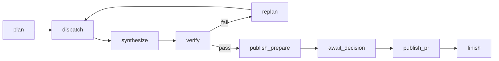

# 31 - Mock interviews (tag: MOCK)

## What this file covers

Seven rounds of increasing difficulty, all specific to AEOS: (1) project intro, (2) implementation deep dive, (3) core concepts (LangGraph, MCP, A2A, sandboxing, checkpointing, embeddings, tracing), (4) architecture and system design, (5) debugging and incidents, (6) senior challenge, (7) rapid fire. Every question has: the expected answer, why that is the right answer, follow-ups with answers, what a strong candidate mentions, and weak answers or misconceptions. Use it by covering the answer and speaking first. Evidence labels: **Verified** (code/tests), **Inferred rationale**, **Potential failure scenario**, **Recommendation**. For mechanisms in depth, follow the links; deeper skeptic questions live in [28-senior-engineer-followups.md](28-senior-engineer-followups.md), and one-page facts in [32-rapid-revision.md](32-rapid-revision.md).

Incident rule for round 5: the repo has no production incidents (it has never been deployed to users as far as the repo shows). Round 5 uses **documented development findings** (PROGRESS/DECISIONS/commits/result files) and **hypothetical scenarios clearly labelled as such**. Never present a hypothetical as something that happened to you.

---

# Round 1 - Project introduction (warm-up, 10 minutes)

## Q-MOCK-1. Tell me about the project in two minutes.
**Difficulty:** Beginner  **Topic:** Pitch
**Expected answer:** "AEOS is a multi-agent system that takes an engineering request, such as 'find why checkout latency regressed' or a code change on a real repo, and produces a pull request. A supervisor plans; specialist agents investigate and write a patch in a no-network Docker sandbox; an independent verifier re-applies the patch and re-runs tests and a benchmark; a human approves; only then a real GitHub PR is opened, never merged. State is in Postgres so a kill -9 resumes. The engineering point is the control plane around the LLMs: deterministic routing, a risk policy in YAML, idempotent side effects, and an eval harness that grades outcomes by recomputation."
**Explanation:** It leads with the problem and the boundary (human gate, no merge), then names the three load-bearing ideas: verification, durability, safety. See [01-project-overview.md](01-project-overview.md).
**Follow-ups:**
- *What is the one thing you are proudest of?* The chaos test: SIGKILL at 23 points and the result is still one PR/branch/commit/audit entry (`tests/chaos/test_chaos.py`). Caveat: fake LLM and the local remote.
- *Size?* About 12.5k lines of Python in `src/aeos`, 476 test functions (counted by grep), a Next.js dashboard, evals.
- *Is it deployed?* Docker Compose stack for local use; no evidence of real users. Say so.
**Strong candidate mentions:** problem, boundary (no merge), verification independence, durability, eval honesty, one limitation unprompted.
**Weak answers:** a list of technologies; "it fixes bugs automatically"; claiming production use.
**Related:** Q-OVR-1.

## Q-MOCK-2. Why build this? What is hard about it that a coding agent demo is not?
**Difficulty:** Beginner  **Topic:** Motivation
**Expected answer:** "A demo agent writes a patch and says 'done'. The hard parts are: knowing the patch is actually good without trusting the author, surviving crashes without double-publishing, bounding what a prompt-injected model can do, and measuring whether it works. AEOS is mostly those four things."
**Explanation:** Frames the project as reliability engineering, not prompt engineering. Matches the code layout: `agents/verifier*.py`, `store/tasks.py` + `graph/checkpoint.py`, `core/risk.py` + `sandbox/`, `evals/`.
**Follow-ups:**
- *Which of the four is weakest?* Honest: security hardening defaults (auth off by default, docker socket mounted, A2A token optional) and cost control (soft budgets).
- *Which is strongest?* Durability: tested by killing processes at defined points.
**Strong candidate mentions:** concrete failure modes, not "hallucination".
**Weak answers:** "LLMs are unreliable so I added agents".

## Q-MOCK-3. Which parts are LLM-driven and which are plain code?
**Difficulty:** Beginner  **Topic:** Boundaries
**Expected answer:** LLM: planning (`agents/supervisor.py`), the specialist loops (analytics, research, coding in `agents/specialists.py`), root-cause synthesis, the judge, and memory reflection. Code: routing (`graph/routing.py::route`, a pure function), plan validation and the appended verify/publish steps, resolving the suspect commit and baseline (`_check_research`), the risk policy (`core/risk.py`), all verifier gates, approvals (`store/approvals.py`), leases, idempotency keys, budgets.
**Explanation:** "Agents decide, code enforces" is the thesis. Confirm with the interviewer that the model cannot skip verification: the verifier step is appended by `finalize_plan`.
**Follow-ups:**
- *Is the judge enforcing?* No: it can only tighten a verdict (`apply_judgement`: "a failed result can never become passed here").
- *Where could the model still hurt?* Within allowed edits: a wrong but test-passing change.
**Strong candidate mentions:** names files, mentions the judge being advisory.
**Weak answers:** "the supervisor agent decides everything".
**Related:** Q-SEN-2.

---

# Round 2 - Implementation deep dive (20 minutes)

## Q-MOCK-4. Walk me through one task from request to PR.
**Difficulty:** Intermediate  **Topic:** End-to-end flow
**Expected answer:** (1) `enqueue` inserts a row into `aeos.tasks`. (2) A worker `claim`s it with a lease (`FOR UPDATE SKIP LOCKED`), builds the graph, starts it. (3) `plan` node: LLM proposes steps, `validate_steps`, `finalize_plan` appends verifier and publish. (4) `dispatch` runs analytics/research (and coding) specialists, in process or over A2A; each runs the agent loop with tools through `ToolRuntime` (risk gate on every call). (5) For regressions `synthesize` picks the root cause; `_check_research` fixes commit facts. (6) coding writes a patch in a sandbox; the patch is taken from the sandbox snapshot. (7) `verify` re-applies the patch in fresh sandboxes: tests, lint, benchmark, secret and path checks, then the advisory judge. (8) Failure -> `replan` with focus hints, up to three attempts then escalate. (9) `publish_prepare` creates branch and commit (allowed by policy) and an approval request, status `awaiting_approval`; the worker releases the task as `paused`. (10) A human decides via API/CLI/dashboard; `apply_decision` is compare-and-set; resume payload is stored. (11) A worker re-claims, `Command(resume=...)`, `publish_pr` creates the PR with a grant bound to the argument hash. (12) `finish`, `reflect` (memory), terminal status.
**Explanation:** The interesting part is the pause: the graph is not waiting in memory, it is a checkpoint plus a row. See [04-end-to-end-workflows.md](04-end-to-end-workflows.md).

Read it as: each arrow is chosen by `route(state)`, not by an LLM; replan is the only loop; `await_decision` is where the process can disappear for a day.
**Follow-ups:**
- *Why is publish three nodes?* So a resume never repeats branch/commit work, and nothing expensive happens before `interrupt()`, which re-enters the node on resume (comment in `await_decision`).
- *Does the coding step run in the same process?* Optionally A2A: specialists can be remote services; the supervisor is unchanged.
**Strong candidate mentions:** pause is a DB state, lease, verifier recomputation, policy gate, hash-bound approval.
**Weak answers:** "the supervisor calls agents then makes a PR".

## Q-MOCK-5. How does the agent loop work, and how does it stop?
**Difficulty:** Intermediate  **Topic:** `agents/loop.py`
**Expected answer:** Each iteration: check `tracker.exhausted()`, compact context, call the LLM with tool specs plus a synthetic `finish` tool, execute returned tool calls through `ToolRuntime`, append results wrapped in `<tool_result origin=...>`. It ends on a valid `finish` payload (pydantic-validated, retried if invalid), `max_steps` (25 per loop by default), budget, stagnation (identical call repeated: warn then stop), malformed (no tool call 3 times) or LLM error.
**Explanation:** `finish` is a tool so the answer is structured and validated rather than parsed from prose (Q-AGT-5). The 200-step Budget is across the whole task; 25 is per loop (`LoopLimits.max_steps`).
**Follow-ups:**
- *Stagnation false positives?* Found in live runs: normal edit-run-edit looked stagnant; mutating tools (`ToolDef.mutates`) now reset the repeat counters (PROGRESS Phase 8).
- *Is budget checked on every LLM call?* Only at the top of this loop; planner/synthesis/judge calls are not gated.
**Strong candidate mentions:** finish-as-tool, bounded loops, two limit levels.
**Weak answers:** "it loops until the LLM says done".

## Q-MOCK-6. What does the verifier do and how is it independent?
**Difficulty:** Intermediate  **Topic:** Verification
**Expected answer:** `run_gates` in `agents/verifier.py` uses a fresh sandbox per check: benchmark at baseline, benchmark at unpatched head (`regression_reproduced`: head must be at least 10 percent slower or the baseline is not a valid known-good), apply patch, run tests, `compileall` as lint, benchmark candidate (p95 within 10 percent of baseline). Static gates: at most 5 files and 300 diff lines, forbidden paths (`benchmark.py`, `checkout/costs.py`, `pytest.ini`), existing tests not edited, secret regexes. A judge LLM reviews the patch but can only make it stricter.
**Explanation:** Independence = it recomputes from the patch artifact; it shares helpers (`run_tests`, `run_benchmark`) with the graders though. For `change` tasks `agents/verifier_change.py` runs the repo's own tests where they can run offline, and reports "could not run" honestly.
**Follow-ups:**
- *Why is `regression_reproduced` there?* Found by the live eval: models chose a wrong "last good" commit, making the benchmark gate pass trivially (`test_a_baseline_that_is_not_faster_than_the_head_cannot_verify_anything`).
- *Is "lint" real linting?* No: syntax compile only. Volunteer it.
**Strong candidate mentions:** reproduce-before-fix, anti-cheating gates, advisory judge, own limits.
**Weak answers:** "it runs the tests the agent ran".

## Q-MOCK-7. Explain the risk policy and an example decision.
**Difficulty:** Intermediate  **Topic:** `policy/risk_policy.yaml`, `core/risk.py`
**Expected answer:** Declarative YAML rules, evaluated: any matching deny wins wherever it appears; otherwise the first matching non-deny rule; otherwise default `require_approval`. Rules include `never-merge` (deny), `branch-namespace` (only `aeos/*`), `read-only` (allow), reversible branch writes (allow), PR needs approval, untrusted-origin writes need approval. A human grant for the exact tool and argument hash turns `require_approval` into allow.
**Explanation:** Keyed on the risk level declared by the server plus normalised tool name, so aliasing does not bypass it. Example: `create_pull_request` with head `main` is denied by `branch-namespace` even if a human approves, since deny precedes grants.
**Follow-ups:**
- *Does the untrusted-origin rule block `commit_patch` after reading a web page?* No: `reversible-branch-writes` matches first. The rule matters only for writes no earlier rule allows (Q-VER-7). Volunteer this.
**Strong candidate mentions:** deny precedence, default-deny-ish, grant binding, ordering subtlety.
**Weak answers:** "the LLM decides if an action is risky".

---

# Round 3 - Core concepts (25 minutes)

## Q-MOCK-8. What is LangGraph and why use it here?
**Difficulty:** Intermediate  **Topic:** LangGraph
**Expected answer:** A library to run a state machine of nodes over a shared state with built-in checkpointing and `interrupt`/resume. AEOS builds a `StateGraph` of 10 nodes (`graph/build.py`), each wrapped in `_crashable`, with conditional edges from every node to `route`. It compiles with an `AsyncPostgresSaver`; `thread_id` = task id; recursion limit 120. Used for two things only: durable checkpoints per node and human-in-the-loop `interrupt()`.
**Explanation:** Nodes return partial state updates; the framework merges them and writes a checkpoint after each node. Not used for LLM abstractions or prebuilt agents: the agent loop is hand-written (`agents/loop.py`) with an own provider interface (`llm/base.py`).
**Follow-ups:**
- *Why a custom loop?* Control over budgets, stagnation, origin labelling, idempotency keys; and a provider-neutral `LLMProvider`. (Inferred rationale; see D-decisions.)
- *What did you have to do for serialisation?* An explicit allowlist of pydantic types in `JsonPlusSerializer(allowed_msgpack_modules=...)`.
**Strong candidate mentions:** thread id, checkpoint per node, interrupt re-enters the node.
**Weak answers:** "LangGraph is for agents/chains".

## Q-MOCK-9. How does checkpointing give crash recovery, and what does it not give?
**Difficulty:** Advanced  **Topic:** Durability
**Expected answer:** After each node completes, the new state is written to Postgres. On restart a worker reads `graph.aget_state`: no values -> start; interrupts -> resume with the stored payload; `snap.next` non-empty -> `ainvoke(None)` continues from the last checkpoint. The interrupted node re-runs from its start. So LLM work in that node repeats, and its budget is lost; external effects are protected by idempotency keys, not by the checkpoint.
**Explanation:** A checkpoint is a snapshot between nodes, not a write-ahead log of steps. That is why node boundaries were placed around side effects (publish split in three).
**Follow-ups:**
- *Exactly-once?* At-least-once node execution plus idempotent effects (Q-SEN-3).
- *What if state grows?* All observations and tool calls are in state; there is no pruning (Potential failure scenario for long tasks).
**Strong candidate mentions:** re-run semantics, idempotency, lease + checkpoint division of labour.
**Weak answers:** "it saves everything so nothing is ever lost".

## Q-MOCK-10. What is MCP and how does AEOS use it?
**Difficulty:** Intermediate  **Topic:** MCP
**Expected answer:** Model Context Protocol: a standard for tool servers (list tools, call tool, schemas, metadata). AEOS runs four first-party servers (github, database, observability, web) under `mcp_servers/`, each started as a stdio subprocess by `McpClient` (`mcp_client.py`), tools declared with `meta.aeos.risk` (`read`, `write_reversible`, `write_irreversible`) which the policy uses. Only calls safe to repeat are retried on transport failure.
**Explanation:** Value: tools separated from agents, schema-described, replaceable, risk declared where the tool lives. Caveat: the risk label is trusted from the server, fine for first-party servers.
**Follow-ups:**
- *Why a dedicated task in the client?* anyio cancel scopes must exit in the task that entered them; LangGraph nodes call from different tasks. Found through a real test failure (D-014).
- *Version risk?* `mcp>=1.2` is an open pin; a major release could change the API (Verified discrepancy).
**Strong candidate mentions:** risk metadata, stdio transport, retry only idempotent tools.
**Weak answers:** "MCP is like an API gateway".

## Q-MOCK-11. MCP vs A2A: what is each for, and why both?
**Difficulty:** Intermediate  **Topic:** A2A
**Expected answer:** MCP connects an agent to tools; A2A connects an agent to another agent (task delegation with status and streamed events, discoverable via an agent card). AEOS can run each specialist as an A2A service (`a2a/server.py`, `a2a/client.py`, `a2a/service.py`): the supervisor sends a task, the service runs the same specialist code and streams events back; agents still use MCP for tools. Default is in-process.
**Explanation:** The two are different layers: tool call (stateless request/response) versus delegated task (long-lived, may stream). Honest note: A2A mode is a demonstration of the boundary; auth is a shared bearer token, optional, compared with `!=` (not constant time), and the task store is in memory.
**Follow-ups:**
- *What if a specialist dies mid-task?* The supervisor sees an error/timeout result for that step and the graph treats the step as failed (Q-A2A-3, Q-REL-5).
- *Discovery public?* Agent card routes are public by design; RPC needs the bearer if configured.
**Strong candidate mentions:** layer distinction, agent card, streaming, own caveats.
**Weak answers:** "A2A is the newer MCP".

## Q-MOCK-12. How does the sandbox work and what are its limits?
**Difficulty:** Advanced  **Topic:** Sandboxing
**Expected answer:** Docker containers via the SDK (`sandbox/manager.py`): `network_mode="none"`, read-only root, all capabilities dropped, memory and pids limits, non-root uid, a keepalive process under a different uid, a command allowlist (no shell, curl, pip), per-exec timeout with leftover-process check and destroy as fallback, files moved via tar over exec stdin because `put_archive` fails on read-only rootfs. Orphans reaped by workers. One exception: an npm container with network for dependency work (`sandbox/npm.py`).
**Explanation:** The agent's tools are all `risk=read` in policy, because they touch only the ephemeral workspace: containment is the sandbox's job. Limits: shared kernel; the Docker socket is mounted into app services (D-041), so the service compromise equals host.
**Follow-ups:**
- *Fork bomb?* `pids_limit` plus post-exec leftover check; test `tests/sandbox/test_abuse.py::test_fork_bomb_is_contained_and_leaves_no_stragglers`.
- *What would you use in production?* gVisor/sysbox/rootless or a separate sandbox host. (Recommendation.)
**Strong candidate mentions:** specific flags, limits, honest residual risk.
**Weak answers:** "Docker makes it secure".

## Q-MOCK-13. Explain embeddings and how memory retrieval works here.
**Difficulty:** Intermediate  **Topic:** Embeddings
**Expected answer:** An embedding maps text to a vector so semantically similar text is nearby. `memory/embedder.py` has `GeminiEmbedder` (model `gemini-embedding-001`) and a `HashEmbedder` (feature hashing for tests/offline), both L2-normalised to the same dimension. Vectors live in Postgres with pgvector (`vector(DIM)`, HNSW index with `vector_cosine_ops`); retrieval orders by `embedding <=> query` and returns `1 - distance` as similarity. Episodes (what happened) and facts (lessons) are stored; hints are injected into planning and specialist prompts with bounded size. A deterministic write gate rejects secrets, instruction-like text, and facts resting only on untrusted content.
**Explanation:** Because rows do not record which embedder produced them, mixing the hash and the Gemini embedder in one table yields meaningless similarities (Verified discrepancy). My own test showed no measurable benefit from memory (PROGRESS Phase 8), so say it is a mechanism, not a result.
**Follow-ups:**
- *Why HNSW?* Approximate nearest-neighbour index for cosine distance; trades exactness for speed, irrelevant at this data size (Inferred).
- *Memory poisoning?* Gate covers lessons only.
**Strong candidate mentions:** cosine, normalisation, pgvector, no benefit shown.
**Weak answers:** "memory makes the agent smarter".

## Q-MOCK-14. How do you trace and observe a run?
**Difficulty:** Intermediate  **Topic:** Tracing
**Expected answer:** OpenTelemetry spans (`telemetry/tracing.py`): a root span per task with W3C context stored in state (`TaskState.trace`) so a resumed task joins the same trace; child spans for nodes, LLM calls (`llm/traced.py`), tool calls, verifier gates, the approval wait. Attributes carry `aeos.task.id` and `langfuse.session.id` so Langfuse (via OTLP) groups by task. Plus an event log table feeding the dashboard stream, and OpenTelemetry metrics instruments.
**Explanation:** Honest gaps (Verified): metrics only go to a debug exporter in the repo's wiring, `run_context` is never called so log lines have null task/trace ids, `AEOS_LOG_LEVEL` is ignored, `/healthz` is constant. Tracing is the strong part, logs and health are weak.
**Follow-ups:**
- *Why store trace context in state?* So spans after a crash/restart or in another worker attach to the same trace.
- *Is anything sensitive in spans?* Telemetry setup registers known secrets for redaction (`init_telemetry` passes the API/Langfuse keys); prompts and tool outputs are in spans, so treat the trace backend as sensitive (Inferred).
**Strong candidate mentions:** context propagation, per-task grouping, own gaps.
**Weak answers:** "we log everything with print".

---

# Round 4 - Architecture and system design (25 minutes)

## Q-MOCK-15. Design question: scale AEOS to 100 concurrent tasks. What changes?
**Difficulty:** Advanced  **Topic:** Scaling
**Expected answer:** Workers are already stateless and claim from Postgres with SKIP LOCKED, so add worker replicas. Bottlenecks to address: (1) LLM rate limits and cost (add a global rate limiter and per-day budget); (2) sandbox host capacity (Docker daemon per worker, or a sandbox pool service) and the Docker-socket exposure; (3) Postgres connections: each helper opens a new connection per call (`_connect()` in `store/*`), so add a pool; (4) the in-memory event sink queue; (5) the A2A task store is in memory; (6) Redis is provisioned in compose but unused, so do not count on it; (7) lease and attempt semantics (Q-SEN-4). Queue is a Postgres table, fine at this scale.
**Explanation:** Say what is proven versus designed: lease/claim and chaos tests are proven for a handful of workers; concurrency beyond that is Inferred.
**Follow-ups:**
- *Would you swap the queue?* Not until polling load or lease churn shows up; Postgres SKIP LOCKED handles hundreds of claims per second typically (general knowledge, not measured here).
- *Fairness?* `ORDER BY created_at`, FIFO, no priority or per-user limits.
**Strong candidate mentions:** idempotency makes horizontal scale safe; names real bottlenecks from the code.
**Weak answers:** "Kubernetes" with no specifics.
**Related:** Q-ARCH-8.

## Q-MOCK-16. Design: a user wants auto-merge when all gates pass. Do you build it?
**Difficulty:** Advanced  **Topic:** Risk design
**Expected answer:** Not as-is. The verifier's spec is narrow (Q-SEN-1), there is no adversarial test set, and the approval is the safety net. A phased approach: start with auto-approve for a policy-defined low-risk class (docs-only, dependency patch bumps with passing tests, small diffs) on non-protected branches, keep merge itself denied until a measured false-pass rate on hold-out tasks is acceptably low, add canary/revert automation. The existing policy engine can express the class (diff size, files, tool, args), which is the right extension point.
**Explanation:** Tests whether you treat the human gate as a control with a cost/benefit, not a checkbox. The `never-merge` deny rule is position-independent, so enabling merge means editing policy and tests, a deliberate act.
**Follow-ups:**
- *What metric?* Rate of "all gates passed but a human would reject" measured on labelled data; currently not measured. (Recommendation.)
**Strong candidate mentions:** measured false-pass rate, blast radius classes, revert path.
**Weak answers:** "Yes, the verifier is independent so it's safe".

## Q-MOCK-17. Where are your trust boundaries, and what lives on each side?
**Difficulty:** Advanced  **Topic:** Trust zones
**Expected answer:** Zones: (1) human/browser (dashboard, CLI; auth optional and off by default); (2) API and workers (trusted code, hold DB creds, GitHub token, Gemini key); (3) MCP server subprocesses (first-party, each with limited creds; database server uses a read-only role and an AST SQL guard); (4) A2A specialist services (own process, optional bearer); (5) sandboxes (no network, untrusted code); (6) external: Gemini, GitHub, web. Untrusted data enters via tool outputs (logs, code, web pages, commit messages) and flows into prompts. The GitHub token is used only in `mcp_servers/github/remote.py` (passed via an environment-supplied header, scrubbed in errors) and only after approval.
**Explanation:** See [03-system-architecture.md](03-system-architecture.md) section 5 and [14-security-and-prompt-injection.md](14-security-and-prompt-injection.md). Honest breaks: docker socket in app services; npm container has network; web SSRF check allows loopback/private addresses.
**Follow-ups:**
- *Where does the token never go?* Not into the sandbox, not into patches (no_secrets gate only regex), not into logs (scrub).
**Strong candidate mentions:** data-flow framing, named exceptions.
**Weak answers:** "everything is in Docker".

---

# Round 5 - Debugging and incidents (20 minutes)

All items are either a **documented development finding** or a labelled **hypothetical**.

## Q-MOCK-18. (Documented) The benchmark gate passed trivially for a wrong fix. How did that come about and what did you do?
**Difficulty:** Advanced  **Topic:** Verifier bug found by live eval
**Expected answer:** Models confused "previous commit touching this file" with "parent commit", so the chosen last-known-good could predate `benchmark.py` or be no faster than head. The verifier then compared a patched candidate against a baseline that was not valid, and the gate could pass trivially or crash. Fixes: harness computes `<suspect>~1` and rejects non-commit SHAs (`_check_research`, event `baseline_corrected`), and a `regression_reproduced` gate fails when the unpatched head is not at least 10 percent slower than baseline. Evidence: PROGRESS Phase 8, D-035, `tests/agents/test_verifier_gates.py`.
**Explanation:** Model-supplied hard facts are replaced by code-computed ones; and the verifier now verifies its own premise.
**Follow-ups:**
- *Is there residue?* The 3 Oct result file still shows an escalation with `can't open file '/workspace/benchmark.py'`, evidence the problem existed pre-fix.
**Strong candidate mentions:** root cause (model confusion), systemic fix (premise check), test.
**Weak answers:** "I tweaked the prompt".

## Q-MOCK-19. (Documented) A paid live eval run lost its results. Walk through it.
**Difficulty:** Intermediate  **Topic:** Harness reliability
**Expected answer:** Commit `2fab6fc`: comparing against an older results file raised on a metric (`fix_rate`) that the older file predated; `main_async` compared before writing the JSON, so the run was lost. Fix: save results first, wrap comparison in try/except, `compare` skips metrics missing on either side; test `test_compare_with_an_older_results_file_skips_metrics_it_lacks`. Lesson: write expensive artifacts before any derived computation; results schema had no version field.
**Follow-ups:**
- *Remaining risk?* Results are held in memory until all tasks complete: a crash mid-run still loses finished tasks.
**Strong candidate mentions:** ordering fix, schema drift, what is still unsafe.
**Weak answers:** "minor bug".

## Q-MOCK-20. (Hypothetical, label it) A task is stuck in `running` for ten minutes. How do you diagnose?
**Difficulty:** Advanced  **Topic:** Operations
**Expected answer:** Check the `aeos.tasks` row: `worker_id`, `heartbeat_at`, `lease_expires_at`, `attempts`, `last_error`. Fresh heartbeat -> worker is alive and working: look at the event stream and Langfuse trace for the current span (LLM call hanging, sandbox exec, approval wait is `paused` not `running`). Stale heartbeat past lease -> next claim will take it; if no worker is running, start one. `attempts >= 5` -> it was escalated by the crash-loop guard. Check docker for `aeos.task_id` labelled containers. `/healthz` is constant so does not tell you whether workers are alive.
**Follow-ups:**
- *Why might a task loop forever re-claiming?* Each claim bumps attempts, including approval resumes, so loops terminate at 5 with escalation; the inverse problem is false escalation after many resumes.
**Strong candidate mentions:** lease columns, trace, docker labels, knows what the health check does not show.
**Weak answers:** "restart everything".

## Q-MOCK-21. (Hypothetical) Two PRs appear for one task. Where do you look first?
**Difficulty:** Expert  **Topic:** Exactly-once failure
**Expected answer:** First, is it one task or two? `idempotency_key` includes task, step id, attempt; a replan or a manual retry changes attempt and head branch (`aeos/{task}-v{plan.version}`), so two PRs from different plan versions is a legitimate result of a rejected-then-replanned flow. For one version: check `vcs.pull_requests` for duplicate keys (unique, so should be impossible), then GitHub: was the first PR closed while a replay ran (`find_open_pr` only sees open PRs)? Then `audit_log` for `pr_created` dedupe keys. Chaos test only covers local remote.
**Strong candidate mentions:** names the actual dedupe points and their limits.
**Weak answers:** "add a lock".

---

# Round 6 - Senior challenge (20 minutes)

## Q-MOCK-22. "Your verifier is independent but written by the same person and uses the same helpers as the graders. Why should I believe 87%?"
**Difficulty:** Expert  **Topic:** Eval validity
**Expected answer:** You should believe the narrower statement: on 30 generated tasks of one family, 26 passed all graders in one trial each (standard error about 0.06), where graders recompute tests/benchmark and compare root cause with ground truth by SHA. Shared helpers are a real shared blind spot (`run_tests`, `compare_benchmarks`). Task author, system author and prompt tuner are the same person, so overfit to the family is plausible. The run differs from the 50% run in code, prompts and graders, so I cannot say what produced the gain. Evidence that would change my mind: hold-out templates, repeated trials, independent grader implementation.
**Follow-ups:**
- *Why include the rubric judge at all?* For report quality only; excluded from success so a bad judge cannot move the headline.
- *And the 0.80 Spearman?* 12 items, at the threshold, no stored output.
**Strong candidate mentions:** states what the claim is and is not, without defensiveness.
**Weak answers:** defending with the number.

## Q-MOCK-23. "Convince me this is not just a thin wrapper around Gemini."
**Difficulty:** Advanced  **Topic:** Substance
**Expected answer:** Count what is not the model: durable queue with leases and fencing (`store/tasks.py`), checkpoint serialisation, idempotency keys across three tools, policy engine, hash-bound approvals with compare-and-set, sandbox with abuse tests, verifier gates, memory gate, eval harness with version hashes, chaos tests with kill points. The LLM provider is behind an interface with a deterministic fake that lets the whole system run in tests without network (`tests/test_no_network.py` asserts that `FakeLLM` makes zero network calls).
**Follow-ups:**
- *What would break if you swapped the model?* Prompt-tuned behaviour and tool-call format handling (`llm/gemini.py` conversion is where model quirks live); infrastructure unaffected.
**Weak answers:** listing frameworks.

## Q-MOCK-24. "What would you cut? What is over-engineered here?"
**Difficulty:** Expert  **Topic:** Judgement
**Expected answer:** Candidates: A2A mode (default is in process; adds a service, a token, and an in-memory store for a boundary not required by the task); Redis (provisioned, unused); the `strong_llm` split (wired but not used in production, so judge uses the same model); the memory subsystem (no demonstrated benefit but a gate, embedder pair, pgvector, HNSW, reflection); the web dashboard's breadth. What I would keep: lease queue, checkpoint, policy, verifier, approvals. Saying this unprompted shows judgement.
**Follow-ups:**
- *Why did you build memory then?* Learning/portfolio value and a safe mechanism; the honest result is "no benefit shown" (Q-MEM-9).
**Weak answers:** "everything is necessary".

---

# Round 7 - Rapid fire (answers in one or two sentences)

Ask yourself these in sequence; each has a one-line answer. IDs are for cross-reference.

| ID | Question | Answer (verify in source) |
|---|---|---|
| Q-MOCK-25 | Default per-task budget? | 200 steps, 1.5M tokens, 5 dollars (estimated), 1800s wall clock (`core/state.py::Budget`). |
| Q-MOCK-26 | Lease length and heartbeat? | Worker default lease 30s, heartbeat every lease/3 (`worker.py`). |
| Q-MOCK-27 | Crash-loop limit? | 5 claims, then `escalated` (`tasks.claim`, `max_attempts`). |
| Q-MOCK-28 | Approval TTL? | 86400s (`approval_ttl_s` in `core/config.py`), expired by `approvals.expire_due` in housekeeping. |
| Q-MOCK-29 | Diff limits in verifier? | 5 files, 300 lines (`GateConfig`). |
| Q-MOCK-30 | p95 tolerance? | 10 percent. |
| Q-MOCK-31 | What does `route` take? | Only `TaskState`; pure function. |
| Q-MOCK-32 | What can the agent write to? | Only `aeos/*` branches; merge/delete/force push denied. |
| Q-MOCK-33 | Who decides root-cause SHA validity? | Code (`_check_research`). |
| Q-MOCK-34 | Does the judge ever approve? | No: it can only fail a passing result. |
| Q-MOCK-35 | What is the thread id in LangGraph? | The task id (`_config`). |
| Q-MOCK-36 | What is `idempotency_key` made of? | task, step, attempt, tool, canonical args (sha). |
| Q-MOCK-37 | Which gate was added after a live-eval failure? | `regression_reproduced`. |
| Q-MOCK-38 | What does `create_pull_request` do on replay? | Returns the original PR (`replayed=True`). |
| Q-MOCK-39 | Does AEOS merge PRs? | Never; `never-merge` deny rule. |
| Q-MOCK-40 | Sandbox network? | None, except the npm container. |
| Q-MOCK-41 | Embedding store? | Postgres + pgvector, HNSW cosine. |
| Q-MOCK-42 | Where does the GitHub token get used? | `mcp_servers/github/remote.py` only, after approval. |
| Q-MOCK-43 | Is Redis used? | Provisioned in compose, unused. |
| Q-MOCK-44 | Is auth on by default? | No. |
| Q-MOCK-45 | Eval success vs fix rate? | 0.867 vs 0.967 (12 Oct run). |
| Q-MOCK-46 | Cost per task in that run? | 0.065 dollars, 25.6 LLM calls, 116 s average. |
| Q-MOCK-47 | Is the chaos test on real GitHub? | No: fake LLM, local bare remote. |
| Q-MOCK-48 | What does "lint" gate run? | `python -m compileall`. |
| Q-MOCK-49 | What does the git history look like? | 8 snapshot commits, not a dev log. |
| Q-MOCK-50 | Biggest accepted security risk? | Docker socket mounted into app services (D-041). |

**Scoring yourself:** after each round, count answers where you gave (a) the mechanism, (b) a file or test, (c) a limitation. A strong round has all three for most questions.

## Post-interview checklist of honest sentences to have ready
1. "That is a known gap; here is how I would close it."
2. "I have not measured that; the evidence I have is X."
3. "That test uses the fake LLM, so it proves the machinery, not the model."
4. "That improvement is not a controlled comparison."
5. "The history in git is snapshots, so I cannot show you incremental commits for that."
