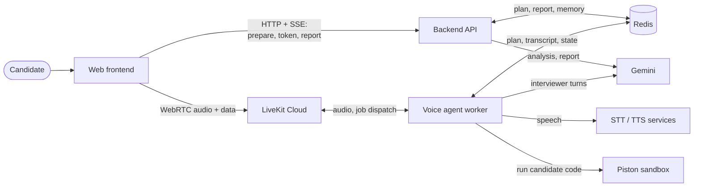

# 00 — Start Here

This chapter gives you the whole project in one sitting: what MockMind does, why it is built the way it is, how the pieces fit, and what a single interview looks like from start to finish. After it you should be able to explain the system in two minutes and know which chapter to open for any deeper question.

## What the project does, in plain English

MockMind is a web app for practising job interviews. You upload your resume and paste a job description. The system writes interview questions tailored to you and that role. You then have a spoken conversation with an AI interviewer called Alex, in your browser. Some questions can be coding questions: you type code in an editor, the code is really run in a sandbox, and the result is discussed. When you finish, you get a scored feedback report. Optionally, the system remembers your weak areas for next time.

## The problem and why it matters

Interview practice usually lacks three things: questions specific to your background and the target role, a realistic spoken format (typing answers is not the same as speaking under pressure), and structured feedback. MockMind automates all three. That is the product reasoning; the repository records no formal requirements document, so treat this as the README's stated purpose **[Inference]**.

It is also a good teaching project because it combines several hard engineering problems in one small codebase: orchestrating several LLM calls, validating untrusted model output, real-time voice, safe code execution, and testing something non-deterministic.

## Main features

- **Preparation.** Resume and job description are analysed by an LLM; a third call writes a question plan (a mix of categories and difficulty).
- **Live voice interview.** Speech-to-text, an LLM, and text-to-speech in a real-time loop, with interruption handling.
- **Coding challenges.** A code editor in the page; code runs in a Piston sandbox; an LLM reviews the result, grounded in the real run output.
- **Feedback report.** A scored, validated JSON report, generated after the interview and fetched by polling.
- **Candidate memory (opt-in).** Past weaknesses are stored under a hashed email key and fed into the next preparation.
- **Evals.** A custom harness with simulated candidates checks real model behaviour; it is run manually, not on every push.

## The stack at a glance

| Technology | Purpose here |
|---|---|
| Next.js / React / TypeScript | The web UI: setup page, interview room, report page |
| FastAPI (Python) | The backend API: preparation, join tokens, report retrieval |
| LiveKit (Cloud + Agents SDK) | Real-time audio transport, and the worker that runs the voice interviewer |
| Google Gemini (`gemini-2.5-flash`) | All LLM work: analysis, question writing, live interviewer, report, code review, memory |
| Soniox / Cartesia / Silero | Speech-to-text, text-to-speech, voice activity detection |
| Redis | Shared, expiring state between backend and agent |
| Piston | Sandboxed code execution |
| Pydantic | Schemas that validate everything the LLM returns |
| Langfuse (optional) | Tracing of LLM calls |
| pytest, GitHub Actions, eval harness | Tests and quality checks |
| Docker Compose | Running all of it locally |

Note what is absent **[Verified]**: no SQL database, no user accounts, no RAG or embeddings, no multi-agent system. State is a handful of Redis keys, and a random session id is the only "login".

## The architecture in one picture

Read it as two halves. The **preparation and reporting half** is ordinary request/response web work: frontend to backend to Gemini, results parked in Redis. The **live half** is a real-time voice call: the browser talks to LiveKit, and a separate agent process joins the same room and plays the interviewer.

The single most important fact: the backend and the agent never call each other. They communicate only through Redis. The backend writes the interview plan; the agent reads it later. [02-architecture.md](02-architecture.md) explains why, and what it costs.

## One example, start to finish

Imagine a candidate, Priya, preparing for an "AI Engineer" role. (This is an illustrative scenario, not recorded output.)

1. **Setup.** On the setup page she uploads her resume PDF, pastes the job ad, and chooses a short interview. The browser sends one multipart POST to the backend.
2. **Preparation.** The backend extracts the resume text, then makes three LLM calls: resume to candidate profile, job ad to job profile, both to an interview plan. Progress streams back to the browser as it goes. The plan and an empty session state are stored in Redis for four hours. If a step fails, the HTTP status is already 200, so the failure arrives as a message inside the stream.
3. **Joining.** She clicks Start. The browser asks the backend for a join token. The backend signs one that says "this person may enter this room, and please send the agent named `mockmind-interviewer` to it". LiveKit then dispatches the agent.
4. **The interview.** The agent loads the plan from Redis, greets Priya and asks question 1. When she stops speaking, voice-activity and turn detection decide she is finished, speech-to-text produces her words, Gemini decides whether to ask a follow-up or call a tool to move on, and text-to-speech speaks the answer. If a question is coding, an editor opens; her code runs in Piston and Gemini reviews it using the real output. The transcript is autosaved to Redis as she goes.
5. **The end.** When Alex finishes the last question it calls an end-of-interview tool, which starts report generation in the background. If Priya leaves earlier, a shutdown hook generates the report instead. The agent never closes the room itself; the browser moves to the report page when she clicks End. The report page polls until the report is ready, or offers Retry if generation failed. The report page polls until the report is ready, or offers Retry if generation failed.

The details of each step, including failure paths, are in [03-how-it-works.md](03-how-it-works.md).

## The concepts that matter most

Learn these ten and everything else in the repo makes sense. Each is introduced in [01-foundations.md](01-foundations.md) and developed in [04-core-concepts.md](04-core-concepts.md).

1. **Workflow versus agent.** Preparation is a fixed workflow of single LLM calls. The live interviewer is a tool-calling LLM inside a code-controlled question sequence: a constrained agent.
2. **Structured output plus validation.** LLM text is untrusted; Pydantic models are the gate.
3. **Retry and backoff** for flaky LLM calls.
4. **Thinking budget:** hidden reasoning tokens count against the output limit and can truncate JSON.
5. **Soft versus hard enforcement.** The follow-up cap is a counter plus a prompt note and an eval check; the model can still ignore it.
6. **Shared state via Redis with TTLs**, instead of services calling each other.
7. **Voice turn-taking:** VAD, turn detection, interruptions.
8. **Grounded code review:** the LLM judges real execution output, not its own guess.
9. **Prompt-injection hygiene** for stored memory and candidate-supplied text.
10. **Evals** for non-deterministic behaviour, and why they are not the same as tests.

## Recommended reading sequence

| Order | File | Read it to learn |
|---|---|---|
| 1 | [01-foundations.md](01-foundations.md) | The prerequisite ideas (HTTP, async, Redis, LLMs, voice, containers). Skip what you already know. |
| 2 | [02-architecture.md](02-architecture.md) | The components, who talks to whom, trust boundaries, the shared-state contract |
| 3 | [03-how-it-works.md](03-how-it-works.md) | The end-to-end workflows with failure paths |
| 4 | [04-core-concepts.md](04-core-concepts.md) | The key techniques, concept by concept |
| 5 | [05-engineering-decisions.md](05-engineering-decisions.md) | Trade-offs, historical issues, limitations, and improvements |
| 6 | [06-quality-and-reliability.md](06-quality-and-reliability.md) | Tests, evals, observability, diagnosing problems |
| 7 | [07-interview-preparation.md](07-interview-preparation.md) | Questions and answers by topic |
| 8 | [08-quick-reference.md](08-quick-reference.md) | Glossary, component table, commands |

Short on time: this file, then 02, the workflows in 03, and 07. Revising before an interview: 05, 07, 08.

## How to read the evidence labels

Claims in this handbook are checked against the repository, which is the source of truth. Where it matters, a label tells you how much to trust a sentence: **[Verified]** (confirmed in code or history), **[Measured]** (we ran it locally), **[Inference]** (reasoned, not proven), **[Hypothesis]** (a possible failure, not observed), **[Not measured]** (no number exists; never quote one). Existing README claims are not automatically facts; for example, the README says difficulty is "guaranteed", but the code draws it randomly by weight.

## Recap

MockMind turns a resume and a job description into a spoken mock interview and a scored report. A web backend prepares and reports; a separate LiveKit worker conducts the live conversation; Redis is the only link between them; Gemini does all the language work, and every model output is validated before it is trusted. Next, read [01-foundations.md](01-foundations.md) for the prerequisites, or jump to [02-architecture.md](02-architecture.md) if you are comfortable with them.
