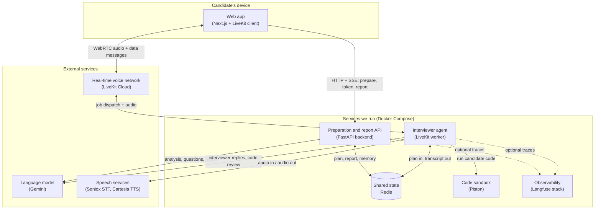
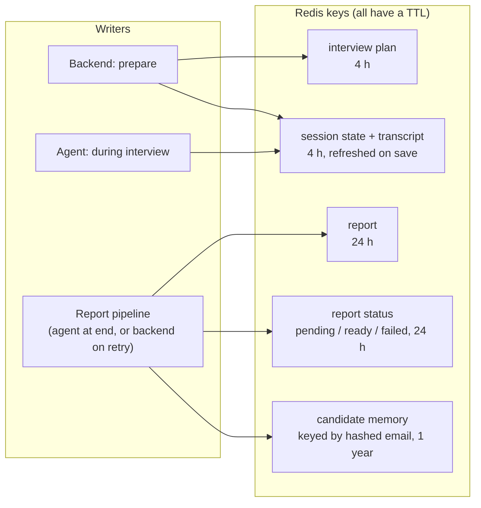
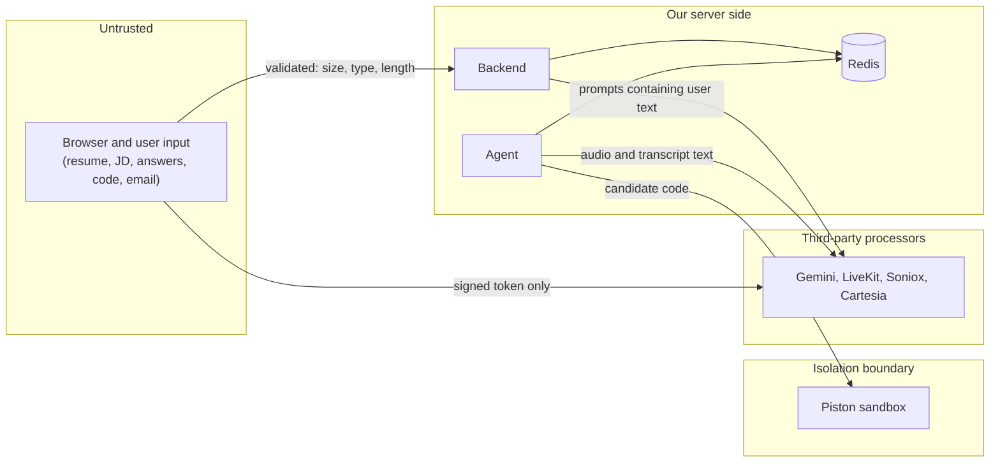

# 02 — Architecture

In this chapter you will learn which pieces make up MockMind, what each one is responsible for, how they talk to each other, and where the system's data lives. It matters because almost every design question in an interview ("why two processes?", "what happens if X dies?", "where is state kept?") is answered by this map. Prerequisite concepts (SSE, Redis TTL, WebRTC, tool calling) are in [01-foundations](01-foundations.md); the step-by-step behaviour over time is in [03-how-it-works](03-how-it-works.md).

Evidence labels: **[Verified]** = read in the repository; **[Measured]** = a command was run locally; **[Inference]** = reasoned, not executed.

---

## 1. The big picture

MockMind is an AI mock-interview product. A candidate uploads a resume and a job description, the system prepares a tailored question plan, an AI interviewer named Alex conducts a spoken interview, and afterwards a scored report is produced.

The system splits naturally into two time periods with different needs:

- **Before and after the interview** the work is ordinary request/response web work with slow LLM calls: parse files, call a model, store JSON. This is the **backend** (FastAPI).
- **During the interview** the work is a continuous, low-latency audio conversation. This is the **voice agent** (a LiveKit worker), which keeps long-lived connections to a voice network, a speech-to-text service, a text-to-speech service and a language model.

These two never call each other. They cooperate through **Redis**, which holds the plan, the live transcript and the report. That single decision explains most of the architecture.

How to read it: solid arrows are the paths that make the product work; dotted arrows are optional tracing that is silently skipped if Langfuse keys are not configured. Three things the picture does not make obvious **[Verified]**:

1. **The backend never contacts LiveKit.** It only signs a token (a JWT) locally; the browser presents that token to LiveKit. There is no arrow from the backend to the voice network.
2. **The agent has no inbound port.** Compose publishes no port for it; the worker dials out to LiveKit and receives interview jobs over that connection. You cannot `curl` it; you read its logs.
3. **"The agent uses backend code" is a code dependency, not a network call.** The agent process imports the backend package (models, report pipeline, code reviewer) as Python modules. That is why both images install overlapping requirements, and why Piston, although conceptually part of "the backend's" code, is only ever called by the agent process (and by the eval harness).

---

## 2. Components, grouped by role

For each role the questions are the same: what is it responsible for, what goes in and out, who does it talk to, why is it separate, what breaks if it fails, and what is the trade-off.

### 2.1 User interface (Next.js frontend)

**Responsibility.** Everything the candidate sees: the setup form with progress bar, the microphone check, the interview room (an animated orb showing speaking/listening/thinking), the code editor popup, and the report page.

**Inputs and outputs.** In: user actions, SSE progress events, a LiveKit token, WebRTC audio and data messages, report JSON. Out: a multipart form to the backend, microphone audio to LiveKit, code submissions as data messages, polling requests for the report.

**Interactions.** Talks to the backend over HTTP and to LiveKit Cloud directly. It never talks to the agent directly; to the browser the agent is just another participant in the room.

**Why separate.** It runs in the user's browser, so it must be a separate deployable. It also holds all timing UX (progress bar, 25-second "interviewer is taking too long" timer, report polling), which keeps the server stateless about the UI.

**If it fails.** A frontend crash affects only that candidate's tab. Because state lives in Redis, reloading `/interview/{id}` can reconnect, but **reconnecting restarts the interview** (see [chapter 03, section 7](03-how-it-works.md#7-disconnect-reconnect-and-end)).

**Trade-offs.** No automated frontend tests exist; the only static check is the TypeScript compiler **[Verified]**. The backend URL is baked in at build time through a public build variable, so changing it needs an image rebuild.

### 2.2 Preparation and report service (FastAPI backend)

**Responsibility.** Four jobs: (a) validate the upload and run the three-step preparation workflow that produces an interview plan; (b) issue LiveKit access tokens; (c) serve and retry reports; (d) delete a candidate's stored memory.

**Inputs and outputs.** In: resume file, job description text, option choices, optionally an email. Out: an SSE stream of progress events, a signed token, report JSON, and two Redis keys (the plan and an empty session state).

**Interactions.** Redis (always), Gemini (for analysis, question generation, and report retries), optionally Langfuse. It never calls the agent, LiveKit, or Piston.

**Why separate.** Preparation takes tens of seconds and is plain request/response work. Keeping it out of the voice process means a slow resume parse can never stall a live conversation, and the API can restart without dropping anyone's call.

**If it fails.** New candidates cannot prepare, get a token, or fetch/retry reports. An interview already in progress is unaffected (the agent needs only Redis and the external services), except that the report page cannot be served until the API returns.

**Trade-offs.**
- It is stateless apart from Redis, so several replicas are conceivable, but the retry tasks live in process memory (a restart during a retry leaves the status stuck at `pending`; see [chapter 05](05-engineering-decisions.md)).
- There is **no authentication or rate limiting** on any endpoint. The session id (a random UUID) is the only secret; whoever has it can fetch the token and the report **[Verified]**.
- Compose runs it with `--reload` and a bind-mounted source directory: a development setup, not a hardened deployment **[Verified]**.

### 2.3 Shared state (Redis)

**Responsibility.** The meeting point of backend and agent, and the only data store the application has. There is no SQL database **[Verified]**.

**What it holds.** The interview plan, the live session state/transcript, the report and its status, and candidate memory. Every key has a time-to-live (TTL). Section 3 describes exactly who writes and reads each.

**Why separate and why Redis.** The agent and backend are different processes in different containers; they need a place to hand data across. Redis is simple, fast, and has native expiry, which fits the "temporary session data" nature of the problem. The repository does not record a design rationale beyond this; the reasoning is **[Inference]**.

**If it fails.** Almost everything stops: preparation cannot store a plan, the token endpoint 404s (it checks that the plan exists), the agent cannot load a plan and exits without speaking, and report writes fail. The backend even pings Redis at startup and refuses to start without it.

**Trade-offs: durability is weaker than "it's a database".** In compose the app's Redis uses the image's default snapshot persistence (RDB), append-only logging is off, and the data directory is an anonymous volume. So writes since the last snapshot can be lost on a crash, and data disappears if the container is recreated with a new anonymous volume. It is *not* "no persistence", and not "durable" either **[Verified in compose; snapshot defaults Measured earlier]**. Redis is also published on host port 6379 with no password in this compose file. For a practice tool with TTLs this is tolerable; for real candidate data it would not be.

### 2.4 Real-time voice infrastructure (LiveKit Cloud)

**Responsibility.** Carries the live audio and small data messages between the browser and the agent. It runs rooms, authenticates participants via the signed token, and dispatches an agent job into a room when a candidate joins.

**Inputs and outputs.** In: the candidate's microphone stream, the agent's synthesized speech, data messages in both directions. Out: those same streams to the other party, plus a "job" message to a registered agent worker.

**Interactions.** Browser (WebRTC), agent worker (outbound WebSocket for registration and jobs, WebRTC for audio). It does not talk to the backend.

**Why separate.** Real-time audio routing (an SFU: selective forwarding unit) is hard infrastructure; the project rents it rather than building it. The token carries an **explicit agent-dispatch directive** (agent name `mockmind-interviewer`, metadata `{session_id}`), so LiveKit knows which worker to call and which session it is for.

**If it fails.** No interviews can start or continue. The browser shows the "taking too long" overlay (if the agent never arrives) or "Connection lost" (if it drops mid-call).

**Trade-offs.** External dependency and vendor lock-in for transport; a cloud account is required. Data messages have no application-level acknowledgement, which matters for code submissions (chapter 03, section 5).

### 2.5 Interviewer agent (LiveKit worker)

**Responsibility.** Conducts the interview. One job process per live interview: it loads the plan, builds a voice pipeline, speaks the opening, listens, runs the follow-up counter, advances through questions, shows the code editor for coding questions, reviews submitted code, autosaves the transcript, and triggers the report at the end.

**Inputs and outputs.** In: job metadata (the session id), the plan from Redis, the candidate's audio (as text via STT), data messages carrying code. Out: spoken replies, data messages that open the editor, transcript writes to Redis, and the report trigger.

**Interactions.** LiveKit, Redis, Gemini, Soniox, Cartesia, Piston. The only component that talks to all four outside services.

**Why separate.** Its lifecycle is per-conversation and long-lived (minutes), with latency-critical streaming. It needs a different runtime model (a worker that receives jobs) from a request/response API. Module-level state is per job, so there is no cross-session leakage **[Verified]**.

**What kind of "agent" is it?** A tool-calling language model operating inside a code-controlled question sequence: the question order, the editor trigger, the counters and the report trigger are code; the wording, the decision to ask a follow-up, and when to call `move_to_next_question` are the model's choice. This is a *constrained agent*, not a free-roaming one. See [04-core-concepts](04-core-concepts.md) for the concept and [01-foundations](01-foundations.md) for agents versus workflows.

**If it fails.** The candidate hears nothing and the UI times out after 25 seconds, or the call drops. If it crashes mid-interview, the transcript is whatever the last autosave wrote (at most about a second stale) **[Verified]**, and no report is produced automatically; the report page's **Try again** can regenerate it from the saved state.

**Trade-offs.**
- Soft control: the follow-up cap is a counter plus a per-turn system note, not a hard block; the model can ignore it.
- The live prompt contains the whole plan, including each question's ideal-answer points, so the interviewer model can see the answer key (the prompt tells it not to reveal it) **[Verified]**.
- In the Docker image the end-of-turn language model files are never downloaded, so the containerised agent most likely runs with silence-based turn detection only **[Inference, not checked in a container]**. Chapter 04 covers what that changes.

### 2.6 External AI services

| Service | Used by | For | If unavailable |
|---|---|---|---|
| Gemini (`gemini-2.5-flash`) | backend and agent | resume analysis, JD analysis, question generation, live interviewer replies, code review, report, memory notes | Backend steps retry up to 3 times with backoff, then surface a safe error or a `failed` report status; the live interviewer relies on the voice framework's own handling and has no custom fallback line |
| Soniox | agent | streaming speech-to-text | the turn may never be committed; no custom handling in our code |
| Cartesia | agent | streaming text-to-speech (voice "Sonic-3") | silence from Alex; the transcript may still say she spoke |

**Why external.** Each is a specialised model that would be impractical to host. **Trade-offs.** Per-use cost (not measured in this repo), latency that stacks in a voice loop, and candidate speech/transcripts sent to third parties. The Gemini model name is hard-coded in several places rather than configured in one **[Verified]**; changing it means editing several files.

### 2.7 Code sandbox (Piston)

**Responsibility.** Run the candidate's code safely and return stdout, stderr and exit code.

**Interactions.** Called over HTTP only by the agent process (through the shared code-review module) and by the eval harness. Never by the backend API.

**Why separate.** Running a stranger's code is dangerous; Piston is a ready-made isolated executor. The project calls it rather than building isolation.

**If it fails.** Each test case records an execution error, so the review sees "0 tests passed", which can unfairly lower the score. The first run of a language may also trigger a package install inside a 30-second HTTP timeout **[Verified in code; the trap itself Inference]**.

**Trade-offs.** The container runs `privileged: true` to build nested isolation, which is itself a risk. No network-egress policy is defined in the repo. Tests use a **run-timeout of 3 seconds**, so infinite loops are killed and the test fails.

### 2.8 Observability (Langfuse and tracing)

**Responsibility.** Let a developer see what each LLM call received and returned, and how a voice turn flowed, grouped by session id.

**How it plugs in.** Two mechanisms: a small wrapper around each backend Gemini call (becomes a no-op when keys are missing), and OpenTelemetry spans emitted by the voice framework, exported to Langfuse and stamped with the same session id. So one candidate's preparation, interview and report appear under one session.

**Why optional.** It must never be a runtime dependency; if keys are unset, tracing is skipped and the app behaves identically **[Verified]**.

**If it fails.** Nothing user-visible. **Trade-offs.** Langfuse retains prompts (which contain resumes and transcripts) indefinitely in its own database; and it is a heavy stack (web, worker, Postgres, ClickHouse, MinIO, Redis) for a small project. There is no latency or cost metric in the application itself.

### 2.8b Evaluation harness (developer-only)

`mockmind/evals/` drives simulated interviews with LLM-played candidates through the *real* question generator, the *real* interviewer rules and tool logic (in text instead of voice), and the real report generator, then scores with an LLM judge and deterministic code checks. It is not part of the running product; it is run manually or through a manually-triggered workflow. Its design and limits are covered in [06-quality-and-reliability](06-quality-and-reliability.md).

---

## 3. Shared-state contract: who owns what in Redis

This is the most important table in the architecture because the backend and agent coordinate *only* through it.

Reading it: the backend writes the plan once and never rewrites it; the agent is the main writer of the live session state; the report pipeline writes the report, the status and (opt-in) memory. Readers: the token endpoint checks the plan exists; the agent loads the plan; the report endpoints read the report, status and (for retry) the session state; preparation reads memory.

Important consequences **[Verified]**:

- **`session_state` has two writers.** Preparation writes an empty one; the agent overwrites it as the interview proceeds. A second agent job for the same session (after "Reconnect") overwrites the first interview's transcript.
- **The plan is the only thing the agent loads at start.** It does not read `session_state`, which is why a reconnect cannot resume.
- **The report pipeline is shared.** The same function runs in the agent process at the end of an interview and in the backend process on retry. It never raises; it records `failed` instead.
- **Connection handling differs.** The backend shares one module-level Redis client; the agent opens a short-lived connection for each load/save.
- **The session id is the access control.** One random UUID created at preparation appears in the Redis keys, the room name, the job metadata, the URLs and the Langfuse session. Anyone holding it can use it.

The TTL asymmetries are worth remembering: a LiveKit token lasts 2 hours but the plan lasts 4, so a candidate who comes back after 2 hours gets a fresh token and a restarted interview; the report lasts 24 hours; memory a year.

---

## 4. Trust boundaries

Who and what is trusted? The question matters because user text goes straight into LLM prompts and user code goes to an executor.

What the code does at each boundary, and what it does not do **[Verified]**:

| Boundary | Controls present | Gaps |
|---|---|---|
| Browser to backend | extension allowlist (pdf, docx, doc, txt), 5 MB cap read as limit+1 bytes, job description cap 15,000 chars, resume text cap 30,000 chars, safe generic error messages, CORS allowlist | no authentication, no rate limiting; file type is decided by extension, not content |
| Browser to LiveKit | server-signed token scoped to one room, 2-hour lifetime | `/api/token` is unauthenticated: a valid session id is enough |
| Text into prompts | fixed prompt templates; stored memory notes are wrapped in `<candidate_notes>` and labelled untrusted data (hardening commit `04da133`) | resume, JD and transcripts are concatenated into prompts without sanitisation; the live prompt contains the answer key |
| Code to sandbox | Piston isolation, 3-second run timeout, 30-second HTTP timeout | privileged container; no egress policy visible |
| Data at rest | TTL on every key; memory key is a SHA-256 of the lower-cased email | Redis unauthenticated and host-published in dev compose; the email itself is stored inside the memory value and in the plan for up to 4 hours; Langfuse keeps prompts |
| Live data channel | token grants publish-data only to the candidate | the agent does not check sender identity or that the submitted question is the *current* one |
| Secrets | `.env` git-ignored; compose injects variables | missing variables become a `KeyError` and a 500; no `.dockerignore`, so `COPY . .` in the backend/agent images can copy a local `.env` into an image layer (a documented concern from the earlier analysis; not re-built here) |

"Current design limitations" is the right label for all of these: they are properties of a demo-grade deployment, not recorded incidents.

---

## 5. Deployment shape

Only Docker Compose is defined; there are no Kubernetes manifests or deployment pipeline **[Verified]**. One Docker host runs: the frontend (container port 3000, mapped to host **3002**), the backend (8000), the agent (no ports), the app's Redis (6379), Piston (2000, privileged), and the Langfuse stack (web on host 3001, MinIO on host 9090, plus worker, Postgres, ClickHouse and its own Redis). The external services are reached over the internet.

Worth knowing:

- **Port mismatch.** The frontend is on host port 3002 but the backend's default CORS origin and the README assume `localhost:3000`. If you use 3002 you must set `CORS_ORIGINS` accordingly.
- **Dev-flavoured settings.** The backend uses `--reload` and a bind mount; the agent runs the production worker mode (`start`) with a bind mount. Start-up ordering waits for Redis health only, not for Piston or Langfuse.
- **Scaling shape.** One agent worker container hosts one job process per live interview. Capacity is bounded by CPU, memory and the voice providers' rate limits; none of this has been load-tested **[Not measured]**. The backend is the easy part to scale; the agent is the hard part.
- **Two Redis instances** exist: the app's (no password) and Langfuse's own (password, named volume). They are unrelated.

---

## 6. Why this decomposition, and what it costs

| Decision | Benefit | Cost |
|---|---|---|
| Backend and agent communicate only through Redis | independent lifecycles; a slow preparation cannot stall a call; either can be restarted | no direct "is the other alive" check; data contract is implicit in key names; two writers of one key |
| Preparation as a workflow of single LLM calls, interview as a constrained agent | predictable cost and failure modes in preparation; conversational flexibility where it is needed | steps 1 and 2 of preparation run one after the other although independent, so latency adds up |
| Plan generated up front, then replayed | the interview cannot invent its own question order; easy to evaluate | questions cannot adapt to how the candidate actually performs |
| Code the model must not forget to do (open the editor, count follow-ups, run tests) lives in Python | reliable, testable | the model can still ignore advisory notes (soft enforcement) |
| Use hosted SaaS for voice, STT, TTS, LLM | working voice product from a small codebase | latency, cost, privacy, vendor dependence |
| Redis only, with TTLs | trivial ops, natural expiry | weak durability, no auth, no history beyond TTL, no queries |

Rationale for these decisions beyond what code comments state is not recorded in the repository; the benefits above are the standard engineering reasons and partly **[Inference]**. [05-engineering-decisions](05-engineering-decisions.md) separates confirmed historical issues, current limitations, hypothetical failures and suggested improvements.

---

## Recap

- Two worlds: a request/response **backend** for preparation and reports, and a streaming **voice agent** for the interview, never calling each other, meeting only in **Redis**.
- LiveKit Cloud moves the audio; the token the backend signs both authorises the browser and tells LiveKit which agent to dispatch, with the session id in its metadata.
- The agent is a constrained tool-calling agent: code owns order, counters, editor and report triggers; the model owns wording and judgement. Piston is called only from the agent side.
- Redis keys, their writers, and their TTLs are the shared-state contract; there is no database, and durability is snapshot-level.
- The system trusts the session id as its only access secret, validates uploads, sandboxes code, and has real gaps (no auth, privileged sandbox, unsanitised prompt inputs) that you should be able to name.

Next: [03-how-it-works](03-how-it-works.md) follows these components through each real workflow.
