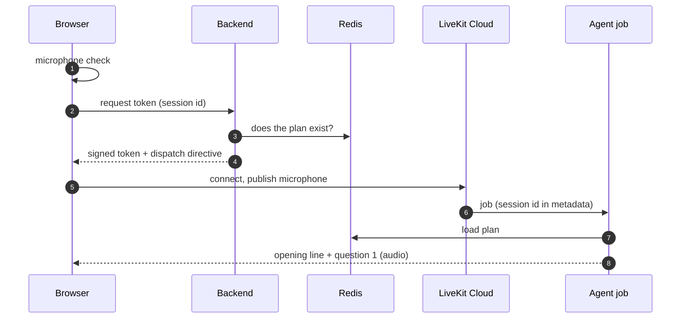
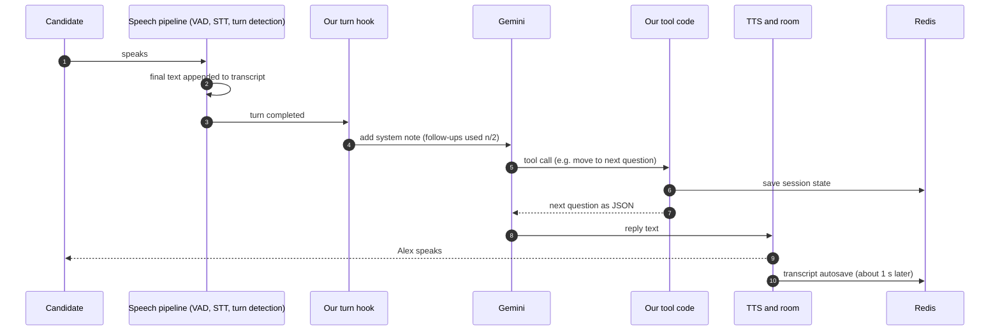
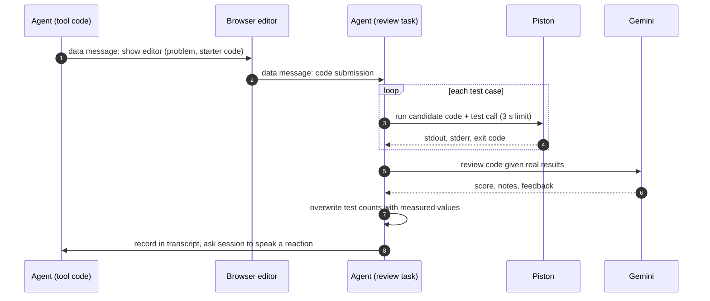
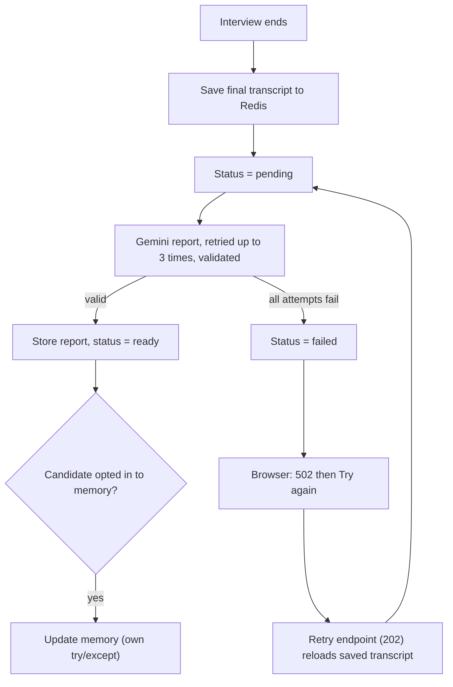

# 03 — How It Works: the Workflows End to End

In this chapter you will follow one candidate through the whole system: preparing an interview, joining it, a live conversation turn, a coding question, the report, candidate memory, and what happens when things drop. For each workflow you get the stages in order, the decision points, which outside services are involved, what can go wrong and how the system responds. It matters because interviewers love "walk me through what happens when…" questions, and a good answer is a story with failure branches, not a list of functions. Components are introduced in [02-architecture](02-architecture.md); concepts such as SSE, tool calling and turn-taking are explained in [01-foundations](01-foundations.md) and [04-core-concepts](04-core-concepts.md).

Labels: **[Verified]** read in the repo; **[Library]** behaviour of the LiveKit Agents framework as read earlier in its source (not re-read in this pass); **[Inference]** reasoned, not run; **[Not measured]** nobody timed it.

Workflows: 1 Preparation · 2 Joining · 3 One live turn · 4 Follow-ups and next question (within the turn) · 5 Coding challenge · 6 Report · 7 Disconnect, reconnect, end · 8 Candidate memory (read and write sit in 1 and 6; summarised in 8).

---

## 1. Preparation: from resume to interview plan

**Trigger.** The candidate clicks *Prepare My Interview* on the setup page. **Outcome.** An interview plan and an empty session record stored in Redis, and a "ready" signal to the browser.

### The stages

**A. Intake and validation**
1. The browser sends one multipart request: resume file, job description, interview type (standard or coding), difficulty (easier/balanced/harder), length (quick/standard), and optional memory settings (opt-in, email, "focus on weak areas"). It had already checked file type, size and description length client-side.
2. The backend mints a new random `session_id` and returns a streaming response. From now on, progress is reported as events inside the stream.
3. The server re-validates: description at most 15,000 characters; resume read as at most 5 MB plus one byte (so oversize is detected without buffering a huge upload); extension must be pdf/docx/doc/txt; non-empty. The text is extracted (synchronously, which briefly blocks the server's event loop) and truncated to 30,000 characters.

**B. Understanding the two inputs (two LLM calls)**
4. **Resume analysis**: Gemini turns the resume text into a structured *candidate profile* (skills, experience, projects, gaps).
5. **Job analysis**: Gemini turns the job description into a *job profile* (required skills, seniority, "red flags to probe").
These two calls are independent but run one after the other, so latency is roughly their sum; running them concurrently would be a straightforward improvement **[Verified, sequential]**.

**C. Personalising the plan**
6. If the candidate opted in and gave an email, the backend looks up their stored memory (see workflow 8). Any failure here is swallowed: the interview is prepared without memory.
7. The option names are turned into numbers: standard means 16 questions, quick means 8, and coding means 6 questions of which 4 are coding (length is ignored). Difficulty maps to weights; "balanced" uses the default 40% basic / 35% intermediate / 25% advanced.
8. **Python, not the model, draws the difficulty sequence**: slot 1 is a fixed basic warm-up, the last slot is the fixed closing question ("Do you have any questions for me?"), and each middle slot gets a difficulty by a weighted random draw. Coding slots are then picked among middle slots, preferring non-basic ones. This is a *draw*, so a given plan will not exactly match the percentages; the README word "guarantee" overstates it.
9. **Question generation**: one more Gemini call gets both profiles, the slot-by-slot sequence and optional memory context, and returns a JSON plan: opening message, and per question the text, intent, ideal-answer points, 2-3 follow-ups, category, difficulty and (for coding) a spec with starter code and test cases. The code validates the result into typed objects; a category outside the allowed set raises an error.

**D. Persist and announce**
10. The plan is stored (4-hour TTL), then a session record with an empty transcript (same TTL). Only after both writes does the server send the `complete` event with the question count, role and name. The page now shows *Start Interview*.

```mermaid
sequenceDiagram
    autonumber
    participant UI as Setup page
    participant API as Backend (streaming endpoint)
    participant G as Gemini
    participant R as Redis
    UI->>API: resume, JD, options
    API-->>UI: progress events (parsing 5-15%)
    API->>G: analyse resume
    G-->>API: candidate profile
    API-->>UI: progress 45%
    API->>G: analyse job description
    G-->>API: job profile
    API-->>UI: progress 65%
    API->>R: memory lookup (only if opted in; failure ignored)
    API->>G: generate questions (profiles, difficulty sequence, memory)
    G-->>API: JSON plan, validated
    API->>R: store plan, then empty session state
    API-->>UI: complete (100%)
```

Progress numbers jump in steps (5, 15, 20, 45, 50, 65, 70, 90, 100) because they are milestones, not a clock: the silent stretches between them are the three model calls.

### Decision points
- Interview type and length decide counts; difficulty decides weights.
- Memory present with weak areas? If "focus weak areas" was requested but none exist, an extra progress message says a balanced interview will run.
- Does the question model use extra "thinking" effort? Yes only when coding slots are requested: with thinking disabled the model was measured (in the code comment, a development observation, not a repeatable benchmark in this repo) to drop the coding tag on about 1 in 4 slots, whereas dynamic thinking missed none in 6 trials. This is an example of a historical fix (commit `3d57ab0`). The coding-format instructions are also only included when coding slots exist, because including them always made the model confuse the field `question_type="coding"` with `category` (commit `b2ba44e`).

### What can go wrong and how the system responds

| Failure | Response |
|---|---|
| Bad file type, empty, oversized, description too long | a specific, safe error event; nothing stored |
| No text extracted (for example a scanned PDF) | "Could not extract text" error event |
| Gemini rate limit, server error, malformed JSON, or invalid category | each LLM step is retried up to 3 times with 1 s then 2 s waits; if all fail, a generic error message is sent and the traceback is logged. Nothing is stored yet, so retrying from the browser starts clean (and pays for steps 1-2 again; nothing is cached) |
| Memory lookup error | ignored; no memory used |
| First Redis write succeeds, second fails | user sees an error; an orphan plan key lingers until its TTL; harmless but untidy **[Inference from code order]** |
| Backend dies mid-stream | the stream ends with neither `complete` nor `error`; the hook has no explicit rule for that, so the UI shows nothing definitive **[Inference]** |
| Failure before the first byte (for example missing form field) | ordinary HTTP error (422), shown as a generic "request failed" |

Why errors are events instead of HTTP codes: the 200 status is sent with the first chunk, so later failures must travel inside the stream. A unit test asserts that a secret inside an exception never reaches the user.

---

## 2. Joining the interview

**Trigger.** *Start Interview* opens `/interview/{session_id}`. **Outcome.** The candidate and the agent are in one LiveKit room and Alex starts speaking.

### The stages

**A. Preflight in the browser**
1. The page asks the browser for microphone permission and immediately stops the test stream. Denied or unsupported shows a fix-it screen with *Try again*; the token is not requested.

**B. Authorisation**
2. The page calls the token endpoint with the session id. The backend checks the plan exists (this is also the 4-hour expiry check); if not, **404**.
3. Otherwise it signs a token locally: identity, permission to join only this room (`interview_<id>`) and publish audio and data, valid 2 hours, and an embedded **agent dispatch** for `mockmind-interviewer` with metadata `{"session_id": ...}`. The backend makes no network call to LiveKit.

**C. Room and agent**
4. The browser connects to LiveKit with that token and publishes the microphone.
5. LiveKit creates the room, sees the dispatch directive, and sends a job to a registered agent worker.
6. The agent job reads the session id, loads the plan from Redis, builds the voice pipeline (speech-to-text, Gemini, text-to-speech, voice-activity detection, optional end-of-turn model), registers its listeners and shutdown hooks, and starts the session.
7. On entry, Alex says the plan's opening message followed by question 1, **uninterruptibly**, and the agent writes that line into the transcript itself.



### What can go wrong

| Failure | What the candidate sees | Response |
|---|---|---|
| Microphone blocked or absent | mic screen | user fixes and retries |
| Plan expired or unknown session | connection error | token endpoint 404; user must prepare again |
| LiveKit environment variables missing | server error | `KeyError` becomes a 500 (no friendly message) |
| Agent worker not running, or never accepts the job | orb stays "connecting"; after **25 seconds** an overlay says the interviewer is taking too long | *Reconnect* reloads the page |
| Agent cannot find the plan or the metadata | nothing is spoken; agent logs an error and returns | same 25-second overlay |
| Redis down or invalid stored plan at load | job raises (only a missing plan is caught gracefully) | same overlay **[Inference on the framework's handling]** |
| Candidate speaks before the agent is there | words lost | the greeting is uninterruptible anyway |

Debug tip: there is no health endpoint on the agent, so "no interviewer" is diagnosed from the agent's logs and whether the worker registered.

---

## 3. One live conversation turn

**Trigger.** The candidate stops talking. **Outcome.** Alex replies (audio), and both sides of the exchange are in the transcript.

### The stages

**A. Hearing the answer**
1. Candidate audio flows through the room to the agent; **voice-activity detection** finds where speech starts and ends, and **speech-to-text** produces final text segments. Each final segment is appended to the transcript as a `candidate` entry; so a 40-second answer may produce several entries, but the interviewer logic runs once per completed turn.
2. **Turn detection** decides the answer is finished. By default the silence threshold is about 0.55 s [Library]; if the end-of-turn language model is loaded it can extend the wait when the sentence sounds unfinished. If that model is unavailable (the Docker image probably lacks its files), the agent falls back to silence-only detection, so a longer thinking pause may be treated as the end of the answer **[Inference]**.

**B. Deciding the reply (our code plus the model)**
3. Before the model replies, our turn-completed hook runs: it counts this turn, builds a short system note ("Follow-ups used on this question: n/2", or a "limit reached" note), and adds it to the model's context for this turn. See workflow 4.
4. Gemini receives the system prompt (Alex's persona, the full plan, behavioural rules), the conversation, and the note. It either replies with text or calls a tool. The tools are `move_to_next_question`, `end_interview` and `get_current_question_context`.
5. If a tool is called, our tool code runs and returns JSON (for example the next question), and the model makes a **second** call with that result to produce what Alex says. The framework caps tool steps per turn at 3 [Library].

**C. Speaking and recording**
6. Text streams to Cartesia; audio chunks stream back to the room; the orb shows "speaking".
7. When the assistant message is committed, it is appended to the transcript as an `interviewer` entry (unless identical to the last one, which avoids duplicating the opening line).
8. A coalescing **autosave** writes the whole session state to Redis about 1 second after a transcript change (bursts share one write).



### Interruptions
If the candidate talks over Alex for about half a second [Library default], Alex's audio is cut off; if it turns out to be a false alarm (for example a cough), speech resumes after a couple of seconds of silence [Library defaults]. The opening line is deliberately uninterruptible. Our code adds nothing custom here; this is framework behaviour. Another side effect: our hook changes the model's context after the framework may already have started a speculative reply, so that speculative reply is discarded and regenerated. That costs a little latency in exchange for deterministic counting **[Library; cost Not measured]**.

### What can go wrong

| Stage | Failure | Result and who handles it |
|---|---|---|
| Audio | mic muted after the check | Alex hears nothing and waits; no "are you there?" logic exists |
| STT | provider error or empty final | the turn may never commit; only empty finals are filtered by us |
| Turn detection | end-of-turn model missing | falls back to silence-only; Alex may cut in on pauses |
| Hook | raises | that turn gets no reply [Library: logged and skipped]; the hook is tiny, so risk is low |
| Tool `move_to_next_question` | Redis save fails before it returns | the in-memory index has already advanced but the model gets no next-question text; what it does next is framework behaviour, not traced |
| Gemini | 429, 5xx, timeout | framework retry or silence; no custom spoken fallback |
| Model | calls the tool, then returns no text (a "silent turn") | candidate hears nothing, and nothing is transcribed for that turn. Seen in stored local eval runs; root cause unknown |
| TTS | fails | Alex is silent, but the transcript may already say she spoke (the opening line is recorded before it is spoken) |
| Autosave | Redis error | logged; the next transcript entry schedules another attempt |

---

## 4. Follow-ups and moving to the next question

These are decisions inside every conversational turn, so they live here rather than in a separate flow.

**The policy.** For each non-coding question, Alex should ask a follow-up only if the answer is vague or incomplete, and at most two. The prompt says so, and code reinforces it.

**The mechanism (stages).**
1. Every completed candidate turn increments a per-question turn counter. The first turn answers the question; every later turn is assumed to answer a follow-up, so `follow_ups = turns - 1`.
2. The hook tells the model the count. At 2 or more it says the limit is reached: acknowledge briefly, then call `move_to_next_question`.
3. When the model calls that tool, the code advances the index, records the question as asked, **resets both counters**, saves state, and returns the next question with its planned follow-ups and the current count.
4. If the index passes the last question, the tool returns "interview complete" and tells the model to call `end_interview`.

**Decision points.**
- Is the question a coding one (or is there no current question)? Then no counting and no note; progress is driven by code submissions instead (workflow 5).
- Is the answer sufficient? That is the model's judgement.
- Has the cap been reached? The note says so, but this is **soft enforcement**: the model can still ask a third follow-up. Stored local eval runs checked this deterministically and found no violation in the runs that had checks, but those are simulated candidates and not a guarantee **[Measured, local]**. A historical eval run did show a violation before the counter existed (see the eval report in `mockmind/evals/REPORT.md`).

**A quirk worth knowing.** Turns are counted, not follow-ups. A candidate saying "sorry, can you repeat that?" counts as a used follow-up; and STT/turn boundaries from the library decide what a "turn" is **[Inference]**.

**Why not hard enforcement?** The code could auto-advance from the hook or remove follow-up ability from the model once the cap is hit. It does neither; the trade-off is naturalness and simplicity versus strict guarantees. The concept is expanded in [04-core-concepts](04-core-concepts.md).

---

## 5. The coding challenge and code review

**Trigger.** The model calls `move_to_next_question` and the next question is a coding one. **Outcome.** The candidate sees an editor, submits code, the code is run against tests, reviewed, and Alex reacts out loud.

### Why a separate path
The voice pipeline only starts a turn when the candidate *speaks*. Code is typed, so it needs its own entry point: a **data message** over the same LiveKit room, on a named topic. The agent therefore has two independent inputs (audio turns and data packets) sharing one session state.

### The stages

**A. Showing the editor (code-driven, not model-driven)**
1. The tool code itself publishes a `coding_challenge` message (question id, language, problem statement, starter code) to the browser. This is deterministic Python so the editor opens even if the model forgets; the code comments record this as a lesson from the follow-up-cap finding.
2. The tool result tells the model: the problem and editor have already been shown; explain briefly in your own words, ask them to submit, then wait and do not advance until the submission has been reviewed.
3. The browser opens a Monaco editor pre-filled with the starter code.

**B. Submitting**
4. The candidate presses *Submit*. The browser sends a reliable `code_submission` message with the question id and code, and hides the editor.

**C. Grounded review (agent side)**
5. The agent parses the packet, finds the question and requires that it has a coding spec.
6. For each test case, the code builds a program by appending the test's *call snippet* after the candidate's code (for example `print(add(2, 3))`), sends it to Piston with a 3-second run timeout, and compares trimmed stdout to the expected output and checks exit code 0. Note: despite a model comment saying "passed to stdin", the input is appended as code, not sent as stdin; the generator prompt says the same.
7. Gemini is then asked to review the code **given the real results** (low temperature, thinking off) and returns a score, quality notes and spoken-style feedback.
8. Python **overwrites** the model's `tests_passed` and `tests_total` with the measured counts, so the model cannot invent a passing grade. This is the "grounded review" idea; see [04-core-concepts](04-core-concepts.md).
9. The transcript records the submitted code and a system line with the result, and the agent calls `generate_reply(...)` with instructions to react naturally and ask at most one follow-up about the approach, then call `move_to_next_question`. That call is what lets an out-of-band event make Alex speak without a user turn.



### What can go wrong

| Step | Failure | Response |
|---|---|---|
| Editor message | publish fails | logged only; the editor never appears although the model was told it did |
| Submission | lost, or agent gone | no review and no notice to the candidate; reliable delivery protects against network loss, not an absent receiver |
| Parse or lookup | malformed payload, unknown or non-coding question id | logged, nothing spoken. The agent does not check that the submitted question is the *current* one |
| Execution | infinite loop | Piston kills at 3 s; that test fails |
| Execution | Piston down or timeout | each test is recorded as an execution error, so the review sees 0 passed and may score unfairly low |
| First use of a language | Piston installs a runtime within the 30-second HTTP limit | could fail every test on a fresh volume **[Inference, not run]** |
| Review | Gemini fails or returns unparseable JSON (not retried here) | Alex is told to apologise briefly and ask to resubmit or move on |
| Duplicate or rapid submissions | each runs as its own task | two reviews and reactions may overlap **[Inference]** |
| Review result | submission was made, but then the editor is hidden | if the review fails the candidate has no editor to resubmit; observed as a dead end in earlier analysis |

The review score also does not appear separately in the final report; the report is generated from the transcript, which contains the review line **[Verified]**.

---

## 6. Report generation, retrieval and retry

**Trigger.** The interview ends. **Outcome.** A validated report in Redis, a status the browser can read, and optionally updated memory.

### The stages

**A. Triggering (two entry paths)**
1. *Path A, model-driven:* Alex says a closing statement and calls `end_interview`. The tool sets the end time and starts report generation as a background task, then returns "session ended".
2. *Path B, disconnect-driven:* the candidate clicks *End Interview*, closes the tab, or drops. The framework closes the session, and the agent's shutdown callback sets the end time and generates the report, but only if the end time is not already set (this prevents a duplicate after path A).
3. Notice: after `end_interview` no agent code closes the room or tells the browser. The browser goes to the report page only from the *End Interview* button (it disconnects, waits 2.5 seconds, then navigates). Behaviour if the candidate keeps talking afterward is untested, and later turns would not be in that report **[Inference]**.

**B. The pipeline (one shared function)**
4. The agent first **saves the final transcript** to Redis, deliberately before generating, so a retry is possible even if generation fails.
5. Status is set to `pending`.
6. Gemini receives the plan and the full transcript and returns a JSON report; it is retried up to 3 times with backoff, and *validated* (required keys present, recommendation one of four values, scores numeric). A malformed report fails here and is retried instead of crashing the report page.
7. On success: the report is stored (24 h) and status becomes `ready`.
8. If the plan carries an email (the candidate opted in), memory is updated after that (workflow 8).
9. On any exception, status becomes `failed` and the function returns false. It never raises, because the agent's teardown and the backend's background task have nobody to catch it.

**C. Retrieval and retry (browser and backend)**
10. The report page polls every 4 seconds, up to 30 times (about 2 minutes). The responses: **200** report JSON (checked first, so a stale `failed` never hides a later success); **502** with `failed`; **404** "not ready".
11. On `failed`, or after polling gives up, the page shows *Try again*, which calls the retry endpoint. The backend returns `pending` as a no-op if one is already running, `ready` if a report exists, **404** if the session state is gone, **409** if there is no transcript; otherwise it sets `pending`, runs the same pipeline from the saved transcript as a background task, and returns **202**. The page resets its counter and polls again.



The flowchart shows why the order "save first, generate second" matters: failure in the model step still leaves everything needed for a retry.

### Why a status key
With only a report key, "absent" could mean generating, failed, or never started, and the page would poll blindly. A three-state status turns it into a tiny state machine: stop polling on `failed`, show a button. It is the standard pattern for asynchronous work without a job queue; here the "worker" is just an async task inside whichever process called the pipeline.

### What can go wrong

| Situation | What Redis holds | Candidate sees | Recovery |
|---|---|---|---|
| Agent crashes mid-interview | session state from the last autosave (at most about 1 s stale); no status | 404 for the full polling window, then *Try again* | retry works from the saved state |
| Candidate closes the tab | shutdown callback saves and runs the pipeline | normal pending then ready, if the job process is allowed to finish | retry if cut off. Whether teardown can always finish long model calls is a **[Hypothesis]**, not a confirmed incident |
| Gemini fails 3 times, or validation keeps failing | `failed` | 502, *Try again* | retry endpoint |
| Output truncated by thinking tokens | earlier measured as a real cause of broken JSON; mitigated by disabling thinking and raising the output limit (see the eval report) | n/a now | n/a |
| Redis down during the pipeline | maybe nothing, not even a status | 404 forever | restart Redis, then *Try again* |
| Backend restarts mid-retry | status stuck at `pending` until its 24 h TTL; no staleness check | spinner, and retry returns "pending" | none in code **[Hypothesis from code reading]** |
| Session state expired (over 4 h) | gone | retry returns 404 | none; the candidate must run a new interview |

Another observation from stored local eval runs: report scores for similar transcripts sometimes differed from the judge's view; root cause unknown, so treat the numbers as indicative, not calibrated.

---

## 7. Disconnect, reconnect and end

| Event | What happens |
|---|---|
| Candidate closes the tab or the network drops | the participant leaves; the session closes (the agent also asks the room to be deleted on close); the shutdown callback generates a report if none was started |
| UI shows "Connection lost" | shown when the page was once connected, the interview was not ended by the button, and the connection state is now disconnected. The text says answers so far are saved, which is true of the autosave |
| Candidate clicks **Get my report** | goes to the report page, which polls as in workflow 6 |
| Candidate clicks **Reconnect** | the page reloads, requests a new token, joins a new room session, a **new agent job** loads *only the plan*, and **starts again from question 1**. Its autosave overwrites the previous transcript, and the next report overwrites the old one |
| Agent process crashes | no shutdown callback runs; the last autosave persists; no automatic report; *Try again* can regenerate it |
| Token expires (2 h) | reload gets a new token if the plan (4 h) still exists, but the interview restarts |

**Conclusion [Verified]:** there is no resume. "Reconnect" is a restart. Supporting resume would require the agent to load the saved session state (index, transcript) and re-prime the model; this is a suggested improvement, not current behaviour.

Between workflows 6 and 7 is an easy interview trap: "does ending the call end the interview?" The answer: the report is triggered by either the model's tool call or the shutdown callback; the browser's navigation is separate.

---

## 8. Candidate memory (read and write)

The "memory" is an ordinary Redis record per email, not a model capability. The LLM remembers nothing between calls; code reads a JSON document and pastes parts of it into the next prompt.

**Read side (during preparation).**
1. If the candidate opted in with an email, the key is a SHA-256 of the lower-cased, trimmed email (so capitalisation does not create two profiles).
2. The stored record may contain: weak categories, the last 15 recent questions to avoid repeating, and short notes. These are added to the *question-generation prompt* only. The notes are wrapped in a `<candidate_notes>` block marked as untrusted historical data, a hardening step (commit `04da133`) against a stored note acting as an instruction.
3. The live interviewer prompt does **not** receive memory; it only gets the plan that memory shaped.
4. If "focus weak areas" is on and weak categories exist, the prompt requires at least two thirds of the middle questions to come from them.

**Write side (after a report is stored).**
5. The code loads existing memory, appends this session's category scores, recomputes weak categories (average strictly below 6.0, sorted ascending, at most three), appends this session's questions keeping the last 50, and asks Gemini once to rewrite the 2-3 sentence note describing trends.
6. It saves with a one-year TTL.

Example, hand-computed from the thresholds: after one session with technical 4 and communication 8, technical is weak. After a second with 7 and 5, the averages are 5.5 and 6.5: technical is still weak, communication is not. A category exactly at 6.0 is not weak.

**Delete.** `DELETE /api/candidate-memory` with an email removes the record (idempotent, 204).

**What can go wrong.** Read failures are swallowed (no memory, interview still prepared). Write failures after the report is stored are logged and do not affect the report, but that session's memory update is simply lost with no retry. The write is read-modify-write without a lock, so two sessions for the same email finishing together can lose an update. The email appears inside the stored value (only the key is hashed), and `candidate_email` also sits in the plan and session state for up to 4 hours.

---

## Recap

- **Preparation** is a staged workflow of three Gemini calls, streamed to the browser as progress events, ending with two Redis writes; failures are safe, retried, and leave nothing half-announced.
- **Joining** is: mic check, token (which authorises the browser and dispatches the agent), room, agent loads the plan from Redis, Alex speaks.
- **A live turn** is speech to text, a turn decision, our counting hook, a Gemini reply possibly via a tool call, speech back, and an autosave; follow-up limits are soft and next-question logic is code-owned.
- **Coding** uses a separate data-message path: the editor is shown deterministically, code is run in Piston, the model reviews real results, and Python overwrites the test counts.
- **Reports** are asynchronous with a three-state status: save first, generate with retry and validation, never raise, retry from the saved transcript.
- **Memory** is a hashed-email JSON record read in preparation and written after the report; it never reaches the live prompt directly.
- **Reconnect restarts**; there is no resume.

Where to go next: [04-core-concepts](04-core-concepts.md) explains the ideas used here (structured output, retry, soft vs hard enforcement, grounded review); [05-engineering-decisions](05-engineering-decisions.md) separates confirmed issues from limitations and hypotheticals; [06-quality-and-reliability](06-quality-and-reliability.md) shows how to test and diagnose these flows.
