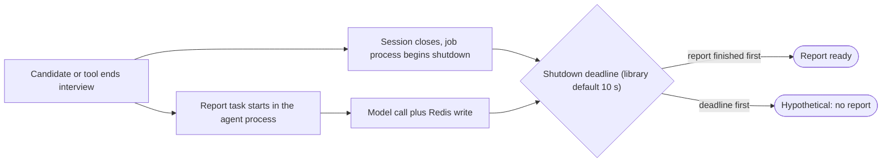

# 05 - Engineering Decisions: Challenges, Failure Modes and Trade-offs

This chapter is about things going wrong and the choices behind the design. You will learn which problems demonstrably occurred (with evidence), which behaviours were only observed in local eval runs, which weaknesses exist in today's code, which failures are merely plausible, what we can and cannot say about performance and scaling, and why the main design choices look the way they do. It matters because interviewers probe honesty as much as knowledge: "what went wrong, how do you know, and what did you fix?" Concepts referenced here are explained once in [04-core-concepts](04-core-concepts.md).

## How to read this chapter: four categories, never mixed

| Category | Meaning | Evidence required |
|---|---|---|
| **A. Confirmed historical issues** | Demonstrably went wrong and was changed | A git commit message or diff, a regression test, or the repository's `evals/REPORT.md` |
| **B. Stored eval-run observations** | Seen in local result files (git-ignored, one machine, about 11 days, changing prompts) | The files themselves, counted by script. Root causes are unknown. |
| **C. Current design limitations** | Verified properties of today's code that are weaknesses | Reading the code or running it |
| **D. Hypothetical failure scenarios** | Derived from the architecture; **not observed** | Reasoning only |

Suggested improvements (E) follow at the end. Attribution note: every commit uses a single Git identity and the repository does not say who diagnosed or fixed anything. This chapter says what the evidence shows, not who did it. In an interview, speak only to what you personally did.

Evidence labels: **[Verified]**, **[Measured]** (computed locally, no network), **[Inference]**, **[Hypothesis]**, **[Not measured]**. Several large commits have messages that do not describe their contents, so "which commit introduced X" below is answered from diffs, not messages.

---

# Part A. Confirmed historical issues

Each entry: problem, why it occurs, effect, technical cause, how to diagnose, fix, why it works, limits, alternatives, how an interviewer may probe.

## A1. The model wrote `category: "coding"` and question generation crashed

- **Evidence.** Commit `b2ba44e` (2026-10-02) message and diff; the test `test_question_generator_coding_category_bug.py`.
- **Problem and effect.** Preparation crashed with an uncaught `ValueError` "on roughly every other real call", even with no coding questions requested. The frequency is the commit author's report; it cannot be re-measured without live calls. **[Not measured]**
- **Why it occurs.** The plan schema has two fields that both look like "kind of question": `category` (six allowed values, none of them `coding`) and `question_type` (`conversational` or `coding`). When the model put `coding` in `category`, the enum conversion raised.
- **Technical cause (per the commit).** The prompt always described the coding-question format, even with zero coding slots. The block is about 1,400 characters, more than half the size of the 2,500-character main prompt **[Measured]**. Having the word in context primed the model to misuse it.
- **How to diagnose.** Read the traceback (`'coding' is not a valid QuestionCategory`), then look at what the prompt mentions. The commit says it was found by repeated manual testing.
- **Fix.** Include the coding block only when coding slots exist, and add an always-on rule that `category` is never `coding`.
- **Why it works / limits.** Removing an irrelevant concept removes the temptation; the explicit rule covers the residual case. This is an explanation, not a proof (no A/B is stored). The real safety net is validation plus retry, so a bad output is retried; if all three attempts fail the user sees a generic error.
- **Test.** One pytest test asserts on the *assembled prompt text* (block absent without coding slots, present with them, rule present in both). The second half of that file makes real API calls and is run manually, not in CI.
- **Alternatives.** Enforced response schema with enum; tolerant parsing that remaps `coding` to the right field.
- **Interview probe.** "How can irrelevant prompt text cause a bug?" Priming; show the fix as conditional assembly plus negative rule plus backstop.

## A2. Dropped coding tags (a silent failure) and the thinking-budget fix

- **Evidence.** Commit `3d57ab0` (2026-10-03) message, test docstring, and a code comment in the question generator.
- **Problem.** With thinking off, the model "reliably dropped the `question_type="coding"` tag on some of the requested coding slots (as low as 1 of 4 in one run)".
- **Why it is silent.** A coding spec is built only when the model both tags a question coding and supplies the spec; otherwise the question becomes conversational. Nothing compares the result with the coding slots chosen in Python. Effect: an interview with fewer coding questions than the setup page promised, with no error.
- **Technical cause.** Not proven. The finding is empirical: dynamic thinking fixed it. That per-slot constraints (this slot coding, that one not, plus category and difficulty) need reasoning is an **[Inference]**.
- **Numbers disagree across places.** The commit message says dynamic thinking "measured 13/13 perfect compliance", the test docstring says 13/13, a code comment says "0 misses across 6 trials". Possibly different batches; not reconcilable from the repo; not re-measurable here.
- **Fix.** `thinking_budget=-1` and a 16,384-token ceiling only when coding slots are requested; thinking off and 8,192 otherwise.
- **Trade-off.** Coding preparation is slower and costlier (**[Not measured]**); thinking tokens eat the same output budget, hence the larger ceiling.
- **Alternative / improvement.** After generation, assert the number of coding questions equals the planned slots and retry on mismatch. That turns a silent failure into a retried one. **[Suggestion]**
- **Interview probe.** "How did you tune reasoning?" Per call site, from an observed failure. Admit which numbers cannot be reproduced.

## A3. Report JSON truncated because thinking consumed the output budget

- **Evidence.** `evals/REPORT.md` ("Bug #2"). Git: the first report generator (`74a0b97`) had a 4,096-token ceiling and no JSON mime type or thinking config; by `7e98c15` it has 16,384, JSON mime type, and thinking off. **[Verified by `git show`]** The change rides inside `7e98c15`, a commit whose message is about tracing.
- **Problem.** The first real eval run crashed with `JSONDecodeError: Unterminated string`.
- **Why it occurs.** One output budget per call. Hidden thinking tokens spend from it; the visible JSON gets the remainder and stops mid-string if it does not fit.
- **Diagnosis (per REPORT.md).** Inspect `finish_reason` on the raw response; `MAX_TOKENS` confirms truncation. The same pattern reproduced in the eval judge and was fixed there by a larger ceiling.
- **Fix and why it works.** Thinking off, JSON mode, ceiling 16,384: the whole JSON fits.
- **A discrepancy to know.** REPORT.md calls the judge's thinking "nominally disabled", but the judge file has never contained a thinking config in any commit **[Verified by `git log -S`]**. It runs on the model's default thinking with an 8,192 ceiling.
- **Ordering caveat.** The report fix precedes the harness commit in history, yet REPORT.md says the first eval run found it; so the harness existed in the working tree before it was committed **[Inference]**.
- **Remaining risk.** Stored reports are 29,409 to 71,775 characters **[Measured]**, because every candidate answer is copied into the report. The largest exceeds 16,384 tokens at the usual 4 characters per token, yet parsed, so that ratio under-counts for this JSON **[Inference]**. Token usage is not stored, so headroom is unknown.
- **Prevention that exists.** Validation, retry, `failed` status and a retry endpoint (added in `568bffc`). A test asserting `finish_reason != MAX_TOKENS` would catch regressions; none exists.
- **Interview probe.** "Your JSON was cut off; walk me through it." Symptom, finish reason, shared budget, fix, residual risk.

## A4. The eval harness discarded a generated report on error

- **Evidence.** `evals/REPORT.md` ("Bug #1").
- **Problem and cause.** The exception branch of the run function reset the report variable to `None`, discarding a report generated before a later step (the judge) failed.
- **Fix.** Initialise once before the `try`; partial progress is kept in a shared dict that inner steps fill incrementally. Tests: the run function never raises and records the error; hung runs time out.
- **Lesson.** A harness must be crash-safe so one failure does not erase evidence.

## A5. The follow-up cap was prompt-only and was violated

- **Evidence.** `evals/REPORT.md` ("Finding #1, `vague` persona"): three follow-ups on one question, the third naming the technologies outright. REPORT.md also says the follow-up counter method existed but was never called from the interviewer. Git: the method first appears in code in `74a0b97`; the per-turn counting method and hook arrive in `568bffc` (2026-10-12), the shared note function and the deterministic check in `f2243ad` (2026-10-13).
- **Measured symptom.** In the stored `vague` run the candidate has 4 turns on question 0 and 2 on every other question **[Measured]**.
- **Why it occurs.** The rule was a request, not a guarantee, and the state meant to track it was never updated, so tool results always reported zero follow-ups used (**[Inference]** from the code).
- **Fix and how to diagnose.** A persona built to pressure the interviewer plus a judge, with transcripts read manually. The fix counts turns in code, injects the count and a stop instruction each turn, and adds the deterministic transcript check ([04 concept 5](04-core-concepts.md)).
- **Limits.** Still soft. The hook discards speculative replies (latency cost **[Not measured]**).
- **Evidence of effect.** One earlier baseline run shows at most 3 turns per question and passed, but predates the hook, so the improvement cannot be attributed to it. A/B attempts are inconclusive (B4). Do not call this "proven fixed".
- **Alternatives.** Auto-advance at the cap; block-and-regenerate validator.
- **Interview probe.** "A prompt rule isn't enforcement. What did you do?" Measure, count in code, add a check, say it is still soft.

## A6. A fresh checkout of `main` was broken

- **Evidence.** Commit `7e98c15` message: tracing code and requirements "were built and verified earlier this session but never committed"; later commits imported the tracing module at top level, "so main was broken on a fresh checkout until now". Found by a "fresh-context final review".
- **Cause and fix.** Uncommitted files that committed code depended on; the fix commits them.
- **Prevention.** CI on a clean checkout (`ci.yml`, added in `568bffc`, installs requirements and runs the backend tests) would plausibly have caught it **[Inference]**.
- **Lesson.** Verify from a clean checkout; local working trees hide missing files.

## A7. A two-hop prompt-injection path through stored notes

- **Evidence.** Commit `04da133`; test `test_memory_context_frames_notes_as_data_not_instructions`.
- **Problem.** Identified in review, not as an observed exploit: notes are LLM-written from a summary derived from candidate-influenced text and re-injected into the next question-generation prompt.
- **Fix.** Wrap notes in `<candidate_notes>` with "untrusted historical data" framing. The commit says it "doesn't claim to block a sufficiently motivated injection outright".
- **Limits.** No sanitisation; up to one-year persistence; memory kept out of the live prompt as a deliberate boundary.

## A8. The interviewer's rules and the judge's rubric contradicted each other

- **Evidence.** Diff of `f2243ad` to the interviewer prompt and the judge.
- **Problem.** The rules said never acknowledge being an AI unless asked, while the question-generation prompt tells the model to open by introducing "Alex, the AI interviewer", spoken verbatim. The system's own opening violated its own rule, and the judge could fail every run on it.
- **Fix.** Both texts now say the opening introduction is expected; the rubric exempts it.
- **Supporting stored data.** 6 of 10 stored runs with checks failed the in-character check, 3 for the introduction and 3 for apologies or discussing question order **[Measured]**. All were generated before the fix, so the fix's effect is **not** measured.
- **Lesson.** Two independently maintained texts drift; derive both from one source of truth.

---

# Part B. Stored eval-run observations (local, not in git; root causes unknown)

Source: the git-ignored results directory (23 files: 14 eval runs, 6 optimizer runs, 3 summaries), counted by script. Rows are not independent samples. These are text-mode runs with simulated candidates, not live voice sessions; do not present as benchmarks.

| # | Observation | Measured fact | What is not known |
|---|---|---|---|
| B1 | Silent interviewer turns | 7 silent-turn records in 2 of 9 runs that have the check | Whether a tool call preceded each; mechanism; never reproduced in live voice. Transcripts do not record tool calls. |
| B2 | Role confusion | In 2 of 10 checked runs the judge flagged leaked ideal points; one note says the interviewer "repeatedly answered its own questions" | Harness artifact (two chat models mirroring) or a real prompt weakness. The account is the judge's, an LLM's opinion. |
| B3 | Report scores inconsistent | 2 of 14 reports: overall 9.5 vs per-question mean 1.88, and 9.2 vs 7.69 | By reading the prompt, the model emits overall, category and per-question scores independently with nothing tying them; the validator checks none of it. |
| B4 | A/B of the follow-up note | Two batches of 3 strong runs, 1 pass each | Which batch was which arm is not stored; failure kinds differ; n=3. Inconclusive. |
| B5 | Runs hitting the 30-turn safety cap | All 3 `vague` transcripts, none of 13 others | Likely a harness limit (follow-ups consume turns), **[Inference]**; one run never advanced the question index (cause unknown). |
| B6 | Provider 503 errors | 4 of 6 optimizer files contain `503 UNAVAILABLE` despite retries | Which call failed; duration of the outage. The only first-hand evidence of provider failure here. |
| B7 | Plans shorter than requested | 11 runs had 16 questions, others 15, 14 and 13 | Which slots were lost. Nothing validates the count. |

Also worth knowing **[Measured]**: strong-persona overall report scores average 9.19 (standard deviation 0.14) over 12 runs, a ceiling effect that limits what memory's weak-area logic can learn; and the judge "pass" recorded in an older run would fail under today's stricter pass rule, so results are not comparable across harness versions.

How you would diagnose these: first make transcripts record tool calls, then rerun the failing persona, compare with traces in Langfuse (if configured), and only then form a root-cause hypothesis.

---

# Part C. Current design limitations (verified, grouped)

**Security and privacy**
- No authentication, authorization or rate limiting on any endpoint; session ids act as capabilities. Cost abuse and report access by anyone with an id.
- Prompt injection defences are partial (A7). Resume, job description and spoken text are unsanitised.
- The live prompt carries the answer key (ideal answer points, coding test cases).
- Resume text, transcripts and reports go to Google; audio to Soniox, Cartesia and LiveKit. Tracing (if on) stores prompts, including resume text, with no retention policy configured here. No PII redaction.
- No `.dockerignore`: local image builds copy the git-ignored `.env` and `node_modules` into the build context. Not a repo leak; a local-build hygiene risk if an image were shared.

**Reliability and correctness**
- "Reconnect" restarts the interview (page reload; agent restores only the plan) and its autosave overwrites the old state.
- Follow-up cap is soft. Difficulty mix is random per interview, "guarantee" in the README is too strong, and compliance is only logged.
- Plan size and coding-slot count are not validated after generation (A2, B7).
- Report scores are not derived from per-question scores and the validator has no range checks; the report copies every answer into its output (near the token ceiling, A3).
- Code review and memory notes are not retried; Piston outage looks like wrong code; no way to resubmit after a failed review.
- Report generation at interview end is a fire-and-forget task; the shutdown path only generates a report if the end time is unset.
- Redis in the compose file has no persistence configuration, no named volume, no password: image defaults mean snapshot-only saves (writes since the last snapshot can be lost, up to about an hour on a lightly written instance **[Inference]** from the default rules), AOF off, and an anonymous volume that may not survive `down -v`. It is not "no persistence".
- Memory read-modify-write has no lock.
- `retry_async` retries every exception, with no jitter, no deadline, no per-call timeout anywhere; resume parsing blocks the event loop.

**Maintainability**
- Fence-stripping helper duplicated five times; tool definitions mirrored by hand in the eval harness (the text-mode version lacks the coding branch).
- Dependency ranges without a lock file; Node 18 in the frontend image versus Node 20 in CI; a deprecated turn-detector plugin import.
- Frontend port mismatch: compose publishes the frontend on host port 3002, but the README and the default CORS origin assume 3000. Following the README with `docker compose up` finds nothing on 3000 **[Verified]**; browser calls from 3002 would be blocked by the default CORS list **[Inference]**.
- No frontend tests, no voice-path tests, a single eval fixture, an uncalibrated judge. The evals workflow is manual-trigger only; evals do not gate merges.

---

# Part D. Hypothetical failure scenarios (not observed)

Everything here is reasoning. Treat as **[Hypothesis]**.

| Scenario | Mechanism | Detection or mitigation |
|---|---|---|
| Report cut off at teardown | The report task starts as the session ends. The LiveKit library's default shutdown deadline for a job process is 10 seconds and shutdown callbacks run concurrently, while the UI promises 15 to 30 seconds. | Measure report success rate; generate in the backend or in the library's post-session hook; auto-retry from the UI |
| Retry storm in an outage | All requests retry three times in lockstep; B6 shows an outage can outlast the retries, but no storm has been observed | Jitter, circuit breaker, global limiter |
| Stranded `pending` | Backend restarts mid-retry; no staleness check | Store start time; treat old `pending` as failed |
| Duplicate identity / two tabs | Same identity for repeated joins; maybe an extra agent job | Test; unique identities |
| Lost memory update | Concurrent opted-in sessions on one email | Locking or transaction |
| SSE dropped mid-stream | No event ids, no client timeout | Timeout and reconnect |
| Piston outage mislabels good code | Per-test exceptions count as failures | Distinguish infrastructure errors |
| Malicious PDF stalls the server | Synchronous parse of untrusted input | Sandbox, timeout, process pool |
| Plan expires while candidate waits | Four-hour TTL, no user warning | Friendly message; extend on activity |
| Mid-interview `idle` shows "taking too long" overlay | UI treats non-listening/thinking/speaking as disconnected | Handle `idle` explicitly |
| Redis outage mid-interview | Autosave failures only logged | Retries, health alerts |
| Code submission lost | Data message has no acknowledgement; parse errors are logged and swallowed | Ack message; timeout |
| Hook exception ignores a turn | Library logs the exception and drops the turn | Keep the hook minimal (it is) |

This diagram is **hypothetical** and illustrates the race behind the first row; it has not been observed or measured in a live session.

---

# Part E. Suggested improvements (prioritised)

1. Authentication, session ownership and rate limits.
2. A durable store for sessions, reports and memory; Redis kept for ephemeral state; or at least a persistence configuration and named volume.
3. Generate reports in the backend or a post-session hook with UI auto-retry and a staleness rule for `pending`.
4. Compute headline scores in code from per-question scores; stop copying answers into the output; use a response schema.
5. Real resume semantics: restore transcript and counters on rejoin.
6. Hard follow-up enforcement; record tool calls in transcripts, then investigate silent turns and role confusion with traces.
7. Validate plan size and coding-slot count after generation and retry on mismatch; deterministic quota allocation for the difficulty mix.
8. Per-call timeouts, narrower retry classes, jitter, breaker; separate infrastructure errors from wrong answers in code review.
9. Prompt versioning and prompt-assembly tests; one shared JSON-cleaning helper.
10. Pin dependencies, align Node versions, add `.dockerignore`, fix the port mismatch, replace the deprecated plugin import, run resume and JD analysis concurrently.
11. Voice-path metrics and browser end-to-end tests; calibrate the judge against human grades.

---

# Part F. Performance, reliability and scaling: measured versus reasoned

**Honesty rule.** No load tests, latency benchmarks or throughput numbers exist in the repository, and nothing below was measured with a paid or networked call. Do not quote reasoned numbers as measurements.

## What was measured (offline)

- **Prompt and payload sizes.** Static prompts range from about 630 to 2,500 characters; the interviewer's rules plus an *empty* plan are 2,696 characters. On **synthetic** plans (field lengths assumed) the live system prompt is about 17,000 characters for 8 questions, 28,700 for 16, and 20,800 for 6 with 4 coding. Marginal cost is about 1,430 characters per question. Real plans will differ; measure `len()` of a stored plan.
- **Stored artefacts.** Transcripts (as the report prompt builds them) 26,043 to 100,859 characters (median 38,160); reports 29,409 to 71,775 (median 36,269). Whole-session Redis state with the largest transcript is about 122 KB, rewritten in full per autosave.
- **Resend arithmetic.** If each candidate turn sends the full system prompt plus history, one median-size run totals about 881,000 input characters across 19 calls (about 220 thousand tokens by chars divided by 4), the largest about 1.39 million characters. The 4 characters-per-token ratio is a crude estimate.
- **Component cost.** Silero VAD alone used about 0.035 to 0.041 CPU-seconds per second of audio on a 12-core dev machine (synthetic noise), roughly 4 percent of one core per stream. A process that imports the agent and loads VAD had about 209 MB resident, a lower bound, not a per-job cost.
- **Difficulty draw.** 2,000 simulated interviews: advanced count per interview 0 to 11 ([04 concept 5](04-core-concepts.md)).

## What can be reasoned (not measured)

**Where time goes.**
- *Preparation:* three sequential LLM calls, so total is roughly the sum. Resume and JD analyses do not depend on each other and could run concurrently; the gain is **[Not measured]**. The coding preset adds dynamic thinking and a larger ceiling, so it is slower **[Inference]**. Worst case per step is three attempts plus 3 seconds of waiting, with no per-call timeout. **[Inference]**
- *Voice turn:* `delay is roughly endpointing + STT finalisation + LLM first token (plus a second LLM call on tool turns) + TTS first audio + network`. Only endpointing is derivable from configuration (about 0.55 s normally, up to about 3 s if an end-of-turn model predicts "unfinished"); library defaults, version 1.8.4. Every other term, including Gemini's default-thinking first-token time, is **unknown**. No latency metric exists.
- *Report:* one call, output scales with transcript length (answers are copied in); wall-clock **[Not measured]**.

**Concurrency model.** One backend event loop, stateless per request, so multiple workers behind a balancer is plausible. One LiveKit job process per live interview, so agent capacity is the number of job processes a machine fits. A new Gemini client is built inside every call; no limiter, no timeout. Piston runs test cases sequentially, so a looping submission could mean 9 to 15 seconds of silence (3 to 5 cases at 3 s each, **[Inference]**).

**Likely bottlenecks, in estimated order [Inference].** Gemini quota and latency; agent capacity (per-interview process with streaming STT, TTS and VAD); Redis durability before throughput (payloads are tens of KB); event-loop blocking from resume parsing; Piston under concurrent submissions.

**Worked capacity example (reasoning only).** Goal "20 interviews at once, 30 minutes each". Candidate turns per run have median 17 (range 16 to 30) in stored text runs **[Measured]**. Assuming one extra model call per question advance, an interview needs about 37 model calls including preparation and the report, or roughly 25 requests per minute across 20 interviews **[Inference]**. Input volume would be on the order of 9 to 14 million tokens per 30 minutes if nothing is cached **[Inference, assumptions flagged]**. The missing number is your project's Gemini quota in requests and tokens per minute; look it up and compare before trusting any of this. Per-job CPU is unknown beyond the VAD floor. Memory floor for 20 jobs is at least 4.2 GB before the turn-detector model. **[Inference]**

**Measure first.** (1) The provider quota. (2) Per-stage voice latency via the library's metrics events. (3) Report success versus failure versus stale pending. (4) Real per-job CPU and memory with the end-of-turn model loaded. (5) Silent-turn frequency in live voice.

**Reliability mechanisms that exist.** Validate then retry (three attempts, 1 s and 2 s); explicit report status with retry endpoint; input limits (5 MiB file, 30,000 resume characters, 15,000 job-description characters, extension allow-list); Redis TTLs (plan and session 4 h, report and status 24 h, memory 1 year); debounced autosave; library retries for STT, LLM and TTS (three retries, 10 s timeout per attempt, session closes after repeated unrecoverable errors, library defaults); optional-component fallbacks (tracing, turn detector) that degrade silently. What is missing: timeouts, jitter, durable storage, auth, rate limits, voice metrics.

---

# Part G. Key design decisions, with alternatives

For each: what the code does, whether the repo records a rationale, the alternative, and the trade-off. "Rationale not recorded" means exactly that; inferred reasons are labelled.

| # | Decision | Rationale in repo? | Alternative | Main trade-off |
|---|---|---|---|---|
| 1 | Backend and agent never call each other; **Redis is the shared state** | Briefly: the design spec and README say state is shared via Redis. Why Redis over a database: not recorded. | HTTP between services; a database | Independent restarts versus an implicit contract (key names and shapes) with no auth |
| 2 | Agent imports the backend package | Not recorded beyond a requirements comment | Shared library; duplicated models | No schema drift versus the agent image needing backend code |
| 3 | Dispatch embedded in the participant token | Not recorded; differs from the spec's server-side dispatch call, and the code used the token form from its first commit | Server-side dispatch; automatic dispatch | One browser call and no LiveKit API call versus quiet failure when misconfigured |
| 4 | Plan prepared before the call, then a live interviewer | In the spec; latency argument is **[Inference]** | One big live prompt; fully scripted | Low live latency versus an upfront wait, a stale plan, answer key in the prompt |
| 5 | Constrained agent: LLM plus three tools in a code-driven sequence | Not framed this way in the repo | Autonomous or scripted | Predictability versus adaptiveness |
| 6 | Follow-up cap counted in code plus per-turn note | Motivation in REPORT.md; commit messages do not describe it | Prompt only; hard auto-advance | Visible state versus softness and lost preemption |
| 7 | One model (Gemini 2.5 Flash) everywhere | Named in the spec; reason not recorded | Mixed or stronger models | Simplicity and speed versus capability ceiling and lock-in |
| 8 | Thinking budget per call site | Yes: commit and comment (A2, A3) | Always on or off | Reliability versus latency and cost |
| 9 | JSON text plus Pydantic plus retry, not `response_schema` | Spec said `response_schema`; first code used the JSON mime type; **rationale not recorded** | Enforced schema | Simplicity versus brittle parsing and paid retries |
| 10 | SSE for preparation progress | Spec records progress streaming and `ReadableStream` because POST | WebSocket; polling | Simplicity versus no resume |
| 11 | Report generated by the agent at interview end, with a status machine added later | Agent-side generation in the spec; status machine in `568bffc` | A backend worker after a webhook | Transcript already in hand versus teardown risk |
| 12 | Redis with TTLs, no database | Code comment calls memory expiry deliberate; why 4 h and 24 h: not recorded | Postgres | Zero ops and expiry versus durability |
| 13 | Memory keyed by hash of email, opt-in, no accounts | README: "not real authentication, an explicit accepted tradeoff" | Accounts | Personalisation without login versus email as credential |
| 14 | Memory kept out of the live prompt | Code comment | Inject live | Smaller injection surface versus less in-call adaptation |
| 15 | Piston sandbox with grounded review | README explains it runs untrusted code | LLM-only | Real facts versus a privileged container and the outage-looks-like-failure gap |
| 16 | LiveKit data channels for editor and submission | README; no alternative discussed | Backend relay | Low latency versus no acknowledgement |
| 17 | Soniox, Cartesia, Silero, optional turn detector | Cartesia reason in the spec; STT change from the spec's Deepgram not recorded | Other vendors | Unmeasured quality, vendor lock-in |
| 18 | Custom eval harness over text-mode interviews | REPORT.md: an earlier audit found no behaviour evaluation (that audit document is not in the repo) | Manual tests; third-party tool | Targets this app versus an uncalibrated judge and no voice coverage |
| 19 | Optional tracing that degrades to a no-op | Docstring and commit | Mandatory | No breakage versus silent loss |
| 20 | Docker Compose local stack | Comment on the privileged Piston container | Kubernetes; bare processes | Parity versus a privileged container and a bind-mounted source tree |

**Principles with evidence behind them.** Prompts are requests, code is enforcement (A5). Fail visibly with explicit status (report states, SSE error events). Measure before tuning (A2, A3). Keep untrusted text out of instruction positions (A7). Ground model judgements in tool output (concept 9).

**What I would change first.** Authentication and ownership (security), then durable report storage and backend-side report generation (reliability), then derive report scores in code (correctness), then request timeouts and voice-path metrics (so tuning is evidence-driven).

---

## Recap

- Eight problems are confirmed by git or the repository's own write-up; each was fixed with a partial or evidenced mechanism, and several are still only soft (follow-up cap, injection framing, difficulty mix).
- Stored eval runs show silent turns, role confusion and inconsistent report scores; their causes are unknown and they come from text-mode runs.
- Today's design is deliberately simple (Redis, one model, no auth) and has real limits: durability, auth, timeouts, validation of plan size and scores, reconnect.
- Performance and scaling claims are reasoned from measured payload sizes and library defaults; no end-to-end latency, throughput or cost has been measured.
- Where the repository records no rationale for a decision, say "not recorded", then offer a labelled inference.
