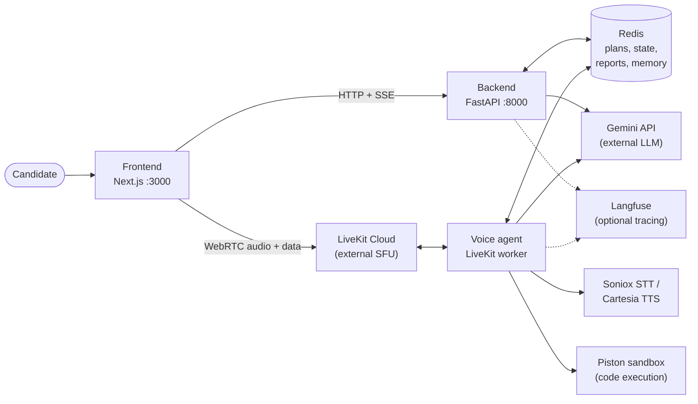
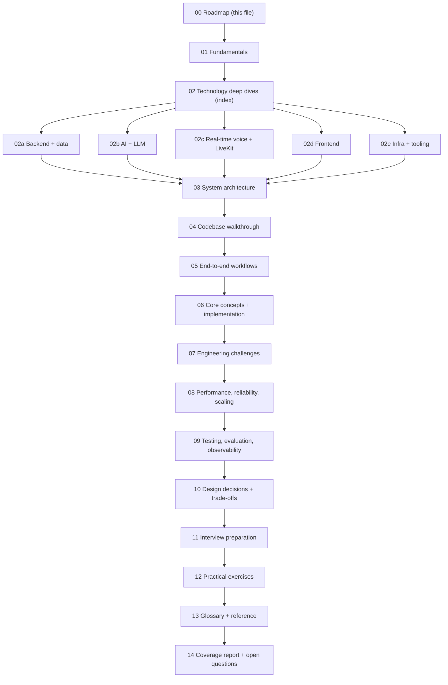

# 00 — Learning Roadmap and "Understanding the Project in 15 Minutes"

> **Purpose of this series:** teach you the MockMind codebase well enough to explain its architecture, justify its design decisions, debug it, discuss trade-offs, answer demanding interview questions, and modify it confidently.
> **How it was produced:** by reading the repository's source, tests, configuration, Git history and the installed library source, and by running the commands listed in [14 — Coverage Report](14-coverage-report-and-open-questions.md). Where something could not be verified, it is labelled.

---

## 0.1 How to read the evidence labels

Every non-trivial claim in this series carries (explicitly or by section header) one of these labels. Learn them first — they tell you how much to trust a statement.

| Label | Meaning |
|---|---|
| **[Verified]** | Confirmed by reading this repository's code, tests, configuration, or Git history, or by running a command and observing the result. |
| **[Library source]** | Confirmed by reading the *installed* third-party library source (e.g. LiveKit Agents 1.8.4 in `mockmind/agent/.venv`). It describes that version only. |
| **[Standard knowledge]** | General computer-science / engineering knowledge, not specific to this repo. |
| **[Inference]** | A reasoned interpretation of the evidence; plausible but not proven. |
| **[Hypothesis]** | A possible failure scenario or explanation derived from the architecture; **not** observed. |
| **[Not measured]** | A performance/behavior claim for which no measurement exists in the repo. Never treat as fact. |
| **[Measured]** | A number I observed by running something during this analysis (the exact method is stated). |

### Source references
References use this format (paths are relative to the repository root):

`Source: mockmind/backend/routers/prepare.py → prepare_interview() (L97–225)`

Line numbers were produced from the code (Python via `ast`) at the time of writing and re-checked against the working tree during the audit pass. **Do not treat line numbers as permanent identifiers** — the symbol name is the durable reference. If a range looks wrong, search for the function name (`grep -n "def prepare_interview" mockmind/backend/routers/prepare.py`).

### How to apply the labels when you quote this series
- If a sentence has **[Verified]**, you may say "the code does X". If it has **[Inference]**/**[Hypothesis]**, say "probably"/"could". If it has **[Not measured]**, never quote a number. A common interview mistake is to turn a *hypothesis* ("a big PDF could block the event loop") into a *fact* ("it blocks"). The labels exist to stop that.
- **[Measured]** values are point-in-time observations on one machine (installed library versions, a local `pytest` run). They are not guarantees about CI or production.
- The A–H structure used in the technology chapters (02a–02e): **A** what it is, **B** why it exists, **C** how it works internally, **D** where it is used here, **E** a concrete example, **F** alternatives, **G** trade-offs, **H** interview connection.

---

## 0.2 The project in plain English

**MockMind** is a web application for practising job interviews. You give it your **resume** and a **job description**. It uses large language models (LLMs) to write a set of **interview questions tailored to you and the role**. Then you have a **spoken conversation** with an AI interviewer named *Alex* in your browser. When you finish, the system writes a **scored feedback report**. Optionally it can ask **coding questions** (you type code in an editor and it is really executed in a sandbox) and can **remember your past performance** (opt-in) to focus later interviews on your weak areas.

*Source: `README.md`; behavior verified in the code paths documented in [05](05-end-to-end-workflows.md).*

### What problem does it solve?
Practising for interviews usually lacks three things: questions specific to *your* background and the *target role*, a realistic spoken format, and structured feedback. MockMind automates all three. **[Inference]** from the README's stated purpose and the feature set.

### Who or what interacts with it?
| Actor | Interaction |
|---|---|
| **Candidate (human)** | Uses the Next.js web app: uploads, answers questions by voice, reads the report. |
| **Browser** | Runs the frontend; captures the microphone; plays the agent's voice; sends/receives data messages. |
| **FastAPI backend** | Prepares interviews, issues join tokens, serves reports. |
| **Voice agent (Python worker)** | Joins the live room and conducts the interview. |
| **Redis** | Shared state between backend and agent. |
| **LiveKit Cloud** | Real-time audio/data transport and agent dispatch (external service). |
| **Google Gemini** | LLM for analysis, question writing, the live interviewer's reasoning, reports, code review (external). |
| **Soniox / Cartesia** | Speech-to-text / text-to-speech (external). |
| **Piston** | Sandboxed code execution (self-hosted container); called only by the agent process. |
| **Langfuse** | Optional LLM tracing (self-hosted containers). |
| **Developer/operator** | Runs Docker Compose, the test suite and the eval harness. |

---

## 0.3 The major technologies

| Layer | Technology | Where |
|---|---|---|
| Frontend | Next.js 14 (`next` pinned to exactly `14.2.0`; App Router), React 18, TypeScript 5, Tailwind CSS 3.4, `@livekit/components-react` ^2.6, `livekit-client` ^2.5, `@monaco-editor/react` ^4.7 | `mockmind/frontend/` |
| Backend | Python 3.12 (Docker/CI image; the local venvs are 3.12.3), FastAPI, Uvicorn, Pydantic v2, `redis.asyncio`, `google-genai`, `livekit-api`, `pypdf`, `python-docx`, `aiohttp`, `langfuse`, `python-multipart` (needed for file uploads) | `mockmind/backend/` |
| Voice agent | LiveKit Agents (Python; requirement `~=1.5`, **[Measured]** installed 1.8.4 in `agent/.venv`) with plugins: Soniox STT, Gemini LLM, Cartesia TTS, Silero VAD, turn detector; plus `opentelemetry-exporter-otlp-proto-http` | `mockmind/agent/` |
| State | Redis 7 | `mockmind/docker-compose.yml` |
| Sandbox | Piston | `mockmind/docker-compose.yml` |
| Observability | Langfuse (self-hosted), OpenTelemetry | `mockmind/backend/services/tracing.py`, `mockmind/agent/agent.py` |
| Quality | pytest, GitHub Actions, a custom LLM **eval harness** | `mockmind/backend/tests/`, `.github/workflows/`, `mockmind/evals/` |

*Source: `mockmind/backend/requirements.txt`, `mockmind/agent/requirements.txt`, `mockmind/frontend/package.json`, `mockmind/docker-compose.yml`.* **[Verified]**

**Version-pinning caveat [Verified]:** both Python requirements files use open lower bounds (`fastapi>=0.110.0`, `pydantic>=2.6.0` ...) except `livekit-agents[...]~=1.5` (compatible-release: `>=1.5,<2.0`). Two installs on different days can therefore differ. The versions quoted in this series (FastAPI 0.142.2, Uvicorn 0.54.0, Pydantic 2.13.5, redis-py 8.1.0, Starlette 1.7.0, pypdf 6.19.0, aiohttp 3.14.3, httpx 0.28.1) are **[Measured]** from `mockmind/backend/.venv` on the analysis machine only.

---

## 0.4 The high-level architecture

**Ports at a glance [Verified from `docker-compose.yml` and `README.md`]:** backend `8000`; Redis `6379`; Piston `2000`; Langfuse web `3001` (container 3000); MinIO `9090` (container 9000); the Next.js dev server uses `3000` (README says "Open http://localhost:3000"), but the Compose `frontend` service publishes **host `3002` → container `3000`**. The backend's CORS default allowlist is `http://localhost:3000` (`backend/main.py`), so a browser loaded from `http://localhost:3002` would not be in the default `CORS_ORIGINS` list unless you add it. That the browser would then be blocked is **[Inference]** from CORS rules plus these two settings; I did not run the Compose frontend to confirm.

**The single most important architectural fact [Verified]:** the backend and the agent are **separate processes that never call each other**. They coordinate only through Redis keys (`interview_plan:{id}`, `session_state:{id}`, `interview_report:{id}`, `interview_report_status:{id}`, `candidate_memory:{hash}`), and they share Python code through the `backend` package that the agent imports.
*Source: `mockmind/agent/session_state.py` → `AgentSessionState.load()` (L32–45) reads the plan the backend wrote; `mockmind/backend/routers/prepare.py` → `prepare_interview()` writes it.*

---

## 0.5 One complete example (end to end, abbreviated)

*Priya* wants to practise for an "AI Engineer" role.

1. **Setup.** She uploads `priya.pdf` and pastes the job ad on `/setup`, picks *Quick*, *Balanced*. The page `POST`s a multipart form to `/api/prepare`.
   *Source: `mockmind/frontend/hooks/usePreparation.ts` → `usePreparation()`; `mockmind/backend/routers/prepare.py` → `prepare_interview()`.*
2. **Preparation (streamed).** The backend validates the upload, extracts text, then calls Gemini three times: resume → `CandidateProfile`, job ad → `JobProfile`, both → `InterviewPlan` (8 questions). It streams progress as Server-Sent Events and stores the plan *and an empty session state* in Redis (4-hour TTL). If anything fails mid-way the HTTP status is still 200 (headers were already sent) and the failure arrives as an SSE event with `stage: "error"`.
   *Source: `mockmind/backend/agents/*.py`.*
3. **Join.** She clicks *Start*. The browser checks microphone permission, then `POST /api/token`. The backend mints a signed LiveKit JWT (valid 2 hours, room `interview_{session_id}`, identity `candidate_<first 8 chars>`) whose room configuration asks LiveKit to dispatch the agent named `mockmind-interviewer`, passing `{"session_id": ...}` as dispatch metadata. If the plan key has expired (TTL 4 h) the backend answers 404 instead.
   *Source: `mockmind/backend/routers/session.py` → `get_token()` (L31–84).*
4. **Agent joins.** LiveKit hands a *job* to the agent worker; `entrypoint()` loads the plan from Redis, builds the voice pipeline, and speaks the opening line plus question 1.
   *Source: `mockmind/agent/agent.py` → `entrypoint()` (L166–274); `mockmind/agent/interviewer.py` → `InterviewerAgent.on_enter()` (L53–68).*
5. **Conversation.** Each time Priya answers: voice-activity detection and a turn detector decide she's done; speech-to-text produces text; a hook adds a follow-up-count note; Gemini decides to follow up or call the `move_to_next_question` tool; text-to-speech speaks the reply. The transcript is autosaved to Redis.
6. **End and report.** The interview ends (tool call or disconnect). The report pipeline generates a validated JSON report, stores it, and sets status `ready`. The report page polls `GET /api/report/{id}` (every 4 s) until it appears: 404 means "not ready, keep polling", 502 with `{status: failed}` means "generation failed, offer Retry", 200 is the report.
   *Source: `mockmind/backend/services/report_pipeline.py` → `run_report_pipeline()` (L11–54); status endpoint `routers/session.py` → `get_report()` (L88–105).*

Full traces (with failure paths) are in [05](05-end-to-end-workflows.md).

---

## 0.6 The ten concepts you must learn first

1. **Client/server and HTTP**, including status codes and streaming (SSE). → [01](01-fundamentals.md) §1.2–1.4
2. **Async programming** (`async`/`await`, event loop, background tasks). → [01](01-fundamentals.md) §1.5
3. **Redis as a shared, expiring key–value store.** → [02a](02a-backend-and-data-technologies.md)
4. **Pydantic models** as the contract between AI output, Redis and APIs. → [02a](02a-backend-and-data-technologies.md)
5. **LLM basics:** tokens, temperature, structured (JSON) output, thinking budget, hallucination. → [01](01-fundamentals.md) §1.8, [02b](02b-ai-and-llm-deep-dive.md)
6. **Prompting and prompt injection.** → [02b](02b-ai-and-llm-deep-dive.md)
7. **Tool calling, workflows vs agents.** → [02b](02b-ai-and-llm-deep-dive.md) §2b.6
8. **Real-time voice:** STT → LLM → TTS, VAD, turn detection, interruptions. → [02c](02c-real-time-voice-and-livekit.md)
9. **LiveKit:** rooms, tokens, dispatch, workers/jobs, data channels. → [02c](02c-real-time-voice-and-livekit.md)
10. **Testing non-deterministic systems:** evals, deterministic checks, pass rates. → [09](09-testing-evaluation-and-observability.md)

---

## 0.6.1 Mini-glossary for the first read
You will meet these words before the chapters define them. One line each; full entries in [13](13-glossary-and-reference.md).
- **Session id** — a random UUID created at `/api/prepare`; it names the Redis keys, the LiveKit room and the report. Possessing it is the only "login".
- **Plan** — the JSON the question-generation step produces (questions, ideal-answer points, opening message). The agent reads it from Redis.
- **Agent** (two senses!) — (1) the *LiveKit worker* process that speaks (`mockmind/agent/`); (2) the *LLM-with-tools* idea ([02b](02b-ai-and-llm-deep-dive.md)). The backend "agents" folder (`backend/agents/`) holds plain LLM-call *workflows*, not LiveKit agents.
- **Worker / job** — LiveKit's names for the long-running agent process and one interview assigned to it.
- **TTL** — Redis auto-delete timer; why a plan disappears after 4 hours.
- **SSE** — one-way streaming over a normal HTTP response; used for preparation progress.

---

## 0.7 Recommended reading order

| If you have… | Read |
|---|---|
| 1 hour | This file, [03](03-system-architecture.md), [05](05-end-to-end-workflows.md) §5.1–5.4, [11](11-interview-preparation.md) "Interview-ready explanations" |
| A day | 00 → 01 → 02b → 02c → 03 → 05 → 07 → 11 |
| A week | Everything in order, doing [12](12-practical-exercises.md) as you go |
| Revising before an interview | [10](10-design-decisions-and-tradeoffs.md), [07](07-engineering-challenges.md), [11](11-interview-preparation.md), [13](13-glossary-and-reference.md) |

---

## 0.8 Documentation index

| File | What it contains |
|---|---|
| [00-learning-roadmap.md](00-learning-roadmap.md) | This overview, evidence labels, reading order |
| [01-fundamentals.md](01-fundamentals.md) | Programming, networking, async, data, container and AI prerequisites |
| [02-technology-deep-dives.md](02-technology-deep-dives.md) | Index + common structure for the technology chapters |
| [02a-backend-and-data-technologies.md](02a-backend-and-data-technologies.md) | FastAPI, ASGI, Pydantic, asyncio, Redis, SSE, parsers |
| [02b-ai-and-llm-deep-dive.md](02b-ai-and-llm-deep-dive.md) | Gemini API, prompts, structured output, tools, agents, memory, safety, evals |
| [02c-real-time-voice-and-livekit.md](02c-real-time-voice-and-livekit.md) | WebRTC, LiveKit, the STT→LLM→TTS pipeline, VAD, turn detection, interruptions |
| [02d-frontend-technologies.md](02d-frontend-technologies.md) | Next.js, React, TypeScript, Tailwind, LiveKit React, Monaco, print CSS |
| [02e-infra-and-tooling.md](02e-infra-and-tooling.md) | Docker/Compose, config, Langfuse/OpenTelemetry, CI, pytest, Piston |
| [03-system-architecture.md](03-system-architecture.md) | Components, communication, trust boundaries, deployment, diagrams |
| [04-codebase-walkthrough.md](04-codebase-walkthrough.md) | Directory map, entry points, key files and abstractions |
| [05-end-to-end-workflows.md](05-end-to-end-workflows.md) | Detailed happy-path and failure-path traces |
| [06-core-concepts-and-implementation.md](06-core-concepts-and-implementation.md) | The most valuable code, explained |
| [07-engineering-challenges.md](07-engineering-challenges.md) | Confirmed issues vs limitations vs hypotheticals |
| [08-performance-reliability-and-scaling.md](08-performance-reliability-and-scaling.md) | Performance, resilience, scaling analysis |
| [09-testing-evaluation-and-observability.md](09-testing-evaluation-and-observability.md) | Tests, evals, tracing, debugging commands |
| [10-design-decisions-and-tradeoffs.md](10-design-decisions-and-tradeoffs.md) | Why it is designed this way |
| [11-interview-preparation.md](11-interview-preparation.md) | Levelled questions, answers, follow-ups |
| [12-practical-exercises.md](12-practical-exercises.md) | Beginner → advanced exercises with hints and solutions |
| [13-glossary-and-reference.md](13-glossary-and-reference.md) | Terms, commands, tables (Redis keys, HTTP API, env vars, ports) |
| [14-coverage-report-and-open-questions.md](14-coverage-report-and-open-questions.md) | What was investigated, verified, and what remains uncertain |
