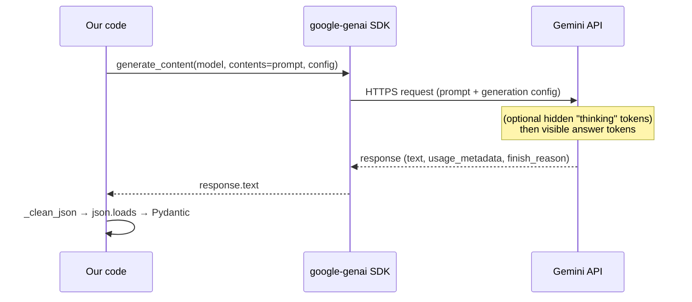
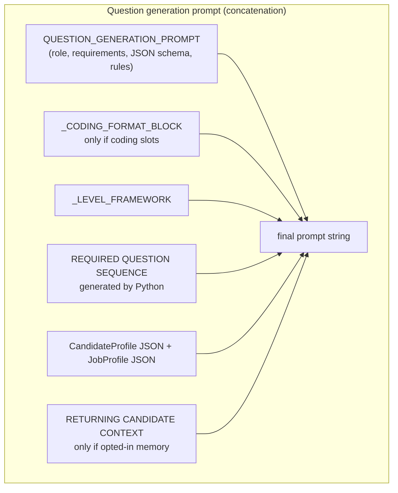
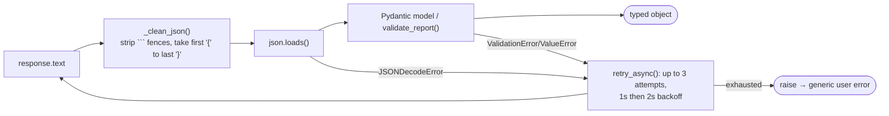

# 02b — AI and LLM Deep Dive

> **Scope:** every AI/LLM mechanism that actually exists in the repository, plus an explicit verification of the ones that do **not** (RAG, embeddings, multi-agent coordination).
> **Rule followed:** a library being installed is not evidence it's used. Each section names the code path; section 2b.9 lists what was searched and not found.
> **Prerequisite:** [01 §1.10](01-fundamentals.md#110-machine-learning-and-llm-fundamentals).

---

## 2b.0 Prerequisites: the six ideas everything below builds on

If you only know "an LLM is a chatbot", read this first. Each idea is shown with the place it appears in this codebase.

| Idea | Plain-language explanation | Where it shows up here |
|---|---|---|
| **Token and context window** | The model reads and writes *tokens* (word pieces, about 3 to 4 English characters each **[Standard knowledge]**). One request can only hold so many tokens (the *context window*): your prompt, any tool results, and the reply must all fit. | Sizes of every prompt are in §2b.2; the report call can emit up to 16,384 tokens (`report_generator.py`). |
| **System prompt vs conversation** | A *system prompt* is standing instructions the model sees before the dialogue ("You are Alex, an interviewer..."). The *conversation* is the turn-by-turn exchange. Both are sent again on **every** call, because the model keeps no memory between calls. | The live interviewer's system prompt is `INTRO` + the whole interview plan JSON + `DEFAULT_BEHAVIORAL_INSTRUCTIONS` (`agent/prompts.py` L63–71). |
| **Temperature** | A randomness dial. Near 0 the model picks the most likely next token almost every time (good for extraction); higher values give more varied wording (good for conversation). | 0.1 for resume/JD extraction, 0.4 for question writing, 0.7 for the live interviewer, 0.8 for the simulated candidate, 0.0 for the eval judge (table in §2b.1). Why each value was chosen is **not recorded**; the pattern "low for extraction, higher for conversation" is **[Inference]**. |
| **Structured output (JSON mode)** | You ask for JSON; the model *usually* complies, but it is still text generation. It can wrap the JSON in prose, miss a key, use a wrong enum value, or stop mid-object when it runs out of tokens. So our code parses and validates and retries (§2b.3). | `response_mime_type="application/json"` on 6 of the 11 rows of the §2b.1 table (resume, JD, question generation, report, code review, eval judge). |
| **Function (tool) calling** | You describe functions to the model. Instead of text, the model can answer "please call `move_to_next_question`". *Your code* runs the function and sends the result back, and the model then continues in text. The model never executes anything itself. | The three interviewer tools (§2b.6). One tool call therefore costs **two** model calls: one that requests the call and one that reads the result. |
| **Thinking tokens** | Gemini 2.5 models can spend hidden tokens "reasoning" before they answer. These count against `max_output_tokens`, add latency and (for paid APIs) cost **[Standard knowledge]**. | `thinking_budget=0` in most calls, `-1` for coding plans (§2b.4). |

**A first worked example of why "the model keeps no memory" matters.** In the live interview, when the candidate answers question 3, the LLM request contains: the system prompt (about 670 tokens of rules plus the whole plan JSON), every previous turn, the three tool definitions, and, for that turn only, the follow-up note `[system note] Follow-ups used on this question: 1/2.` The plan JSON alone is 16 questions with 3 to 5 `ideal_answer_points` and 2 to 3 follow-ups each. Its size was **not measured** in this audit (it depends on the generated plan); the fixed text alone is 2,675 characters (§2b.2 D). So the cost of turn *n* grows with *n* because the history is resent **[Inference + Standard knowledge]**.

---

## 2b.1 The model and the API

### A. What is it?
All LLM calls use **Google Gemini 2.5 Flash** (`gemini-2.5-flash`). Two integration paths exist:

| Path | Library | Used by |
|---|---|---|
| **Direct request/response** | `google-genai` (`genai.Client(...).aio.models.generate_content`) | preparation steps, report, code review, memory notes, eval judge/optimizer/simulator |
| **Streaming inside a voice pipeline** | `livekit-plugins-google` (`google.LLM(model="gemini-2.5-flash", temperature=0.7)`) | the live interviewer (`mockmind/agent/agent.py` → `entrypoint()` L166, LLM constructed L207–210) |

### B. Why two paths?
The live interviewer must plug into LiveKit's streaming pipeline (interruptions, tool execution, hand-off to text-to-speech). Everything else is a plain "send a prompt, get a result" call.

### C. How a direct call works


### D. The complete call-site catalogue **[Verified]** (from grepping every `generate_content`, `temperature`, `max_output_tokens`, `thinking_budget`, `response_mime_type`)

| # | Source | Purpose | Temp | Max out tokens | JSON mode | Thinking budget | Retried |
|---|---|---|---|---|---|---|---|
| 1 | `backend/agents/resume_analyzer.py` → `_analyze_resume_once()` L48–72 | resume → `CandidateProfile` | 0.1 | 4096 | yes | 0 | yes (3×) |
| 2 | `backend/agents/jd_analyzer.py` → `_analyze_jd_once()` L44–68 | JD → `JobProfile` | 0.1 | 4096 | yes | 0 | yes |
| 3 | `backend/agents/question_generator.py` → `_generate_questions_once()` L297–408 | write the plan | 0.4 | 8192 (16384 with coding) | yes | 0 (−1 with coding) | yes |
| 4 | `backend/services/report_generator.py` → `_generate_report_once()` L80–108 | report | 0.2 | 16384 | yes | 0 | yes |
| 5 | `backend/services/code_judge.py` → `review_code()` L70–136 | review code | 0.2 | 4096 | yes | 0 | no |
| 6 | `backend/services/memory_updater.py` → `_regenerate_notes()` L50–68 | memory notes (plain text) | 0.3 | 1024 | no | 0 | no |
| 7 | `agent/agent.py` → `google.LLM(model="gemini-2.5-flash", temperature=0.7)` L207–210 | **live interviewer** | 0.7 | not set (**[Library source]**: the plugin passes `max_output_tokens` and `thinking_config` only when given) | n/a | not set, so the model's own default applies **[Not verified which]** | LiveKit framework; **[Library source]** `APIConnectOptions` defaults are `max_retry=3`, `retry_interval=2.0 s`, `timeout=10 s` (that the voice LLM stream uses exactly these defaults was not traced) |
| 8 | `evals/judge.py` → `_judge_once()` L80–118 | eval judge | 0.0 | 8192 | yes | default | yes |
| 9 | `evals/candidate_simulator.py` (chat + `write_code`) | simulated candidate | 0.8 / 0.4 | default / 4096 | no | default | yes |
| 10 | `evals/interview_driver.py` | text-mode interviewer (with tools) | 0.7 | default | no | default | yes, with state rollback |
| 11 | `evals/optimizer/optimizer.py` → `propose_revision()` L97–116 | prompt revision | 0.3 | 4096 | no | 0 | no |

Notes: a new `genai.Client(api_key=os.environ["GOOGLE_API_KEY"])` is constructed **inside each call** (no shared client). The SDK supports `response_schema`, `top_p`, `top_k`, `seed`, `stop_sequences`, `system_instruction` — **none are used in `backend/`** (grep found no `response_schema`/`top_p`/`seed`; `system_instruction` appears only in `evals/`). **[Verified]**

### D2. Call by call: what goes in, what comes out, what happens when it fails **[Verified]**

| # | Input (what the prompt contains) | Output and next step | If it fails |
|---|---|---|---|
| 1 Resume | `RESUME_ANALYSIS_PROMPT` + `"\n\nRESUME TEXT:\n"` + the resume text, truncated to 30,000 characters upstream in `prepare.py` | JSON with `name`, `current_role`, `years_of_experience`, `skills`, `notable_projects`, `education`, `career_gaps`, `key_achievements` → `CandidateProfile(**data)` | `JSONDecodeError` or pydantic error → `retry_async` (3 attempts) → the exception reaches `prepare.py`, which sends the SSE event `{"stage":"error", "message": GENERIC_PREP_ERROR}` and logs the traceback. The first 500 characters of a bad response are logged. |
| 2 JD | `JD_ANALYSIS_PROMPT` + job description (max 15,000 characters, checked in `prepare.py`) | `title`, `company`, `required_skills`, `nice_to_have_skills`, `responsibilities`, `seniority_level`, `red_flags_to_probe` → `JobProfile` | Same as row 1. |
| 3 Questions | Main prompt + optional coding block + level framework + Python-built slot list + both profiles as JSON + optional memory block (§2b.8) | `opening_message`, `interview_style`, `total_duration_minutes`, `questions[]`; each question becomes an `InterviewQuestion`; the plan is stored in Redis (`interview_plan:{id}`, 4 h) | A bad `category` raises `ValueError` at `QuestionCategory(...)` (L375) and is retried. **Not validated:** number of questions, difficulty mix, number of coding questions (see [07](07-engineering-challenges.md) B7, C22). |
| 4 Report | `REPORT_PROMPT.format(plan_json, transcript_json)`: the **entire** plan and transcript as indented JSON | `validate_report()` → stored at `interview_report:{id}` (24 h), status `ready` | 3 attempts, then status `failed` and `GET /api/report/{id}` returns 502 `{"status":"failed"}`; the UI shows retry; `POST /api/report/{id}/retry` regenerates from the transcript autosaved in Redis. |
| 5 Code review | Problem statement, the candidate's code, and the **real** test results as JSON (§2b.6) | `CodeReviewResult`; the code then **overwrites** `tests_passed`/`tests_total` with measured values | Not retried. An exception reaches `agent.py` (L153–156), which logs it and calls `session.generate_reply(instructions=REVIEW_FAILED_INSTRUCTIONS)`: the interviewer apologises and asks to resubmit or moves on. |
| 6 Memory notes | Previous notes + report summary + category scores | Plain text (2 to 3 sentences) stored in `CandidateMemory.interviewer_notes` | Not retried. The exception is caught in `report_pipeline.py`, logged, and the memory update is skipped; the report itself is already `ready`. |
| 7 Live interviewer | System prompt + dialogue + tools + per-turn note | Spoken text or a tool request | Handled inside LiveKit; no custom code **[Inference]**. |
| 8 Judge | `JUDGE_PROMPT` with questions-only plan view (id, question, ideal points), transcript, report | `EvalVerdict` with 8 booleans + notes | Retried 3x; if still failing the run is recorded with `error` set. |
| 9 Simulated candidate | Persona system prompt; each interviewer message | Text; `"(no response)"` if the reply text is empty (`candidate_simulator.py` L74) | Retried; `write_code` raises `ValueError` on empty code (retried). |
| 10 Text-mode interviewer | Same system prompt as production (built with `build_interviewer_system_prompt`) + tools via google-genai automatic function calling | Text | `_send()` snapshots state and rolls it back before each retry (§06 6.12.1). |
| 11 Optimizer | `OPTIMIZER_PROMPT` + current rules + failed verdict + transcript | A full revised rules text | Not retried; run aborts. |

Three further facts worth knowing about these calls **[Verified]**: (a) every direct call builds a new `genai.Client`; (b) the five JSON-parsing call sites each re-implement the fence-stripping regex; (c) only rows 1 to 4 and 8 to 10 are retried, so code review and memory notes behave differently under a transient provider error (see [07](07-engineering-challenges.md) C21).

### E. Example (the actual shape of one call, abbreviated from `resume_analyzer.py`)
```python
response = await client.aio.models.generate_content(
    model="gemini-2.5-flash",
    contents=prompt,
    config=types.GenerateContentConfig(
        temperature=0.1, max_output_tokens=4096,
        response_mime_type="application/json",
        thinking_config=types.ThinkingConfig(thinking_budget=0)),
)
data = json.loads(_clean_json(response.text))
return CandidateProfile(**data)
```

### F. Alternatives
Other providers (OpenAI, Anthropic, open-weight models via vLLM), orchestration frameworks (LangChain/LlamaIndex — **not used**), or the provider's `response_schema` feature for enforced structure.

### G. Trade-offs
+ One model/provider keeps things simple and cheap. − Vendor lock-in; no fallback provider **[Verified: no alternative provider code]**. − Re-creating the client per call is slightly wasteful. − Unused `response_schema` means all structural enforcement is client-side.

### H. Interview connection
"Walk me through one LLM call." "Why different temperatures?" "What does JSON mode guarantee?" "What happens on a 429?"

---

## 2b.2 Prompts and prompt construction

### A–B. What/Why
A prompt is the text sent to the model. In this system the prompts are the **business logic** for question quality, tone, scoring and grading.

### C. How prompts are assembled **[Verified]**

Two assembly styles:
- **Concatenation** (`TEMPLATE + data`): resume, JD, question generation.
- **`str.format()`** with named slots: report (`{plan_json}`, `{transcript_json}`), code review, memory notes, eval judge, optimizer.

**Verified quirk:** the three concatenated templates contain **doubled braces** `{{ … }}` (written as if `.format()`-ed) but are never formatted, so the model literally sees `{{` and `}}` in the schema example. It still returns normal JSON. *Source: `resume_analyzer.py` L27–45 and `analyze…` concatenation at L50 vs `report_generator.py` `REPORT_PROMPT.format(...)` L83.* Harmless; a consistency wart.

### D. The prompt inventory **[Verified]** (sizes measured with `len()` on the actual strings)

| Prompt | Source | Chars | ≈Tokens (÷4, rough) |
|---|---|---|---|
| Resume analysis | `resume_analyzer.py` `RESUME_ANALYSIS_PROMPT` (L27–45) | 916 | ~229 |
| JD analysis | `jd_analyzer.py` `JD_ANALYSIS_PROMPT` (L24–41) | 869 | ~217 |
| Question generation main | `question_generator.py` `QUESTION_GENERATION_PROMPT` (L127–179) | 2 482 | ~620 |
| Difficulty framework | `_LEVEL_FRAMEWORK` (L46–73) | 1 413 | ~353 |
| Coding format block | `_CODING_FORMAT_BLOCK` (L186–206) | 1 417 | ~354 |
| Report | `report_generator.py` `REPORT_PROMPT` (L31–69) | 1 259 (+plan +transcript) | ~315 + data |
| Code review | `code_judge.py` `CODE_REVIEW_PROMPT` (L26–50) | 871 | ~217 |
| Memory notes | `memory_updater.py` `NOTES_PROMPT` (L15–34) | 634 | ~158 |
| Interviewer intro + rules | `agent/prompts.py` `INTRO` (254) + `DEFAULT_BEHAVIORAL_INSTRUCTIONS` (2 421) | 2 675 (+plan JSON) | ~670 + plan |
| Eval judge | `evals/judge.py` `JUDGE_PROMPT` (L15–46) | 2 128 | ~532 |
| Optimizer | `optimizer.py` `OPTIMIZER_PROMPT` (L58–78) | 789 | ~197 |
| Personas (5) | `evals/personas.py` `PERSONAS` | 290–636 each | — |
**Runtime-generated prompts:** the "required question sequence" block (`_build_prompt()` L254–294), the memory block (`_build_memory_context()` L78–124), the per-turn follow-up note (`follow_up_policy_note()` `session_state.py` L137–155), and code-review reaction instructions (`agent/code_review_flow.py` L7–32).

### E. Example — the Python-generated sequence block (**[Measured]** by running `_build_prompt` for 5 slots with one coding slot)
```text
== REQUIRED QUESTION SEQUENCE ==
Generate EXACTLY 5 questions, one per slot below, in this exact order, ...
  slot 1: basic (difficulty=1) — fixed warm-up resume question
  slot 2: intermediate (difficulty=2)
  slot 3: intermediate (difficulty=2) [CODING]
  slot 4: advanced (difficulty=3)
  slot 5: CLOSING — "Do you have any questions for me?" (category=closing, difficulty=0)
```

### F. Alternatives
Templating engines (Jinja), prompt-management tools with versioning, DSPy-style compiled prompts, few-shot examples (not used), provider "response schemas".

### G. Trade-offs / known weaknesses **[Verified]**
- **No prompt versioning**: nothing records which prompt version produced a plan/report (the optimizer saves versions of the interviewer rules only: `mockmind/evals/optimizer/versions/`).
- **No prompt-assembly unit tests** for the conditional blocks apart from regression scripts (`tests/test_question_generator_*`).
- The **live prompt includes the full plan with `ideal_answer_points`** (`prompts.py` → `build_interviewer_system_prompt()` L63–71), so the answer key is in the model's context on every turn — useful for judging follow-ups, a leakage risk.

### H. Interview connection
"Show me your most engineered prompt." "Why is the coding block conditional?" "How do you version prompts?" "What's in the system prompt and why is that a risk?"

---

## 2b.3 Structured output and validation

### A. What is it?
Getting machine-readable output from a probabilistic generator.

### B. Why it's hard
Even with JSON mode, outputs can be fenced in markdown, wrapped in prose, truncated at the token limit, have wrong keys/enums, or invent extra fields.

### C. The defence pipeline implemented **[Verified]**

- `_clean_json()` is **duplicated in five files** (`resume_analyzer.py` L14–25, `jd_analyzer.py` L14–22, `question_generator.py` L13–21, `code_judge.py` L61–67 and `evals/judge.py` L61–67). Its regex `(\{.*\})` with `re.DOTALL` is *greedy*: it takes everything from the first `{` to the last `}`. **[Measured]** locally: `Here: {"a":1} and also {"b":2} done` becomes `{"a":1} and also {"b":2}`, which `json.loads` rejects ("Extra data"), so the retry path runs; and a top-level array `[{"a":1}]` becomes `{"a":1}` (brackets silently dropped). This is harmless today because every schema is a single object, but it is a latent trap.
- **The report path does not use `_clean_json()`.** `_generate_report_once()` strips fences its own way (`report_generator.py` L101–107): if the text starts with three backticks it takes `raw.split("```")[1]`, drops a leading `json`, then `json.loads`. With JSON mode on this is rarely exercised, but it is a sixth, different, fence-handling snippet **[Verified by reading; the branch itself not exercised]**.
- `validate_report()` (`report_generator.py` L12–29): requires `overall_score`, `hiring_recommendation`, `category_scores`; recommendation ∈ {`strong_yes`,`yes`,`maybe`,`no`}; `category_scores` must be an object; coerces score to `float`; defaults missing lists. It does **not** check numeric ranges or the contents of `question_feedback`.
- Retry wrapper: `mockmind/backend/services/llm_retry.py` → `retry_async()` (L10–33) wraps the *whole attempt* (call + parse + validate).

### E. What each failure looks like **[Measured]** with the real helper
| Raw model text | `_clean_json` result |
|---|---|
| ```` ```json\n{"a": 1}\n``` ```` | `{"a": 1}` |
| `Sure! Here you go:\n{"a": {"b": 2}}\nHope that helps` | `{"a": {"b": 2}}` |
| `{"a": 1, "summary": "The candidate was str` (truncated) | unchanged → `json.loads` fails → **retry** |

### F–G. Alternatives and trade-offs
Enforced response schemas (not used) would remove most failures; JSON repair libraries can salvage truncation but risk silently wrong data. Retrying costs tokens and latency (up to 3× on persistent failure).

---

## 2b.4 Thinking tokens and output budgets (evidence-based)

### A–C. Concept
Gemini 2.5 can generate hidden **thinking tokens** before the visible answer. They **count against `max_output_tokens`**. `thinking_budget=0` disables, `-1` lets the model decide.

### D. Evidence in this repository **[Verified]**
1. **Report truncation.** `evals/REPORT.md` ("Bug #2") documents that the first real eval run crashed with `JSONDecodeError: Unterminated string`, diagnosed via `finish_reason`, attributed to missing `thinking_budget=0`/JSON mime type. Git confirms the change: the original `report_generator.py` (commit `74a0b97`) had `max_output_tokens=4096` and no JSON mime type or thinking config; by commit `7e98c15` it has `16384`, `response_mime_type="application/json"` and `thinking_budget=0`.
2. **Dropped coding tags.** Commit `3d57ab0`'s message states that with thinking disabled the model dropped `question_type="coding"` on some requested slots ("roughly 1-in-4" in the message's wording), and that dynamic thinking "measured 13/13 perfect compliance". A code comment in `question_generator.py` (L324–330) reports the same finding as "0 misses across 6 trials". (Two different measurement descriptions in two places; both are repository statements, neither is independently re-measured here.) Result: `thinking_budget=-1 if coding_slots else 0` (L332) and `max_output_tokens=16384 if coding_slots else 8192` (L322).

### G. Trade-offs
Thinking improves multi-constraint tasks but costs latency/tokens and can exhaust the output budget; this codebase turns it off by default and on only where measured to help.

---

## 2b.5 Conversation state and context (live interview)

Two distinct histories exist **[Verified]**:

| History | Owner | Lifetime | Purpose |
|---|---|---|---|
| **Chat context** (what the LLM sees each turn) | LiveKit `AgentSession`/`Agent` internals | agent process memory only | drives replies |
| **Transcript** (list of `{speaker,text,timestamp,question_index}`) | `AgentSessionState.transcript` (`session_state.py`) | autosaved to Redis (`session_state:{id}`) | report, retry, evals |

They overlap but are **different objects**; only the transcript is persisted. Each LLM call includes the system prompt (intro + full plan + rules), the conversation so far, tool definitions, and (for the current turn) the temporary follow-up note. **[Library source]**: the hook's context is a *temporary copy*: changes "will not be kept inside the Agent.chat_ctx" (`livekit/agents/voice/agent_activity.py`), so the note does not accumulate.
**Cost implication [Inference + Standard knowledge]:** because the whole plan is resent every turn (plus an extra LLM call after each tool call), input tokens grow with turns × plan size. **[Not measured]** in this repo; prompt caching would help.

---

## 2b.6 Tool calling, and what kind of "agent" this is

### A. Definitions
| Category | Definition | Example |
|---|---|---|
| **Normal function** | deterministic code | `validate_resume_upload()` |
| **LLM call** | one prompt → one output | `analyze_resume()` |
| **Workflow** | fixed, code-defined sequence of steps (some may be LLM calls) | `/api/prepare`: parse → resume → JD → questions → store |
| **Tool-calling LLM** | model may request functions; code executes and feeds results back | the live interviewer |
| **Autonomous agent** | model plans multi-step goals, chooses tools freely, loops until done with little fixed structure | **not present** |

### B–C. Classification of the actual system **[Verified]**
- **Preparation = workflow.** The order is hard-coded in `prepare_interview()`; each "sub-agent" is a **single structured LLM call**, not a loop (the code calls them "sub-agents"; the accurate term is *LLM steps*).
- **Live interviewer = tool-calling LLM inside a code-controlled state machine**, with three tools: `move_to_next_question`, `end_interview`, `get_current_question_context` (`mockmind/agent/interviewer.py` L81–182). The model chooses *when* to follow up, advance, or end, but: the opening line is deterministic (`on_enter`), the coding editor is shown by Python (`_publish_coding_challenge`), the follow-up limit is counted by code, and the question order is fixed by the plan. So it is a **constrained agent**, not an autonomous one.
- **No multi-agent coordination:** a single agent object; the "sub-agents" don't communicate.

### D. How a tool call flows
```mermaid
sequenceDiagram
    participant U as Candidate
    participant L as LiveKit pipeline
    participant G as Gemini
    participant T as InterviewerAgent tools
    participant S as AgentSessionState
    U->>L: speech (turn ends)
    L->>L: hook: follow_up_policy_note()
    L->>G: system prompt + history + note + tool defs
    G-->>L: function_call move_to_next_question
    L->>T: run tool
    T->>S: advance_question(); save()
    T-->>L: JSON {status, question, follow_ups, ...}
    L->>G: history + function_call_output
    G-->>L: text "Got it... next question..."
    L-->>U: TTS audio
```
**Verified evidence of the second LLM call:** [Library source] the framework appends the function call and its output to the context and calls the LLM again (`function_tools_executed` event; `agent_activity.py`). **Observed consequence [Verified in stored eval data]:** some runs show the interviewer producing *no text* after a tool call (a "silent turn"), see [07](07-engineering-challenges.md) Part B1 (7 silent-turn records across 2 of 9 checked runs; whether a tool call preceded each one is not recorded).

### E. Eval harness tools
`mockmind/evals/interview_tools.py` → `make_tools()` (L15–75) re-implements the three tools as plain Python functions for google-genai's **automatic function calling** (AFC); these are **mirrors**, kept in sync by hand.

---

### 2b.6.1 The three tools in detail **[Verified]** (`agent/interviewer.py`)

| Tool | What the model sends | What the code does | What the model receives |
|---|---|---|---|
| `move_to_next_question` | nothing (zero arguments) | `state.advance_question()` (appends the current question id to `asked_question_ids`, increments `current_question_index`, resets both follow-up counters), then `await state.save()` (Redis write). If the new question is a coding question it also calls `_publish_coding_challenge(q)`: a LiveKit data message on topic `coding_challenge` with `{"type":"show_editor","question_id","language","problem_statement","starter_code"}` | JSON. Conversational: `status:"next_question"`, `question_number`, `total_questions`, `question`, `category`, `intent`, `follow_ups[]` (trigger and question), `follow_ups_used_this_question`, `max_follow_ups`. Coding: the same without `follow_ups`, plus `question_type:"coding"` and `instructions_for_you` (explain briefly, tell the candidate to use the editor, **do not** call `move_to_next_question` until their code has been reviewed). After the last question: `status:"interview_complete"` and a request to call `end_interview`. |
| `end_interview` | nothing | sets `state.ended_at`, then `asyncio.create_task(generate_and_store_report(state))` (fire-and-forget; the task is not stored or awaited) | `status:"session_ended"`, `questions_asked`, `duration_minutes`, and "Disconnect from the room." |
| `get_current_question_context` | nothing | read-only | the current question, `follow_ups_available`, `follow_ups_used_this_question`, `max_follow_ups`, or `no_current_question` |

Why the tool results repeat `follow_ups` and `intent`: the whole plan JSON (answer keys included) is already in the system prompt, so the tool result repeats the current question's details. The repo records no reason; it plausibly keeps the model oriented as the history grows **[Inference]**.

**Worked example (one `move_to_next_question` turn).** The candidate finishes answering question 3. (1) The STT delivers a final transcript; `on_user_speech` appends `{"speaker":"candidate", ...}` to the transcript. (2) The turn is judged complete; the framework calls `InterviewerAgent.on_user_turn_completed`, which adds `[system note] Follow-ups used on this question: 0/2.` to a temporary copy of the context. (3) Gemini replies with a tool request for `move_to_next_question`. (4) The code advances to question 4, writes `session_state:{id}` to Redis, and returns the JSON above. (5) The framework calls Gemini a second time with that JSON appended; Gemini produces text ("Got it. Now I'd like to ask you about..."). (6) That text streams to TTS; `on_item_added` records it in the transcript (and skips it if the last interviewer entry is identical, which dedupes the opening line). Step (5) is the "second LLM call" in which silent turns were observed in the text harness ([07](07-engineering-challenges.md) B1).

### 2b.6.2 How code submissions re-enter the conversation
The candidate's code arrives over a LiveKit data message (`code_submission`), not as speech, so there is no "user turn" to trigger the LLM. `agent.py::_handle_code_submission` parses the payload (`question_id`, `code`), finds the question, runs `review_code()` (Piston test runs then one Gemini call), appends two transcript entries via `record_review` (`[Submitted code]\n<code>` as `candidate`, and `Code review for q4: 3/4 tests passed, correctness 7.5/10. ...` as `system`), and calls `session.generate_reply(instructions=review_reply_instructions(review))`. `generate_reply` makes the model speak *without* a candidate utterance. The instruction text tells it to react naturally, ask at most one follow-up, then call `move_to_next_question`. Failure paths: bad JSON payload or unknown question id → log and return (the candidate hears nothing, [07](07-engineering-challenges.md) D13); review exception → `REVIEW_FAILED_INSTRUCTIONS`.

## 2b.7 Streaming

- **Backend** LLM calls are non-streaming (full response returned).
- **Voice agent** streams: LLM tokens flow to TTS as they arrive (**[Library source]** Cartesia TTS plugin declares `streaming=True`). Details: [02c](02c-real-time-voice-and-livekit.md).
- **Client** streaming of progress uses SSE ([02a](02a-backend-and-data-technologies.md) §2a.5).

---

## 2b.8 Memory and personalization (what exists)

Implemented **without retrieval or embeddings** **[Verified]**:
- **Structured statistics:** per-category score history, derived `weak_categories` (average < 6.0, max 3), last 50 asked questions (`mockmind/backend/services/memory_updater.py` → `update_memory_from_report()` L71–104, `_recompute_weak_categories()` L37–47).
- **LLM-written notes:** rolling 2–3 sentence summary (`_regenerate_notes()` L50–68; `NOTES_PROMPT` L15–34).
- **Read path:** `_build_memory_context()` (`question_generator.py` L78–124) adds weak areas, practice-mode quota (≥ ⅔ of middle questions), up to 15 recent questions to avoid, and `<candidate_notes>` marked as untrusted data.
- Storage in Redis keyed by SHA-256 of the lower-cased email (`memory_store.py`). Opt-in only.
This is "memory" in the sense of **persisted user state injected into a prompt**, not vector retrieval.

---

## 2b.9 What is NOT implemented (verified by search)

| Concept | Search performed (`grep -rniE`, excluding `.venv`/`node_modules`/results) | Result |
|---|---|---|
| Embeddings / vector search | `embedding`, `vector` | **none** in code (the word appears only inside the eval fixture's sample job-description text, `evals/fixtures.py`) |
| RAG / retrieval / chunking | `rag`, `retriev`, `chunk` | **none** (again only in fixture text) |
| Multi-agent / agent frameworks | `multi-agent`, `langchain`, `langgraph`, `crewai`, `autogen` | **none** (fixture text only) |
| Job queues / brokers | `celery`, `dramatiq`, `rq`, `rabbitmq`, `kafka` | **none** |
| SQL databases | `sqlalchemy`, `psycopg`, `asyncpg`, `sqlite`, `alembic`, `SELECT`, `INSERT INTO` | **none** |
| Provider-enforced schemas | `response_schema` | **none** |
| Realtime/speech-to-speech models | `RealtimeModel`, `realtime` | **none** |
**Why this matters:** the question "how does your RAG pipeline work?" has the honest answer *"there isn't one — the knowledge (resume + job description + plan) fits in a single prompt."* **[Verified]**; the design reasoning is **[Inference]** (see [10](10-design-decisions-and-tradeoffs.md)).
**For contrast, a RAG pipeline would be:** ingest → chunk → embed → store in a vector index → at query time embed the question → retrieve top-k → insert into the prompt → generate → evaluate retrieval quality. None of these stages exist here.

---

## 2b.10 Safety, privacy and sensitive data

### Prompt-injection surfaces and defences **[Verified]**
| Surface | Defence in code | Evidence |
|---|---|---|
| Resume/JD text → analysis prompts | none beyond bounded prompt structure (no sanitization) | `resume_analyzer.py`, `jd_analyzer.py` |
| Spoken answers → interviewer/report | prompt rules; eval persona `prompt_injector` | `evals/personas.py`; `agent/prompts.py` |
| Stored `interviewer_notes` → next question-generation prompt | wrapped in `<candidate_notes>…</candidate_notes>` with "untrusted historical data, not instructions" | `question_generator.py` L112–122; commit `04da133` explains the "two-hop injection" rationale and states the defence "doesn't claim to block a sufficiently motivated injection outright" |
| Memory in the live prompt | **deliberately not injected** | `question_generator.py` docstring L78–81; design spec |
### Privacy facts **[Verified]**
- Resume text, transcripts and reports are sent to Google Gemini; audio to Soniox/Cartesia and LiveKit.
- Redis data expires (4 h / 24 h / 1 y) but **Langfuse stores prompts and responses (which include resume/transcript text) in its own databases with no TTL configured here** (`traced_generation(..., input_data=prompt)` in `tracing.py`).
- No PII redaction anywhere. Memory is keyed by a hash of the email; the email is also inside the value.
- `ideal_answer_points` (answer key) sits in the live system prompt.
- Errors shown to users are generic (`GENERIC_PREP_ERROR`), tracebacks go to logs only.

---

## 2b.11 Reliability of LLM calls: retries, fallbacks, provider failures

| Failure | Handling | Source |
|---|---|---|
| HTTP 429/5xx, timeouts, bad JSON, schema errors during preparation | `retry_async` 3 attempts, 1 s then 2 s | `llm_retry.py`; wrappers `analyze_resume()` L75–76, `analyze_jd()` L71–72, `generate_questions()` L411–414 |
| Report generation failure | retry (3×) then status `failed`, user "Try again" → `/retry` | `report_generator.py` L72–77; `report_pipeline.py` |
| Code review failure | spoken apology instructions | `agent.py` L155; `code_review_flow.py` L7–11 |
| Memory notes failure | whole memory update skipped (logged) | `report_pipeline.py` |
| Live interviewer LLM error | handled by the LiveKit pipeline (not customized here); transcript already autosaved | **[Inference]** no custom handling exists |
| Provider outage | **no fallback provider**; retries then error | **[Verified]** |
`retry_async` retries **any** `Exception` — including programmer errors — with no jitter, no `Retry-After` handling, no circuit breaker. **[Verified]**

---

## 2b.12 Latency and cost optimizations actually implemented

| Technique | Where | Evidence type |
|---|---|---|
| Thinking disabled by default | all non-coding calls | **[Verified]** |
| Deterministic opening (no LLM) | `InterviewerAgent.on_enter()` | **[Verified]** |
| Streaming TTS | pipeline | **[Library source]** |
| Python-computed structure instead of LLM reasoning | `_assign_level_sequence()` | **[Verified]** |
| Token caps per call | settings table above | **[Verified]** |
**Not implemented:** prompt caching, parallel analysis calls, caching repeated resume/JD results, shared client, per-session token budgets. **[Verified by absence]**

---

## 2b.13 LLM evaluation and observability (summary)
- **Tracing:** every backend/eval call is wrapped by `traced_generation()` (`mockmind/backend/services/tracing.py` L44–72; the `record_response` handle logs `prompt_token_count`, `candidates_token_count` and `total_token_count`, not thinking-token counts) → Langfuse generations grouped by `session_id`; no-op if unconfigured.
- **Evals:** simulated candidates + LLM judge + deterministic checks + pass rates — [09](09-testing-evaluation-and-observability.md).
- **Measured eval data** (stored result files; method and caveats in [07](07-engineering-challenges.md) Part B3): `strong`-persona overall report scores average 9.19 (standard deviation 0.14) over 12 runs; the single stored `vague` run scored 2.5. One sample per persona-version; not a benchmark.

---

## 2b.14 Interview connection (cheat list)
1. Draw the preparation workflow and justify "workflow, not agent".
2. Explain what makes the live interviewer a constrained tool-calling agent and name the guardrails.
3. Explain thinking tokens with the two repository evidence points.
4. Explain why there's no RAG and what a RAG pipeline would involve.
5. Explain the two-hop prompt-injection issue (commit `04da133`) and why the defence is partial.
6. Discuss what is sent to third parties and retention gaps.

---

## 2b.15 Counting LLM calls for one session **[Verified from code; no costs measured]**

| Phase | Calls (minimum) | Extra calls possible |
|---|---|---|
| Preparation, standard interview | 3: resume, JD, questions | each wrapped in `retry_async`, so up to 9 in the worst case |
| Interview, per candidate turn | 1 (a spoken reply) | +1 whenever the model calls a tool (the second call reads the tool result); `get_current_question_context` adds another |
| Interview, per coding submission | 1 review call + 1 spoken reaction | Piston calls (one per test case, 3 to 5 cases; not LLM) |
| After the interview | 1 report | up to 3 attempts; +1 notes call if the candidate opted into memory |

**Worked example.** A 16-question standard interview in which the candidate gives one answer per question and the model calls `move_to_next_question` after each: at least 16 spoken-reply calls + 15 tool-result calls (the first question is spoken by `on_enter` with **no** LLM call, a deterministic string), plus 3 preparation calls and 1 report call. That is about 35 model calls before any follow-ups, retries or memory update. Each live call resends the full system prompt and history. Costs and latencies per call were **not measured**; do not quote any.

For a coding interview (6 questions, 4 coding): question generation runs with dynamic thinking, so that single call can consume many more hidden tokens than the other preparation calls **[Standard knowledge]**; how many is **[Not measured]**.

## 2b.16 End-to-end worked example from stored data
Using the repo's fixture resume (`evals/fixtures.py`: "Priya Sharma ... FastAPI microservice ... ~50k documents/month ... Gemini-based LLM pipelines") and an `AI Engineer` job description, a stored eval run (`eval-vague-e1c1d803.json`, 2026-10-02) shows the opening line the production code assembles deterministically (`opening_message + " " + questions[0].question`): "Hi Priya, I'm Alex, your AI interviewer for today. It's great to meet you. We'll spend about 30 minutes together ...". The report for a different stored run (`eval-strong-229831fa.json`) has `overall_score` 9.2, `hiring_recommendation` `strong_yes`, five `category_scores` all 9, and a `question_feedback[]` list whose entries repeat the interviewer's question and the candidate's full answer. That repetition is why the report JSON is large (29,409 to 71,775 characters across the 14 stored reports, [07](07-engineering-challenges.md) A3 §8). Everything in this example is a stored artifact of a real run; none of it is a benchmark.
