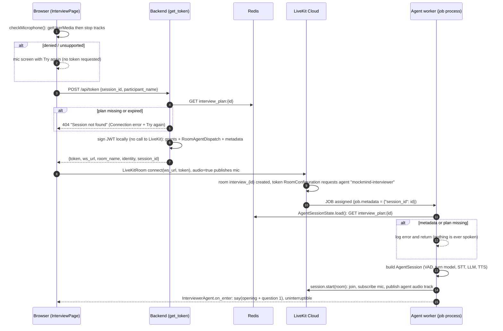
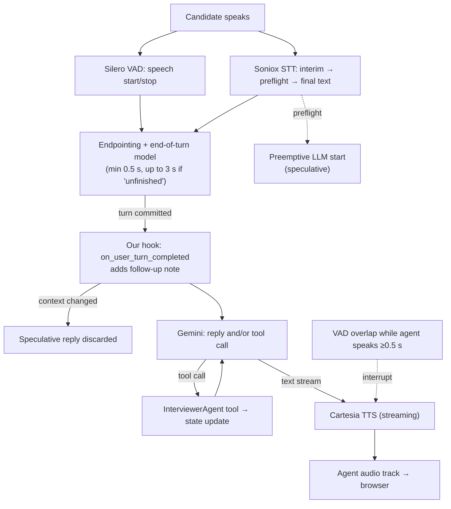
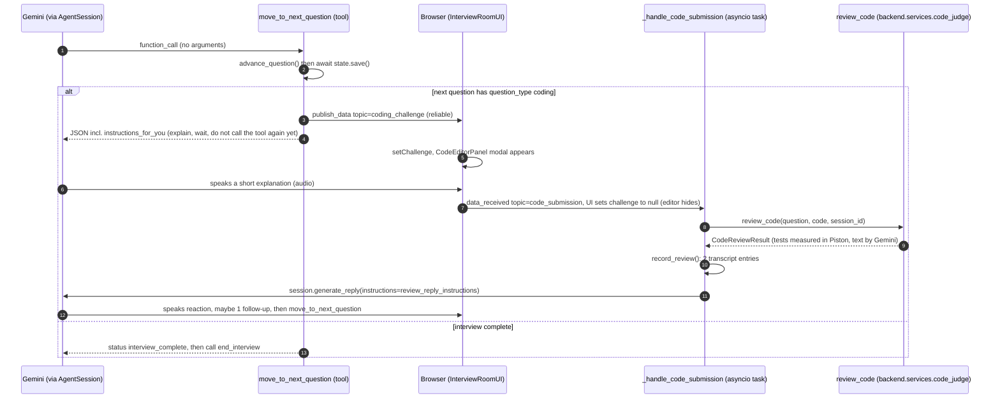

# 02c — Real-Time Voice and LiveKit

> **Scope:** WebRTC and SFUs, LiveKit (rooms, tokens, dispatch, workers/jobs, data channels), the STT → LLM → TTS pipeline, voice-activity detection, turn detection, interruptions, and latency.
> **Evidence sources:** `[Verified]` = this repo; `[Library source]` = the installed LiveKit Agents **1.8.4** (`mockmind/agent/.venv/lib/python3.12/site-packages/livekit/...`); `[Not measured]` = no latency measurement exists. Library defaults below may change in other versions.
> **Prerequisite:** [01 §1.11](01-fundamentals.md#111-audio-real-time-and-voice-fundamentals). Section 2c.0 below gives the minimum vocabulary if you have not read it.
> **Version caveat [Verified]:** `mockmind/agent/requirements.txt` pins `livekit-agents[soniox,google,cartesia,silero,turn-detector]~=1.5` (any 1.x from 1.5 up). The local venv has 1.8.4 (`livekit_agents-1.8.4.dist-info`), and every "library default" below was read from that version. The Docker image runs `pip install` at build time, so it resolves **whatever 1.x is newest on the build day**, which can differ from 1.8.4 **[Inference; the image was not built or inspected here]**. Treat numeric defaults as "true for 1.8.4".

---

## 2c.0 Minimum vocabulary (read this first if voice AI is new to you)

| Term | Plain meaning | Worked number |
|---|---|---|
| **Sample rate** | how many amplitude measurements per second represent the sound | speech STT here runs at 16 kHz = 16 000 numbers per second; Cartesia output is 24 kHz |
| **Frame** | a tiny slice of audio handed to a model at a time | Silero VAD scores slices of tens of milliseconds, so it makes dozens of decisions per second |
| **PCM** | raw, uncompressed samples (`pcm_s16le` = 16-bit signed little-endian) | 16 kHz x 2 bytes = 32 kB/s of raw mono speech, versus a few kB/s once Opus-compressed on the WebRTC leg |
| **Streaming** | processing audio/text while it is still arriving rather than after it ends | the transcript starts appearing while the candidate is still talking |
| **Latency** | delay between an event and its reaction | "end of candidate's last word" to "first sound of Alex" is the number users feel |
| **Barge-in** | the human talking over the AI | handled by VAD plus the interruption settings (2c.8) |
| **Endpointing** | deciding the speaker has *finished* | the core difficulty of voice agents: too early cuts people off, too late feels dead |

**Why a cascade at all?** A speech model cannot reason about an interview plan; an LLM cannot hear. So three specialists are chained: ears (STT), brain (LLM), mouth (TTS), with two small local models (VAD, end-of-turn) acting as the "social sense" that decides *when* to talk. Everything below is about wiring those five parts and what goes wrong at the seams.

---

## 2c.1 WebRTC, SFUs and LiveKit

### A. What is it?
**WebRTC** is the browser-native technology for real-time audio/video/data. **LiveKit** is a platform built on WebRTC consisting of: **LiveKit Cloud** (hosted media servers — an **SFU**, selective forwarding unit), client SDKs (`livekit-client`, `@livekit/components-react`), server SDKs (`livekit-api`), and the **Agents** framework (`livekit-agents`) for running AI participants.

### B. Why does it exist?
Real-time media across the internet is hard: NAT/firewall traversal (ICE/STUN/TURN), jitter and packet loss, codecs, encryption, scaling relays. Building this yourself is a large project; LiveKit provides it, plus an agent runtime that dispatches AI workers to rooms.

### C. How it works internally **[Standard knowledge]**
1. Peers exchange connection descriptions via **signalling** (LiveKit uses a WebSocket) — WebRTC itself doesn't define signalling.
2. **ICE** gathers candidate network paths; **STUN** reveals public addresses; **TURN** relays when direct paths fail.
3. Media flows as encrypted **RTP/SRTP** packets, usually over **UDP**. Speech uses the **Opus** codec.
4. An **SFU** receives each participant's streams and forwards them to others **without mixing** (unlike an MCU).
5. **Data channels** carry arbitrary small messages, optionally reliable and ordered.

| Responsibility split | |
|---|---|
| **LiveKit Cloud/SDKs do** | signalling, ICE, encryption, media forwarding, data channels, job dispatch |
| **Our code does** | mint tokens, define the agent, publish/consume data topics, handle UI states |

### D. LiveKit concepts mapped to this codebase **[Verified]**
| Concept | Meaning | Where |
|---|---|---|
| Project URL / key / secret | credentials for signing and registration | env `LIVEKIT_URL`, `LIVEKIT_API_KEY`, `LIVEKIT_API_SECRET` (`mockmind/.env.example`); the browser gets the URL from the token response (`ws_url`); `NEXT_PUBLIC_LIVEKIT_URL` is declared but not read by frontend source **[Verified by grep]** |
| Room | a session | `interview_{session_id}` (`mockmind/backend/routers/session.py` → `get_token()`) |
| Identity | participant id | `candidate_{session_id[:8]}` |
| Access token (JWT, HS256) | signed permissions | `AccessToken(...).to_jwt()` |
| Grants | permissions | `VideoGrants(room_join, room, can_publish, can_subscribe, can_publish_data)` |
| TTL | token validity | 2 hours (`.with_ttl(timedelta(hours=2))`) |
| Agent dispatch | request LiveKit to send an agent | `RoomConfiguration(agents=[RoomAgentDispatch(agent_name="mockmind-interviewer", metadata=...)])` |
| Worker | long-lived program registered under an agent name | `AgentServer()` + `@server.rtc_session(agent_name="mockmind-interviewer")` (`mockmind/agent/agent.py` L162–165) |
| Job | one room assignment | `entrypoint(ctx: JobContext)` L166 |
| Job metadata | string passed to the job | `{"session_id": ...}` read in `entrypoint()` |
| Data message + topic | small payloads | `coding_challenge` (agent→browser), `code_submission` (browser→agent) |

### E. The join sequence (actual implementation)

*Source: `session.py` L30–84 (decorator at L30, `get_token` L31); `agent.py` L166–274; browser flow in `mockmind/frontend/app/interview/[sessionId]/page.tsx` (`InterviewPage` L36–128).*

**Steps the diagram compresses, and what to know about them:**
- **Two microphone acquisitions.** `checkMicrophone()` (L25–34) opens the mic only to prove permission and immediately stops its tracks. `<LiveKitRoom audio={true}>` then opens it again to publish. The first call exists purely for a friendly error screen; it does not hand its stream to LiveKit **[Verified]**.
- **The backend never talks to LiveKit.** `AccessToken(...).to_jwt()` is local HMAC signing with `LIVEKIT_API_SECRET`; LiveKit Cloud validates the signature later when the browser connects **[Verified in `session.py`; HS256 signing is Standard knowledge]**.
- **Dispatch is triggered by the room being created with that token** (`RoomConfiguration.agents`). If the room already exists with another config, behaviour is a LiveKit-server matter that this repo does not test **[Not verified]**.
- **Race to be aware of:** the browser is connected and publishing audio *before* the agent exists. Nothing the candidate says in that window is heard; the agent's greeting is uninterruptible anyway (2c.8). UI shows "Connecting..." until `useVoiceAssistant()` reports `listening/thinking/speaking`.
- **Token TTL is 2 h but the plan TTL is 4 h** (`interview_plan` is `SETEX` 14400 s). A candidate who opens the page 3 h after preparing still gets a token; one who waits over 4 h gets a 404 **[Verified]**.

### F. Alternatives
Raw WebRTC + own signalling/TURN/SFU; Twilio/Daily/Agora (similar platforms); plain WebSocket audio streaming (no NAT traversal, jitter handling); speech-to-speech provider APIs.

### G. Trade-offs
+ Offloads hard real-time infrastructure; open-source core and agent framework. − Third-party processor of audio (privacy), vendor dependence, token endpoint is unauthenticated here **[Verified]**, Cloud pricing **[Not verified here]**.

### H. Interview connection
"How does the agent get into the right room?" "Why can't the browser forge the token?" "What's the difference between a worker and a job?" "What happens when the candidate disconnects?" (below).

---

## 2c.2 Agent worker, jobs and the process model

### C. How it works **[Library source]**
- The `AgentServer` registers with LiveKit using the API key/secret from the environment and advertises its `agent_name`.
- On dispatch, LiveKit assigns a **job**; the worker runs it in a **separate OS process** by default (`JobExecutorType.PROCESS` on non-Windows, `livekit/agents/worker.py`).
- Production-mode defaults (`start`): `num_idle_processes = min(CPU count, 4)` warm processes, `load_threshold = 0.7`, `initialize_process_timeout = 10 s`, `shutdown_process_timeout = 10 s`, `session_end_timeout = 300 s`, drain timeout 1 h. In `dev` mode: no idle processes, unlimited load threshold.
- Because the dispatch names the agent, dispatch is **explicit** (only rooms that request the name get it).
- Session close: `RoomOptions.close_on_disconnect` defaults to `True` → when the participant leaves, the session closes and shutdown callbacks run.

### D. Used here
`mockmind/agent/agent.py` → `entrypoint()` (L166–274) builds an `AgentSession` and calls `session.start(room=ctx.room, agent=InterviewerAgent(state=state), room_options=room_io.RoomOptions(delete_room_on_close=True))` (L266–272). `delete_room_on_close=True` overrides the library default (`False`, `voice/room_io/types.py`) so the LiveKit room is deleted when the session closes.

**What `entrypoint()` does, in order [Verified]** (so you can predict logs and failure points):
1. log `Agent joining room: ...`; parse `ctx.job.metadata` JSON for `session_id` (L174-183). Missing or invalid -> log error and `return` (no exception, no speech).
2. `AgentSessionState.load(session_id)` (L189) reads `interview_plan:{id}` from Redis; `ValueError` if absent -> log and `return` (L195-197). Any *other* exception (for example Redis unreachable, or invalid plan JSON failing Pydantic validation) is **not** caught here and propagates to the framework **[Verified by reading; consequence in the framework not exercised]**.
3. construct `AgentSession(...)` (L200-220), including `silero.VAD.load()` and `_load_turn_detector()`.
4. register three event handlers: `user_input_transcribed`, `conversation_item_added`, and the room's `data_received` (L223-248).
5. register shutdown callbacks (report if `ended_at` unset; flush OpenTelemetry spans) (L251-263).
6. `await session.start(...)` (L266). Inside, the library connects to the room and calls `InterviewerAgent.on_enter()`, which speaks the opening. The Docker command is `python agent/agent.py start` (`mockmind/agent/Dockerfile`). **No `prewarm_fnc`, no `on_session_end`, no custom `ServerOptions`** **[Verified by grep]**.

### G. Consequences and risks
- Module-level state is per job process (e.g. `_trace_provider` in `agent.py` L116).
- `silero.VAD.load()` runs per job inside `entrypoint()` (L215). **[Library source]** its docstring says loading is blocking and recommends a prewarm function.
- **[Hypothesis / unverified]** report generation inside a shutdown callback (`agent.py` L251–257) or a fire-and-forget task (`interviewer.py` L149) may be cut off if the job process is torn down within the supervisor's shutdown deadline; the library provides `on_session_end` (300 s budget) for post-session work. Not tested in a live session. See [07](07-engineering-challenges.md) §7.4.

---

## 2c.3 The voice pipeline: STT → LLM → TTS

### A. What is it?
A **cascaded** pipeline: speech-to-text, then an LLM, then text-to-speech, orchestrated by `AgentSession`.

### B. Why this design?
Transcripts are first-class (needed for reports, retries, evals, tracing); tools are mature; vendors are swappable. The alternative, **speech-to-speech**, lowers latency but gives less text-level control. **[Inference]** from the code's dependence on transcripts (`session_state.py`, `report_generator.py`); the original spec explicitly describes the "half-cascade architecture" rationale (`MOCK_INTERVIEW_PLATFORM.md` §13 Note 1: text-only Gemini + Cartesia for voice quality and control). **[Verified: explicit rationale in the spec]**

### C. Component settings and defaults
```python
session = AgentSession(
    stt=soniox.STT(params=soniox.STTOptions(model="stt-rt-v4", language_hints=["en"])),
    llm=google.LLM(model="gemini-2.5-flash", temperature=0.7),
    tts=cartesia.TTS(model="sonic-3", voice="<voice id>"),
    vad=silero.VAD.load(),
    turn_handling=TurnHandlingOptions(turn_detection=_load_turn_detector()),
    userdata=state,
)
```
*Source: `mockmind/agent/agent.py` L200–220. `userdata=state` is how tools reach our `AgentSessionState` (`context.userdata` in `interviewer.py`).*

| Component | Our setting | Library defaults/behaviour **[Library source]** |
|---|---|---|
| STT (Soniox) | `stt-rt-v4`, `language_hints=["en"]` | library default model `stt-rt-v5`; 16 kHz mono; language identification on; `max_endpoint_delay_ms` 2000; emits interim, preflight and final transcripts |
| LLM | Gemini 2.5 Flash, temp 0.7 | streaming + tool calling via plugin |
| TTS (Cartesia) | `sonic-3`, fixed voice id | `pcm_s16le`, 24 kHz, `word_timestamps=True`, streaming-capable |
| VAD (Silero) | `VAD.load()` defaults | `min_speech_duration` 0.05 s, `min_silence_duration` **0.55 s**, `prefix_padding_duration` 0.5 s, `activation_threshold` 0.5, 16 kHz, CPU |
| Turn detection | `MultilingualModel()` if loadable else `None` | `None` → auto-select; with VAD present and no realtime LLM → **VAD mode** |
| Endpointing | unset | fixed, `min_delay` 0.5 s, `max_delay` 3.0 s |
| Interruptions | unset | enabled; `min_duration` 0.5 s; `false_interruption_timeout` 2.0 s; `resume_false_interruption` true |
| Preemptive generation | unset | **enabled**; LLM-only; ≤ 10 s speech; ≤ 3 attempts |
| Tool loop | unset | `max_tool_steps=3`: at most 3 consecutive tool calls per LLM turn (`voice/agent_session.py` L402). Our flow needs 1 (`move_to_next_question`), so the cap is not normally hit **[Library source]** |

### Flow of one audio turn


---

## 2c.4 Voice-activity detection (VAD)

**What:** a small neural network (Silero, ONNX) that scores short audio frames for speech probability; runs locally on CPU. **Why:** fast voice-onset/offset detection and barge-in.
**How [Library source]:** a frame counts as speech above `activation_threshold`; speech must last `min_speech_duration` to start; silence must last `min_silence_duration` (0.55 s) to end; `prefix_padding_duration` (0.5 s) of audio before the detected start is kept so the first syllable isn't clipped.
**Limit:** VAD cannot tell a thinking pause from a finished answer — hence turn detection.
**Used here:** `silero.VAD.load()` at `agent.py` L215.

---

## 2c.5 Speech-to-text (STT)

**What/why:** converts audio to text; streaming so text appears while the person speaks.
**How [Library source]:** the plugin streams audio over a persistent connection; results are **interim** (changing guesses), **preflight** (near-final, used for early LLM start) and **final** (settled).
**Used here:** only **final** results are recorded: `@session.on("user_input_transcribed")` → `state.add_transcript_entry("candidate", event.transcript)` when `is_final` (`agent.py` L223–228). A long answer can arrive as **several final segments → several transcript entries**, whereas a *turn* (counted by the follow-up hook) is the whole answer. **[Verified]**
**Limits:** domain jargon may be misheard; Soniox `context` terms are available but unused **[Verified by grep]**.
**Where the interviewer's side of the transcript comes from [Verified]:** two sources, deduplicated by a string compare.
1. `on_enter()` records `"{opening_message} {first question}"` **before** speaking it (`interviewer.py` L53-68).
2. `@session.on("conversation_item_added")` (`agent.py` L230-241) records every assistant message with non-empty text, but skips it if it equals the last transcript entry from the interviewer (so the opening line is not stored twice).
Consequences **[Inference from code, not observed]**: the opening is recorded even if audio never played; text that the TTS was interrupted halfway through may still be stored in full, because the entry is the LLM's text, not what was heard; tool calls and tool results are never in the transcript, only spoken text.
Each entry is `{speaker, text, timestamp, question_index}` (`session_state.py` L69-76); code submissions add `speaker="candidate"` `[Submitted code]` entries and `speaker="system"` review entries (`code_review_flow.py`).

---

## 2c.6 Turn detection and endpointing

**Problem:** when has the speaker finished? Silence alone is wrong in both directions.
**Modes [Library source]:** `"vad"`, `"stt"`, `"realtime_llm"`, `"manual"`, or a detector object. Auto-selection with `None`: realtime LLM → VAD → STT → manual. MockMind's configuration yields **VAD mode** (optionally with the end-of-turn model).
**The end-of-turn (EOU) model [Library source]:** `MultilingualModel` reads recent conversation text and predicts the probability that the turn is complete; below a per-language "unlikely" threshold the wait extends to `max_delay`.
**The algorithm (`audio_recognition.py` → `_run_eou_detection`, simplified):**
```text
on VAD end-of-speech (or STT end): endpointing_delay = min_delay (0.5 s)
if EOU model available and transcript exists:
    p = P(turn complete);  if p < unlikely_threshold: endpointing_delay = max_delay (3.0 s)
extra_sleep = endpointing_delay − (now − last_speaking_time)      # measured from the LAST speech, not from VAD's announcement
if extra_sleep > 0: wait (cancel if speech resumes)  else: commit immediately
```
**Consequence [Library source reasoning]:** VAD's own 0.55 s silence timer already exceeds `min_delay` (0.5 s), so in the normal case the turn commits right after VAD ends; the wait lengthens (to ~3 s after the last word) only when the EOU model predicts "unfinished".
**Which endpointing defaults apply to us [Library source]:** the library has two default sets: `min_delay 0.5 / max_delay 3.0` ("legacy") and a tighter `0.3 / 2.5` used only when the turn detector is a *streaming* detector (`voice/turn.py` L136-146, selection at L300-315). `MultilingualModel` exposes `predict_end_of_turn` but no `stream()` method, so it is **not** a streaming detector and the 0.5/3.0 pair applies. If the detector is `None` the same 0.5/3.0 pair applies.
**Language support [Library source]:** before predicting, the loop calls `supports_language(self._last_language)`; for an unsupported language the model is skipped and only `min_delay` governs (`audio_recognition.py`, `_run_eou_detection`). Our STT hint is English only.
**Worked example (illustrative arithmetic from the defaults above; not a measurement).** Let `t = 0` be the instant the candidate's last syllable ends.
| Case | What the pipeline sees | When the turn commits |
|---|---|---|
| A. Clear ending ("...so latency dropped forty percent.") with the end-of-turn model loaded | VAD declares end of speech at about `t = 0.55 s` (its `min_silence_duration`). `endpointing_delay = 0.5`; time already elapsed since last speech is 0.55 s, so `extra_sleep <= 0` | about `t = 0.55 s` |
| B. Trailing filler ("...and then, um,") with the model loaded and `P(complete) < threshold` | `endpointing_delay` is raised to `max_delay = 3.0`; `extra_sleep = 3.0 - 0.55 = 2.45 s` | about `t = 3.0 s`, unless speech resumes first (which cancels the wait) |
| C. Same filler, model **not** loaded (fallback / Docker case above) | no prediction, delay stays `min_delay` | about `t = 0.55 s`, so Alex may cut in on a mid-thought pause |
Add STT finalization, the hook, LLM first token and TTS first audio on top (2c.12) to get the delay the candidate experiences.

**Fallback in our code [Verified]:** `_load_turn_detector()` (`agent.py` L119–127) catches any failure to construct `MultilingualModel()` and returns `None` with a warning (observed log: *"Turn detector model not available … Falling back to Silero VAD only. Run `python agent/agent.py download-files`"*). **Why it fails when files are missing [Library source]:** `EOUModelBase.__init__` loads `languages.json` with `local_files_only=True` (`plugins/turn_detector/base.py`), i.e. it never downloads at start-up, and raises `RuntimeError` if the Hugging Face cache lacks the file.
**Docker implication [Inference]:** `mockmind/agent/Dockerfile` never runs `download-files` (verified: it only runs `pip install` and copies the code), and `docker-compose.yml` mounts only `.:/app`, not a Hugging Face cache. So unless the model was fetched some other way, the containerised agent most likely runs in the **VAD-only fallback**, with no end-of-turn model, so a "thinking pause" longer than about 0.55 s can be treated as a finished answer. Check the agent container log for the fallback warning to confirm; **not checked here**. **Deprecation [Measured]:** running `agent.py --help` prints `DeprecationWarning: livekit.plugins.turn_detector is deprecated ... Use livekit.agents.inference.TurnDetector instead`.

---

## 2c.7 The hook and its interaction with preemptive generation

`InterviewerAgent.on_user_turn_completed()` (`mockmind/agent/interviewer.py` L70–79) calls `follow_up_policy_note(self._state)` and appends the result as a system message to the *temporary* context.
**[Library source]:** after the hook returns, the framework compares the speculative (preemptive) request's chat context with the edited context (`ChatContext.is_equivalent`, which compares item count and content). Adding a system message makes them **non-equivalent**, so the speculative reply is **discarded** and a fresh generation starts; the library logs *"preemptive generation invalidated after `on_user_turn_completed`…"*. Also: an exception inside the hook is logged and the turn is **ignored**.
The comparison is wider than the chat context: the preemptive reply is kept only if the **transcript text, chat context, tool list and tool_choice** are all unchanged (`voice/agent_activity.py` L2850-2880). The hook raising `StopResponse` also ends the turn silently (a library feature we do not use).
**Implication [Inference]:** deterministic follow-up counting costs the preemptive-generation head start (extra tokens, some latency). **[Not measured]**.
**What the hook does *not* cover [Verified]:** on a coding question `follow_up_policy_note()` returns `None` (no counting, no note), so for those turns the preemptive reply is *not* invalidated by our code. Spoken turns during a coding question are ordinary conversation; the interviewer is steered only by the tool result's `instructions_for_you` text (see 2c.10).
**Worked example (follow-up cap, from `session_state.py`):** Question 3 asked. Turn 1 (the answer): `candidate_turns=1`, `follow_ups=max(0,1-1)=0` -> note `Follow-ups used on this question: 0/2.` Alex asks a follow-up. Turn 2: `turns=2`, `follow_ups=1` -> `1/2`. Alex asks a second follow-up. Turn 3: `turns=3`, `follow_ups=2` -> cap reached -> note says do NOT ask another, call `move_to_next_question`. That tool calls `advance_question()`, which zeroes both counters.

---

## 2c.8 Interruptions (barge-in)

**[Library source defaults]:** when VAD (and transcript) indicate the user speaks while the agent speaks for ≥ 0.5 s, the agent's speech is cancelled; if the user stays silent for 2 s afterwards, the interruption is deemed false and the agent **resumes**. The opening greeting is spoken with `allow_interruptions=False` (`interviewer.py` L65). While an utterance is uninterruptible, buffered user audio is discarded by default (`discard_audio_if_uninterruptible=True`), so speech during the greeting may be lost.
**Worked example:** Alex is asking Q4 (a 12-second question). At second 5 the candidate says "sorry, can you repeat that?". VAD hears speech for >= 0.5 s -> Alex's audio is cut. If the candidate then stays silent for 2 s the library judges it a false interruption (a cough, not a turn) and **resumes** speaking. If the candidate does speak, STT yields a final transcript, the turn is committed, the hook runs, and Gemini answers the "repeat" request (the prompt allows it: "If asked to repeat a question, do so without complaint").
**Two-sided effect [Inference]:** because the *whole* opening (greeting plus question 1) is uninterruptible, a candidate who starts answering immediately is ignored for the length of that opening; that audio is discarded, not queued.

---

## 2c.9 Text-to-speech and audio output

Cartesia's plugin is streaming: text from the LLM stream is fed in as it arrives and audio chunks return as soon as possible, so the first words can play before the reply is fully written. The agent publishes the audio as a LiveKit track; the browser's `<RoomAudioRenderer />` (rendered inside `<LiveKitRoom>`, page L124) plays it. Without it the agent would be connected and "speaking" (the orb animates) but nothing would be audible, because LiveKit does not attach remote audio to speakers by itself.
**Voice choice [Verified]:** a fixed Cartesia voice id (`agent.py` L213, commented as "Barbershop Man"); there is no per-candidate voice option and no fallback voice if Cartesia rejects it. **Speaking is text-driven [Inference]:** what Alex *says* is whatever text Gemini streams; Cartesia does not know about interview state.

---

## 2c.10 Data channels and the live-coding loop

**First principles.** The audio track is a one-way stream of sound. Anything structured (a problem statement, source code) needs a different path: a **data message**, a small payload sent over the same WebRTC connection and tagged with a **topic** string so each side can filter. Messages are bytes; this app sends UTF-8 JSON.

| Topic | Direction | Sender code | Receiver code | Payload |
|---|---|---|---|---|
| `coding_challenge` | agent -> browser | `interviewer.py` -> `_publish_coding_challenge()` (L20-41) `ctx.room.local_participant.publish_data(payload, reliable=True, topic=...)` | `useDataChannel('coding_challenge', ...)` (`interview/[sessionId]/page.tsx` L326-335) | `{type:"show_editor", question_id, language, problem_statement, starter_code}` |
| `code_submission` | browser -> agent | `useDataChannel('code_submission')` -> `send(bytes, {reliable:true})` (L337, L343) | `@ctx.room.on("data_received")` (`agent.py` L245-248) -> `_handle_code_submission` (L130-159) | `{question_id, code}` |

**There are no acknowledgements or app-level retries [Verified].** `reliable=True` asks the transport for ordered, retransmitted delivery; it does not tell the sender the other side *processed* the message. The test-case expected outputs are never sent to the browser (`CodingChallenge` has no test fields) **[Verified]**.

### The full coding loop, step by step


**Details a reader tends to miss [Verified unless marked]:**
- The editor is published **by Python in the tool**, not by the LLM, so the editor cannot be forgotten (the code comments cite the follow-up-cap lesson, `interviewer.py` L20-27).
- `_handle_code_submission` runs as a **separate task** (`asyncio.create_task`, `agent.py` L248), so a slow Piston/Gemini review does not block the audio pipeline. Review time is `N` sequential test runs (each its own HTTP session, 30 s total timeout, 3 s `run_timeout`) plus one Gemini call; **[Not measured]**.
- While the review runs the agent is not generating, so the library's agent state is most likely `listening`, not `thinking` **[Inference from the library state model; not observed]**. The UI comment (`interview/[sessionId]/page.tsx` L344-346) says the orb's "thinking" state covers the review time; that looks inaccurate, and the candidate probably sees "Your turn to speak" while waiting. Worth checking in a live run.
- **Resubmission gap:** `REVIEW_FAILED_INSTRUCTIONS` tells Alex to "ask them to resubmit", but the editor is hidden on submit (`setChallenge(null)`, L347) and `show_editor` is only ever published from `move_to_next_question`. After a failed review there is no editor to resubmit from **[Verified by reading both sides]**.
- Submissions are trusted by `question_id` only: the handler accepts a submission for *any* coding question id in the plan, not just the current one, and does not check which participant sent it (`packet.participant` is unused) **[Verified]**. Only the candidate holds a token with publish rights in normal use, so this matters only if tokens leak.
- A replayed or duplicated message would be reviewed again (the panel unmounting prevents a double click, not a replay).
- Payload size: LiveKit documents a practical size ceiling for reliable data messages (on the order of 15 KiB per message) **[Standard knowledge; not verified against the installed SDK]**. A very large code submission or starter code could exceed it; no size check exists in this repo.
- On a coding question the follow-up counter is bypassed (2c.7); the review reply instructions say "ask at most one follow-up ... then call move_to_next_question", so the one-follow-up rule here is **prompt-only**.
- `generate_reply(instructions=...)` is called from outside a user turn. If Alex is mid-sentence when the review finishes, how the library orders the two utterances was not examined here **[Not verified]**.

## 2c.11 Agent and user states, and the UI

**[Library source]** `AgentState` is `initializing | idle | listening | thinking | speaking`; `UserState` is `speaking | listening | away` (`voice/events.py` L309-310). The browser reads the agent state with `useVoiceAssistant()` (`@livekit/components-react`).

| Library agent state | Orb state in `InterviewRoomUI` (L352-357) | Label / colour | Notes |
|---|---|---|---|
| `speaking` | `speaking` | "Alex is speaking" (blue, fast pulse 0.9 s) | |
| `listening` | `listening` | "Your turn to speak" (green, mic icon) | also what the candidate probably sees during a code review (2c.10) |
| `thinking` | `thinking` | "Processing..." (amber, rotation + shimmer) | LLM/tool time |
| `initializing`, `idle`, no agent yet | `disconnected` | "Connecting..." (grey, no animation) | starts the 25 s timer |

**Timer [Verified]:** `useEffect` on `orbState` (L363-370) starts `setTimeout(..., 25_000)` whenever the orb is `disconnected` and clears it when the state changes, so the overlay "The interviewer is taking too long to join" appears only if the agent never leaves `initializing/idle` for 25 s. **[Inference]** A mid-interview `idle` lasting 25 s would also trigger it (the label would then be misleading); not observed.
**Other UI states on this page [Verified]:** mic `checking` ("Checking your microphone..."), mic `denied`/`unsupported` screen, token error screen ("Connection error" + Try again, which re-runs the effect through `attempt`), "Connecting to interview room..." while the token loads, `connectionLost` overlay (requires `wasConnected`, not `isEnded`, and `ConnectionState.Disconnected`), the ended overlay ("Interview Complete!"), and the coding modal. The `LiveKitRoom` has no `onDisconnected`/`onError` handler, so network errors surface only through `useConnectionState`.
**Unused hook [Verified by grep]:** `hooks/useInterviewSession.ts` maps states differently (any non-speaking/thinking state, including `idle`, becomes `'listening'`, and a non-connected room becomes `'disconnected'`). The page uses `useVoiceAssistant()` and `useConnectionState()` directly instead, so the two mappings disagree; only the page's mapping affects users.

---

## 2c.12 Latency (reasoning only — nothing here is measured)

Contributors **[Standard knowledge + Library defaults]**: silence wait (about 0.55 s normally; up to ~3 s after the last word if "unfinished"), STT finalization, our hook (microseconds; it is a counter), LLM time-to-first-token (plus a **second** LLM call after a tool call such as `move_to_next_question`), TTS time-to-first-audio, network. **No latency measurement, metric or SLO exists in the repo** **[Verified]**; the library emits `metrics_collected` events and records an `on_user_turn_completed_delay` metric (`agent_activity.py` L2830-2831), but our code does not consume them; spans do flow to Langfuse if configured (2c.16). To measure: log end-of-speech -> first-audio per turn and chart p50/p95 in Langfuse/OTel. See [08](08-performance-reliability-and-scaling.md) §8.2 and exercise 3.6 in [12](12-practical-exercises.md).

**Illustrative budget (placeholder numbers to show the *shape*, not measurements):** silence 0.55 s + STT finalize 0.2 s + LLM first token 0.6 s + TTS first audio 0.3 s = about 1.65 s for an ordinary reply. A turn that needs a tool call adds one more LLM round trip, so about 2.3 s; a turn where our hook invalidates the preemptive reply cannot use the head start that speculation would have given. The point is the structure: **every stage serialises**, which is why preemptive generation and streaming TTS exist.

---

## 2c.13 Failure modes by stage

| Stage | Symptom | Cause | Handling in code | Source |
|---|---|---|---|---|
| No agent joins | UI stuck "Connecting..." | worker down / plan missing / bad keys / agent crashed in `load()` with a non-`ValueError` | 25 s overlay + Reconnect | `interview/[sessionId]/page.tsx` effect L363-370 |
| Missing plan / metadata | agent exits silently | expired/absent `interview_plan:{id}` or no `session_id` | logs error, returns | `agent.py` L174-197 |
| Turn-detector model absent | cruder turn-taking | model files not downloaded (likely in Docker, 2c.6) | fallback to VAD | `agent.py` L119-127 |
| Mic blocked | can't join | browser permission | pre-flight screen | `checkMicrophone()` |
| Participant disconnects | session closes | network/tab close | shutdown callback -> report; UI "Connection lost" | `agent.py` L251-257 |
| Hook exception | turn ignored | bug | (none) | **[Library source]** |
| Silent turn | agent says nothing after tool call | unknown | none; measured by evals | [07](07-engineering-challenges.md) §7.6 |
| Bad code packet | nothing happens | malformed JSON / missing keys | `logger.exception`, return | `agent.py` L136-142 |
| Unknown coding `question_id` | nothing happens | stale or forged id | warning, return | `agent.py` L144-147 |
| Piston/Gemini review failure | Alex apologises | `review_code` raised | `REVIEW_FAILED_INSTRUCTIONS`; no way to resubmit (2c.10) | `agent.py` L150-156 |
| `publish_data` fails | editor never appears | transport error | logged only; tool still returns `instructions_for_you` saying the editor is already shown | `interviewer.py` L36-41 |
| Opening line fails | silence at start | TTS/LLM error in `say()` | `logger.exception`; session continues without a greeting | `interviewer.py` L66-68 |
| Redis down at autosave | transcript not persisted | Redis error | `logger.exception`, retried only on the next transcript entry | `session_state.py` L105-110 |

## 2c.14 Debugging the voice path (verified commands)
```bash
docker compose ps                       # is the agent container running?
docker compose logs -f agent            # worker registration, job assignment, warnings
agent/.venv/bin/python agent/agent.py download-files   # fetch turn-detector model files (not run here: needs network)
agent/.venv/bin/python agent/agent.py console          # talk to the agent in a terminal (needs real API keys; not run here)
```
`agent.py --help` was run and verified (see [14](14-coverage-report-and-open-questions.md)).

---

## 2c.15 Agent-side observability and shutdown [Verified]
- `_setup_otel_tracing()` (`agent.py` L73-113) runs at **import time** (L116). If `LANGFUSE_HOST`, `LANGFUSE_PUBLIC_KEY` and `LANGFUSE_SECRET_KEY` are all set it builds an OpenTelemetry `TracerProvider` with a batch OTLP/HTTP exporter pointed at `{host}/api/public/otel` using HTTP Basic auth built from the two keys (the values are secrets and are not recorded in these docs), and registers it through the library's `set_tracer_provider`. Otherwise it logs "Langfuse not configured" and returns `None`.
- `SessionSpanProcessor.on_start` stamps every span with `session.id` read from job metadata (`_get_context_session_id`, L59-70) so agent spans and backend generations share one id in Langfuse.
- **Shutdown callbacks run concurrently, not in order [Library source]:** `job_proc_lazy_main.py` (L~495-503) wraps each registered callback in a task and awaits them with `asyncio.gather`. So our `flush_trace` (a synchronous `force_flush`) and the report-generating callback start together; spans created by the report's LLM call (made *after* the flush returns) may miss the flush. The library's own comment in that file says "a hung callback here is why jobs hit the supervisor's shutdown deadline", and the default `shutdown_process_timeout` is 10 s (`worker.py` L212) while the report UI text promises "15-30 seconds" **[Inference: report generation can plausibly outlast the deadline; not tested live]**. This is the evidence behind the hypothesis in 2c.2.

---

## 2c.16 Interview connection
- Draw the pipeline and say which stages run locally (VAD, turn model, our code) vs remotely (STT, LLM, TTS, LiveKit).
- Explain endpointing precisely (0.5 s / 3 s; measured from last speech).
- Explain the hook ↔ preemptive-generation interaction and its cost.
- Explain explicit dispatch via the token and process-per-job.
- Explain why report generation at teardown is a risk and how you'd fix it.
