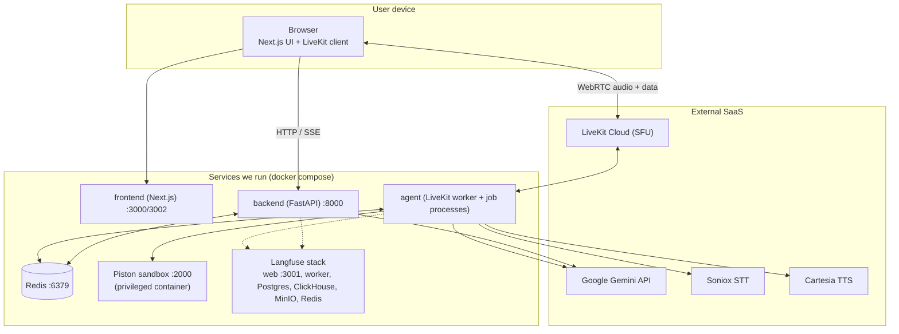
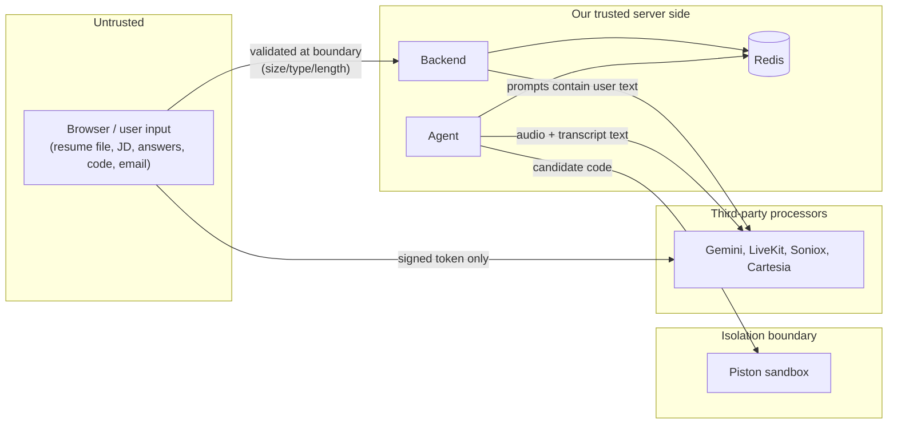
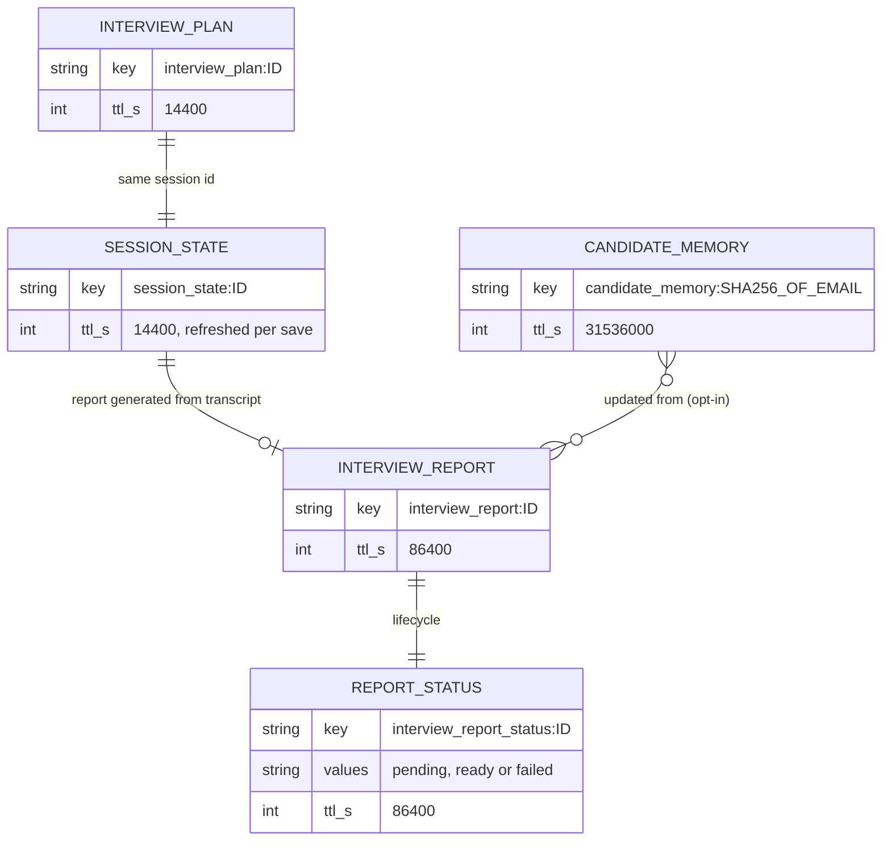
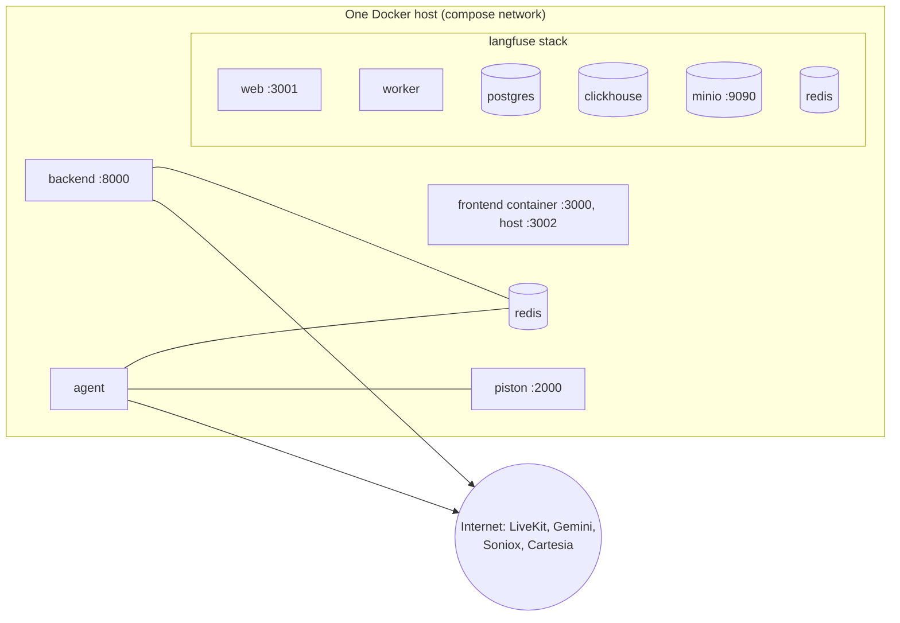
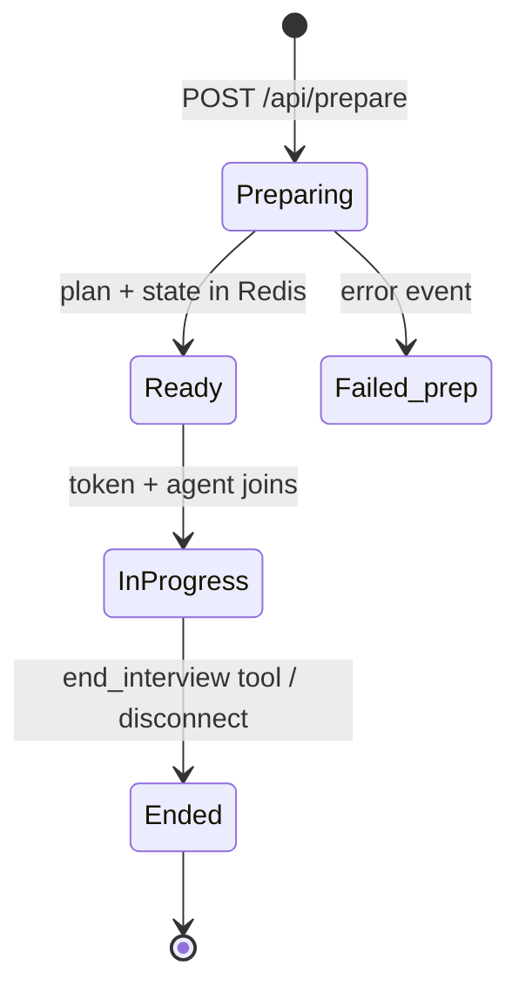
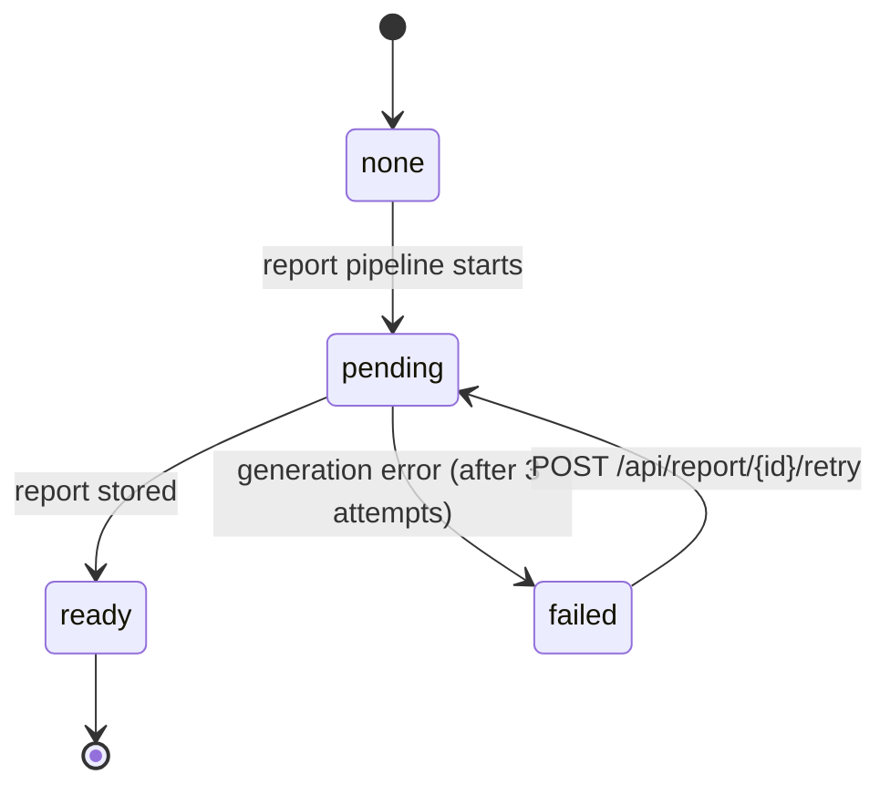
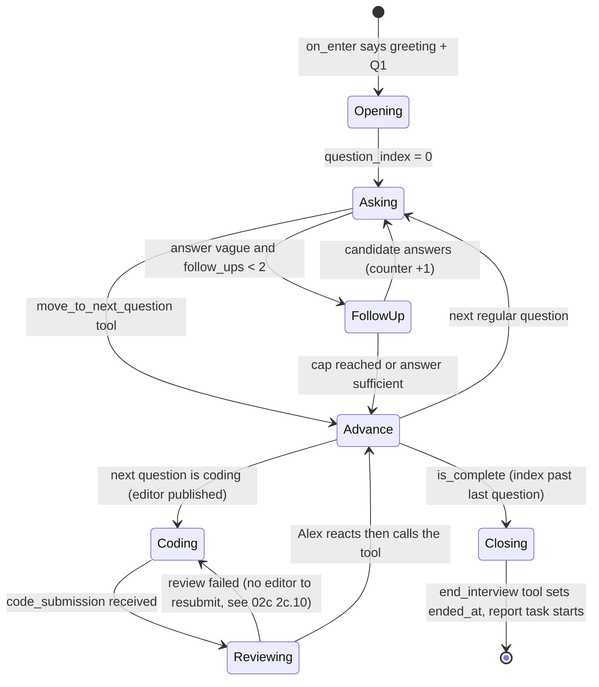
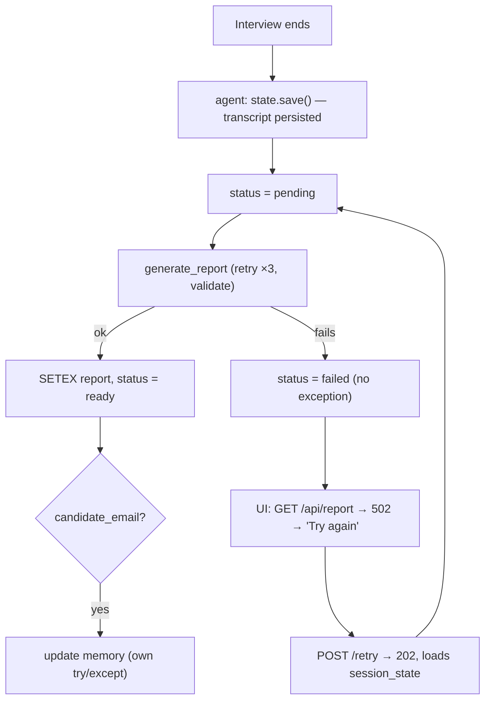

# 03 — System Architecture

> **Everything here reflects the code as it exists** (verified by reading it and, where noted, by running commands). Relationships that are inferred rather than verified are labelled. Diagrams are Mermaid; if your viewer doesn't render them, the surrounding text states the same facts.
> **Prerequisites:** [00](00-learning-roadmap.md), [02a–02e](02-technology-deep-dives.md). If "SFU", "worker/job" or "data channel" are unfamiliar, read [02c §2c.0 and §2c.1](02c-real-time-voice-and-livekit.md#2c0-minimum-vocabulary-read-this-first-if-voice-ai-is-new-to-you) first.
> **How to read this chapter:** 3.1-3.3 answer "what talks to what", 3.4-3.5 "what is trusted and where data lives", 3.6-3.9 "how it runs and changes state", 3.10 is a per-component checklist. Evidence labels: `[Verified]` read in this repo; `[Library source]` read in installed packages; `[Inference]` reasoned, not executed; `[Measured]` command actually run during this documentation pass.

---

## 3.1 Architecture at a glance

**Reading it:** solid arrows are request paths verified in code; dotted arrows are optional tracing paths (only if Langfuse keys are configured). Piston is called **only from the agent process** (`agent/agent.py` → `_handle_code_submission()` imports `backend.services.code_judge.review_code`) and from the eval harness; **[Verified by grep]** no backend router or backend-process code calls `review_code`/`execute_code`, even though that code lives in `backend/services/`.
**Three things the picture hides [Verified]:**
1. **The backend never calls LiveKit.** `get_token()` signs a JWT locally with the API secret; LiveKit validates it when the browser connects. That is why there is no `BE --> LK` arrow.
2. **The agent has no inbound port.** `docker-compose.yml` publishes no ports for `agent`; the worker opens an outbound WebSocket to LiveKit and *receives jobs over that connection* ([Standard knowledge] for the protocol; the absence of `ports:` is verified). So you cannot "curl the agent" to see whether it is alive: check its logs.
3. **"Agent imports backend" is a code dependency, not a network hop.** The agent process loads `backend.models`, `backend.services.report_pipeline` and `backend.services.code_judge` as Python modules (`agent/agent.py` L22 adds `mockmind/` to `sys.path`), which is why both Docker images install overlapping requirements.

---

## 3.2 Components and responsibilities

| Component | Responsibility | Language/runtime | Location |
|---|---|---|---|
| **Frontend** | UI, microphone permission, SSE progress, LiveKit room UI, code editor, report page | TypeScript / Next.js 14 | `mockmind/frontend/` |
| **Backend API** | validate uploads; run preparation (3 LLM steps); store plan; mint LiveKit tokens; serve/retry reports; delete memory | Python / FastAPI | `mockmind/backend/` |
| **Voice agent** | run the live interview: speech I/O, tools, transcript, coding flow, report trigger | Python / LiveKit Agents | `mockmind/agent/` |
| **Shared library** | models, report pipeline, memory logic, code review (imported by both processes) | Python package `backend` | `mockmind/backend/{models,services}/` |
| **Redis** | short-lived shared state and candidate memory | Redis 7 | container |
| **Piston** | sandboxed code execution (called by the agent process) | external image | container |
| **Langfuse** | LLM tracing/scoring | external images | containers |
| **Eval harness** | simulated interviews, judge, checks, optimizer | Python | `mockmind/evals/` |
| **LiveKit Cloud, Gemini, Soniox, Cartesia** | transport, LLM, STT, TTS | SaaS | external |

---

## 3.3 Communication paths

| From → To | Protocol | Purpose | Source |
|---|---|---|---|
| Browser → Backend | HTTP (multipart, JSON), **SSE** response | prepare, token, report, memory delete | `routers/*.py`, `hooks/usePreparation.ts`, `lib/api.ts` |
| Browser ↔ LiveKit Cloud | WebSocket signalling + WebRTC (UDP/Opus) + data channel | live audio, data messages | `@livekit/components-react` |
| LiveKit Cloud ↔ Agent worker | WebSocket (registration/dispatch) + WebRTC | job assignment, audio | `AgentServer` |
| Backend ↔ Redis | Redis protocol (async) | plan/state/report/memory | `redis_client.py` |
| Agent ↔ Redis | Redis protocol | load plan, save transcript, report pipeline | `session_state.py`, `report_pipeline.py` (via shared client) |
| Backend/Agent → Gemini | HTTPS | LLM calls | `google-genai`, `livekit-plugins-google` |
| Agent → Soniox / Cartesia | streaming network connections | STT / TTS | plugins |
| Agent → Piston | HTTP (`aiohttp`) | run code (backend process never calls it) | `code_executor.py` via `code_judge.review_code()` |
| Backend/Agent → Langfuse | HTTPS (SDK) / OTLP-over-HTTP | traces | `tracing.py`, `agent.py` |
| Browser → Agent (via LiveKit) | WebRTC data channel, topic `code_submission` | candidate's code | `useDataChannel('code_submission')`, `agent.py` L245-248 |
| Agent → Browser (via LiveKit) | WebRTC data channel, topic `coding_challenge` | show the editor | `interviewer.py` L20-41 |
**Details:** topic names and payloads are specified in [02c §2c.10](02c-real-time-voice-and-livekit.md#2c10-data-channels-and-the-live-coding-loop). Inside the compose network service names resolve as hosts (`redis`, `piston`, `langfuse-web`) through the `REDIS_URL`, `PISTON_URL`, `LANGFUSE_HOST` variables set in `docker-compose.yml`; from the **host browser** the backend is `http://localhost:8000` (baked into the frontend image as a build arg).
**The backend and agent never call each other [Verified]:** no HTTP client in `agent/` targets the backend, and `backend/` contains no code that contacts the agent. They only meet in Redis and in shared imports.

---

## 3.4 Trust boundaries and security-sensitive components

| Boundary | Controls in code | Gaps **[Verified]** |
|---|---|---|
| User → backend | file extension allowlist, 5 MB cap (`read(limit+1)`), char caps, generic error messages, CORS allowlist | no authentication/rate limiting on any endpoint; extension (not content) decides parser |
| User → LiveKit | server-signed JWT scoped to one room, 2 h TTL | any caller with a valid `session_id` gets a token; `/api/token` unauthenticated |
| Text → LLM prompts | bounded templates; untrusted-data framing for stored notes | resume/JD/transcript concatenated without sanitization; answer key in live prompt |
| Code → sandbox | Piston isolation, 3 s run timeout, 30 s HTTP timeout | container is `privileged: true`; no network-egress policy visible |
| Data at rest | TTLs on Redis keys; hashed memory key | Redis unauthenticated in dev compose; persistence is image-default RDB snapshots only (see §3.5); Langfuse retains prompts indefinitely |
| Secrets | `.env` git-ignored; compose uses `${VARS}` | `KeyError` → 500 when env missing; no `.dockerignore`, so the backend/agent images built with `COPY . .` copy the local `.env` into an image layer ([07](07-engineering-challenges.md) C27) |
| LiveKit data channel | token grants `can_publish_data` to the candidate only | agent does not check the sender identity or that `question_id` is the *current* question (see [02c §2c.10](02c-real-time-voice-and-livekit.md#2c10-data-channels-and-the-live-coding-loop)) |
| Container isolation | Piston container separated from app containers | `privileged: true`; bind mount `.:/app` gives backend/agent containers live write access to the repo; Redis port 6379 and MinIO port 9090 are published to the host **[Verified in compose]** |

---

## 3.5 Data stores and their purposes

| Store | Holds | Durability | Source |
|---|---|---|---|
| **Redis (app)** | plans, session state/transcripts, reports, report status, candidate memory | **snapshot-based, not guaranteed durable**: image-default RDB (`save 3600 1 300 100 60 10000`, **[Measured]** in 02a), AOF off, anonymous `/data` volume; writes since the last snapshot can be lost on a crash, and the data is dropped if the anonymous volume is removed or the container is recreated with a new one; plus TTLs on every key | `docker-compose.yml`, routers/services |
| **Langfuse Postgres/ClickHouse/MinIO/Redis** | traces, sessions, scores, blobs | durable (named volumes) | `docker-compose.yml` |
| **Piston packages volume** | installed language runtimes | durable | `docker-compose.yml` |
| **Browser memory** | React state, LiveKit room | until reload | frontend |
| **Local files** | eval results (`mockmind/evals/results/*.json`, git-ignored), optimizer versions/results | disk | `evals/` |
**There is no application database.** (Verified; see [01 §1.6.1](01-fundamentals.md#161-concepts-the-task-lists-that-this-repo-does-not-use).)

### Redis key model

**Who writes and reads each key [Verified by grep of `setex`/`get`/`delete`]:**
| Key | Written by | Read by | Notes |
|---|---|---|---|
| `interview_plan:{id}` | `prepare_interview()` (once) | `get_token()` existence check; `AgentSessionState.load()` | never rewritten; expires 4 h after preparation |
| `session_state:{id}` | `prepare_interview()` (empty transcript) **and** the agent (`save()`: autosave ~1 s after a transcript entry, each `move_to_next_question`, final save) | `retry_report()` only | two writers: the agent's first save overwrites the empty one; a second agent job (Reconnect) overwrites the first interview's transcript |
| `interview_report:{id}` | `run_report_pipeline()` (agent process, or backend process on retry) | `get_report()`, `retry_report()` (existence) | 24 h |
| `interview_report_status:{id}` | `run_report_pipeline()`, `retry_report()` (sets `pending`) | `get_report()`, `retry_report()` | 24 h; `pending` has no staleness check |
| `candidate_memory:{sha256}` | `run_report_pipeline()` (only if `plan.candidate_email`) | `_maybe_fetch_memory()` in `prepare_interview()`; pipeline (before merge) | deleted by `DELETE /api/candidate-memory` |
**Consequence [Verified]:** the agent itself opens a **new Redis connection per call** in `AgentSessionState.load()`/`save()` (`redis.from_url(...)` then `aclose()` in `finally`), whereas the backend shares one module-level client (`services/redis_client.py`). The report pipeline, when run in the agent process, imports that shared module-level client too, so the agent process holds both kinds.
(This is a conceptual diagram: Redis has no relations; "relationships" are the shared session id and who writes what.)

---

## 3.6 Configuration and deployment boundaries

- **Process boundaries:** frontend (Node), backend (1 uvicorn process), agent (worker + one process per job), Redis, Piston, Langfuse — see [08](08-performance-reliability-and-scaling.md) §8.5.
- **Configuration:** environment variables (listed in [02e](02e-infra-and-tooling.md) §2e.2); build-time public variables for the frontend.
- **Frontend host port [Verified]:** compose maps the frontend `"3002:3000"` (host 3002 to container 3000). The README and the backend's default CORS origin assume `http://localhost:3000` ([07](07-engineering-challenges.md) C28). Langfuse web is host 3001.
- **Deployment target:** only Docker Compose is defined; no Kubernetes manifests, no CD pipeline **[Verified]**.
- **Compose behaviours worth knowing [Verified]:** `backend` runs `uvicorn ... --reload` and bind-mounts `.:/app` (development mode: code edits restart the server; the Dockerfile's own `CMD` has no `--reload`); `agent` runs `python agent/agent.py start` (production mode of the worker, *not* `dev`), also with the bind mount; both load `.env` via `env_file` and override `REDIS_URL`, `LANGFUSE_HOST`, `PISTON_URL` to service hostnames; `depends_on` waits for Redis to be healthy but not for Piston or Langfuse. The app's Redis has no password and no named volume (it relies on the image's anonymous `/data` volume with default RDB snapshots, AOF off, so recent writes can be lost and a recreated volume starts empty; see [02a](02a-backend-and-data-technologies.md)) and is published on host port 6379; `langfuse-redis` by contrast uses `--requirepass` and a named volume. Only the frontend image is built with `NEXT_PUBLIC_*` build args.
- **Docker-specific voice caveat [Inference]:** the agent image never downloads the turn-detector model files, so the containerised agent most likely falls back to VAD-only turn-taking ([02c §2c.6](02c-real-time-voice-and-livekit.md#2c6-turn-detection-and-endpointing)).
- **Frontend image caveat [Inference, not built]:** `COPY --from=builder /app/public` may fail on a fresh clone because `public/` is empty and untracked ([02d §2d.1](02d-frontend-technologies.md)).
- **Scaling shape:** one agent *worker* container can host many *job processes* (one per live interview, plus warm idle processes in production mode; see [02c §2c.2](02c-real-time-voice-and-livekit.md#2c2-agent-worker-jobs-and-the-process-model)); the backend is stateless apart from Redis, so it could run several replicas, but retry tasks (`_retry_tasks`) live in process memory.

---

## 3.7 The session lifecycle as state machines

*Sources: `prepare.py`; `report_pipeline.py` → `run_report_pipeline()`; `session.py` → `retry_report()`.* **[Verified]**

A third, finer state machine lives **inside** the "InProgress" state: the per-question loop that the agent walks, driven by tools.

*The transitions are chosen by the LLM within prompt rules; only the counting (`record_candidate_turn`), index advance, editor publish and report trigger are enforced in code ([05 §5.5](05-end-to-end-workflows.md)). The arrow "Reviewing --> Coding" is an observed dead end, not a designed loop.*

---

## 3.8 Failure and recovery flow (report path)

---

**Reading the failure flow:** the order "save transcript first, then generate" is deliberate: even if all three Gemini attempts fail, `session_state:{id}` already holds everything needed to retry from the browser. The weak link is *who runs this code at teardown* (the agent job process, possibly being shut down); see the hypothesis in [02c §2c.15](02c-real-time-voice-and-livekit.md#2c15-agent-side-observability-and-shutdown-verified).

## 3.9 Correlation id: `session_id`

One UUID4 created in `prepare_interview()` appears in: Redis keys, the room name `interview_{id}`, job metadata `{"session_id": id}`, the agent's `AgentSessionState.session_id`, report keys, the URL (`/interview/{id}`, `/report/{id}`), and Langfuse session ids (backend generations and agent spans). It is also the **only access-control secret** (capability URL). **[Verified]**

---

## 3.10 Component-by-component breakdown

For each: purpose · input · processing · output · dependencies · failure handling · config · location · how to test · how to debug.

### 3.10.1 Frontend
1. **Purpose:** the user interface.
2. **Receives:** user actions; SSE events; token JSON; LiveKit state/data; report JSON.
3. **Processing:** validation, streaming parse, mic pre-flight, room UI, polling, print.
4. **Produces:** HTTP requests, WebRTC audio/data, rendered UI.
5. **Depends on:** backend, LiveKit Cloud.
6. **Failures:** error panels, retries, 25 s join timeout, connection-lost overlay.
7. **Config:** `NEXT_PUBLIC_BACKEND_URL` (read in `lib/api.ts` and `usePreparation.ts`); `NEXT_PUBLIC_LIVEKIT_URL` is declared in the Dockerfile/compose but no frontend source reads it (the LiveKit URL arrives in the token response as `ws_url`) **[Verified by grep]**.
8. **Location:** `mockmind/frontend/`.
9. **Test:** `npx tsc --noEmit` (**[Measured]** exit 0); `npm run build` in CI. No unit/E2E tests.
10. **Debug:** browser DevTools (console/network), `docker compose logs frontend`.

### 3.10.2 Backend — preparation (`/api/prepare`)
1. Create a validated `InterviewPlan` and stream progress. 2. Multipart form (resume, JD, options). 3. Validate → parse → 3 LLM steps → store. 4. SSE events; two Redis keys. 5. Gemini, Redis, optional memory store. 6. `PreparationError` (safe message) vs generic message + logged traceback. 7. Limits and presets in `prepare.py`; `CORS_ORIGINS`. 8. `routers/prepare.py`, `agents/*.py`. 9. `tests/test_prepare_options_and_limits.py` (15 tests) **[Measured: pass]**. 10. `curl -N -F resume=@x.pdf -F "job_description=..." localhost:8000/api/prepare`; backend logs; Langfuse traces.

**In more depth.** *First principles:* the endpoint is a **pipeline of three dependent-looking but actually independent LLM calls** feeding a fourth that needs both outputs. Steps 1 and 2 (resume, JD) have no data dependency on each other, yet run sequentially, so latency is roughly the sum of the calls (not measured). Step 3 needs both profiles plus options plus optional memory. The generator function is `async` and `yield`s progress frames, which is the whole trick behind "streaming progress": FastAPI iterates the generator and flushes each yielded string to the socket as it appears.
*Worked example (failure at the third step):* a user uploads a valid PDF; steps 1 and 2 succeed (frames at 20, 45, 50, 65 %); in step 3 Gemini returns `"category": "technical_depth"`, which is not a `QuestionCategory`. `QuestionCategory(...)` raises `ValueError`; `retry_async` waits 1 s and re-calls; if all 3 attempts fail the exception leaves `generate_questions`, `prepare_interview` catches it as a generic `Exception`, logs the traceback and yields `{"stage":"error","message":GENERIC_PREP_ERROR}`. No Redis key was written (writes happen only after step 3), so a retry from the browser starts clean (a new `session_id` is minted per request). Steps 1 and 2 are paid for again; nothing caches them **[Verified by reading]**.
*Also see:* [05 §5.1-5.2](05-end-to-end-workflows.md) for the sequence diagram and failure table.

### 3.10.3 Backend — token and reports
Token (`session.py` L31–84): input `{session_id}` → check plan exists → sign JWT → `{token, ws_url, room_name, identity, session_id}`; 404 if no plan; `KeyError`→500 if env missing. Report (`session.py` L88–139): 3-state GET; retry with `pending` no-op, 404/409 guards, background task. Tests: `test_report_pipeline_and_endpoints.py` (7), `test_api_smoke.py` (real Redis). Debug: `redis-cli get interview_report_status:<id>`.

**In more depth.** *Why the token endpoint does so little:* LiveKit Cloud, not our backend, is the authority on rooms. Our backend only needs to prove "this browser may join room X as identity Y", which a signed JWT does without a network call; the same JWT carries a `RoomAgentDispatch` (agent name `mockmind-interviewer`, metadata `{"session_id": ...}`) so LiveKit knows which worker to send a job to when the room is created (`session.py` L51-75). The only state check is "does `interview_plan:{id}` exist", which doubles as the expiry check (4 h). *Edge:* the token is valid for 2 h while the plan lives 4 h, so a candidate who reloads after 2 h but before 4 h gets a fresh token (new call) but an interview that restarts from question 1 (see 05 §5.10).
*Worked example of the three report responses:* (a) right after the interview ends, no report key and no status: `GET` returns **404** "Report not ready yet"; the page keeps polling. (b) status `failed`: **502** with `detail.status == "failed"`; the page shows **Try again**. (c) report key present: **200** with the report JSON, regardless of status. Order in `get_report()`: report first, then status, so a stale `failed` status never hides a report that was written later **[Verified, `session.py` L97-105]**.

### 3.10.4 Agent
1. Conduct the live interview. 2. Job metadata, audio, data messages. 3. Pipeline (VAD/STT/turn/LLM/TTS), tools, hook, coding flow, autosave. 4. Audio, data messages, Redis writes, report trigger. 5. LiveKit, Gemini, Soniox, Cartesia, Redis, Piston. 6. missing plan → exit; turn-detector fallback; code-review fallback; shutdown report. 7. Env keys; `TurnHandlingOptions` (defaults); no prewarm. 8. `mockmind/agent/`. 9. `tests/test_follow_up_cap.py` (5 tests; **[Measured]** `5 passed` using `agent/.venv`; skipped by `importorskip` in a venv without `livekit-agents`, and CI installs `livekit-agents~=1.5`). 10. `docker compose logs -f agent`; Langfuse spans.
**Internal structure (4 files + prompt) [Verified]:** `agent.py` (assembly, event handlers, code-submission handler, tracing); `interviewer.py` (`InterviewerAgent`: `on_enter`, the follow-up hook, three tools `move_to_next_question`, `end_interview`, `get_current_question_context`; `_publish_coding_challenge`); `session_state.py` (`AgentSessionState`, autosave, `follow_up_policy_note`, `generate_and_store_report`); `code_review_flow.py` (pure helpers shared with the eval driver); `prompts.py` (system prompt). Walkthrough with line ranges: [04 §4.4](04-codebase-walkthrough.md).
**What lives where at runtime:** *worker process* (registers, receives jobs) -> one *job process* per interview (runs `entrypoint`, owns `AgentSessionState`, its Redis connections, and its own `_trace_provider`). Module-level state is therefore per interview, which is also why there is no cross-session leakage in `AgentSessionState`.

### 3.10.5 Report pipeline
Purpose: generate/validate/store a report with a status machine; shared by agent and retry endpoint. Input: session id, plan dict, transcript list, optional email. Output: `True/False`; Redis keys. Failure: **never raises**, sets `failed`. Location: `services/report_pipeline.py`, `report_generator.py`, `report_store.py`. Tests: `test_report_pipeline_and_endpoints.py`, `test_report_validation.py`. Debug: logs "Report generation failed for session…".

**In more depth.** *First principles:* a report takes tens of seconds, which is too long for a request that a user waits on and too important to lose, so it is modelled as a small asynchronous job with a status record (`pending` → `ready`/`failed`). There is no queue: the "worker" is an `asyncio` task in whichever process called the pipeline. Two callers share one function (`run_report_pipeline`): the agent at teardown (args come from `AgentSessionState`) and the backend's retry route (args come from the persisted `SessionState`). Sharing one function is why behavior is identical in both paths, and why the function must never raise (the agent's teardown and the backend's background task have nobody to catch an exception).
*Worked example (successful path, Redis commands in order, derived from `report_pipeline.py` and `session_state.py`):* `SETEX session_state:{id} 14400 <final transcript>` (final save) -> `SETEX interview_report_status:{id} 86400 pending` -> Gemini call (up to 3 attempts) -> `SETEX interview_report:{id} 86400 <json>` -> `SETEX interview_report_status:{id} 86400 ready` -> if the plan has `candidate_email`: `GET candidate_memory:<hash>` ... `SETEX candidate_memory:<hash> 31536000 <json>`. If any of the middle steps raises, control jumps to the `except`, which attempts `SETEX ... failed` and returns `False`; the memory block is skipped because the function returned before it.

### 3.10.6 Memory subsystem
Purpose: personalize question generation across sessions (opt-in). Input: email, report. Processing: merge scores → weak categories; LLM notes. Output: `CandidateMemory` JSON. Failure: every read/write wrapped; never blocks prep/report. Location: `services/memory_store.py`, `memory_updater.py`, `routers/memory.py`, `agents/question_generator.py` (`_build_memory_context`). Tests: older script-style tests + smoke test. Debug: `redis-cli keys 'candidate_memory:*'`.

**In more depth.** *First principles:* "memory" here is an ordinary user-profile record, not a model capability. The LLM never remembers anything between calls; code reads a JSON document and pastes parts of it into the next prompt. That is why the feature is cheap to reason about: all state is one Redis value per email.
*Worked example (hand-computed from `_recompute_weak_categories`, `WEAK_THRESHOLD = 6.0`, `MAX_WEAK_CATEGORIES = 3`):* after session 1, `category_scores_history = {"technical": [4], "communication": [8]}` gives averages 4.0 and 8.0, so `weak_categories = ["technical"]`. After session 2 with `{"technical": [4, 7], "communication": [8, 5]}` the averages are 5.5 and 6.5: `technical` (5.5) is still weak, `communication` (6.5) is not. A category sitting at exactly 6.0 is *not* weak (strict `<`). The list is sorted by ascending average and truncated to 3. Also kept: the last 50 asked questions (`[-50:]`) and a rewritten 2-3 sentence note.
*Known weaknesses:* read-modify-write without a lock (07 C18); the pure merge function mutates the object it was given (it assigns `memory = existing` then appends), which is harmless here because the object is thrown away after `save_memory` **[Verified by reading]**.

### 3.10.7 Code execution
Purpose: run and grade candidate code. Pieces: `code_executor.py` (Piston client), `code_judge.py` (grounded review), `agent/code_review_flow.py`, data channels. Failure: per-test try/except; spoken fallback. Debug: `curl localhost:2000/api/v2/runtimes`.

**In more depth.** *First principles:* running strangers' code on your own machine is dangerous, so a sandbox is a separate process/container with limits on time, memory and syscalls. This project does not build one; it **calls a ready-made one (Piston) over HTTP**, which itself needs elevated container privileges to create nested isolation (hence `privileged: true` in compose, a risk worth naming).
*Worked example (one test case):* question prompt: "write `add(a, b)`"; the plan's test case has `input = "print(add(2, 3))"`, `expected_output = "5"`. The candidate submits `def add(a, b): return a + b`. `review_code` builds `full_program = code + "\n\n" + tc.input` and calls `execute_code(full_program, language="python")`, which POSTs `{language, version, files:[{name:"main.py", content}], stdin:"", run_timeout:3000}` to `/api/v2/execute`. Piston returns `run.stdout = "5\n"`; the code strips it and compares with `"5"` and requires `exit_code == 0`, so `passed=True`. After all cases run, the model reviews the code *given those real results*, and Python then overwrites `tests_passed`/`tests_total` with the measured counts (so the LLM cannot invent a passing grade). A candidate who enters an infinite loop is killed by Piston after 3 s; the stdout is empty, `signal` is set, so the case fails **[Verified in code; the sandbox kill itself not re-run here]**.
*A first-use trap [Inference]:* `_ensure_language_version()` may call `/api/packages` and *install* a runtime on first use (L29-46) inside an `aiohttp` session whose whole-request timeout is 30 s (L57); on a fresh `piston_packages` volume the first coding submission could therefore spend its time budget installing, and every test case would be recorded as an execution error. The version is then cached in a module dictionary per process. Not tested.

### 3.10.8 Eval harness
Purpose: measure AI behaviour. Pieces: `run_eval.py`, `interview_driver.py`, `interview_tools.py`, `candidate_simulator.py`, `personas.py`, `judge.py`, `checks.py`, `summary.py`, `preflight.py`, `optimizer/`. Failure: runs never raise; timeouts; retries with state rollback. Tests: `test_eval_harness.py` (17). Debug: `evals/results/*.json`.

**In more depth.** *First principles:* with a non-deterministic system, "it worked once" says little, so the harness replaces the human candidate and the human reviewer with LLMs and adds code-level checks that do not depend on an LLM's opinion. The pieces: a **simulator** (persona prompt plays the candidate), the **real** interviewer rules and tool logic driven in text instead of voice, the **real** report generator, an **LLM judge** (temperature 0) scoring a rubric, and **deterministic checks** (ended normally, never silent, follow-up cap) computed from the transcript. A run passes only if all agree (`summary.py`).
*Worked example (what one stored result file contains, verified against `mockmind/evals/results/eval-strong-229831fa.json`):* keys `session_id, persona, transcript, transcript_length, questions_reached, total_questions, report, verdict, error` (plus `checks` for 2026-10-12 runs). That run: 16 of 16 questions, report `overall_score` 9.2, judge `overall_pass` true, all three checks true **[Measured]**. Limits: one resume/JD fixture; simulated candidates; a judge not calibrated against humans (07 C17).

### 3.10.9 Observability
`tracing.py` (backend), `agent.py` (`_setup_otel_tracing`). Optional by design. Debug: Langfuse UI `http://localhost:3001` (sessions by id).

**In more depth.** *Two separate mechanisms [Verified]:* (1) the **backend/eval path**: `traced_generation()` is a context manager wrapped around each Gemini call; if `LANGFUSE_PUBLIC_KEY`/`SECRET_KEY` are unset it yields a no-op handle (`tracing.py` L58-60), so call sites are identical with tracing on or off; if set it opens a Langfuse "generation" under the `session_id`, records input, output and token usage (prompt, candidates, total; not thinking tokens), and on exception marks the generation `ERROR` and re-raises. (2) the **agent path**: OpenTelemetry spans from the LiveKit framework exported over OTLP/HTTP to Langfuse's `/api/public/otel` endpoint, with a custom `SpanProcessor` that stamps each span with `session.id` read from the job metadata, so voice spans and backend generations appear under the same session. *Why both:* the voice framework already emits OTel spans, while the SDK-based wrapper is the simplest way to trace plain `generate_content` calls.
*Debug recipe:* open Langfuse at `localhost:3001`, filter by the session id from the URL (`/interview/{id}`), and compare each generation's input/output with the code path in [02b §2b.1 D](02b-ai-and-llm-deep-dive.md).

---

## 3.11 What the architecture does well and where it is thin (summary; details in [10](10-design-decisions-and-tradeoffs.md))
**Well:** clear process separation; one code path (`run_report_pipeline`) writes the report keys; graceful degradation for optional features; explicit failure states and recovery paths; reproducible local stack.
**Thin:** no auth/rate limiting; no durable store; resume semantics (Reconnect restarts); report generation location (agent teardown risk, hypothesis); no latency/cost metrics; frontend untested; unpinned dependencies.
