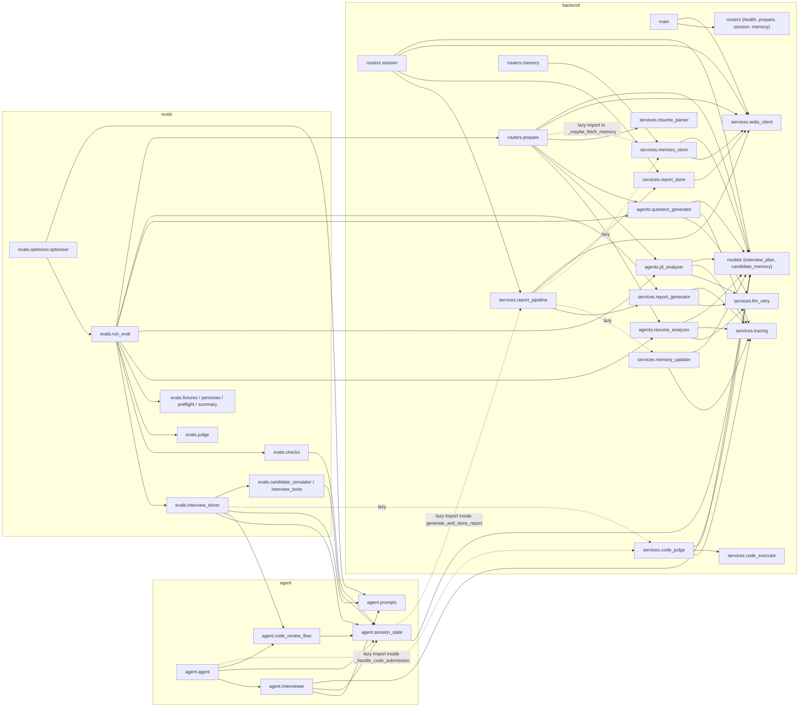

# 04 — Codebase Walkthrough

> **Goal:** be able to open any file and know where it fits, who calls it, and what depends on it.
> **How to use this chapter:** read 4.1-4.2 once to get the map; use 4.3 when a change might ripple (who imports whom); use 4.4 as a symbol index (line numbers were re-checked against the files with `grep -n`/`sed -n`, but will drift when code changes: search by symbol name if a range looks off); use 4.6 as a "where do I look" finder; use 4.7 to trace a runtime call chain end to end.
> **Coverage rule [Verified]:** every tracked source file under `mockmind/agent/`, `mockmind/backend/` and `mockmind/frontend/` appears in a table below, in 4.8 (tests and config), or in the explicit exclusions list at the end of 4.4.
> **Sizes [Measured]** (lines of `.py/.ts/.tsx/.css` in tracked files, via `git ls-files` + `wc -l`): backend routers 394 · backend agents 562 · models 112 · services 670 · **backend tests 1 336** · agent 741 · evals 1 146 · frontend app 1 765 · components 88 · hooks 147 · lib 49 · types 69.

---

## 4.1 Repository layout

```text
agentic-interview-platform/
├── README.md                       public overview (features, quick start, API table, reliability, CI)
├── MOCK_INTERVIEW_PLATFORM.md      ORIGINAL design spec (2 101 lines) — historical intent, partly out of date
├── DESIGN.md / CLAUDE.md           UI design-system reference / instruction for AI assistants
├── skills-lock.json                lockfile for one installed design skill (tooling)
├── docs/
│   ├── superpowers/specs|plans/    memory-feature design spec and 8-task implementation plan
│   └── codebase-learning/          THIS documentation series
├── images/                         README screenshots, demo GIF/MP4
├── .github/workflows/              ci.yml (tests+build), evals.yml (manual LLM evals)
└── mockmind/                       the application
    ├── docker-compose.yml          redis, piston, backend, agent, frontend, langfuse stack
    ├── .env.example                environment template (real .env is git-ignored)
    ├── backend/                    FastAPI app + shared library code
    │   ├── main.py                 app, CORS, startup Redis ping
    │   ├── routers/                HTTP endpoints (health, prepare, session, memory)
    │   ├── agents/                 3 preparation LLM steps (resume, JD, questions)
    │   ├── models/                 Pydantic models (plan, state, memory)
    │   ├── services/               Redis client, parsing, report, retry, memory, code run/judge, tracing
    │   └── tests/                  pytest suite + older script-style tests
    ├── agent/                      LiveKit voice agent (entrypoint, tools, state, prompts)
    ├── frontend/                   Next.js app (pages, components, hooks, lib, types)
    └── evals/                      eval harness, personas, judge, checks, optimizer, REPORT.md
```
*Source: `git ls-files`.* **[Verified]**

---

## 4.2 Entry points

| Entry | File → symbol | How it starts |
|---|---|---|
| **Backend HTTP app** | `mockmind/backend/main.py` → `app` (FastAPI), `lifespan()` (L15–18) | `uvicorn backend.main:app` (Docker CMD; Compose adds `--reload`) |
| **Agent worker** | `mockmind/agent/agent.py` → `server = AgentServer()` (L162), `entrypoint()` (L166) via `@server.rtc_session(agent_name="mockmind-interviewer")` | `python agent/agent.py start|dev|console|download-files` |
| **Frontend** | `mockmind/frontend/app/layout.tsx` + route pages | `npm run dev` / `npm run start` |
| **Eval harness** | `mockmind/evals/run_eval.py` → `main()` (L172–222) | `python evals/run_eval.py ...` |
| **Prompt optimizer** | `mockmind/evals/optimizer/optimizer.py` → `main()` (L224–237) | `python evals/optimizer/optimizer.py ...` |
| **Tests** | `mockmind/backend/tests/` | `python -m pytest backend/tests -q` (from `mockmind/`) |
| **Stack** | `mockmind/docker-compose.yml` | `docker compose up --build` |

---

## 4.3 How the Python modules depend on each other **[Verified by parsing imports with `ast`]**


*Edges were produced by parsing every `import` with Python's `ast` (`ImportFrom` of `backend.*`, `agent.*`, `evals.*`), then hand-drawn; dotted edges are imports that sit inside a function body (loaded only when that function runs). Mermaid note: `A & B --> C` draws one arrow from each of A and B to C. For readability the evals modules' imports of `services.tracing` and `services.llm_retry` (driver, simulator, judge) are not drawn.* **[Verified]**

**Key observations:** (1) the **agent imports backend code** (`session_state.py` lazily imports `report_pipeline`; `agent.py` imports `code_judge`), which is why both need the same dependencies. (2) **`evals.run_eval` imports `backend.routers.prepare`** just to reuse `resolve_plan_options()` — so the eval harness pulls in FastAPI code. (3) The backend never imports `agent` or `evals`. (4) `evals.optimizer` imports `agent` (the package, to reach `prompts`; it rewrites that file's constant) and `evals.run_eval` (to score candidate prompts). (5) `services.report_pipeline` is the one place the agent process and the HTTP backend converge on the same code path (called from `agent.session_state.generate_and_store_report` and from `routers.session.retry_report`).

---

## 4.4 The important files and what they define

### Backend

| File | Key symbols (with verified line ranges) | Role |
|---|---|---|
| `backend/main.py` | `lifespan()` L15–18; CORS middleware; four `include_router` calls | app shell |
| `routers/prepare.py` | `INTERVIEW_TYPE_PRESETS` L25–28, `DIFFICULTY_PRESETS` L37–41, `LENGTH_PRESETS` L42, `resolve_plan_options()` L45–52, limits L56–62, `PreparationError` L65, `validate_resume_upload()` L69–78, `_maybe_fetch_memory()` L81–93, `prepare_interview()` L97–225, `_sse()` L228 | preparation endpoint |
| `routers/session.py` | `TokenRequest` L25, `get_token()` L31–84, `get_report()` L88–105, `_retry_tasks` L109, `retry_report()` L113–139 | token + report API |
| `routers/memory.py` | `ForgetMeRequest` L9, `forget_me()` L14–18 (400 if blank email, else delete, 204) | delete memory |
| `routers/health.py` | `health()` L7: returns `{"status":"ok"}`; no dependency checks (does not ping Redis) | liveness |
| `agents/resume_analyzer.py` | `RESUME_ANALYSIS_PROMPT` L27–45, `_analyze_resume_once()` L48–72, `analyze_resume()` L75–76 | resume → profile |
| `agents/jd_analyzer.py` | `JD_ANALYSIS_PROMPT` L24–41, `_analyze_jd_once()` L44–68, `analyze_jd()` L71–72 | JD → profile |
| `agents/question_generator.py` | `DEFAULT_LEVEL_WEIGHTS` L41, `_LEVEL_FRAMEWORK` L46–73, `_build_memory_context()` L78–124, `QUESTION_GENERATION_PROMPT` L127–179, `_CODING_FORMAT_BLOCK` L186–206, `_normalize_level_weights()` L209–221, `_assign_level_sequence()` L224–236, `_assign_coding_slots()` L239–251, `_build_prompt()` L254–294, `_generate_questions_once()` L297–408, `generate_questions()` L411–414 | the core generator |
| `models/interview_plan.py` | `QuestionCategory` L6, `FollowUp` L15, `CodingTestCase` L20, `CodingSpec` L26, `InterviewQuestion` L33, `CandidateProfile` L46, `JobProfile` L57, `InterviewPlan` L67–83, `SessionState` L86–94 | data contracts shared by backend, agent and evals |
| `models/candidate_memory.py` | `QuestionHistoryEntry` L4–8, `CandidateMemory` L11–18 | memory contract |
| `services/redis_client.py` | module-level `redis_client` | shared client |
| `services/report_generator.py` | `validate_report()` L12–29, `REPORT_PROMPT` L31–69, `generate_report()` L72–77, `_generate_report_once()` L80–108 | report generation |
| `services/report_pipeline.py` | `run_report_pipeline()` L11–54 | report lifecycle |
| `services/report_store.py` | `STATUS_TTL`/`REPORT_TTL` L8–9, `set_status()`/`get_status()` L16–21 | status key |
| `services/llm_retry.py` | `retry_async()` L10–33 | retry/backoff |
| `services/memory_store.py` | `_key()` L10–12, `get_memory()`/`save_memory()`/`delete_memory()` L15–27 | memory persistence |
| `services/memory_updater.py` | `WEAK_THRESHOLD` L11, `_recompute_weak_categories()` L37–47, `_regenerate_notes()` L50–68, `update_memory_from_report()` L71–104 | memory merge |
| `services/code_executor.py` | `_ensure_language_version()` L17–46, `execute_code()` L49–78 | Piston client |
| `services/code_judge.py` | `CODE_REVIEW_PROMPT` L26–50, `CodeReviewResult` L53–58, `review_code()` L70–136 | grounded review |
| `services/resume_parser.py` | `extract_text_from_pdf()` L5–13, `extract_text_from_docx()` L16–19, `extract_resume_text()` L22–29 (dispatch by extension) | parsing |
| `services/tracing.py` | `DEFAULT_MODEL` L6, `is_enabled()` L9, `_GenerationHandle` L13, `_NoopGenerationHandle` L35, `traced_generation()` L44–72 | Langfuse wrapper (no-op when keys absent) |
| `agents/*.py`, `services/code_judge.py`, `evals/judge.py` | each defines its own private `_clean_json()` (the duplication noted in 4.5) | strip markdown fences from LLM JSON |
| `backend/requirements.txt`, `backend/Dockerfile` | `>=` lower-bound dependency ranges (no lock file); image `python:3.12-slim`, `pip install -r backend/requirements.txt`, then `COPY . .` (whole `mockmind/` context, see C27 in [07](07-engineering-challenges.md)), CMD `uvicorn` without `--reload` | dependencies and packaging |
| `__init__.py` files | `backend/`, `backend/agents/`, `backend/models/`, `backend/routers/`, `backend/services/`, `backend/tests/`, `agent/`, `evals/`, `evals/optimizer/`: all empty (0 lines) | make directories importable packages |

### Agent

| File | Key symbols | Role |
|---|---|---|
| `agent/agent.py` | `_get_context_session_id()` L59–70, `_setup_otel_tracing()` L73–113 (runs at import; result in `_trace_provider` L116), `_load_turn_detector()` L119–127, `_handle_code_submission()` L130–159, `server = AgentServer()` L162, `entrypoint()` L166–274 (session build L200–220; handlers `on_user_speech` L223, `on_item_added` L230, `on_data_received` L245; shutdown callbacks L251–263; `session.start` L266), `__main__` guard L277 | worker entry, pipeline assembly |
| `agent/interviewer.py` | `_publish_coding_challenge()` L20–41, `InterviewerAgent` L44–182 (`on_enter` L53–68, `on_user_turn_completed` L70–79, `move_to_next_question` L82–135, `end_interview` L138–156, `get_current_question_context` L159–182) | behaviour and tools |
| `agent/session_state.py` | `MAX_FOLLOW_UPS` L13, `AgentSessionState` L18–134 (`load` L32–45, `advance_question` L61–67, `add_transcript_entry` L69–76, `record_candidate_turn` L81–87, `_schedule_autosave` L93–103, `_autosave` L105–110, `save` L112–134), `follow_up_policy_note()` L137–155, `generate_and_store_report()` L158–178 | state, autosave, policy |
| `agent/code_review_flow.py` | `REVIEW_FAILED_INSTRUCTIONS` L7–11, `record_review()` L14–20, `review_reply_instructions()` L23–32 | shared coding helpers |
| `agent/prompts.py` | `INTRO` L1–5, `DEFAULT_BEHAVIORAL_INSTRUCTIONS` L12–60, `build_interviewer_system_prompt()` L63–71 | live prompt |
| `agent/requirements.txt`, `agent/Dockerfile`, `agent/__init__.py` | `livekit-agents[soniox,google,cartesia,silero,turn-detector]~=1.5`, OTLP exporter, plus the backend's libraries; image runs `python agent/agent.py start` and never `download-files`; empty package marker | dependencies and packaging |

### Frontend

| File | Key symbols | Role |
|---|---|---|
| `app/page.tsx` | `FEATURES` L14, `STEPS` L53, `STATS` L59, `WAVE_DELAYS` L65, `InterviewPreview()` L67, `LandingPage()` L131 | marketing page (server component) |
| `app/layout.tsx` | `spaceGrotesk` / `inter` font objects, `metadata`, `RootLayout` | root shell; imports `globals.css` and `@livekit/components-styles` |
| `app/globals.css` | Tailwind layers, keyframes (`aurora-drift-*`, `fade-in-up`, `shimmer`, `wave`...), `.glow-border`, `.text-shimmer`, `.bg-grid`, `prefers-reduced-motion` L163, `@media print` L174 | global styling |
| `app/setup/page.tsx` | limits L23–25, `LENGTH_OPTIONS` L27, `DIFFICULTY_OPTIONS` L31, `Segmented` L37, `STAGE_CONFIG` L82, `SetupPage` L91 (`canSubmit`, `handleFile`, `handleStart`, `handleBeginInterview`) | setup form, progress |
| `app/interview/[sessionId]/page.tsx` | `MicState` L21, `checkMicrophone()` L25, `InterviewPage` L36, `OrbState` L132, `ORB_CONFIG` L134, `VoiceOrb` L189, `InterviewRoomUI` L316 (`handleSubmitCode` L339, orb mapping L352, 25 s timer L363, `connectionLost` L376, `handleEndInterview` L379) | live room |
| `app/report/[sessionId]/page.tsx` | `RECOMMENDATION_CONFIG` L10, `ScoreBar` L17, `ReportPage` L43 | report |
| `hooks/usePreparation.ts` | `PrepOptions` L7, `usePreparation()` L13 (`startPreparation` L21, `cancel` L108) | SSE-over-POST |
| `hooks/useInterviewSession.ts` | `useInterviewSession()` L6 | **unused** |
| `lib/api.ts` | `BACKEND_URL` L3, `getSessionToken` L6, `ReportResult` L25, `getReport` L31, `retryReport` L39 | API client |
| `components/CodeEditorPanel.tsx` | `CodingChallenge` interface L7, `CodeEditorPanel` L14 | Monaco modal |
| `components/AuroraBackground.tsx` | `AuroraBackground({subtle})` L1 | decorative background used on every page |
| `types/interview.ts` | `QuestionCategory`, `InterviewQuestion` (**unused**), `PrepProgressEvent`, `SessionInfo`, `SessionTokenData`, `TranscriptEntry` (**unused**), `QuestionFeedback`, `EvaluationReport` | hand-written API types |
| `package.json`, `package-lock.json`, `next.config.js`, `tsconfig.json`, `tailwind.config.ts`, `postcss.config.js`, `next-env.d.ts`, `Dockerfile`, `.env.local.example` | scripts/deps, build and style config, image build, env template | configuration (see [02d §2d.11](02d-frontend-technologies.md)) |

### Evals

| File | Key symbols | Role |
|---|---|---|
| `run_eval.py` | `RUN_TIMEOUT_S` L49, `run_one()` L59–161, `main()` L172–222 | batch runner |
| `interview_driver.py` | `_snapshot` L29, `_restore` L40, `_send` L49–64, `_coding_turn` L67–98, `run_simulated_interview` L101–193, `MAX_TURNS` L26 | text-mode interview |
| `interview_tools.py` | `make_tools()` L15–75 | tool mirrors |
| `candidate_simulator.py` | `CandidateSimulator` L11–74 (`respond`, `write_code`) | persona LLM |
| `personas.py` | `PERSONAS` L12–51, `CODING_PERSONAS` L54 | personas |
| `judge.py` | `JUDGE_PROMPT` L15–46, `EvalVerdict` L49–58, `judge_interview()` L70–77 | LLM judge |
| `checks.py` | `deterministic_checks()` L20–49 | code-level checks |
| `summary.py` | `run_passed()` L5–12, `summarize()` L15–27, `below_threshold()` L30–31 | pass rates |
| `optimizer/optimizer.py` | `_score()` L81–94, `propose_revision()` L97–116, `_promote()` L119–135, `run_optimizer()` L138–221, `main()` L224 | prompt self-improvement |
| `fixtures.py` | `SAMPLE_RESUME` L3, `SAMPLE_JOB_DESCRIPTION` L27 | fixed inputs so runs are comparable |
| `preflight.py` | `check_piston()` L6 | fail fast if Piston is down for coding personas |
| `judge.py` (also) | `_clean_json` L61, `_judge_once` L80 | single-attempt judge call under retry |
| `evals/optimizer/versions/*.txt`, `results/*.json`, `evals/results/.gitkeep`, `evals/REPORT.md` | stored prompt versions, optimizer run outputs, results folder marker, write-up | data/evidence, not code |

---

### Not listed above, by design (exclusions) [Verified]
`node_modules/`, `.next/`, `.venv/` (installed/generated); `__pycache__/`, `.pytest_cache/` (caches); `frontend/tsconfig.tsbuildinfo` and `frontend/next-env.d.ts` (generated by TypeScript/Next); `frontend/public/` (empty); `mockmind/.env` (real secrets, git-ignored; never read or quoted in this series). Tests and workflows are in 4.8. There is **no `.dockerignore`** in `mockmind/`, `backend/` or `frontend/` ([07](07-engineering-challenges.md) C27), so Docker build contexts include these local directories.

## 4.5 Naming and style conventions observed **[Verified]**
- `_private` helpers and `_once` suffix for single-attempt functions wrapped by retry (`_analyze_resume_once` / `analyze_resume`).
- Constants in `UPPER_CASE` at module top; models in `models/`; one router per area.
- Defensive try/except with logging around optional features (memory, tracing, turn detector).
- Comments often explain **why** (e.g. thinking-budget comment in `question_generator.py`, "behavior that matters shouldn't depend on the LLM remembering" in `interviewer.py` L20–27). These comments are the main in-repo evidence for design rationale (used in [10](10-design-decisions-and-tradeoffs.md)).
- Duplication to know about: `_clean_json()` ×5; the eval tool mirrors; requirements duplicated between backend and agent.

## 4.6 "Where do I look for…?" quick finder

| Question | Go to |
|---|---|
| How are questions generated? | `agents/question_generator.py` `_generate_questions_once()` |
| How is the difficulty mix chosen? | `_assign_level_sequence()` L224–236 |
| What does Alex say first? | `InterviewerAgent.on_enter()` + `plan.opening_message` |
| How is the follow-up cap enforced? | `follow_up_policy_note()` + `on_user_turn_completed()` |
| Where is the transcript saved? | `AgentSessionState.save()` / `_autosave()` |
| How is a report generated and stored? | `run_report_pipeline()` |
| What happens on a report failure? | status `failed` → `GET` 502 → `retry_report()` |
| How does the browser join? | `InterviewPage` + `get_token()` |
| How does code get graded? | `review_code()`; data channels |
| Where are limits/presets? | `routers/prepare.py` top |
| How is tracing wired? | `tracing.py`; `_setup_otel_tracing()` |
| How are the tests organized? | `backend/tests/`; [09](09-testing-evaluation-and-observability.md) |

## 4.7 Runtime call chains (who calls what, in order)

These are the paths you will actually trace when debugging. Arrows are calls; `(await)` marks async hops; `[lib]` is library code.

**A. Preparation (HTTP).** browser `usePreparation.startPreparation` -> `POST /api/prepare` -> `routers.prepare.prepare_interview` -> `event_stream()` (async generator) -> `validate_resume_upload` -> `services.resume_parser.extract_resume_text` -> `agents.resume_analyzer.analyze_resume` -> `services.llm_retry.retry_async(_analyze_resume_once)` -> `google-genai` [lib] ; then `agents.jd_analyzer.analyze_jd` ; then `_maybe_fetch_memory` -> `services.memory_store.get_memory` ; then `resolve_plan_options` ; then `agents.question_generator.generate_questions` -> `_generate_questions_once` -> `_assign_level_sequence` / `_assign_coding_slots` / `_build_prompt` ; then two `redis_client.setex`.

**B. Join.** `InterviewPage` effect -> `checkMicrophone` -> `lib.api.getSessionToken` -> `POST /api/token` -> `routers.session.get_token` -> `redis_client.get` -> `AccessToken...to_jwt()` -> `<LiveKitRoom>` [lib connects] -> LiveKit dispatches job -> `agent.agent.entrypoint` -> `AgentSessionState.load` -> `AgentSession(...)` -> `session.start` [lib] -> `InterviewerAgent.on_enter` -> `session.say`.

**C. One spoken turn.** mic audio [lib: VAD + Soniox] -> `user_input_transcribed` -> `on_user_speech` -> `AgentSessionState.add_transcript_entry` -> `_schedule_autosave` ; turn committed [lib] -> `InterviewerAgent.on_user_turn_completed` -> `follow_up_policy_note` -> `record_candidate_turn` ; Gemini [lib] -> maybe `move_to_next_question` -> `advance_question` -> `state.save` (-> `[_publish_coding_challenge]` if coding) ; reply text -> Cartesia [lib] ; `conversation_item_added` -> `on_item_added` -> `add_transcript_entry("interviewer")`.

**D. Code submission.** `CodeEditorPanel.onSubmit` -> `InterviewRoomUI.handleSubmitCode` -> `useDataChannel.send` -> LiveKit -> `ctx.room.on("data_received")` -> `_handle_code_submission` -> `backend.services.code_judge.review_code` -> `code_executor.execute_code` (per test) -> Piston ; Gemini review -> `agent.code_review_flow.record_review` -> `session.generate_reply(review_reply_instructions)`.

**E. End and report.** (i) tool path: `InterviewerAgent.end_interview` -> `asyncio.create_task(generate_and_store_report)`; (ii) button path: `handleEndInterview` -> `room.disconnect()` -> session closes [lib] -> `on_session_shutdown` -> `generate_and_store_report`. Both -> `AgentSessionState.save` -> `services.report_pipeline.run_report_pipeline` -> `report_store.set_status("pending")` -> `report_generator.generate_report` -> `llm_retry.retry_async` -> `redis_client.setex(report)` -> `report_store.set_status("ready")` -> (opt-in) `memory_store.get_memory` / `memory_updater.update_memory_from_report` / `save_memory`. Browser: `ReportPage.fetchReport` -> `lib.api.getReport` -> `GET /api/report/{id}` -> `routers.session.get_report`.

**F. Retry.** `ReportPage.handleRetry` -> `lib.api.retryReport` -> `POST /api/report/{id}/retry` -> `routers.session.retry_report` -> `report_store.get_status`, `redis_client.get(session_state)` -> `SessionState.model_validate_json` -> `asyncio.create_task(run_report_pipeline)` (kept in `_retry_tasks`).

## 4.8 Tests, CI and config files (so the inventory is complete)

| File | Kind | Notes |
|---|---|---|
| `backend/tests/conftest.py` | pytest fixtures | in-memory fake Redis, `make_plan` helper (used by agent tests too) |
| `test_api_smoke.py` (1 test) | needs a real Redis | prepare -> token -> simulated agent -> report -> retry -> memory |
| `test_eval_harness.py` (17) | pytest | offline tests of the eval harness |
| `test_prepare_options_and_limits.py` (15 collected) | pytest | presets, limits, safe error messages |
| `test_report_pipeline_and_endpoints.py` (7), `test_report_validation.py` (6 collected) | pytest | report lifecycle, endpoints, validation |
| `test_llm_retry.py` (3), `test_follow_up_cap.py` (5, needs `livekit-agents`), `test_candidate_memory_model.py` (2) | pytest | retry/backoff, the follow-up policy, model |
| `test_question_generator_coding_category_bug.py` (1), `test_question_generator_memory.py` (1) | pytest-collected | the memory one makes a real Gemini call when run as `__main__` (docstring) |
| `test_memory_store.py`, `test_memory_updater.py`, `test_maybe_fetch_memory_resilience.py`, `test_question_generator_coding_slot_compliance.py`, `test_session_state_memory_write.py` | **script-style** (run with `python -m`; collect 0 tests) | need real Redis and/or Gemini; docstrings say which |
| `test_memory_endpoint.sh`, `test_prepare_memory.sh` | shell scripts | manual curl-based checks |
| `.github/workflows/ci.yml`, `evals.yml` | CI | tests + typecheck/build on push/PR; evals manual |
**[Measured]** `pytest backend/tests --collect-only -q` in `backend/.venv` reported **53 tests collected** (the count above sums to 53 with `test_follow_up_cap.py` excluded, because its `importorskip` skips it in that venv); running `test_follow_up_cap.py` with `agent/.venv` reported `5 passed`.

## 4.9 Non-code project documents (and how reliable each is)
| Document | Content | Reliability |
|---|---|---|
| `README.md` | features, setup, API table, reliability, CI, eval notes | mostly accurate; **one claim is stronger than the code supports**: it says the configured difficulty distribution "is a guarantee" (the levels are decided in code by random draw; a single interview's mix varies — see [06](06-core-concepts-and-implementation.md) §6.2) |
| `MOCK_INTERVIEW_PLATFORM.md` | original plan | **historical**; differs from code (Deepgram vs Soniox; `tools.py` merged; 15–20 questions vs 16/8/6; planned UI components not built) |
| `docs/superpowers/specs|plans/` | memory feature spec/plan | accurate to intent; evidence of process |
| `mockmind/evals/REPORT.md` | first real eval run write-up | primary evidence for two bugs and findings ([07](07-engineering-challenges.md)) |
| `DESIGN.md`, `CLAUDE.md` | design guidance | tooling, not runtime |
