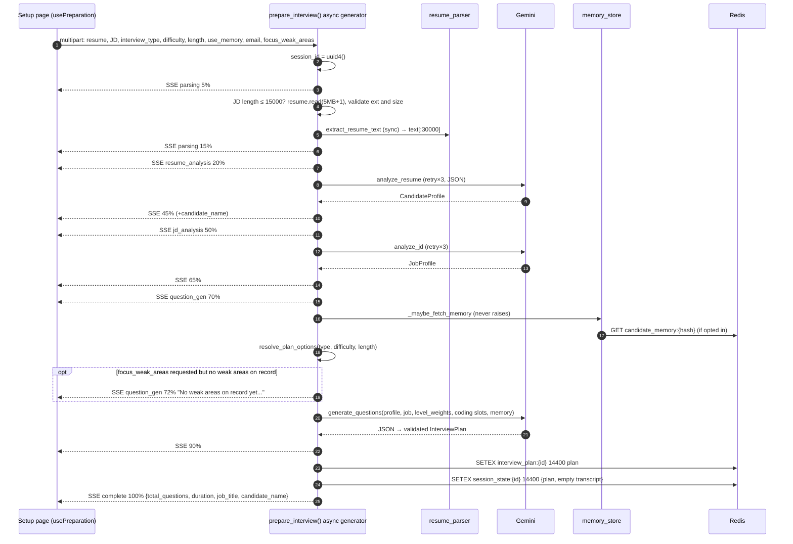
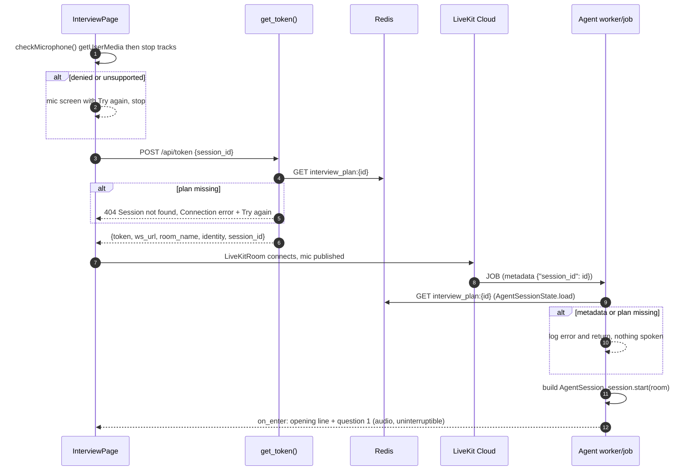
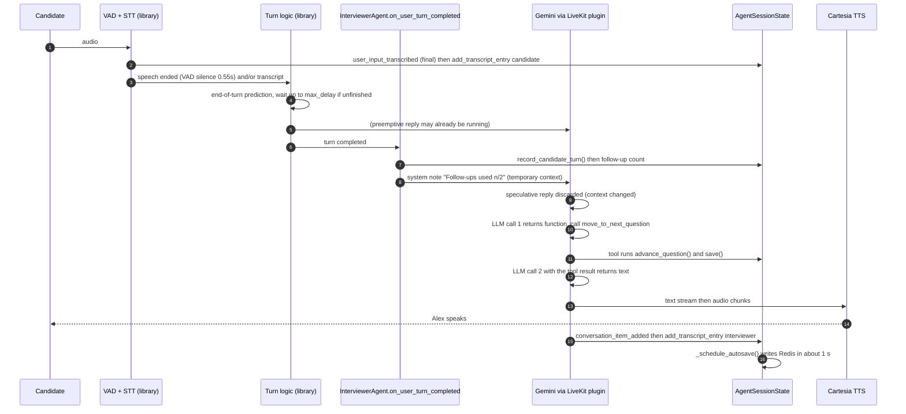
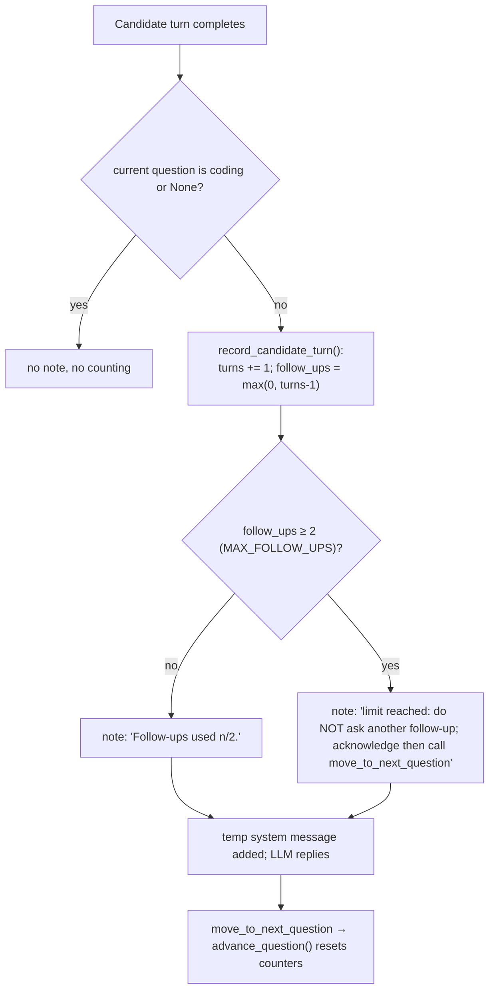
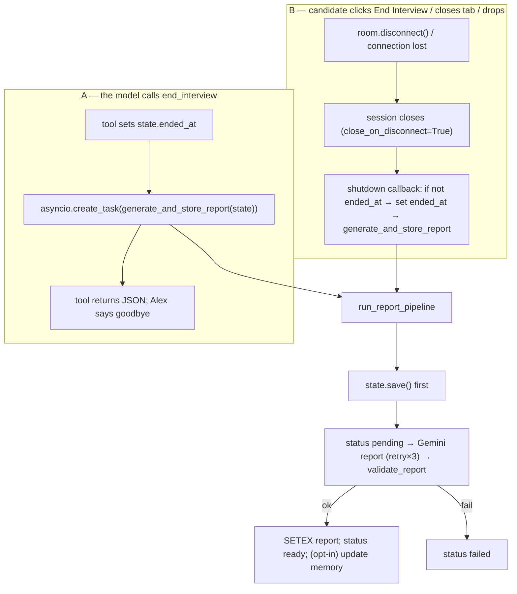
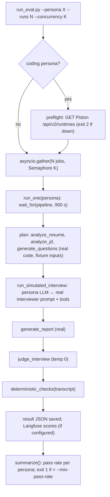

# 05 — End-to-End Workflows

> Each workflow lists: **trigger → entry point → components → data transformations → state changes → async/concurrency boundaries → success → error paths → output.** Everything is **[Verified]** from the code unless labelled. Library-internal steps are **[Library source]**.
> Prerequisites: [03](03-system-architecture.md), [04](04-codebase-walkthrough.md).

**How to read the sequence diagrams.** Time flows downward. A solid arrow `->>` is a call or message, a dashed arrow `-->>` a response or an event pushed to the other side, `alt ... end` blocks are alternative branches (failure paths), and the number on each arrow is the order. "Library" participants are code we did not write; the text beside each diagram says which steps are ours.
**Evidence labels used:** `[Verified]` read in this repo; `[Library source]` read in the installed LiveKit Agents 1.8.4 (see [02c](02c-real-time-voice-and-livekit.md) for the version caveat); `[Inference]`/`[Hypothesis]` reasoned but not executed; `[Measured]` a command or test actually run in this pass; `[Not measured]` nobody has measured it.

Workflows: 5.1 Preparation · 5.2 Preparation failures · 5.3 Joining the room · 5.4 One live conversation turn · 5.5 Follow-up enforcement · 5.6 Live-coding submission · 5.7 Ending the interview and report generation · 5.8 Report failure and retry · 5.9 Candidate memory (read and write) · 5.10 Disconnect, crash and "Reconnect" · 5.11 An eval run

---

## 5.1 Preparation (happy path)

**Trigger:** the user clicks **Prepare My Interview** on `/setup`.
**Entry:** `usePreparation().startPreparation()` → `POST /api/prepare` → `prepare_interview()`.



### Step-by-step with data transformations
1. **Client:** builds `FormData` (resume file, JD text, `interview_type`, `difficulty`, `length`, `use_memory`, `candidate_email`, `focus_weak_areas`) and `fetch`es with `signal`. *Source: `mockmind/frontend/hooks/usePreparation.ts`.*
2. **Server:** FastAPI parses the form into function parameters (`prepare.py` L96–107); returns `StreamingResponse(event_stream(), "text/event-stream")` (L225).
3. **Validation** (inside the stream): JD length ≤ 15 000 (`MAX_JD_CHARS`), `await resume.read(MAX_RESUME_BYTES + 1)` (L127), `validate_resume_upload()` (extension ∈ `.pdf .docx .doc .txt`, non-empty, ≤ 5 MB).
4. **Text extraction:** `extract_resume_text()` (sync) → string; empty → `PreparationError`; truncated to 30 000 chars.
5. **Step ①** `analyze_resume(text, session_id)` → `retry_async(_analyze_resume_once)`: prompt = template + `"\n\nRESUME TEXT:\n"` + text → Gemini (temp 0.1, JSON) → `_clean_json` → `json.loads` → `CandidateProfile(**data)`.
6. **Step ②** `analyze_jd(...)` → `JobProfile`.
7. **Memory:** `_maybe_fetch_memory(use_memory, email)` → `(CandidateMemory|None, email|None)`; any exception → `(None, email)`. `weak_focus = bool(focus_weak_areas and memory and memory.weak_categories)`; if practice mode was requested but there's no weak area, an extra SSE (progress 72) says so.
8. **Options:** `resolve_plan_options()` maps friendly names to numbers: standard → 16 questions/0 coding; quick → 8; coding → 6 questions/4 coding (length ignored); difficulty `easier`/`harder` → weight dicts, `balanced` → `None` (default 0.40/0.35/0.25).
9. **Step ③** `generate_questions(...)` → `_generate_questions_once`: `_normalize_level_weights`, `_assign_level_sequence` (Python draw), `_assign_coding_slots`, `_build_prompt` (+ memory block), Gemini (temp 0.4; tokens 8192/16384; thinking 0/−1), clean/parse, build `InterviewQuestion`s (`QuestionCategory(...)` validates), log target-vs-actual level counts, return `InterviewPlan`.
10. **Persist:** two `SETEX` calls (4 h each): plan; `SessionState(session_id, plan)` with empty transcript.
11. **Complete event:** `{total_questions, duration_minutes, job_title, candidate_name}`; the page flips the button to **Start Interview**.

**State changes:** two new Redis keys. **Async boundaries:** every Gemini call and Redis write is an `await`; resume parsing is **synchronous** (blocks the loop). **Concurrency note:** steps ①② are independent but run sequentially **[Verified]** (candidate for `gather`).

**Output:** an `InterviewPlan` in Redis plus a terminal SSE `complete` event.

**Worked example (what the browser actually receives, abbreviated, illustrative values).** Each line below is one SSE frame (`data: ` + JSON + blank line):
```text
{"stage":"parsing","message":"Reading your resume...","progress":5,"session_id":"3f2a..."}
{"stage":"parsing","message":"Resume parsed successfully.","progress":15,...}
{"stage":"resume_analysis","message":"Analyzing your background and experience...","progress":20,...}
{"stage":"resume_analysis","message":"Profile built: 6 years experience, 14 skills identified.","progress":45,"data":{"candidate_name":"Asha"}}
{"stage":"jd_analysis",...,"progress":50}   {"stage":"jd_analysis",...,"progress":65}
{"stage":"question_gen","message":"Crafting personalized interview questions...","progress":70,...}
{"stage":"question_gen","message":"Generated 16 tailored questions across 4 categories.","progress":90,...}
{"stage":"complete","progress":100,"data":{"total_questions":16,"duration_minutes":..,"job_title":"...","candidate_name":"Asha"}}
```
`progress` jumps in steps (5, 15, 20, 45, 50, 65, 70, 90, 100) because it is *milestone-based*, not time-based: the long silent stretches are the three Gemini calls. `usePreparation` stores `event.progress` as `currentProgress` and, on `complete`, builds `SessionInfo` from `session_id` and `data`. **Why two `SETEX` calls with the same 4 h TTL?** `interview_plan` is the immutable input the agent loads; `session_state` is the mutable record the agent later overwrites. At `complete` they hold the same plan, so `retry_report` could not run before the agent saves a transcript (it would 409 "No interview transcript").

---

## 5.2 Preparation failure paths

| Failure | Where detected | Result | Source |
|---|---|---|---|
| JD > 15 000 chars | `prepare_interview()` | SSE `error`: "Job description is too long…" | L121–126 |
| Bad extension / empty / > 5 MB | `validate_resume_upload()` | SSE `error` with a specific message (**[Measured]**: `cv.exe` → "Unsupported file type. Please upload a PDF, DOCX or TXT resume.") | L69–78 |
| No text extracted (e.g. scanned PDF) | `if not resume_text` | SSE `error` "Could not extract text…" | L129–133 |
| Gemini 429/5xx/garbled JSON/invalid enum | inside `retry_async` | 3 attempts (1 s, 2 s), then exception → `except Exception` → generic message; traceback logged | `llm_retry.py`; `prepare.py` L215–223 |
| Memory store error | `_maybe_fetch_memory` | logged; continues without memory | L81–93 |
| Redis write fails (`setex`) | inside `try` | `except Exception` → generic error event (**[Hypothesis]** plan not stored; user told to retry) | L186–198 |
| Backend crash mid-stream | — | connection closes; client's `reader` ends without `complete`; UI shows nothing definitive (no timeout in the hook) | **[Inference]** from `usePreparation.ts` (no explicit "stream ended without complete" handling observed) |
| Client aborts | `AbortController` | `AbortError` not shown as error (`SetupPage` has no Cancel button, so `cancel()` is never called today) | `usePreparation.ts` L98 (abort check), L108 (`cancel`) |
| Non-2xx from FastAPI before streaming starts (for example missing form field -> 422) | hook | `throw new Error('Preparation request failed')` -> error panel | `usePreparation.ts` L57 |
| Client-side validation | `SetupPage.handleFile`, `canSubmit` | the request is never sent (bad extension, > 5 MB, JD <= 50 or > 15 000 chars) | `setup/page.tsx` L23-25, L84-105 |
**Why errors are events, not HTTP codes:** the 200 status is sent with the first chunk; later failures must be conveyed in the stream. **Safe-message rule:** `PreparationError` → user text; anything else → `GENERIC_PREP_ERROR` (a unit test asserts a secret inside an exception never appears in the output: `test_unexpected_errors_hide_internal_detail`).

**Partial-write analysis (why the order of the two `SETEX` calls matters) [Verified by reading `prepare.py` L186-212; failure not exercised].** The `complete` event is yielded only *after* both writes. If the first `SETEX` (`interview_plan`) succeeds and the second (`session_state`) raises, the `except Exception` branch sends the generic error event and the user sees a failure and no **Start Interview** button, but an orphan `interview_plan:{id}` key now exists (it expires after 4 h). Nobody holds its `session_id` except the browser tab that received it in earlier SSE frames, so it is harmless but not cleaned up. Reverse case (plan write fails): nothing is stored. The design takes the simple route of "write both, then announce success"; the alternative (one Redis transaction/pipeline) would make the pair atomic, at the cost of a little more code **[Inference]**.

**Which layer notices which failure (first principles).** A streaming endpoint has three places a failure can surface: (1) *before the first byte*, where FastAPI can still return a real HTTP status (only form-parsing errors such as a missing field produce a 422 here); (2) *inside the stream*, where the status is already 200 so the failure must be encoded as data (our `{"stage":"error"}` frame); (3) *the connection itself dies*, where the browser sees the body end with no `complete` or `error` frame, and our hook has no rule for "stream ended without a terminal event" (see [07](07-engineering-challenges.md) D6). Knowing which of the three a given failure falls into is how you predict what the user sees.

---

## 5.3 Joining the interview

**Trigger:** *Start Interview* → `/interview/{sessionId}`.


Same flow with library-level detail (room creation, dispatch, the two mic acquisitions): [02c §2c.1 diagram](02c-real-time-voice-and-livekit.md#e-the-join-sequence-actual-implementation).
**Failure paths [Verified]:** (a) mic blocked → pre-flight screen; (b) plan expired (>4 h) → `/api/token` 404; (c) LiveKit env missing → `KeyError` → 500; (d) agent not running → UI `orbState === 'disconnected'` for 25 s → "taking too long" overlay (`InterviewRoomUI` effect L363–371); (e) agent can't find the plan → logs and returns (nothing spoken; same overlay); (f) token expires → connect error; (g) the agent's `AgentSessionState.load()` raises something other than `ValueError` (Redis down, invalid plan JSON) -> the job fails inside `entrypoint` (not caught there) and the UI shows the same 25 s overlay **[Verified by reading; framework consequence not exercised]**; (h) the browser can connect and publish audio before the agent exists, so early speech is lost (the greeting is uninterruptible anyway).
**Worked example (timeline, illustrative):** t=0 candidate clicks Start -> t=0.3 s mic permission already granted -> t=0.5 s token returned -> t=1 s room connected, orb "Connecting..." -> t=2-4 s job assigned, plan loaded, VAD loaded, session started **[Not measured]** -> orb turns "Alex is speaking". If nothing changes by t=25 s the "taking too long" overlay appears.
**State change:** none in Redis at join; the agent's first transcript entries trigger autosave (creating/overwriting `session_state:{id}`).

---

## 5.4 One live conversation turn (happy path)

**Trigger:** the candidate speaks. Library steps are **[Library source]**; our code is **[Verified]**.


**Data transformations:** audio → text segments → transcript entries `{speaker, text, timestamp, question_index}` → (with note) chat context → tool call JSON → next-question JSON → reply text → audio.
**State changes:** `current_question_index`, `asked_question_ids`, counters reset (`advance_question()` L61–67); `session_state:{id}` rewritten (TTL 4 h) by tool `await state.save()` and by autosave.
**Concurrency:** the autosave task (1 s sleep then save) runs alongside the loop; code submissions run as separate tasks (§5.6).
**Success condition:** Alex speaks the next question; transcript contains the exchange.
**Worked example (one turn, illustrative content).** Q2 = "Tell me about a time you debugged a production incident." Candidate speaks 40 s; STT emits two final segments ("Last year our checkout API..." and "...so I added a circuit breaker."). Transcript gets **two** `candidate` entries (one per final segment), but the hook runs **once** for the committed turn: `candidate_turns_this_question=1`, `follow_ups=0`, note `Follow-ups used on this question: 0/2.` Gemini decides the answer lacks a metric and asks the follow-up from the plan. Transcript gets one `interviewer` entry. Candidate answers; hook: turns=2, follow_ups=1. Alex says "Thank you" and calls `move_to_next_question`; the result JSON contains Q3 and `follow_ups_used_this_question: 0` (reset by `advance_question`). Alex asks Q3.
**What happens on the very first turn [Verified]:** before any candidate speech, `InterviewerAgent.on_enter()` speaks `"{opening_message} {questions[0].question}"` with `allow_interruptions=False`, and records that text itself (`interviewer.py` L53-68); `on_item_added` then skips the duplicate.
**Interruption branch:** if the candidate talks over Alex for >= 0.5 s Alex's audio is cut; a 2 s silence resumes it ([02c §2c.8](02c-real-time-voice-and-livekit.md#2c8-interruptions-barge-in)).
**Failure paths:** hook exception → turn ignored **[Library source]** (`on_user_turn_completed` is wrapped in `try/except`, logged as "error occurred during on_user_turn_completed", and the turn is dropped); tool-loop cap `max_tool_steps=3` per turn **[Library source]**; STT/TTS/LLM errors are handled by the library (not customized); a **silent turn** (LLM returns no text after the tool) leaves the candidate in silence — observed in stored eval runs, root cause unknown ([07](07-engineering-challenges.md) Part B1).

**Failure and edge matrix for one turn, by stage [Verified unless labelled].**

| Stage | What can go wrong | What the candidate experiences | Who handles it |
|---|---|---|---|
| Audio capture | mic muted or blocked after the pre-flight check | Alex hears nothing and stays silent; orb stays in `listening` | nobody (no "are you there?" logic in our code) **[Inference]** |
| STT | provider error or empty final transcript | the turn may never be committed; `on_user_speech` ignores finals with no text (`agent.py` L225) | library retries/reports; our code only filters empties |
| Turn detection | end-of-turn model missing | falls back to VAD-only endpointing (`_load_turn_detector()` returns `None`, L119-127), so Alex may cut in earlier or wait for silence | our fallback + library |
| Hook (`on_user_turn_completed`) | an exception | that candidate turn gets no reply **[Library source]** | library logs it; our hook is two statements so risk is low |
| Tool `move_to_next_question` | `state.save()` raises (Redis down) *before* the tool returns JSON (`interviewer.py` L90-91) | the in-memory index has *already advanced* but the model gets no next-question text; what the model does after a tool error is framework behaviour not traced here **[Not verified]** | not handled in our code; autosave later may retry the write |
| Coding publish | `publish_data` fails | the editor never opens, but the model is told it has been shown; logged only (`_publish_coding_challenge` try/except, L41) | logged |
| LLM | 429/5xx/timeout | silence or a framework-level retry; no custom fallback line | library (`APIConnectOptions`, see [02c](02c-real-time-voice-and-livekit.md)) |
| Transcript write | `on_item_added` sees empty assistant text (a silent turn) | nothing recorded for that turn, so the report cannot even show it happened | skipped by design (`agent.py` L236) |
| Autosave | Redis error | only a log line; next transcript entry schedules another attempt (`session_state.py` L105-110) | `_autosave` try/except |

**Why the transcript entry is written before speech finishes.** `on_enter` appends the opening line to the transcript *before* `session.say()` returns (L63 vs L65). If TTS fails, the transcript claims Alex said something the candidate never heard. This is a deliberate-looking simplification (one writer, no dependence on a library event) but it is a fidelity gap worth naming in an interview **[Verified ordering; intent is Inference]**.

---

## 5.5 Follow-up enforcement flow


*Source: `agent/session_state.py` → `follow_up_policy_note()` L137–155, `record_candidate_turn()` L81–87; `agent/interviewer.py` → `on_user_turn_completed()` L70–79.* **Enforcement level [Verified]:** **soft** — the model can ignore the note. Layers: prompt rule (`prompts.py` "Never ask more than 2 follow-ups"), the injected note, and the eval's deterministic check (`evals/checks.py`).

**Worked trace of the counter (values computed by hand from `record_candidate_turn()` and `follow_up_policy_note()`; the logic is simple enough that this is [Verified by reading], not by running).** One conversational question, `MAX_FOLLOW_UPS = 2`:

| Event | `candidate_turns_this_question` | `follow_up_count_this_question` | Note given to the model |
|---|---|---|---|
| Alex asks Q (via tool result), counters reset | 0 | 0 | none yet |
| Candidate answers (turn 1) | 1 | `max(0, 1-1)` = 0 | `Follow-ups used on this question: 0/2.` |
| Alex asks follow-up A; candidate answers (turn 2) | 2 | 1 | `1/2.` |
| Alex asks follow-up B; candidate answers (turn 3) | 3 | 2, so `follow_up_cap_reached` | `2/2. The limit is reached: do NOT ask another follow-up...` |
| Alex calls `move_to_next_question` | reset to 0 | reset to 0 | (next turn starts again at 0/2) |

**Consequences of counting turns rather than follow-ups.** The counter assumes every candidate turn after the first answers a follow-up. So if the candidate says "sorry, can you repeat the question?" that completed turn counts as a "follow-up used", and the cap can be reached with fewer real follow-ups than intended; conversely a candidate who never speaks twice cannot trigger it. Also, because the framework may merge or split STT segments into turns, the count is only as good as the library's turn boundaries **[Inference]**. And because the note is only advice, the interviewer can still ask a third follow-up: in stored runs the `follow_up_cap_respected` check (`evals/checks.py`) passed in all 10 runs that have checks **[Measured]**, but that is evidence about the harness's simulated candidates, not a guarantee. Why not hard enforcement? A hard cap would mean either removing the `follow_up` ability from the tool surface once the count is reached or auto-calling `advance_question()` from the hook; the repo does neither **[Verified by absence]**.

**Coding questions bypass the counter entirely** (`follow_up_policy_note()` returns `None` when `q.question_type == "coding"`, L146-147), so a candidate talking during a coding question does not increment anything; progress there is driven by code submissions instead (§5.6).

---

## 5.6 Live-coding submission

```mermaid
sequenceDiagram
    autonumber
    participant AG as move_to_next_question
    participant UI as Browser
    participant H as _handle_code_submission
    participant J as review_code
    participant P as Piston
    participant G as Gemini
    AG->>UI: publish_data topic=coding_challenge {question_id, language, problem, starter_code}
    UI->>UI: show Monaco editor
    UI->>H: data topic=code_submission {question_id, code} (reliable)
    H->>H: find question; require coding_spec
    loop each test case
      J->>P: POST /api/v2/execute (code + test.input), run_timeout 3000ms
      P-->>J: stdout/stderr/exit_code/signal
    end
    J->>G: prompt with REAL test results (temp 0.2, JSON)
    G-->>J: scores/notes
    J->>J: overwrite tests_passed/total with measured counts
    H->>H: record_review(): "[Submitted code]" + "Code review for qN: x/y ..."
    H->>H: session.generate_reply(instructions=review_reply_instructions)
```
**Failure paths [Verified]:** malformed packet → logged/ignored; unknown or non-coding `question_id` → warning; a test's execution error → that test `passed=False` with `stderr="execution error: ..."`; the whole review raising → `session.generate_reply(instructions=REVIEW_FAILED_INSTRUCTIONS)`; infinite loop → Piston kills at 3 s (**[Standard/verified earlier in the project's own testing per README; not re-run here]**).
**Gap:** no ack/retry for data messages; duplicate submissions are reviewed again.

**Failure matrix for a code submission [Verified by reading `agent.py` L130-159, `code_judge.py`].**

| Step | Failure | Result |
|---|---|---|
| Browser sends the data message | candidate disconnected / message lost | no review; nobody tells the candidate (reliable delivery only protects against network loss, not against an absent receiver) |
| Parse payload | invalid JSON or missing `question_id`/`code` | `logger.exception`, return; nothing spoken |
| Look up question | unknown id or no `coding_spec` | warning, return; nothing spoken (also happens if the candidate submits for a question that is not the current one but *is* a coding question: the code does not check "is current") |
| Run tests on Piston | Piston down / timeout | each test becomes `passed=False` with `stderr="execution error: ..."`; the review then tells the model "0 tests passed", which may unfairly lower the score (07 D7) |
| Gemini review | exception (not retried) | `REVIEW_FAILED_INSTRUCTIONS`: the interviewer apologises and asks to resubmit or moves on |
| `generate_reply` | called but session already closing | not traced **[Not verified]** |
| Two quick submissions | two tasks run concurrently (`asyncio.create_task` per packet) | two reviews, two spoken reactions, possible overlap **[Inference]** |

**First-principles note: why code arrives over a data message and not as speech.** The LLM pipeline only starts a turn when the candidate *speaks*. Code is typed, so it needs its own entry point; the data channel is the existing low-latency, ordered pipe between browser and agent. The agent therefore has two independent inputs (audio turns and data packets) feeding one shared `AgentSessionState`, which is why code submissions run as separate tasks and why `generate_reply(instructions=...)` exists (it makes the model speak without a user turn).

---

## 5.7 Ending the interview and generating the report

Two entry paths **[Verified]**:


**Verified detail about path A:** after `end_interview`, **no agent code closes the session or notifies the browser** (grep: no `shutdown`/`aclose`/`session.close`); the browser navigates to `/report/{id}` **only** from the End Interview button (`handleEndInterview`, `interview/[sessionId]/page.tsx` L379–384, `router.push` L383). So a tool-ended interview still relies on the candidate clicking End; behavior if they keep talking is untested.
**Verified detail about guards:** the shutdown callback generates a report only if `ended_at` is unset (`agent.py` L251–257), preventing a duplicate after path A.
**Report page:** polls `GET /api/report/{id}` every 4 s, up to 30 times.
**[Hypothesis]** Report generation in either path runs in the agent's job process during/after teardown; see [07](07-engineering-challenges.md) Part D1.

**Failure timeline: what is lost at each point [Verified by reading; none exercised end to end].**

| When the failure strikes | State in Redis | What the report page shows | Recovery |
|---|---|---|---|
| Agent crashes mid-interview | `session_state` = last autosave (at most about 1 s stale), no status key | polls: 404 "not ready" for up to 30 polls (about 2 min at 4 s), then "Report is taking longer than expected" with a **Try again** button (`report/[sessionId]/page.tsx`, shown when `!polling && pollCount >= 30`) | **Try again** works because `retry_report` finds `session_state` with a transcript and no `pending` status |
| Browser closes tab, job process shuts down normally | shutdown callback sets `ended_at`, saves, runs the pipeline | normal `pending` then `ready`, if the job process is allowed to finish (teardown risk, 07 D1) | same as above if it was cut off |
| `end_interview` ran, candidate keeps talking | `ended_at` set, report task started, session still open | nothing yet (page not opened) | none needed, but turns spoken after the call are likely missing from that report: `generate_report` builds its prompt once from the transcript it was handed (the live list), so entries appended later are not included **[Inference]** |
| Gemini fails 3 times | `pending` then `failed` | 502 failed, **Try again** | retry endpoint |
| Redis down during the pipeline | `set_status` raises inside the `try`; the handler's own `set_status("failed")` raises too and is caught/logged | 404 forever (no report, no status) | start Redis again, then Try again |
| Backend restarts during a retry | status `pending` stuck up to 24 h | spinner until timeout, retry returns `{"status":"pending"}` | none in code (07 D3) |

**First principles: why a status key at all.** With only `interview_report:{id}`, "no key" could mean "still generating", "failed", or "never started"; the polling UI could not tell them apart and would poll blindly until a timeout. A three-state key (`pending`/`ready`/`failed`, each with a 24 h TTL: `report_store.py`) turns it into a tiny state machine the browser can read: stop polling on `failed`, show a button. It is a standard pattern for asynchronous jobs without a job queue **[Standard knowledge]**.

---

## 5.8 Report failure and retry

1. Generation fails after 3 attempts (or validation keeps failing) → `run_report_pipeline` logs, sets `interview_report_status:{id}` = `failed`, returns `False` (**never raises**).
2. Browser polls `GET /api/report/{id}` → report key absent, status `failed` → **502** `{"detail":{"status":"failed","message":"Report generation failed."}}` → `getReport()` returns `{status:'failed'}` → page shows **Try again**.
3. Click → `retryReport()` → `POST /api/report/{id}/retry`:
   - status `pending` → `{"status":"pending"}` (no-op);
   - report exists → `{"status":"ready"}`;
   - `session_state:{id}` missing → **404**; transcript empty → **409**;
   - else set `pending`, `asyncio.create_task(run_report_pipeline(...))` (kept in `_retry_tasks`), return **202** `{"status":"pending"}`.
4. The page resets its poll counter and polls again.
**Recovery limits:** retry only works while `session_state` exists (4 h from last save). **State-loss risk:** a backend restart during a retry leaves status `pending` until its 24 h TTL (**[Hypothesis]**; no timeout/staleness check exists).
**Verified by tests:** `test_report_pipeline_and_endpoints.py` (pipeline ready/failed; GET 404/502/200; retry 404/409/202/no-op; regeneration from the persisted transcript) and the real-Redis `test_api_smoke.py` flow.

---

## 5.9 Candidate memory (read and write)

**Read (during preparation):** opt-in → `get_memory(email)` (Redis `candidate_memory:{sha256(lower(email))}`) → `_build_memory_context()` appended to the question prompt: weak areas, practice-mode quota, up to 15 recent questions to avoid, and `<candidate_notes>` marked untrusted. Failure → no memory.
**Write (after a successful report, if `plan.candidate_email`):** `get_memory` → `update_memory_from_report()` (append scores; recompute `weak_categories` = average < 6.0, max 3; append questions, keep last 50; one Gemini call to rewrite notes) → `save_memory()` (1-year TTL). Wrapped in its own `try/except`; failures logged.
**Delete:** `DELETE /api/candidate-memory {email}` → 204 (idempotent).
**Verified numerics [Measured]:** with three made-up reports the real merge function produced weak categories `['technical']` → `['technical','situational','communication']` → `['situational']`, and a score of exactly 6.0 is *not* weak (`< 6.0`).
**Race [Verified by reading]:** read-modify-write with no lock → a lost update if two sessions for the same email finish simultaneously.

**Failure paths [Verified by reading].** Read side: `_maybe_fetch_memory` swallows any exception (Redis down, bad JSON in the stored value) and the interview is simply prepared without memory; the setup page is not told, except for the practice-mode message ("No weak areas on record yet...") when `focus_weak_areas` was requested. Write side: three separate failure points exist in `run_report_pipeline` after the report is stored (L38-53): `get_memory`, `update_memory_from_report` (which includes one Gemini call, not retried) and `save_memory`; all sit in one `try/except` that logs `Candidate memory update failed`, so the report stays `ready` and the memory is **not updated for that session** with no retry path. Delete side: `DELETE` is idempotent (204 whether or not the key existed). Privacy edge: the email is stored inside the value (the key is only hashed) and `candidate_email` is also stored in the plan and `session_state` for up to 4 h.

**Worked example (read path, made-up data).** Candidate opts in with `Asha@Example.com`. The key is `candidate_memory:` + SHA-256 of `asha@example.com` (lower-cased first, so capitalisation does not create a second profile). Stored: `weak_categories=["technical"]`, `interviewer_notes="..."`, `asked_questions=[...]`. Next prepare call: `_build_memory_context()` adds "weak areas: technical", a rule that at least two-thirds of middle questions come from weak areas if practice mode is on, up to 15 recent questions to avoid repeating, and the notes wrapped in `<candidate_notes>` with "untrusted historical data". The live interviewer prompt does **not** receive memory, only the question *plan* that was shaped by it.

---

## 5.10 Disconnect, crash and "Reconnect"

| Event | What happens | Evidence |
|---|---|---|
| Candidate closes the tab / network drops | participant leaves → session closes → shutdown callback generates a report if `ended_at` unset | `agent.py` L251–257; `close_on_disconnect` default **[Library source]** |
| UI shows "Connection lost" | `connectionLost = wasConnected && !isEnded && state === Disconnected` | `interview/[sessionId]/page.tsx` L376 |
| User clicks **Get my report** | navigates to `/report/{id}` (report generated at disconnect) | L456 |
| User clicks **Reconnect** | `window.location.reload()` → new token → new room → **new agent job** → `AgentSessionState.load()` reads only `interview_plan` → **starts at question 1** → its autosave **overwrites** `session_state:{id}`; the next report overwrites the previous | `session_state.py` L32–45; L449 |
| Agent process crashes | no shutdown callback; transcript as of the last autosave (≈≤1 s old) is in Redis; no report is generated automatically; the report page would poll to timeout, then **Try again** can regenerate from the saved state | `session_state.py` L93–110 |
**Conclusion [Verified]:** there is **no resume** feature; "Reconnect" is a restart.

---

## 5.11 An eval run (developer workflow)


**Failure handling:** `run_one` never raises (errors recorded); `asyncio.TimeoutError` → `"TimeoutError: run exceeded Ns"`; interviewer turns retried with **state snapshot/rollback**; `MAX_TURNS = 30` safety cap. A run **passes** only if no error **and** the judge's `overall_pass` **and** all deterministic checks pass (`summary.py` → `run_passed()` L5–12). *Details and measured outcomes: [09](09-testing-evaluation-and-observability.md).* **Cost note:** a run makes tens of LLM calls (**[Not measured]** exactly); **I did not run evals during this analysis** (it would call the external API).
